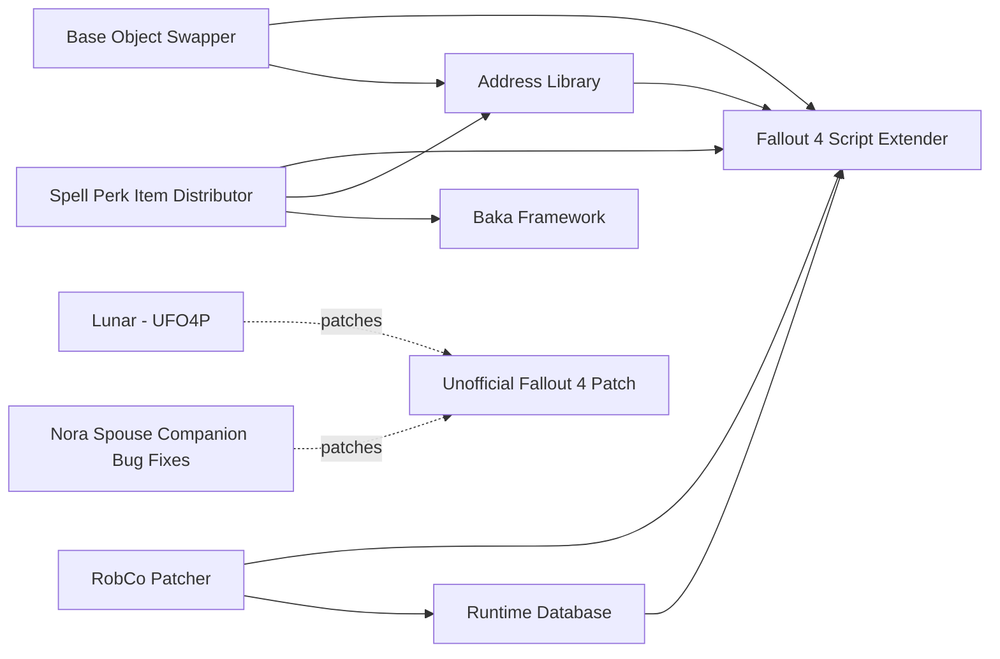

# Base: script extender and unofficial patch

Every list on runtime 1.11.240 starts from three pieces: Fallout 4 Script Extender, Address Library and the Unofficial Fallout 4 Patch. All three caught up with 1.11.240 in August 2026: F4SE 0.7.9 (2026-08-18) requires it, the Address Library All In One file for 1.11.240 is dated 2026-08-22, and UFO4P 2.2.2a needs 1.11.221 or later plus the free update content. The main risk sits downstream: every F4SE DLL mod must state 1.11.240 support, because DLLs built for 1.10.163 (old-gen) or 1.10.984 (next-gen) do not work. RobCo Patcher and Runtime Database are listed here because the "Improved" faction series depends on them.

## Suggested stacks

| Profile | Take | Skip |
| --- | --- | --- |
| Any list | Fallout 4 Script Extender (copied into the game folder by hand, not through Mod Organizer 2), Address Library, Unofficial Fallout 4 Patch (PRP requires it) | Nothing: all three are core |
| Plugin-only list on a Mac under Wine | The three core mods | RobCo Patcher, Runtime Database |
| Player who wants Improved Minutemen, Improved Brotherhood of Steel or Improved Hostile Factions | The three core mods, RobCo Patcher 6.0.6, Runtime Database 1.0.0 | Nothing here, but test on a throwaway save first: Runtime Database dates from 2026-08-26 and has no stability reports under Wine either way |

## Our choice

The reference playthrough takes the three core rows: Fallout 4 Script Extender, Address Library and Unofficial Fallout 4 Patch. We leave out RobCo Patcher and Runtime Database: RobCo 6.0.6 is days old on 1.11.240, untested under Wine, invisible to FO4Edit and likely to override Lunar at runtime, and a mod built on it cannot be removed mid-game.

<!-- BEGIN GENERATED: do not edit, run scripts/build_catalog.py -->
7 mods: 3 core, 4 optional. Plugin slots if you take everything not marked avoid: 1 full.

### Core

| | Mod | What it does | Fit | Cost | Links |
| --- | --- | --- | --- | --- | --- |
|  | **[Address Library](https://www.nexusmods.com/fallout4/mods/47327)** by Ryan · v1.11.240 · updated 2026-08-21 · 68,559 endorsements · 57.7 MB | Memory addresses for F4SE plugins *All In One 1.11.240 file dated 2026-08-22* | `core` 1.11.240: yes | perf low | needs: Fallout 4 Script Extender |
|  | **[Fallout 4 Script Extender](https://www.nexusmods.com/fallout4/mods/42147)** by F4SE Team · v0.7.9 · updated 2026-08-18 · 101,706 endorsements · 0.9 MB | Script extender every DLL mod depends on *Copy into the game folder by hand; not through MO2; 0.7.9 (2026-08-18) requires game 1.11.240* | `core` 1.11.240: yes F4SE DLL | perf low |  |
|  | **[Unofficial Fallout 4 Patch](https://www.nexusmods.com/fallout4/mods/4598)** by The Unofficial Patch Project Team · v2.2.2a · updated 2026-08-18 · 214,839 endorsements · 41.8 MB | Thousands of community bug fixes *Needs 1.11.221 or later and the free update content; 2.2.2a (2026-08-18); PRP requires it* | `core` 1.11.240: yes Lunar: patch | perf low scripts light 1 full / 0 light | patches: Lunar - UFO4P, Nora Spouse Companion Bug Fixes |

### Optional

| | Mod | What it does | Fit | Cost | Links |
| --- | --- | --- | --- | --- | --- |
|  | **[Base Object Swapper](https://www.nexusmods.com/fallout4/mods/67528)** by powerofthree · v2.2.1 · updated 2025-11-30 · 4,746 endorsements · 0.3 MB | F4SE framework that swaps base objects and references from INI configs *Install only as a dependency; In 18 of 24 Wabbajack lists (2026-10); Gap audit 2026-10-29* | `optional` 1.11.240: yes F4SE DLL | perf low | needs: Fallout 4 Script Extender, Address Library |
|  | **[RobCo Patcher](https://www.nexusmods.com/fallout4/mods/69798)** by Zzyxzz · v6.0.6 · updated 2026-10-23 · 18,316 endorsements · 0.7 MB | F4SE plugin that patches game records at runtime from ini files *6.0.6 (2026-10-23); main file labelled 'Game Version OG, NG, AE'; 1.11.240 support comes through Runtime Database; Only install it if a chosen mod needs it (Improved Minutemen, Improved BoS, Improved Hostile Factions, Improved Guards); The Midnight Ride removed its last RobCo requirement; 6.0.6 (2026-10-23): OG, NG, AE; Needed by Improved Minutemen, Improved BoS, TR RobCo patch, Ragged Thunder RobCo; Injected items skip Lunar's balance rules; STEP 1.1 still says RobCo is not yet stable on AE (older note); 6.0.6 (2026-10-23) supports OG/NG/AE (not 1.11.240 by name); SS2 wiki: RobCo INIs with NONE/keyword filters break SS2 weapons and are invisible to xEdit; Required by Improved Minutemen; test carefully* | `optional` 1.11.240: yes F4SE DLL | perf low | needs: Fallout 4 Script Extender, Runtime Database |
|  | **[Runtime Database](https://www.nexusmods.com/fallout4/mods/108394)** by Zzyxzz · v1.0.0 · updated 2026-08-26 · 1,844 endorsements · 46.4 MB | Address-search layer that RobCo Patcher 6.x depends on *1.0.0 (2026-08-26); States support for 1.11.x including 1.11.221 and 1.11.240; Very new; no stability reports under Wine either way; 1.0.0 lists 1.11.240; Required by RobCo 6.0.6, Bastion, Energy Weapon Calculation Fix, VATS Freeze Fix, Modern Combat AI* | `optional` 1.11.240: yes F4SE DLL | perf low | needs: Fallout 4 Script Extender |
|  | **[Spell Perk Item Distributor](https://www.nexusmods.com/fallout4/mods/48365)** by powerofthree-sasnikol · v3.1.1 · updated 2025-11-30 · 7,376 endorsements · 0.3 MB | F4SE plugin that distributes perks, items, spells and packages to NPCs from config files *AE 3.1.1 (2025-11-30) states 'version 1.11.137 +'; no explicit 1.11.240 statement or user report found; Also needs VC++ 2022 and Baka Framework (5.0.0 states 1.11.240); Do not take the OG 2.0 or NG 3.0.0 files; Check po3_SpellPerkItemDistributorF4.log after first launch* | `optional` 1.11.240: unknown F4SE DLL | perf low | needs: Fallout 4 Script Extender, Address Library, Baka Framework |

### Dependencies and patches

<!-- END GENERATED -->
