# Brotherhood of Steel

Faction overhauls, ranks and armor, the Prydwen, Boston Airport and Fort Strong, BoS quests and Danse. The classic overhauls (Ad Victoriam - Apocalyptic Edition, Brotherhood Power Armor Overhaul, Improved BoS (THJT-9)) have been frozen since 2016-2019 and overwrite records that Lunar balances. The one maintained overhaul, Improved Brotherhood of Steel 2.1.3 (2026-09-30), works through RobCo Patcher at runtime. Quest content is thin: Show No Mercy - Fort Strong Expansion (2026-07, ships a PRP 81 patch) is the best maintained, and David Hunter was updated in 2026-01. The main risk is precombines: Prydwen and Airport mods rebuild or remove previs, and several of their PRP patches still target branch 74, not 81.

## Pick one

| Choose between | Difference | Our pick |
| --- | --- | --- |
| Faction overhaul: Improved Brotherhood of Steel, BDR - BoS Done Right, Ad Victoriam - Apocalyptic Edition, Brotherhood Power Armor Overhaul, Improved BoS (THJT-9), RobCo Patcher - BoS Overrides (PA and weapon redistribution) | All rewrite BoS NPCs, gear or ranks. With Lunar only Improved Brotherhood of Steel is advisable; the others conflict with Lunar | None: Lunar's own BoS gear |
| Infantry armor: Sons of Steel - Brotherhood Infantry Armor, CROSS Brotherhood Recon, Look At Me - Brotherhood Of Steel Edition, Ad Victoriam - Apocalyptic Edition | Each replaces the BoS combat armor lists | None |
| Vertibird durability: Improved Brotherhood of Steel, Durable Vertibirds, Ad Victoriam - Apocalyptic Edition, BDR - BoS Done Right | Each edits vertibird health | None |
| Boston Airport: Boston Airport Redux, Rebuild Boston Airport, Better Boston Airport, Improved Boston Airport 2.0, BOS Airport - SS2 City Plan | Same cell | None |
| Prydwen: Prydwen Redux or A Sensible Prydwen Overhaul | Same interior. Prydwen Redux is incompatible with Faction Housing Overhaul - All In One | None |
| Fort Strong: Show No Mercy - Fort Strong Expansion or Fort Strong Redux | Show No Mercy turns the vanilla quest into a real assault; Fort Strong Redux adds an outpost with variants for other factions | Show No Mercy - Fort Strong Expansion |
| Outcasts storyline: Outcasts and Remnants + Project Valkyrie, or Brothers in Arms - Return of the Outcasts (CSEP) | The author states the lore is incompatible | Neither |
| Danse: HE'S WITH ME - No BoS Hostility for Danse and The Danse Dilemma, or Radiant Brotherhood of Steel | Radiant BoS removes Danse from the early quests | HE'S WITH ME - No BoS Hostility for Danse |

## Suggested stacks

| Profile | Take | Skip |
| --- | --- | --- |
| Lunar on a light machine | Show No Mercy - Fort Strong Expansion + Show No Mercy - PRP 81 Patch, David Hunter - A Brotherhood Story, HE'S WITH ME - No BoS Hostility for Danse, Baseline Plots Brotherhood - SS2 Add-On, Map Marker Fix - Prydwen and Airport Ruins, Fort Hagen Prydwen Flyover Fix | Improved Brotherhood of Steel, Ad Victoriam - Apocalyptic Edition, Prydwen Redux |
| Lore armor fan | Chain that Binds - Light BoS Overhaul, Strength in Steel - BoS T-60 Overhaul + Strength in Steel - RobCo Patcher patch (keeps Lunar's T-60 records intact), Sons of Steel - Brotherhood Infantry Armor, Boston Airport Redux | CROSS Brotherhood Recon, Look At Me - Brotherhood Of Steel Edition |
| Vanilla balance, no Lunar | BDR - BoS Done Right for rank insignia and Prydwen comforts, or Ad Victoriam - Apocalyptic Edition for a "superpower BoS" | Every other faction overhaul |
| Content-hungry, tolerant of edgy tone and patch work | Outcasts and Remnants + Project Valkyrie, Optimization and Tweaks for Thuggysmurf's Quest Mods, Outcasts and Remnants - Sim Settlements 2 Immersion Patch, Outcasts and Remnants - T5VPatch. Project Valkyrie adds alternate endings | Brothers in Arms - Return of the Outcasts (CSEP) |

## Our choice

The reference playthrough keeps Lunar's BoS gear and adds Show No Mercy with its PRP 81 patch, David Hunter, HE'S WITH ME and Baseline Plots Brotherhood; A New Dawn (factions page) keeps the BoS career alive after a Minutemen ending. None of them locks an ending. The BoS research ranked Improved Brotherhood of Steel first, but it runs on RobCo Patcher, which this playthrough keeps out: if you accept that risk, test it on a throwaway save first.

<!-- BEGIN GENERATED: do not edit, run scripts/build_catalog.py -->
69 mods: 9 recommended, 49 optional, 11 avoid. Plugin slots if you take everything not marked avoid: 0 full.

### Recommended

| | Mod | What it does | Fit | Cost | Links |
| --- | --- | --- | --- | --- | --- |
|  | **[Baseline Plots Brotherhood - SS2 Add-On](https://www.nexusmods.com/fallout4/mods/85787)** by mac92 · v2.2 · updated 2025-12-05 · 377 endorsements · 118.2 MB | 99 BoS-themed Sim Settlements 2 plots with per-plot outfits and titles and a dynamic BoS flag *2.2 (2025-12-05); Auto-registered SS2 add-on; vanilla SS2 balance; Recommended if you want BoS-flavoured settlements beside Minutemen ones; Our BoS shortlist #7; Vanilla balance; clutter can be disabled via the performance settings* | `recommended` 1.11.240: plugin only | perf low | needs: Sim Settlements 2 - All Chapters Pack |
|  | **[David Hunter - A Brotherhood Story](https://www.nexusmods.com/fallout4/mods/16808)** by Seddon4494 · v2.6 · updated 2026-01-07 · 2,768 endorsements · 76.4 MB | Voiced Lyons-style scribe questline that brings water and power to settlements *Edits the General Atomics Factory cell: load BoSStory.esp before PRP.esp and skip its Automatron patch* | `recommended` 1.11.240: plugin only | perf low **breaks precombines** |  |
|  | **[HE'S WITH ME - No BoS Hostility for Danse](https://www.nexusmods.com/fallout4/mods/12814)** by 00015169 aka STIMPAK · v3 · updated 2024-05-07 · 1,525 endorsements · 3 KB | The BoS stops attacking you when Danse follows you after Blind Betrayal *v3 (2024-05-07), Danse Dilemma patch included; Recommended if you keep Danse; Strict enable procedure (dismiss Danse first); Removes a forced hostility; Our BoS shortlist #5; May edit Danse's NPC record like Lunar: check in FO4Edit* | `recommended` 1.11.240: plugin only | perf low |  |
|  | **[Improved Brotherhood of Steel](https://www.nexusmods.com/fallout4/mods/76756)** by Warsaw · v2.1.3 · updated 2026-09-30 · 1,529 endorsements · 10.1 MB | Gives BoS NPCs rank-correct power armor, adds Senior Paladins, Lancer-Captains and pilots, tougher vertibirds and post-Institute BoS encounters *v2.1.3 (2026-09-30), modular FOMOD by Warsaw; Works through RobCo Patcher at runtime (no DLL of its own); SPID is only needed by optional modules and SPID on 1.11.240 is unverified, so skip those; Fills a gap in Lunar (no BoS NPC template fix) but its minigun list additions overlap Lunar's LLI_BoSSoldier_MinigunOrGatling; consider skipping the NPC-stat and legendary-boss inis to keep Lunar balance; Load after the AriesThe_Ram ESLs; Encounters switch to raiders/Gunners after the Institute falls; Precombine impact unverified (no cell edits described); Install only after Improved Minutemen passes testing; Our BoS shortlist #1; Faction report's call; Edits many vanilla BoS NPC records in its ESP: overlap with Lunar NPC/leveled-list changes needs a patch check; SPID AE optional* | `recommended` 1.11.240: unknown F4SE DLL | perf med NPCs few | needs: RobCo Patcher, Random Encounter Framework, Fallout 4 Script Extender conflicts: Durable Vertibirds, BDR - BoS Done Right, Ad Victoriam - Apocalyptic Edition, Brotherhood Power Armor Overhaul, Improved BoS (THJT-9), RobCo Patcher - BoS Overrides (PA and weapon redistribution) |
|  | **[Show No Mercy - Fort Strong Expansion](https://www.nexusmods.com/fallout4/mods/59643)** by HaplessAccreditation · v2.5 · updated 2026-07-27 · 485 endorsements | Turns the Fort Strong BoS quest into a real assault with power armor knights and vertibirds, then a garrison, a voiced companion and a settlement *2.5 (2026-07-27); Best-maintained BoS quest/location mod; Ships an optional SS2 City Plan; One large battle plus garrison NPCs; Our BoS shortlist #2* | `recommended` 1.11.240: plugin only | perf med NPCs few | patches: Show No Mercy - PRP 81 Patch conflicts: Fort Strong Redux |
|  | **[Fort Hagen Prydwen Flyover Fix](https://www.nexusmods.com/fallout4/mods/76693)** by Glitchfinder · v1.00 · updated 2023-12-13 · 595 endorsements · 16 KB | Makes the Prydwen flyover trigger from any Fort Hagen exit *2023-12-13, ESL, by Glitchfinder; May already be included in UFO4P 2.2.2a (unverified)* | `recommended` 1.11.240: plugin only | perf low |  |
|  | **[Knight Varham Is Not a Vault Dweller](https://www.nexusmods.com/fallout4/mods/94436)** by Glitchfinder · v1.00 · updated 2025-06-16 · 166 endorsements · 1 KB | Fixes Knight Varham wearing a vault suit as underarmor *2025-06, ESL; Tiny fix* | `recommended` 1.11.240: plugin only | perf low |  |
|  | **[Map Marker Fix - Prydwen and Airport Ruins](https://www.nexusmods.com/fallout4/mods/89943)** by Tenhats · v1.01 · updated 2024-12-17 · 218 endorsements · 14 KB | Fixes wrong map marker data and the fast-travel mat bug at the Prydwen and Airport ruins *2024-12-17, ESL, no cell records; Zero-cost fix* | `recommended` 1.11.240: plugin only | perf low |  |
|  | **[Show No Mercy - PRP 81 Patch](https://www.nexusmods.com/fallout4/mods/59643)** by HaplessAccreditation · v2.5 · updated 2026-07-27 · 485 endorsements | PRP 81 previs patch for Show No Mercy - Fort Strong Expansion *Official file dated 2026-07-27 on the mod page* | `recommended` 1.11.240: plugin only | perf  | needs: Show No Mercy - Fort Strong Expansion, Previsibines Repair Pack |

### Optional

| | Mod | What it does | Fit | Cost | Links |
| --- | --- | --- | --- | --- | --- |
|  | **[A Sensible Prydwen Overhaul](https://www.nexusmods.com/fallout4/mods/24198)** by NordKitten · v1.3 · updated 2025-03-12 · 2,241 endorsements · 5.9 MB | Prydwen bathrooms, better bunks and a reworked main deck *1.3 (2025-03-12); Previs incompatibility fixed by a patch from r4v1n6m4d; PRP 81.9 status unverified; Conflicts with anything editing PrydwenHull01* | `optional` 1.11.240: plugin only | perf low | conflicts: Prydwen Redux |
|  | **[BDR - BoS Done Right](https://www.nexusmods.com/fallout4/mods/58140)** by Noah Huls · v2.0.0 · updated 2023-04-01 · 310 endorsements · 59.6 MB | Rank insignia and paints on BoS armor, Teagan sells power armor mods, multiple rank-ups, Prydwen bed and vendor, Maxson in power armor *2.0.0 (2023-04-01), stale; Must load at the bottom, so it overrides Lunar's BoS armor and leveled lists; Edits Prydwen/Airport doors and workbenches: likely touches precombined cells (unverified), no PRP patch; Avoid for our Lunar list; Optional for vanilla-balance readers* | `optional` 1.11.240: plugin only Lunar: conflict | perf low | conflicts: Improved Brotherhood of Steel |
|  | **[BOS Airport - SS2 City Plan](https://www.nexusmods.com/fallout4/mods/59194)** by xMORIDARx · v2.1 · updated 2023-06-02 · 343 endorsements · 64 KB | Sim Settlements 2 city plan that rebuilds the BoS Airport *2023-06; Pick one Airport layout* | `optional` 1.11.240: plugin only | perf  | needs: Sim Settlements 2 - All Chapters Pack conflicts: Boston Airport Redux |
|  | **[Brothers in Arms - Return of the Outcasts (CSEP)](https://www.nexusmods.com/fallout4/mods/73657)** by Commonwealth Story Expansion Project · v2.6 · updated 2024-03-26 · 1,029 endorsements · 789.5 MB | 25 voiced quests about the Lyons Loyalists with a BoS-side path and multiple endings *2.6 (2024-03-26), about 4 h; Needs XDI and the SS2 XDI patches; Author states its lore is incompatible with Outcasts and Remnants / Project Valkyrie; Has consequences whose impact on BoS standing is unverified; Precombine impact unknown* | `optional` 1.11.240: plugin only | perf med | needs: Extended Dialogue Interface conflicts: Outcasts and Remnants, Project Valkyrie |
|  | **[Captives - Scribes - Squires - Vertibird Travel](https://www.nexusmods.com/fallout4/mods/49858)** by LarannKiar · v1.3 · updated 2021-06-25 · 215 endorsements · 36 KB | Escort NPCs ride the vertibird with you *2021-06* | `optional` 1.11.240: plugin only | perf low |  |
|  | **[Chain that Binds - Light BoS Overhaul](https://www.nexusmods.com/fallout4/mods/98631)** by AriesThe_Ram · v1.3 · updated 2026-02-27 · 592 endorsements · 71.8 MB | Retextured BoS outfits per Order, a new flag, banners in BoS locations, holotag and medallion *1.3 (2026-02-27); Mostly visual, out of our current scope; Places banners at the Airport, Prydwen and Cambridge PD: precombine impact unverified, no PRP patch; Boston Airport Redux ships a patch for it; Retexture only, no Lunar stat conflict* | `optional` 1.11.240: plugin only | perf med |  |
|  | **[Constructible Settlement Faction Guards](https://www.nexusmods.com/fallout4/mods/71856)** by Babaloo321 · vv1.2.5 · updated 2024-06-17 · 60 endorsements · 25 KB | Teagan sells tokens to build BoS Knight/Paladin guards (Paladin rank and up) and Minutemen guards in settlements *2024-06; Guards are not commandable; Interaction with SS2 unverified* | `optional` 1.11.240: plugin only | perf low |  |
|  | **[Cut Content - Brotherhood Scribes](https://www.nexusmods.com/fallout4/mods/74122)** by rsm000rsm · v2 · updated 2023-08-23 · 80 endorsements · 13 KB | Restores two cut scribes on the Prydwen *2023; Places NPCs on the Prydwen* | `optional` 1.11.240: plugin only | perf low NPCs few |  |
|  | **[Cut Content NPCs AIO](https://www.nexusmods.com/fallout4/mods/77236)** by rsm000rsm · v5 · updated 2025-08-24 · 444 endorsements · 87 KB | Restores 21 cut NPCs, including the Prydwen scribes *2025; Includes the content of Cut Content - Brotherhood Scribes: pick one* | `optional` 1.11.240: plugin only | perf low NPCs few | conflicts: Cut Content - Brotherhood Scribes |
|  | **[Durable Vertibirds](https://www.nexusmods.com/fallout4/mods/2857)** by Utherix · v2.2 · updated 2026-06-05 · 19,117 endorsements · 0.6 MB | Doubles vertibird health, adds flee AI and tougher pilots *2.2 (2026-06-05), ESL option; Edits the same vertibird actors as Improved Brotherhood of Steel: use it only if you skip Improved BoS; 2.2 (2026-06); Overlap with Lunar vertibird actor stats unverified* | `optional` 1.11.240: plugin only | perf low | conflicts: Improved Brotherhood of Steel |
|  | **[Edmond's BoS Power Armor Drop Team](https://www.nexusmods.com/fallout4/mods/22286)** by Edmond Noir · v1.02 · updated 2021-08-21 · 686 endorsements · 32 KB | A BoS team airdrops power armor to you from a vertibird *2021-08; Requires Power Armor Airdrop* | `optional` 1.11.240: plugin only | perf low |  |
|  | **[Elder Maxson Legendary Loot](https://www.nexusmods.com/fallout4/mods/42362)** by GlennCroft · v0.1 · updated 2019-12-02 · 456 endorsements · 3 KB | Maxson drops legendary loot if killed *2019; Supports Danse Dilemma; Only relevant if you fight the BoS: skip for us* | `optional` 1.11.240: plugin only | perf low |  |
|  | **[FALLOUT Brotherhood - Storyteller](https://www.nexusmods.com/fallout4/mods/48030)** by ShoddyCast unoctium · v1.2 · updated 2020-10-27 · 1,772 endorsements | Voiced interactive-movie quest about Roger Maxson and the T-49 power armor *2020; Interior content; Use the eXoPatch (delays the start until after Dangerous Minds, fixes bugs)* | `optional` 1.11.240: plugin only | perf low |  |
|  | **[Faction Housing Overhaul - Prydwen Quarters](https://www.nexusmods.com/fallout4/mods/13218)** by Elianora · v1.2 · updated 2016-05-10 · 6,904 endorsements · 23.2 MB | Player quarters on the Prydwen with workbenches and storage *2016; Interior edits; PRP status unknown; Pick one Prydwen quarters mod* | `optional` 1.11.240: plugin only | perf low |  |
|  | **[Flyable Personal Vertibird](https://www.nexusmods.com/fallout4/mods/47187)** by PJMail · v1.6.9 · updated 2026-10-28 · 5,701 endorsements | Craftable, flyable personal vertibirds *1.6.9 (2026-10-28); WASD control uses F4SE scripting; whether it needs a DLL is unverified; A player toy, not BoS presence; 1.6.9p (2026), 'works on NG, OG, AE with or without F4SE'; The author warns SS2 script load can make it unresponsive (CPU flag)* | `optional` 1.11.240: unknown | perf med scripts heavy |  |
|  | **[Fort Strong Redux](https://www.nexusmods.com/fallout4/mods/70196)** by slavomirperun · v2.3 · updated 2026-08-12 · 299 endorsements · 20.7 MB | BoS outpost at Fort Strong with two defend quests; Minutemen, Institute, Railroad and America Rising 2 variants *2.3 (2026-08-12), ESL; Regenerated cluster previs, load after PRP; its PRP patches target 74.x only; Not compatible with other Fort Strong mods; Alternative to Show No Mercy* | `optional` 1.11.240: plugin only | perf med | conflicts: Show No Mercy - Fort Strong Expansion |
|  | **[Operation Manhattan](https://www.nexusmods.com/fallout4/mods/24216)** by Alex Ramon · v1.02b · updated 2017-05-23 · 3,577 endorsements · 23.9 MB | BoS quest set in New York *2017, old; Precombine impact unknown* | `optional` 1.11.240: plugin only | perf low |  |
|  | **[Recruit Scribe Haylen as Settler](https://www.nexusmods.com/fallout4/mods/66866)** by LarannKiar · v1.5 · updated 2023-08-06 · 751 endorsements · 10.6 MB | Mini-quest after Blind Betrayal to recruit Scribe Haylen as a settler *2023-08; Needs the BoS friendly* | `optional` 1.11.240: plugin only | perf low |  |
|  | **[SKK Fast BOS](https://www.nexusmods.com/fallout4/mods/30147)** by SKKmods · v001 · updated 2018-03-02 · 2,621 endorsements · 4 KB | Brings the Prydwen in early *2018; New forms only; Pacing taste; Report says the Prydwen arrives after Call to Arms; the Nexus title says ArcJet triggers it* | `optional` 1.11.240: plugin only | perf low |  |
|  | **[SS2 - Ad Victoriam Settler](https://www.nexusmods.com/fallout4/mods/49564)** by Blackbelt · v1.0.3 · updated 2021-03-01 · 360 endorsements · 40 KB | BoS-strategic Sim Settlements 2 city plans *2021-03* | `optional` 1.11.240: plugin only | perf  | needs: Sim Settlements 2 - All Chapters Pack |
|  | **[Shawzzo's Rebuilt Boston Airport (WF blueprint)](https://www.nexusmods.com/fallout4/mods/99624)** by Shawzzo · v1.1 · updated 2025-12-31 · 85 endorsements · 35 KB | Workshop Framework blueprint that rebuilds the Boston Airport *2025-12-31; Workshop-built objects (normal settlement cost); heavy script load while it builds* | `optional` 1.11.240: plugin only | perf med | needs: Workshop Framework conflicts: Boston Airport Redux |
|  | **[The Danse Dilemma](https://www.nexusmods.com/fallout4/mods/21923)** by DavidTheFalcon · v2.9 · updated 2017-05-02 · 9,071 endorsements · 7.4 MB | Restores cut dialogue: Danse can leave, join the Railroad, or duel Maxson to become Elder *2.9 (2017-05); Recommended if you love Danse; Can replace Maxson as Elder without faction expulsion; Load after BoS quest mods; never install during Blind Betrayal; He's With Me v3 includes the Danse Dilemma patch; Changes BoS leadership without locking an ending; Edits BoS quests and Danse dialogue, so it clashes with BoS overhauls (BDR, Improved BoS): check in xEdit; Install only before or after Blind Betrayal* | `optional` 1.11.240: plugin only | perf low | patches: HE'S WITH ME - No BoS Hostility for Danse |
|  | **[VertiCall - BoS Prydwen Flight Deck](https://www.nexusmods.com/fallout4/mods/40313)** by niston · v1.8 · updated 2024-07-27 · 173 endorsements · 1.0 MB | Vertibird fast-travel console on the Prydwen *2024-07-27* | `optional` 1.11.240: plugin only | perf low |  |
|  | **[Vertibird Reinforcement](https://www.nexusmods.com/fallout4/mods/109520)** by DEFAULT · v1.2 · updated 2026-10-20 · 23 endorsements · 11.6 MB | Signal grenade sold by Teagan calls a vertibird drop of BoS soldiers; Minutemen version too *1.2 (2026-10-20), about 9,999 caps per grenade; New, little feedback (23 endorsements); No dependencies* | `optional` 1.11.240: plugin only | perf med NPCs few |  |
|  | **[Brotherhood Service Pistol](https://www.nexusmods.com/fallout4/mods/99012)** by Des · vV1.0 · updated 2026-04-02 · 129 endorsements · 167.6 MB | Adds a Hi-Power pistol to BoS leveled lists *2026-04, ESL; Touches only leveled lists, which overlaps Lunar's BoS weapon lists* | `optional` 1.11.240: plugin only | perf low |  |
|  | **[Brotherhood Uniforms Expanded](https://www.nexusmods.com/fallout4/mods/99462)** by Pyroteknics · v1.00 · updated 2025-12-27 · 12 endorsements · 16 KB | Standalone Mk II BoS outfits *2025-12-27; Niche (12 endorsements); no vanilla edits* | `optional` 1.11.240: plugin only | perf low |  |
|  | **[CROSS Brotherhood Recon](https://www.nexusmods.com/fallout4/mods/27418)** by Niero · v091b2 · updated 2017-11-14 · 19,206 endorsements · 178.4 MB | Recon armor set injected into BoS leveled lists by script, no vanilla edits *2017-11-14, ageing but still works; Script injection keeps conflicts low; stats are not Lunar-balanced; Skip its optional Crafting Highlight Fix DLL (old-gen); No vanilla records edited; Was in LitR* | `optional` 1.11.240: plugin only Lunar: patch | perf med | patches: Lunar - Cross Brotherhood Recon conflicts: Sons of Steel - Brotherhood Infantry Armor |
|  | **[Capital Wasteland BoS Outfits (Standalone - SPID)](https://www.nexusmods.com/fallout4/mods/101756)** by Ney · v2.0.1 · updated 2026-10-18 · 21 endorsements · 6 KB | Fallout 3 style outfits distributed to BoS NPCs through SPID *2.0.1 (2026-10-18); Needs SPID, whose AE build targets 1.11.137+; 1.11.240 support unverified (DLL risk); Additive distribution* | `optional` 1.11.240: unknown F4SE DLL | perf low | needs: Spell Perk Item Distributor |
|  | **[Paladin Sword](https://www.nexusmods.com/fallout4/mods/96599)** by Commonwealth Weaponry · v1.0.4 · updated 2025-09-15 · 767 endorsements · 44.9 MB | New BoS melee sword *2025-09, ESL; New weapon not Lunar-balanced* | `optional` 1.11.240: plugin only | perf low |  |
|  | **[Sons of Steel - Brotherhood Infantry Armor](https://www.nexusmods.com/fallout4/mods/107610)** by PrincessAries · v1.8.1 · updated 2026-10-12 · 694 endorsements · 286.3 MB | Tiered infantry armor that replaces BoS combat armor on non-power-armor soldiers, with backpacks, gas masks and goggles *1.8.1 (2026-10-12), ESL; Overwrites the BoS combat-armor leveled lists; Stats are vanilla-balanced, not Lunar-balanced, and there is no Lunar patch; Use the default textures (4k optional); A Dogmeat armor is placed in the Cambridge PD interior (unverified)* | `optional` 1.11.240: plugin only | perf med | conflicts: CROSS Brotherhood Recon, Ad Victoriam - Apocalyptic Edition |
|  | **[Strength in Steel - BoS T-60 Overhaul](https://www.nexusmods.com/fallout4/mods/99283)** by AriesThe_Ram · v1.7.1 · updated 2026-08-12 · 860 endorsements · 409.1 MB | Rank-coloured cloth, veteran accessories and a Paladin sword scabbard on BoS T-60, with a rank-spawn fix *1.7.1 (2026-08-12), ESL, very active; Edits vanilla T-60 records: use its RobCo Patcher patch so Lunar's T-60 records stay intact; Its rank fix overlaps Improved Brotherhood of Steel; load Improved BoS after it and check in xEdit; Our BoS shortlist #8 (taste)* | `optional` 1.11.240: plugin only Lunar: patch | perf med | patches: Strength in Steel - RobCo Patcher patch |
|  | **[Tumbajamba's BoS Armor Collection](https://www.nexusmods.com/fallout4/mods/86287)** by tumbajamba and shreddah4 · v1.0.1 · updated 2024-08-19 · 1,750 endorsements · 13.6 MB | New BoS armors and the XO-51 power armor *2024-08; Standalone items; not Lunar-balanced* | `optional` 1.11.240: plugin only | perf med |  |
|  | **[Tumbajamba's Brotherhood - eXospanded](https://www.nexusmods.com/fallout4/mods/86934)** by Exoclyps · v1.0.3 · updated 2026-03-01 · 364 endorsements · 2.1 MB | Modding expansion for Tumbajamba's BoS Armor Collection *2026-03* | `optional` 1.11.240: plugin only | perf med | needs: Tumbajamba's BoS Armor Collection |
|  | **[Diverse Brotherhood of Steel](https://www.nexusmods.com/fallout4/mods/76155)** by rsm000rsm · v10 · updated 2025-08-07 · 395 endorsements · 0.2 MB | More varied faces for BoS NPCs *2025-08; Recommended by the Improved Brotherhood of Steel author; low facegen cost* | `optional` 1.11.240: plugin only | perf low |  |
|  | **[Diverse Brotherhood of Steel - Squires](https://www.nexusmods.com/fallout4/mods/100278)** by rsm000rsm · v1 · updated 2026-01-17 · 19 endorsements · 35 KB | More varied faces for BoS squires *2026-01* | `optional` 1.11.240: plugin only | perf low |  |
|  | **[Knight Rhys and Scribe Haylen Dialogue Redux](https://www.nexusmods.com/fallout4/mods/92227)** by ThreatUnprofiled · v1.0 · updated 2025-03-19 · 87 endorsements · 38 KB | Rhys and Haylen speak respectfully to you after your promotion *2025-03; Do NOT ESL-flag it; Conflicts with Player Comments and Head Tracking (a patch is available)* | `optional` 1.11.240: plugin only | perf low |  |
|  | **[Liberty Prime MK2 voice](https://www.nexusmods.com/fallout4/mods/55780)** by Satafinix · v1.0 · updated 2021-11-15 · 486 endorsements · 3.7 MB | New voice for Liberty Prime *Voice only; Report verdict: skip* | `optional` 1.11.240: unknown | perf  |  |
|  | **[Maxson uses PA when attacking the Institute](https://www.nexusmods.com/fallout4/mods/62639)** by Domenicus · v1.0 · updated 2022-07-30 · 152 endorsements · 13 KB | Cosmetic quest fix: Maxson wears power armor during the Institute assault *2022; Conflicts with mods editing the Prime-attack controller quests* | `optional` 1.11.240: plugin only | perf low |  |
|  | **[Nuclear Option (BoS) Maxson dialog fix](https://www.nexusmods.com/fallout4/mods/17523)** by Darth Donut · v1.0 · updated 2016-08-18 · 28 endorsements · 3 KB | Fixes a rare bug where Maxson does not start his dialogue and The Nuclear Option (BoS) cannot advance *1.0 (2016-08-18), 28 endorsements; Emergency only, contents not reviewed; may conflict with mods editing the BoS ending quests (A New Dawn edits the Minutemen MQ302 family, not checked); UFO4P overlap unverified* | `optional` 1.11.240: plugin only | perf  |  |
|  | **[SavrenX Better Robots and HD Liberty Prime](https://www.nexusmods.com/fallout4/mods/40305)** by SavrenX · v1.00 · updated 2019-07-28 · 5,049 endorsements · 458.7 MB | Higher-resolution robot and Liberty Prime textures *2019-2021; Visual only; Report verdict: skip (no gameplay Liberty Prime mod worth adding)* | `optional` 1.11.240: unknown | perf  |  |
|  | **[Worn Colors - Desaturated BoS Insignia](https://www.nexusmods.com/fallout4/mods/103905)** by AriesPlaysGames · v1.1 · updated 2026-04-21 · 3 endorsements · 0.1 MB | Desaturated texture for BoS insignia *2026-04; Report verdict: skip (visual only, out of our scope)* | `optional` 1.11.240: unknown | perf low |  |
|  | **[FALLOUT Brotherhood - Storyteller eXoPatch](https://www.nexusmods.com/fallout4/mods/72452)** by Exoclyps · v1.2.2 · updated 2026-07-07 · 366 endorsements | Fixes bugs in Storyteller and delays its start until after Dangerous Minds *Updated 2026-07* | `optional` 1.11.240: plugin only | perf low | needs: FALLOUT Brotherhood - Storyteller |
|  | **[Optimization and Tweaks for Thuggysmurf's Quest Mods](https://www.nexusmods.com/fallout4/mods/56876)** by Generated by CreationKit · v2.3.3 · updated 2026-01-13 · 1,498 endorsements · 1301.1 MB | Previs and facegen fixes for Thuggysmurf's quest mods (Outcasts and Remnants, Fusion City, Depravity) *Updated 2026-01; Needed by Outcasts and Remnants / Project Valkyrie; PRP 81.9 status unverified; Only with the Thuggyverse mods; Cells with extensive edits stay unoptimised* | `optional` 1.11.240: plugin only | perf  |  |
|  | **[Outcasts and Remnants - Sim Settlements 2 Immersion Patch](https://www.nexusmods.com/fallout4/mods/73869)** by Exoclyps · v1.1.1 · updated 2024-10-05 · 712 endorsements · 0.3 MB | Compatibility patch between Outcasts and Remnants and Sim Settlements 2 *Only if you install Outcasts and Remnants* | `optional` 1.11.240: plugin only | perf  | needs: Outcasts and Remnants, Sim Settlements 2 - All Chapters Pack |
|  | **[Outcasts and Remnants - T5VPatch](https://www.nexusmods.com/fallout4/mods/87827)** by Exoclyps and The5thViking · v1.0.2 · updated 2025-01-25 · 288 endorsements · 4.5 MB | Compatibility patch for Outcasts and Remnants (T5V) *What 'T5V' patches against is not described in the report* | `optional` 1.11.240: plugin only | perf  | needs: Outcasts and Remnants |
|  | **[Paladins carry CWE Paladin Swords - RobCo Patch](https://www.nexusmods.com/fallout4/mods/100855)** by N7kie · v1 · updated 2026-01-30 · 45 endorsements · 0 KB | RobCo Patcher config that gives the Paladin Sword to BoS Paladins *2026-01* | `optional` 1.11.240: unknown F4SE DLL | perf low | needs: Paladin Sword, RobCo Patcher |
|  | **[Project Valkyrie SRD Patch](https://www.nexusmods.com/fallout4/mods/76989)** by sordac · v1.0.1b · updated 2023-12-25 · 281 endorsements · 2 KB | SRD compatibility patch for Project Valkyrie | `optional` 1.11.240: plugin only | perf  | needs: Project Valkyrie |
|  | **[Strength in Steel - RobCo Patcher patch](https://www.nexusmods.com/fallout4/mods/99283)** by AriesThe_Ram · v1.7.1 · updated 2026-08-12 · 860 endorsements · 409.1 MB | Applies Strength in Steel's T-60 changes through RobCo Patcher instead of overwriting the T-60 records *Optional file on the Strength in Steel page; exact file name on the Files tab not checked* | `optional` 1.11.240: unknown F4SE DLL | perf  | needs: Strength in Steel - BoS T-60 Overhaul, RobCo Patcher |
|  | **[Boston Airport Redux](https://www.nexusmods.com/fallout4/mods/46022)** by slavomirperun · v3.0 · updated 2026-01-09 · 542 endorsements · 30.2 MB | Cleans and rebuilds the BoS Airport HQ with a full workbench, a vertibird at Cambridge PD and sentries *3.0 (2026-01-09), ESL; Ships regenerated cluster previs and must load after PRP, so it owns the Airport cells' previs; PRP 81.9 compatibility unverified; Also incompatible with Fort Strong BoS Outpost; Ships a Chain that Binds patch* | `optional` 1.11.240: plugin only | perf med | conflicts: Rebuild Boston Airport, Better Boston Airport, Improved Boston Airport 2.0, BOS Airport - SS2 City Plan |

### Avoid

| | Mod | What it does | Fit | Cost | Links |
| --- | --- | --- | --- | --- | --- |
|  | **[Ad Victoriam - Apocalyptic Edition](https://www.nexusmods.com/fallout4/mods/22168)** by Sinlessorrow · vV1.3 · updated 2018-05-16 · 4,272 endorsements · 277.3 MB | Total BoS overhaul of stats, weapons, armor and textures (laser LMGs, BoS Marine armor) *V1.3 (2018-05-16), frozen; Hard conflict with Lunar stats, leveled lists and armor; known to overwrite other faction mods; Adds an armory to Cambridge PD: likely breaks precombines, no PRP patch; Author warns the game can crash on the first flight to the Prydwen; Vanilla-balance readers wanting a 'superpower BoS' look may still pick it* | `avoid` 1.11.240: plugin only Lunar: conflict | perf med | conflicts: Improved Brotherhood of Steel |
|  | **[Better Boston Airport](https://www.nexusmods.com/fallout4/mods/13958)** by Mika999 · v1.00 · updated 2017-01-08 · 2,765 endorsements · 18.3 MB | Concept-art style rebuilt Boston Airport *2017; Likely breaks previs, no PRP patch; Uses quest layers that expect all three faction endings* | `avoid` 1.11.240: plugin only | perf  | conflicts: Boston Airport Redux, Improved Boston Airport 2.0 |
|  | **[Brotherhood Power Armor Overhaul](https://www.nexusmods.com/fallout4/mods/11978)** by Bordraw · v1.0 · updated 2016-08-24 · 5,709 endorsements · 0.1 MB | Assigns T-45/T-51/T-60/X-01 power armor by BoS rank, with rank paints *1.0 (2016-08-24); Requires Consistent Power Armor Overhaul and rewrites many leveled lists, which conflicts with Lunar's power armor distribution* | `avoid` 1.11.240: plugin only Lunar: conflict | perf low | conflicts: Improved Brotherhood of Steel |
|  | **[Faction Reinforcements](https://www.nexusmods.com/fallout4/mods/68166)** by RascalArt · v1.3 · updated 2023-03-06 · 1,776 endorsements · 97.0 MB | High-level BoS can summon Centurions and Vertihawk gunships *2023-03; Lore stretch; edits the BoS weapon leveled list (vs Lunar); Adds spawns in exterior cells, precombine impact unknown* | `avoid` 1.11.240: plugin only Lunar: conflict | perf med |  |
|  | **[Improved BoS (THJT-9)](https://www.nexusmods.com/fallout4/mods/14662)** by THJT-9 · vV2.62 · updated 2019-07-01 · 4,161 endorsements · 11.6 MB | Rank paints and BoS bug fixes *2.62 (2019-07-01), abandoned; superseded by Warsaw's Improved Brotherhood of Steel; Record overrides clash with Lunar; Precombine impact unknown* | `avoid` 1.11.240: plugin only Lunar: conflict | perf low | conflicts: Improved Brotherhood of Steel |
|  | **[Improved Boston Airport 2.0](https://www.nexusmods.com/fallout4/mods/27078)** by mach1991 · vv2.22b · updated 2018-05-28 · 852 endorsements · 0.7 MB | Concept-art style rebuilt Boston Airport *2018; Likely breaks previs, no PRP patch* | `avoid` 1.11.240: plugin only | perf  | conflicts: Boston Airport Redux, Better Boston Airport |
|  | **[Prydwen Redux](https://www.nexusmods.com/fallout4/mods/88885)** by slavomirperun · v1.1 · updated 2026-07-02 · 93 endorsements | Cleans up the Prydwen interior *2026-07-02, ESL; Removes previs/precombines in the Prydwen (adds occlusion) and must load after PRP: costly on a weak GPU; Incompatible with Faction Housing Overhaul AIO* | `avoid` 1.11.240: plugin only | perf med **breaks precombines** | conflicts: A Sensible Prydwen Overhaul |
|  | **[Radiant Brotherhood of Steel](https://www.nexusmods.com/fallout4/mods/85533)** by WasteTheLand · v004 · updated 2026-04-24 · 34 endorsements · 26 KB | Removes Danse from Fire Support and Call to Arms and reroutes the BoS introduction *2026-04; New game required; edits the main BoS quests and static objects at Cambridge PD; fragile; Removes Danse, so it is incompatible in spirit with Danse Dilemma and He's With Me; Alters the BoS main path (no ending lock as such)* | `avoid` 1.11.240: plugin only | perf low |  |
|  | **[Rebuild Boston Airport](https://www.nexusmods.com/fallout4/mods/97507)** by Aurie · v1.0 · updated 2025-10-23 · 218 endorsements · 2.5 MB | Repairable Boston Airport terminal *2025-10-23, ESL; Regenerated previs, but its PRP patch targets PRP 74.x only (we run 81.9); Avoid for us because of the outdated PRP patch* | `avoid` 1.11.240: plugin only | perf low **breaks precombines** | conflicts: Boston Airport Redux |
|  | **[RobCo Patcher - BoS Overrides (PA and weapon redistribution)](https://www.nexusmods.com/fallout4/mods/82858)** by cyanide4suicide · v2.6 · updated 2024-06-15 · 26 endorsements · 10 KB | RobCo Patcher configs that force BoS NPCs into power armor and chosen weapons *2.6 (2024-06-15), RobCo ini files only; Fights Lunar loadouts and Improved Brotherhood of Steel* | `avoid` 1.11.240: unknown F4SE DLL Lunar: conflict | perf low | needs: RobCo Patcher conflicts: Improved Brotherhood of Steel |
|  | **[Stronger Brotherhood of STEEL](https://www.nexusmods.com/fallout4/mods/10916)** by Medardus · v0.8 · updated 2016-03-14 · 982 endorsements · 0.1 MB | Raises BoS NPC health *2016; Redundant with Lunar's NPC balance* | `avoid` 1.11.240: plugin only | perf low |  |

### Dependencies and patches

```mermaid
graph LR
  baseline_plots_brotherhood["Baseline Plots Brotherhood - SS2 Add-On"]
  bos_airport_ss2_city_plan["BOS Airport - SS2 City Plan"]
  brothers_in_arms_csep["Brothers in Arms - Return of the Outcasts (CSEP)"]
  capital_wasteland_bos_outfits_spid["Capital Wasteland BoS Outfits (Standalone - SPID)"]
  cross_brotherhood_recon["CROSS Brotherhood Recon"]
  danse_dilemma["The Danse Dilemma"]
  f4se["Fallout 4 Script Extender"]
  fallout_brotherhood_storyteller["FALLOUT Brotherhood - Storyteller"]
  hes_with_me["HE'S WITH ME - No BoS Hostility for Danse"]
  improved_brotherhood_of_steel["Improved Brotherhood of Steel"]
  lunar_cross_brotherhood_recon_patch["Lunar - Cross Brotherhood Recon"]
  oar_ss2_patch["Outcasts and Remnants - Sim Settlements 2 Immersion Patch"]
  oar_t5v_patch["Outcasts and Remnants - T5VPatch"]
  outcasts_and_remnants["Outcasts and Remnants"]
  paladin_sword["Paladin Sword"]
  paladin_sword_robco_patch["Paladins carry CWE Paladin Swords - RobCo Patch"]
  project_valkyrie["Project Valkyrie"]
  prp["Previsibines Repair Pack"]
  pv_srd_patch["Project Valkyrie SRD Patch"]
  random_encounter_framework["Random Encounter Framework"]
  robco_bos_overrides["RobCo Patcher - BoS Overrides (PA and weapon redistribution)"]
  robco_patcher["RobCo Patcher"]
  shawzzo_rebuilt_boston_airport["Shawzzo's Rebuilt Boston Airport (WF blueprint)"]
  show_no_mercy_fort_strong["Show No Mercy - Fort Strong Expansion"]
  show_no_mercy_prp_patch["Show No Mercy - PRP 81 Patch"]
  sim_settlements_2["Sim Settlements 2 - All Chapters Pack"]
  spid["Spell Perk Item Distributor"]
  ss2_ad_victoriam_settler["SS2 - Ad Victoriam Settler"]
  storyteller_exopatch["FALLOUT Brotherhood - Storyteller eXoPatch"]
  strength_in_steel["Strength in Steel - BoS T-60 Overhaul"]
  strength_in_steel_robco_patch["Strength in Steel - RobCo Patcher patch"]
  tumbajamba_bos_armor_collection["Tumbajamba's BoS Armor Collection"]
  tumbajamba_bos_exospanded["Tumbajamba's Brotherhood - eXospanded"]
  workshop_framework["Workshop Framework"]
  xdi["Extended Dialogue Interface"]
  baseline_plots_brotherhood --> sim_settlements_2
  improved_brotherhood_of_steel --> robco_patcher
  improved_brotherhood_of_steel --> random_encounter_framework
  improved_brotherhood_of_steel --> f4se
  show_no_mercy_prp_patch -. patches .-> show_no_mercy_fort_strong
  show_no_mercy_prp_patch --> show_no_mercy_fort_strong
  show_no_mercy_prp_patch --> prp
  bos_airport_ss2_city_plan --> sim_settlements_2
  brothers_in_arms_csep --> xdi
  capital_wasteland_bos_outfits_spid --> spid
  lunar_cross_brotherhood_recon_patch -. patches .-> cross_brotherhood_recon
  storyteller_exopatch --> fallout_brotherhood_storyteller
  oar_ss2_patch --> outcasts_and_remnants
  oar_ss2_patch --> sim_settlements_2
  oar_t5v_patch --> outcasts_and_remnants
  paladin_sword_robco_patch --> paladin_sword
  paladin_sword_robco_patch --> robco_patcher
  pv_srd_patch --> project_valkyrie
  shawzzo_rebuilt_boston_airport --> workshop_framework
  ss2_ad_victoriam_settler --> sim_settlements_2
  strength_in_steel_robco_patch -. patches .-> strength_in_steel
  strength_in_steel_robco_patch --> strength_in_steel
  strength_in_steel_robco_patch --> robco_patcher
  hes_with_me -. patches .-> danse_dilemma
  tumbajamba_bos_exospanded --> tumbajamba_bos_armor_collection
  robco_bos_overrides --> robco_patcher
```

<!-- END GENERATED -->
