# Companions

New companions, multi-follower frameworks, companion AI fixes and affinity tools. Heather Casdin (2,400+ voiced lines, her own AI) is still the community's clear first choice in October 2026 threads. Simple Everyone's Best Friend (2025) has replaced the original, and AFT Plus 4.39 (September 2026) is the multi-follower option. Follower AI Approach Reaction Fix ships a build for 1.11.137-1.11.240. The main risks are script load (AFT Plus, Follower Revive System, Companion Command and Tactics) and Lunar: companion rebalances such as Better Companions AIO collide with Lunar's companion edits.

## Pick one

| Choose between | Difference | Our pick |
| --- | --- | --- |
| Multi-follower: Simple Everyone's Best Friend or AFT Plus | Simple EBF adds Dogmeat plus one companion. AFT Plus allows up to 10, edits FollowersScript and is script-heavy | Simple Everyone's Best Friend |
| Companion balance: Lunar's companion edits or Better Companions AIO | Better Companions AIO changes perks, ammo, accuracy and combat style against Lunar | Lunar |
| Affinity display: Visible Companion Affinity or Companion Affinity Pip-Boy Tab | Notifications and a holotape, or a Pip-Boy tab; either works | Neither |
| Deacon's disguises: Better Deacon Disguises or Dress-Up Deacon | Better-fitting disguises, or disguises as playable outfits | Neither |
| Companion and settler lines: Settler and Companion Dialogue Overhaul or Icebreaker - Settler Dialogue | Both rewrite repeated lines | Neither yet |

## Suggested stacks

| Profile | Take | Skip |
| --- | --- | --- |
| Lunar on a light machine | Heather Casdin, Simple Everyone's Best Friend, Follower AI Approach Reaction Fix, Settler and Companion Dialogue Overhaul | AFT Plus, Better Companions AIO, Follower Revive System |
| Big party | AFT Plus + AFT Plus Patch Hub (SS2 patch). Do not import Heather Casdin into it | Simple Everyone's Best Friend |
| Character-focused | Ellen - the cartographer, It's Molly, Nora Spouse Companion + Nora Spouse Companion Bug Fixes + Nora Spouse Companion SS2 Patch, Companion Ivy + Companion Ivy - XDI patch (LoversLab, adult) | Lucy MacLean companion, Paladin Frost |
| Faction loyalist | BoS: The Danse Dilemma, Brotherhood Lancer Companion. Railroad: Keep Deacon's Trust, Settler and Companion Dialogue Overhaul (Deacon's quest). Any faction: Keep both X6-88 and Porter Gage Plus Deacon | Paladin Frost (AI-voiced) |

## Our choice

The reference playthrough takes Heather Casdin, Simple Everyone's Best Friend and Follower AI Approach Reaction Fix. Heather runs her own follower system next to one vanilla companion and Dogmeat, so she is never imported into a framework. AFT Plus stays out: it is script-heavy and incompatible with Simple EBF. With Lunar, Dogmeat is a bit strong as a second companion; Lunar - Everyone's Best Friend targets the original EBF, and its fit with Simple EBF is unverified.

<!-- BEGIN GENERATED: do not edit, run scripts/build_catalog.py -->
40 mods: 5 recommended, 26 optional, 9 avoid. Plugin slots if you take everything not marked avoid: 0 full.

### Recommended

| | Mod | What it does | Fit | Cost | Links |
| --- | --- | --- | --- | --- | --- |
|  | **[Follower AI Approach Reaction Fix](https://www.nexusmods.com/fallout4/mods/92024)** by LarannKiar · v3.1 · updated 2026-08-20 · 2,693 endorsements · 74 KB | Companions stop walking away when you approach them *3.1 (2026-08-20), AE 1.11.137-1.11.240; Works with all companions, modded ones too* | `recommended` 1.11.240: yes F4SE DLL | perf low |  |
|  | **[Heather Casdin](https://www.nexusmods.com/fallout4/mods/23273)** by llamaRCA · v2.7 · updated 2024-02-17 · 33,095 endorsements · 193.9 MB | Voiced story companion with 2,400+ lines, quests, own AI and bunker *2.7 (2024-02-17); Own follower system: runs alongside a vanilla companion plus Dogmeat; do not import into a framework; Assignable in SS2; No XDI patch needed; Bunker cell vs precombines unverified* | `recommended` 1.11.240: plugin only | perf med scripts light NPCs few |  |
|  | **[Keep Deacon's Trust](https://www.nexusmods.com/fallout4/mods/88920)** by JanuarySnow · v0.1 · updated 2024-11-03 · 61 endorsements · 4 KB | If you skip Deacon's note he takes it back after 3 days and his affinity quest continues *Tiny fix for a design trap* | `recommended` 1.11.240: plugin only | perf  |  |
|  | **[Settler and Companion Dialogue Overhaul](https://www.nexusmods.com/fallout4/mods/41785)** by Project Valkyrie Discord Server · v1.01 · updated 2020-12-12 · 19,974 endorsements · 47.0 MB | Less repetitive companion and settler lines, small quests *Edits companion dialogue quests and DialogueFarmGeneric only; Compatible with multi-follower mods per author; SS2 not listed (unverified); Needs Automatron, Nuka-World, Vault-Tec (GOTY OK); Pick SCDO or Icebreaker for settlers; The only real Deacon content (also 8 other companions); Overlaps other dialogue mods: cross-check with the companions report; LITE version without the radiants exists* | `recommended` 1.11.240: plugin only | perf low |  |
|  | **[Simple Everyone's Best Friend](https://www.nexusmods.com/fallout4/mods/92314)** by SoleVaultBoy · v1.1.1 · updated 2025-11-01 · 2,170 endorsements · 53 KB | Dogmeat plus one companion at the same time *1.1.1 (2025-11-01); Mods that edit FollowersScript (AFT, AFT Plus) are incompatible; With Lunar, Dogmeat is a bit OP; the Bodega EBF patch targets the original EBF and its fit with Simple EBF is unverified* | `recommended` 1.11.240: plugin only | perf low | conflicts: AFT Plus |

### Optional

| | Mod | What it does | Fit | Cost | Links |
| --- | --- | --- | --- | --- | --- |
|  | **[AFT Plus](https://www.nexusmods.com/fallout4/mods/59699)** by Sranger - Dheuster · v4.39 · updated 2026-09-12 · 2,278 endorsements · 2.6 MB | Up to 10 companions, SS2 interjections, optional spouse companion *Alternative to Simple EBF, not alongside; 4.39 (2026-09-12) 'supports all FO4 versions as of 8.20.26'; needs GOE 23.2+; A no-F4SE build 3.15 exists; Script-heavy; Do not import Heather* | `optional` 1.11.240: yes SS2: patch | perf high scripts heavy | needs: Garden of Eden Papyrus Script Extender patches: AFT Plus Patch Hub conflicts: Simple Everyone's Best Friend |
|  | **[Ada2Human](https://www.nexusmods.com/fallout4/mods/16967)** by LazyGirl · v0.10.1 · updated 2023-02-26 · 4,807 endorsements · 4.1 MB | Turns Ada into a human companion *MCM hotkey optional* | `optional` 1.11.240: plugin only | perf low |  |
|  | **[Better Deacon Disguises](https://www.nexusmods.com/fallout4/mods/33396)** by rjinthematrix · v1 · updated 2018-07-22 · 67 endorsements · 1 KB | Deacon's disguises fit their context better *Edits the same outfits as Dress-Up Deacon (2018)* | `optional` 1.11.240: plugin only | perf  | conflicts: Dress-Up Deacon |
|  | **[Brotherhood Lancer Companion](https://www.nexusmods.com/fallout4/mods/77940)** by Martin Toms · v1.0 · updated 2024-02-02 · 30 endorsements · 4.2 MB | Generic BoS Lancer follower and settler *2024-02; Niche (30 endorsements)* | `optional` 1.11.240: plugin only | perf low |  |
|  | **Companion Ivy**  | Deep voiced companion (LoversLab) *LoversLab only, no Nexus page; Adult content and heavy profanity (toggleable per Reddit); Version and AE status unknown* | `optional` 1.11.240: unknown | perf  | patches: Companion Ivy - XDI patch |
|  | **[Deeper Thoughts - Curie](https://www.nexusmods.com/fallout4/mods/25050)** by DisplacerBeast8u · v1.1b · updated 2017-10-02 · 5,651 endorsements · 5 KB | More 'your thoughts' lines for Curie *Edits Curie dialogue* | `optional` 1.11.240: plugin only | perf low |  |
|  | **[Dress-Up Deacon](https://www.nexusmods.com/fallout4/mods/82397)** by ptmc2112 · v1.0 · updated 2024-05-10 · 14 endorsements · 7 KB | Deacon's disguises become playable outfits, with a toggle holotape for disguise swaps *ESL; Supersedes Deacon Outfit Change Change (2016); Pick one with Better Deacon Disguises* | `optional` 1.11.240: plugin only | perf  0 full / 1 light | conflicts: Better Deacon Disguises |
|  | **[Ellen - the cartographer](https://www.nexusmods.com/fallout4/mods/15962)** by guicool · vFinal · updated 2017-05-27 · 17,407 endorsements · 54.0 MB | 1,200-line voiced companion with a quest and romance *2017 final version; compatibility unverified* | `optional` 1.11.240: plugin only | perf low |  |
|  | **[Full Deacon Romance](https://www.nexusmods.com/fallout4/mods/58890)** by FenbyRat · v1.2 · updated 2024-04-27 · 318 endorsements · 1.5 MB | Adds flirt and romance dialogue for Deacon *Known dialogue loop bug (console fix); Not lore-neutral* | `optional` 1.11.240: plugin only | perf  |  |
|  | **[It's Molly](https://www.nexusmods.com/fallout4/mods/75137)** by Commonwealth Story Expansion Project · v1.7 · updated 2023-10-25 · 829 endorsements · 31.6 MB | Companion with 600+ human-voiced lines *Compatibility unverified* | `optional` 1.11.240: plugin only | perf low |  |
|  | **[Keep both X6-88 and Porter Gage Plus Deacon](https://www.nexusmods.com/fallout4/mods/29192)** by Nechigawara · v0.1 · updated 2018-01-18 · 756 endorsements · 8 KB | Keep X6-88 after the Institute falls, Gage after turning on the raiders, and Deacon *0.1 (2018-01-18); Script edits; incompatible with mods editing those NPCs (face mods) or their kick-out scripts; Removes companion loss; v0.1, untested and unsupported by the author; edits vanilla scripts (InstKickOutQuestScript) and conflicts with face mods; The Deacon part is undocumented* | `optional` 1.11.240: plugin only | perf low |  |
|  | **[Nora Spouse Companion](https://www.nexusmods.com/fallout4/mods/24680)** by HouseVariable · v1.2 · updated 2020-05-22 · 13,660 endorsements · 29.6 MB | Your spouse survived and becomes a voiced companion *Lore-bending premise; Overwrites UFO4P fixes (hence Bug Fixes), edits main and side quests for interjections, disables Nora's corpse* | `optional` 1.11.240: plugin only | perf low NPCs few | patches: Nora Spouse Companion Bug Fixes, Nora Spouse Companion SS2 Patch |
|  | **[Run Deacon Run](https://www.nexusmods.com/fallout4/mods/62090)** by Homodemiks · v1.0 · updated 2022-07-10 · 54 endorsements · 1 KB | Deacon runs instead of walking during Tradecraft *AI package edit (QoL)* | `optional` 1.11.240: plugin only | perf  |  |
|  | **[Shortcut to Curie](https://www.nexusmods.com/fallout4/mods/31766)** by 5133p39 · v1.0.0 · updated 2018-05-31 · 2,263 endorsements · 54 KB | Get Curie and her synth body without the Vault 81 and Kurzweil chain *Skips content; ESL variant conflicts with Player Comments and Head Tracking* | `optional` 1.11.240: plugin only | perf low |  |
|  | **[Companion Affinity Pip-Boy Tab](https://www.nexusmods.com/fallout4/mods/76398)** by bp42s · v4.0.0 · updated 2024-08-29 · 1,479 endorsements · 0.4 MB | Affinity tab in the Pip-Boy *1.11.240 via its dependencies (GOE 23.8, PipboyTabs); Needs a new game when updating from an old version; FallUI interaction unverified* | `optional` 1.11.240: yes | perf low | needs: Garden of Eden Papyrus Script Extender, PipboyTabs |
|  | **[Companion Command and Tactics](https://www.nexusmods.com/fallout4/mods/11784)** by registrator2000 · v1.3 · updated 2017-09-09 · 4,427 endorsements · 8 KB | Companion command hotkeys and restored cut tactics | `optional` 1.11.240: plugin only | perf med scripts light | needs: Mod Configuration Menu |
|  | **[Companion Weapon Proficiency Infinite Ammo](https://www.nexusmods.com/fallout4/mods/75770)** by WhiskyTangoFox · v1.3 · updated 2026-01-11 · 169 endorsements · 1 KB | Infinite ammo for each companion's preferred weapon type *Interaction with Lunar ammo not checked* | `optional` 1.11.240: plugin only | perf low |  |
|  | **[Follower Revive System](https://www.nexusmods.com/fallout4/mods/26282)** by BestPJ · v2.14 · updated 2022-02-15 · 2,738 endorsements · 22 KB | Companions can revive the player *'Requires F4SE', probably Papyrus functions only (unverified); Overlap with Lunar's companion handling unverified* | `optional` 1.11.240: unknown | perf med scripts light |  |
|  | **[No Negative Affinity / No Cooldown](https://www.nexusmods.com/fallout4/mods/3276)** by ricky horror · v1.6 · updated 2015-12-09 · 49,520 endorsements · 59 KB | Removes negative affinity and the affinity cooldown *Taste* | `optional` 1.11.240: plugin only | perf  |  |
|  | **[Visible Companion Affinity](https://www.nexusmods.com/fallout4/mods/10660)** by CDante · v4.15 · updated 2024-02-14 · 32,840 endorsements · 10.2 MB | Affinity notifications plus a holotape *No vanilla script overrides; Pick this or the Affinity Pip-Boy Tab* | `optional` 1.11.240: plugin only | perf low scripts light |  |
|  | **[Where Are You Now](https://www.nexusmods.com/fallout4/mods/7903)** by drdanzel · v1.4 · updated 2016-04-26 · 13,853 endorsements · 0.2 MB | Map markers to track companions | `optional` 1.11.240: plugin only | perf low |  |
|  | **[AFT Plus Patch Hub](https://www.nexusmods.com/fallout4/mods/98121)** by Sranger - Dheuster · v1.09 · updated 2026-07-13 · 327 endorsements | Compatibility patches for AFT Plus, including SS2 | `optional` 1.11.240: plugin only | perf  | needs: AFT Plus |
|  | **[Companion Ivy - XDI patch](https://www.nexusmods.com/fallout4/mods/57868)** by Evi1Panda · v1.1 · updated 2022-08-27 · 1,452 endorsements · 1.0 MB | Makes Companion Ivy work with XDI *Built for Ivy 6.0; fit with the current Ivy version unverified* | `optional` 1.11.240: plugin only | perf  | needs: Companion Ivy, Extended Dialogue Interface |
|  | **[Lunar - Everyone's Best Friend](https://www.nexusmods.com/fallout4/mods/62679)** by WhiskyTangoFox · v3.1 · updated 2026-03-13 · 256 endorsements · 10 KB | Lunar rebalance patch for Everyone's Best Friend *From Lunar Gameplay Patch Bodega; Made for Everyone's Best Friend; we use Simple Everyone's Best Friend: check whether it applies; Made for the original EBF; whether it applies to Simple Everyone's Best Friend is unverified* | `optional` 1.11.240: plugin only | perf  | needs: Lunar Fallout Overhaul Deluxe |
|  | **[Nora Spouse Companion Bug Fixes](https://www.nexusmods.com/fallout4/mods/58136)** by Sranger - HouseVariable · v1.2 · updated 2022-04-22 · 554 endorsements · 82 KB | Restores UFO4P fixes and fixes bugs in Nora Spouse Companion | `optional` 1.11.240: plugin only | perf  | needs: Nora Spouse Companion, Unofficial Fallout 4 Patch |
|  | **[Nora Spouse Companion SS2 Patch](https://www.nexusmods.com/fallout4/mods/57813)** by Sranger · v0.4 · updated 2023-03-12 · 213 endorsements · 3 KB | Compatibility patch between Nora Spouse Companion and SS2 *WIP (2023)* | `optional` 1.11.240: plugin only | perf  | needs: Nora Spouse Companion, Sim Settlements 2 - All Chapters Pack |

### Avoid

| | Mod | What it does | Fit | Cost | Links |
| --- | --- | --- | --- | --- | --- |
|  | **[FallAway](https://www.nexusmods.com/fallout4/mods/107753)** by dmki · v1.2.1 · updated 2026-10-26 · 13 endorsements · 81.7 MB | NPCs driven by an online or offline LLM with microphone input *Local model or network: unrealistic on Wine with 16 GB* | `avoid` 1.11.240: unknown F4SE DLL | perf high |  |
|  | **[Dual Survivors - Nate](https://www.nexusmods.com/fallout4/mods/22289)** by kesabelus · v1.3.2 · updated 2017-06-08 · 2,761 endorsements · 18.6 MB | Nate as a companion *Old (2017); Vault 111 edits; reported problems with Start Me Up* | `avoid` 1.11.240: plugin only | perf low |  |
|  | **[Glory Follower ESP](https://www.nexusmods.com/fallout4/mods/4116)** by BOTLANNER · v1 · updated 2015-12-02 · 127 endorsements · 3 KB | Makes Glory a follower *2015, needs a bat file; Subversion is the only real route to Glory as a companion* | `avoid` 1.11.240: plugin only | perf  |  |
|  | **[Glory clone](https://www.nexusmods.com/fallout4/mods/18403)** by User_35328905 · v1 · updated 2016-09-16 · 232 endorsements · 3.6 MB | Glory clone follower *2016 work in progress* | `avoid` 1.11.240: plugin only | perf  |  |
|  | **[Lucy MacLean companion](https://www.nexusmods.com/fallout4/mods/100191)** by MrsDanse · v2.0 · updated 2026-10-25 · 133 endorsements · 11.3 MB | Basic companion using TV-show voice clips *Thin template-based companion with ripped show voice; known first-recruit bug needs a reload* | `avoid` 1.11.240: plugin only | perf low |  |
|  | **[Paladin Frost](https://www.nexusmods.com/fallout4/mods/80763)** by TheFalloutFanboy · v2.3.2 · updated 2025-07-23 · 41 endorsements · 5.4 MB | AI-voiced BoS companion *2025-07; AI voice, little feedback (41 endorsements)* | `avoid` 1.11.240: plugin only | perf low |  |
|  | **[Better Companions AIO](https://www.nexusmods.com/fallout4/mods/18547)** by techprince · v1.38 · updated 2025-09-30 · 23,415 endorsements · 43 KB | Companion perks, infinite ammo, accuracy and combat style changes *Lunar also edits companions, so one overwrites the other* | `avoid` 1.11.240: plugin only Lunar: conflict | perf low |  |
|  | **[Companion Infinite Ammo](https://www.nexusmods.com/fallout4/mods/6233)** by TheTalkieToaster · v1.3 · updated 2016-02-10 · 67,569 endorsements · 5 KB | Infinite ammo for companions *Tagged broken (previous research)* | `avoid` 1.11.240: unknown | perf  |  |
|  | **[Companions also need to eat and sleep](https://www.nexusmods.com/fallout4/mods/55908)** by goubachof · v1.06 · updated 2022-01-08 · 345 endorsements · 2.9 MB | Survival-style needs for companions *Survival-style; we play without Survival* | `avoid` 1.11.240: plugin only | perf med scripts light |  |

### Dependencies and patches

```mermaid
graph LR
  aft_plus["AFT Plus"]
  aft_plus_patch_hub["AFT Plus Patch Hub"]
  companion_affinity_pipboy_tab["Companion Affinity Pip-Boy Tab"]
  companion_command_and_tactics["Companion Command and Tactics"]
  companion_ivy["Companion Ivy"]
  companion_ivy_xdi_patch["Companion Ivy - XDI patch"]
  garden_of_eden["Garden of Eden Papyrus Script Extender"]
  lunar["Lunar Fallout Overhaul Deluxe"]
  lunar_ebf_patch["Lunar - Everyone's Best Friend"]
  mcm["Mod Configuration Menu"]
  nora_spouse_bug_fixes["Nora Spouse Companion Bug Fixes"]
  nora_spouse_companion["Nora Spouse Companion"]
  nora_spouse_ss2_patch["Nora Spouse Companion SS2 Patch"]
  pipboytabs["PipboyTabs"]
  sim_settlements_2["Sim Settlements 2 - All Chapters Pack"]
  ufo4p["Unofficial Fallout 4 Patch"]
  xdi["Extended Dialogue Interface"]
  aft_plus --> garden_of_eden
  aft_plus_patch_hub -. patches .-> aft_plus
  aft_plus_patch_hub --> aft_plus
  companion_affinity_pipboy_tab --> garden_of_eden
  companion_affinity_pipboy_tab --> pipboytabs
  companion_command_and_tactics --> mcm
  companion_ivy_xdi_patch -. patches .-> companion_ivy
  companion_ivy_xdi_patch --> companion_ivy
  companion_ivy_xdi_patch --> xdi
  lunar_ebf_patch --> lunar
  nora_spouse_bug_fixes -. patches .-> nora_spouse_companion
  nora_spouse_ss2_patch -. patches .-> nora_spouse_companion
  nora_spouse_bug_fixes --> nora_spouse_companion
  nora_spouse_bug_fixes --> ufo4p
  nora_spouse_ss2_patch --> nora_spouse_companion
  nora_spouse_ss2_patch --> sim_settlements_2
```

<!-- END GENERATED -->
