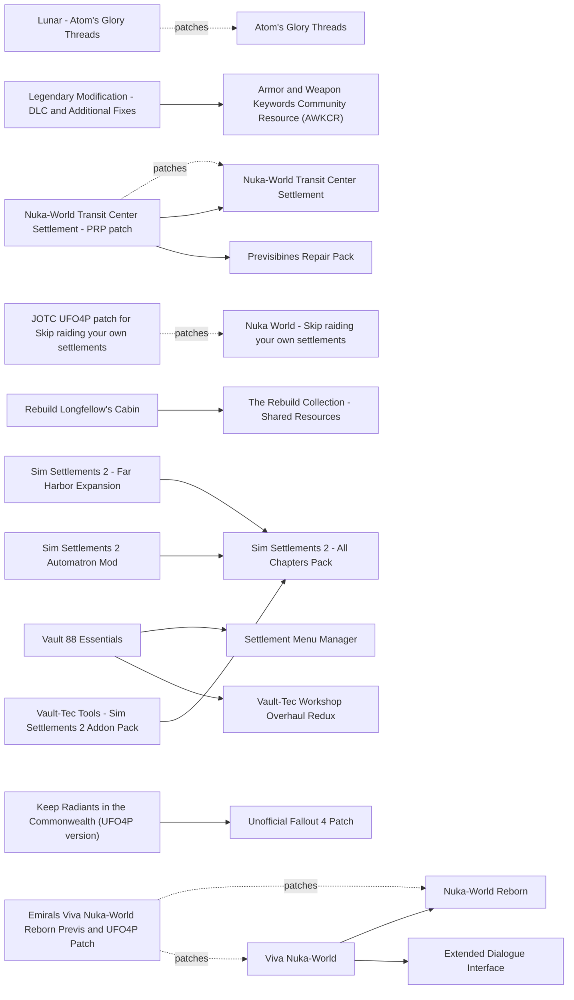

# DLC

Automatron, Far Harbor, Nuka-World, the workshop DLCs and the free Creation Club items. Almost everything here is plugin only, so 1.11.240 is rarely the blocker. The quest spam at the Vault 111 exit is mostly solved by Integrated Addons (2026-06, with an AE hotfix), which supersedes the older delay mods. Lunar 111 and later already rebalances the free Creation Club gear, so Creation Club rebalance mods and DLC leveled-list mods fight it. The main risks are previs in Nuka-World and Far Harbor cells (Nuka-World Reborn conflicts with PRP previs) and CPU during large scripted battles.

## Pick one

| Choose between | Difference | Our pick |
| --- | --- | --- |
| Start-up control: Integrated Addons (optionally with DLC Timing), Whisper's Delayed DLC, No Quest Autostart - Far Harbor | DLC Timing, Whisper's Delayed DLC and No Quest Autostart replace the same DLC scripts. Integrated Addons integrates the quests without level gates; DLC Timing adds gates (load Integrated Addons after it). Integrated Automatron, Creation Club Delayed and Simple Creation Club Delayed NG are superseded | Integrated Addons |
| Who frees Nuka-World: Minutemen Takeover - Nuka World, Nuka World Plus, Nuka-World Reborn + Viva Nuka-World, or vanilla Open Season | A Minutemen army, a faction claim (BoS included), or a quest route. Nuka World Open Season Extend II sits on top of any of them | Minutemen Takeover - Nuka World |
| Leveled lists: Lunar, or DLC Leveled List Integration, DLC Leveled List Integration and Rebalance, DLC Weapons in Commonwealth (Injector) | Not both without FO4Edit patches | Lunar |
| Creation Club weapon balance: Lunar 111+ or Creation Club Tesla Cannon Unofficial Patch | Bug fixes now come from Community Fixes Merged | Lunar |
| Vault building: Vault-Tec Workshop Overhaul Redux + Vault 88 Essentials, or Workshop Rearranged | Incompatible snapping | Neither yet |
| DiMA's memories: Skip DiMA memories - Far Harbor, Skip DiMA's Memory Games, Radiant Best Left Forgotten - Skip DiMA's Memory | All at once, one memory at a time, or by trigger box or terminal | None |

## Suggested stacks

| Profile | Take | Skip |
| --- | --- | --- |
| Lunar on a light machine | Integrated Addons, Far Better Far Harbor - Exploration Expanded, Nuka World Open Season Extend II, Keep Radiants in the Commonwealth (UFO4P version), Moddable Robot Settlers Compilation (Automatron), Robot Workbench Fix, The Secret of Huntress Manor - A Far Harbor Story, Jurttu's Interiors - Nuka-World | DLC Leveled List Integration and Rebalance, Creation Club Tesla Cannon Unofficial Patch, Nuka-World Reborn |
| BoS player who wants Nuka-World for the Brotherhood | Nuka World Plus, Save Kasumi and Destroy Acadia | Minutemen Takeover - Nuka World |
| Quest-hungry, morally grey Nuka-World | Nuka-World Reborn + Viva Nuka-World + Emirals Viva Nuka-World Reborn Previs and UFO4P Patch (on a BoS run, use Viva Nuka-World's lore option to delete the Nuka-World Brotherhood) | Minutemen Takeover - Nuka World, Nuka World Plus |
| Robot or vault builder | Automatron EyeBot Companions, Capital Wasteland Robot Pack, Automatron Expanded Weapons System, Automatron Randomized Bots, Automatron Unlocked, Vault-Tec Workshop Overhaul Redux + Vault 88 Essentials + Vault 88 Settler Sandbox Fix | Integrated Automatron, Workshop Rearranged |

## Our choice

The reference playthrough takes Integrated Addons (the FOMOD's AE hotfix option), Far Better Far Harbor (loaded before PRP.esp, per its author) and Nuka World Open Season Extend II, plus Minutemen Takeover from the Minutemen page for a Minutemen-led Open Season. Turn its corpse-banish option on: the battle puts about 25 Minutemen and 15 raiders per gang on screen at once. Nuka-World Reborn stays out because its Nuka-World Brotherhood turns hostile to Maxson's and it conflicts with PRP previs.

<!-- BEGIN GENERATED: do not edit, run scripts/build_catalog.py -->
65 mods: 12 recommended, 42 optional, 11 avoid. Plugin slots if you take everything not marked avoid: 0 full.

### Recommended

| | Mod | What it does | Fit | Cost | Links |
| --- | --- | --- | --- | --- | --- |
|  | **[Far Better Far Harbor - Exploration Expanded](https://www.nexusmods.com/fallout4/mods/60641)** by Instant Hero aka Vegawagon350 · v1.2.8.1 · updated 2025-12-29 · 1,765 endorsements · 21.3 MB | Dozens of new Far Harbor encounters and interiors, 3 player homes and a Harbormaster hub *Author: plays well with PRP; recommended order loads it before PRP.esp so PRP wins (not checked in FO4Edit); Conflicts with mods editing the Far Harbor exterior workbenches* | `recommended` 1.11.240: plugin only | perf med |  |
|  | **[Integrated Addons](https://www.nexusmods.com/fallout4/mods/92016)** by Glitchfinder · v1.06 · updated 2026-06-30 · 1,651 endorsements | Starts Automatron and the free Creation Club quests like base-game quests, hides untouched DLC/CC quests from the log and adds random encounters that lead to them *Pick the FOMOD's Anniversary Edition hotfix option (TMR); Requires all free Next-Gen CC content; Supersedes Integrated Automatron; Load after DLC Timing if both are used; TMR lists an IA-CFM patch whose need changed between releases: check the FOMOD; Lunar interaction and edits beyond radio range not verified* | `recommended` 1.11.240: yes | perf med 0 full / 1 light | conflicts: Integrated Automatron, Simple Creation Club Delayed NG, Creation Club Delayed, More Immersive Quest Start - CC Enclave Remnants |
|  | **[Jurttu's Interiors - Nuka-World](https://www.nexusmods.com/fallout4/mods/86012)** by Jurttu · v1.3 · updated 2025-10-17 · 530 endorsements · 48.6 MB | Four Nuka-World dungeons, one quest and a unique revolver *Author: purely additive, does not break precombines/previs* | `recommended` 1.11.240: plugin only | perf low |  |
|  | **[Nuka World Open Season Extend II](https://www.nexusmods.com/fallout4/mods/47209)** by LarannKiar · v2.1 · updated 2023-03-26 · 1,859 endorsements · 7.2 MB | After Open Season, recruits settlers and fills the parks with traders, travelers and faction NPCs *Complements Minutemen Takeover (fills the empty parks); Can add Minutemen, Institute and BoS NPCs; Precombine safety inferred (idle markers and a terminal), not verified; Non-recruited settlers are deleted; 2.1 (2023-03-26); Author: compatible with any other mod; Precombine impact unknown; A 2026-08 patch (108232, 'Nuka Reign') lets raiders and settlers coexist without Open Season* | `recommended` 1.11.240: plugin only | perf med NPCs few |  |
|  | **[The Secret of Huntress Manor - A Far Harbor Story](https://www.nexusmods.com/fallout4/mods/27311)** by Seddon4494 · v1.7 · updated 2021-09-14 · 4,973 endorsements · 94.8 MB | 10-quest voiced Lovecraftian Far Harbor story with follower/settler Ronald *Precombine effect unknown (new island interior, probably additive); Own two endings, no faction effect* | `recommended` 1.11.240: plugin only | perf low |  |
|  | **[Elevator Buttons Fix (Contraptions)](https://www.nexusmods.com/fallout4/mods/20664)** by Seb263 · v1.0.0 · updated 2016-12-17 · 5,545 endorsements · 4 KB | Fixes disappearing elevator buttons *Only if you build elevators; Script-only; UFO4P overlap unverified* | `recommended` 1.11.240: plugin only | perf low |  |
|  | **[Keep Radiants in the Commonwealth (UFO4P version)](https://www.nexusmods.com/fallout4/mods/56089)** by Ungeziefi · v1.4 · updated 2026-07-16 · 4,765 endorsements | Faction radiant quests no longer send you to Far Harbor or Nuka-World *In TMR 1.11.240; Touches radiant quest aliases: check against Who's The General, YAWA2 and TftC radiants in FO4Edit (unverified); 1.4 (2026-07-16); Alternative to Keeper (in The Midnight Ride); WTG hub has a patch* | `recommended` 1.11.240: plugin only | perf low | needs: Unofficial Fallout 4 Patch conflicts: Keeper of the Commonwealth Radiants |
|  | **[Moddable Robot Settlers Compilation (Automatron)](https://www.nexusmods.com/fallout4/mods/11976)** by CDante · v1.16 · updated 2017-11-21 · 4,650 endorsements · 9 KB | Makes the Graygarden bots, Drinkin' Buddy, Goodfeels, Deezer and Codsworth moddable at the robot bench *In STEP 1.1* | `recommended` 1.11.240: plugin only | perf low |  |
|  | **[Robot Workbench Fix](https://www.nexusmods.com/fallout4/mods/91336)** by niston · v1.1 · updated 2025-02-07 · 437 endorsements · 0.3 MB | Robots and NPCs no longer get stuck at the robot workbench *Loose mesh, no plugin* | `recommended` 1.11.240: plugin only | perf low |  |
|  | **[Vault 88 Essentials](https://www.nexusmods.com/fallout4/mods/52121)** by SethNorris · v1.2.2.1 · updated 2025-09-03 · 3,926 endorsements · 38.7 MB | New vault room kits, working doors, snap fixes and light snaps *Load after VTWOR (STEP); NG cubemap (black metal) issue: add Fix Cubemaps* | `recommended` 1.11.240: plugin only | perf med | needs: Settlement Menu Manager, Vault-Tec Workshop Overhaul Redux |
|  | **[Vault 88 Settler Sandbox Fix](https://www.nexusmods.com/fallout4/mods/77411)** by Tenhats · v1.00 · updated 2024-01-10 · 670 endorsements · 25 KB | Vault 88 settlers use the whole vault, not just the first chamber | `recommended` 1.11.240: plugin only | perf low 0 full / 1 light |  |
|  | **[Vault-Tec Workshop Overhaul Redux](https://www.nexusmods.com/fallout4/mods/43643)** by litbeep · v2.3 · updated 2026-09-16 · 4,950 endorsements · 8.3 MB | Fixes vault lights, snapping and power, doubles conduit range, with LOW/HIGH/ULTRA light presets *Use the LOW light preset: HIGH/ULTRA cost FPS (author); Incompatible with Workshop Rearranged and Vanilla Extensions; Load before Vault 88 Essentials (STEP)* | `recommended` 1.11.240: plugin only | perf low |  |

### Optional

| | Mod | What it does | Fit | Cost | Links |
| --- | --- | --- | --- | --- | --- |
|  | **[Atom's Retribution 2](https://www.nexusmods.com/fallout4/mods/73683)** by GlowingPeketo · v3.88 · updated 2026-10-28 · 404 endorsements · 914.8 MB | DLC-sized Children of Atom story with new endings, robot parts and a rebuild system *3.88 (2026-10-28); author: works with OG, NG, Anniversary; Adds 'purge every rival faction' alternate endings (not one of our ending values); Reads SS2 / SS1 / America Rising 2 globals; lists incompatibilities; Avoid for us (ending risk, low signal); for readers who want an Atom path; Precombine impact unknown; Avoid for us: can destroy the Institute, BoS or Railroad and sets the vanilla globals, so it can change faction endings; Optional for CoA fans; 200+ NPCs; Precombine effect unknown* | `optional` 1.11.240: plugin only | perf med NPCs many |  |
|  | **[Capital Wasteland Robot Pack](https://www.nexusmods.com/fallout4/mods/52147)** by HcGxGrill - TheFriedturkey · v1 · updated 2021-05-17 · 3,751 endorsements · 356.1 MB | Classic Mr Handy/Gutsy, Protectron, Eyebot, Securitron and a Vendo-tron vendor *World spawns, workshop attacks and scripts; Not patched for Lunar balance* | `optional` 1.11.240: plugin only | perf med NPCs few |  |
|  | **[DLC Timing](https://www.nexusmods.com/fallout4/mods/53057)** by Jonx0r · v1.3.2 · updated 2024-10-08 · 3,282 endorsements · 50 KB | Per-DLC minimum level, prerequisite quest or day delay before Automatron, Far Harbor, Nuka-World and Vault-Tec start *Report: Recommended if you want hard level gates (e.g; Nuka-World at 30+), optional otherwise; Replaces 5 vanilla DLC scripts: new game required; STEP 1.1 keeps it; TMR dropped it (settings too arbitrary); Integrated Addons loads after it and overrides its Automatron part; Optional MCM menu needs F4SE + MCM* | `optional` 1.11.240: plugin only | perf low | conflicts: Whisper's Delayed DLC, No Quest Autostart - Far Harbor |
|  | **[March of The Enclave - Enclave Remnants](https://www.nexusmods.com/fallout4/mods/64480)** by SabutaiKhan · v1.25 · updated 2026-03-22 · 825 endorsements · 45 KB | Enclave Remnant squads, a hit squad and BoS vs Enclave encounters around the Commonwealth after Echoes of the Past *NG/AE branch (old-gen users take 1.01); Masters: Hellfire, X-02, Heavy Incinerator CC; Gear uses CC records, so Lunar's balance applies; Medium CPU cost (extra armed NPCs incl; power armor): drop it first if FPS suffers* | `optional` 1.11.240: yes | perf med |  |
|  | **[No Quest Autostart - Far Harbor](https://www.nexusmods.com/fallout4/mods/31450)** by steamcanuck · v1.0 · updated 2018-04-30 · 1,433 endorsements · 1 KB | Far Harbor starts only from Ellie's radio message or the Nakano house *Script-only, 2018; behaviour against AE script changes unknown; Sibling mods exist for Nuka-World, Vault 88 and Automatron (IDs not checked); Same quest-script family as DLC Timing: pick one* | `optional` 1.11.240: unknown | perf low | conflicts: DLC Timing |
|  | **[Nuka World Plus](https://www.nexusmods.com/fallout4/mods/31164)** by Systoliker · v1.1 · updated 2022-04-30 · 3,336 endorsements · 257.9 MB | Post-Open Season upgrades of Nuka-Town for good players *1.1 (2022-04-30); Incompatible with Nuka-World Reborn / Viva Nuka-World: pick one; Precombine impact unknown; Best fit for a BoS player who wants Nuka-World; pick one vs Minutemen Takeover (both hook Open Season); Edits the Nuka-Town exterior cell: likely conflicts with PRP previs there (unverified); Overlaps Open Season Extend II; Not tested on AE* | `optional` 1.11.240: plugin only | perf low | conflicts: Nuka-World Reborn, Viva Nuka-World, Emirals Viva Nuka-World Reborn Previs and UFO4P Patch, Minutemen Takeover - Nuka World |
|  | **[Nuka-World Reborn](https://www.nexusmods.com/fallout4/mods/32857)** by EnvyDeveloper · v2.12 · updated 2025-01-12 · 3,177 endorsements · 577.3 MB | 16 Nuka-World quests: a Traders questline, a raider-sabotage route that can keep Gage, a Nuka-World Brotherhood and Institute, companion Claire *2.12 (2025-01-12); Not a main-ending lock, but its Nuka-World Brotherhood and Maxson's Brotherhood end up enemies: you choose one (BoS players read its faction guide first); Incompatible with mods adding quest affinity events (128-entry array; at most two extra reacting companions); Tales from the Commonwealth impact unverified; Alternative to Minutemen Takeover (untested together); Avoid for us: its Nuka-World Brotherhood is hostile to Maxson's BoS; author says it is incompatible with mods editing Nuka-World precombines/previs (clashes with PRP); companion-affinity array limit; Its NW-Brotherhood line targets the Institute: effect on vanilla endings not verified; Optional for quest-heavy readers* | `optional` 1.11.240: plugin only | perf med | patches: Emirals Viva Nuka-World Reborn Previs and UFO4P Patch conflicts: Nuka World Plus, Minutemen Takeover - Nuka World |
|  | **[Nuka-World Transit Center Settlement](https://www.nexusmods.com/fallout4/mods/68273)** by Tenhats · v1.03.3 · updated 2024-05-23 · 517 endorsements · 12.9 MB | Large settlement at the Nuka-World Transit Center with regenerated precombines *STEP 1.1 includes it with the PRP optional file* | `optional` 1.11.240: plugin only | perf med | patches: Nuka-World Transit Center Settlement - PRP patch |
|  | **[Rebuild Longfellow's Cabin](https://www.nexusmods.com/fallout4/mods/72688)** by Aurelianis · v3.0.1 · updated 2024-05-02 · 475 endorsements · 16.4 MB | Makes Longfellow's cabin, shed and pier repairable with scrappable landscape *Ships regenerated previs and a PRP patch; Author no longer supports it* | `optional` 1.11.240: plugin only | perf low 0 full / 1 light | needs: The Rebuild Collection - Shared Resources |
|  | **[Remnants - Secrets of the Enclave](https://www.nexusmods.com/fallout4/mods/89894)** by RascalArt · v1.2 · updated 2025-01-17 · 714 endorsements · 225.0 MB | Three Enclave black sites with custom enemies *Requires Automatron, Far Harbor and Nuka-World; Precombine effect unknown (entrances on existing buildings)* | `optional` 1.11.240: plugin only | perf med |  |
|  | **[Save Kasumi and Destroy Acadia](https://www.nexusmods.com/fallout4/mods/16197)** by SebbiUltimate · v1.0 · updated 2016-07-08 · 192 endorsements · 8 KB | Lets you bring Kasumi home and still call the BoS strike on Acadia *Edits a Far Harbor quest; UFO4P overlap unverified* | `optional` 1.11.240: plugin only | perf low |  |
|  | **[Sim Settlements 2 - Far Harbor Expansion](https://www.nexusmods.com/fallout4/mods/61661)** by Foxel · v2.0 · updated 2023-09-17 · 2,185 endorsements · 30.0 MB | 14 Far Harbor-themed SS2 plots, flags, island pets and Bar Harbor houses via SS2 repopulation *For SS2 players* | `optional` 1.11.240: plugin only | perf low | needs: Sim Settlements 2 - All Chapters Pack |
|  | **[Sim Settlements 2 Automatron Mod](https://www.nexusmods.com/fallout4/mods/50277)** by pra · v2.1.1 · updated 2025-03-09 · 2,030 endorsements · 18 KB | Stops SS2 rerolling robot SPECIAL to 1-2 and lets robot mods raise SPECIAL *Recommended only if robots go on SS2 plots; Edits the base robot and vanilla robot mods: conflicts with other robot overhauls* | `optional` 1.11.240: plugin only | perf low | needs: Sim Settlements 2 - All Chapters Pack |
|  | **[Vault-Tec Tools - Sim Settlements 2 Addon Pack](https://www.nexusmods.com/fallout4/mods/48700)** by Samutz and Wulfharth · v3.1.2 · updated 2026-06-22 · 5,553 endorsements | 100+ vault interior plots, desks and flags for SS2 *For SS2 vault builders; Needs DLC; Chapter 3 for units; For Vault 88 builders* | `optional` 1.11.240: plugin only | perf low | needs: Sim Settlements 2 - All Chapters Pack |
|  | **[Viva Nuka-World](https://www.nexusmods.com/fallout4/mods/37356)** by EnvyDeveloper · v2.24 · updated 2026-05-19 · 1,610 endorsements · 448.7 MB | Sequel to Nuka-World Reborn with more structured quests *2.24 (2026-05-19); Needs Nuka-World Reborn and the base DLC finished; Needs NWR 1.31+ and is built for XDI; One-time option removes the NW Brotherhood/Exiles (use it on a BoS run); Same Nuka-World previs caveat as NWR* | `optional` 1.11.240: plugin only | perf med | needs: Nuka-World Reborn, Extended Dialogue Interface patches: Emirals Viva Nuka-World Reborn Previs and UFO4P Patch conflicts: Nuka World Plus, Minutemen Takeover - Nuka World |
|  | **[Whisper's Delayed DLC](https://www.nexusmods.com/fallout4/mods/59951)** by Whisper · v6 · updated 2025-05-20 · 275 endorsements · 18 KB | Starts each DLC from a holotape or MCM, with optional DiMA-puzzle and Mechanist-lair shortcuts *Updated for Next-Gen but not for the new CC content (author); Uses the same DLC scripts as DLC Timing: pick one; MCM optional* | `optional` 1.11.240: plugin only | perf low | conflicts: DLC Timing |
|  | **[Atom's Glory Threads](https://www.nexusmods.com/fallout4/mods/42577)** by Myrmarachne and Tinuvia · v1.0.4 · updated 2021-11-13 · 2,245 endorsements · 70.7 MB | Four armors and ten outfits for the Children of Atom, injected into their leveled lists *Leveled-list injection on top of Lunar is unbalanced without the Lunar patch (Whisky's Armor Bazaar has one)* | `optional` 1.11.240: plugin only Lunar: patch | perf low | patches: Lunar - Atom's Glory Threads |
|  | **[Automatron Expanded Weapons System](https://www.nexusmods.com/fallout4/mods/29858)** by sgtbarney · v1.2.4 · updated 2021-10-30 · 5,410 endorsements · 57.9 MB | Plasma, gauss, mortar and microwave weapons for robots *Not Lunar-balanced* | `optional` 1.11.240: plugin only | perf low |  |
|  | **[Automatron EyeBot Companions](https://www.nexusmods.com/fallout4/mods/11459)** by th1nk · vv1.6a · updated 2017-02-03 · 7,640 endorsements · 491.3 MB | Buildable EyeBot companions with frames and weapons *New robot mods are not balanced for Lunar; no patch found* | `optional` 1.11.240: plugin only | perf low |  |
|  | **[Automatron Randomized Bots](https://www.nexusmods.com/fallout4/mods/39552)** by Rylasasin · v1.1 · updated 2019-11-20 · 1,759 endorsements · 67 KB | Mechanist and Rust Devil bots get randomized parts and colors *ESM + overrider; the overrider must load last; separate patches per robot-parts mod* | `optional` 1.11.240: plugin only | perf low |  |
|  | **[All Settlements Extended - Far Harbor](https://www.nexusmods.com/fallout4/mods/25487)** by neeher · v2.0 · updated 2018-04-10 · 3,380 endorsements · 0.1 MB | Bigger build areas for the four Far Harbor settlements *Author: doesn't move or remove anything (precombine safety inferred); SS2 build-area mods may overlap (unverified)* | `optional` 1.11.240: plugin only | perf low |  |
|  | **[Automatron Unlocked](https://www.nexusmods.com/fallout4/mods/12530)** by Robbie · vv1.0 · updated 2017-02-01 · 4,965 endorsements · 2 KB | Robot workbench available from level 1 | `optional` 1.11.240: plugin only | perf low |  |
|  | **[Bug Fix - Nuka World Raiders](https://www.nexusmods.com/fallout4/mods/93058)** by rsm000rsm · v1 · updated 2025-04-16 · 47 endorsements · 5 KB | Fixes wrong armor in the Disciples leveled list and a few NPC records *Lunar may edit the same leveled list: check in FO4Edit* | `optional` 1.11.240: plugin only | perf low |  |
|  | **[Contraptions Builders Auto-Fill](https://www.nexusmods.com/fallout4/mods/103035)** by LeahTheUnknown · v1.0 · updated 2026-03-28 · 21 endorsements · 16 KB | Contraptions builders come pre-filled with 5,000 batches *Cheat-ish* | `optional` 1.11.240: plugin only | perf low |  |
|  | **[Decreased Automatron Bullshit Encounters + Rust Devil Tweaks](https://www.nexusmods.com/fallout4/mods/28891)** by CptCOOTS · v1.1 · updated 2026-08-16 · 3,792 endorsements · 8 KB | Fewer forced Automatron encounters and Rust Devil tweaks *1.1 (2026-08-16); Edits Script Events: check against Lunar; Redundant with Integrated Addons + Community Fixes Merged; TMR removed it (would need a patch)* | `optional` 1.11.240: plugin only | perf low |  |
|  | **[Far Harbor Fog free](https://www.nexusmods.com/fallout4/mods/19831)** by Das_P0m · v0.9beta · updated 2016-11-07 · 842 endorsements · 0.8 MB | Removes most of the Far Harbor fog *Possible FPS lever on the Mac if fog costs frames (unmeasured); Overlaps weather mods* | `optional` 1.11.240: plugin only | perf low |  |
|  | **[Fog Harbor Lite](https://www.nexusmods.com/fallout4/mods/14447)** by gorey666 · v1.1 · updated 2016-05-31 · 751 endorsements · 1 KB | Reduces the Far Harbor fog *Possible FPS lever (unmeasured); Overlaps weather mods* | `optional` 1.11.240: plugin only | perf low |  |
|  | **[Hellfire Power Armor - Creation Club - Mesh Improvements](https://www.nexusmods.com/fallout4/mods/91689)** by CaptainCrackhorse · v1.0.0 · updated 2025-02-20 · 118 endorsements · 0.2 MB | Closes gaps in the CC Hellfire power armor meshes *Loose meshes; overlaps the CFM buttplate fix (mesh order)* | `optional` 1.11.240: plugin only | perf low |  |
|  | **[Nucleus Decontamination Arch Fix](https://www.nexusmods.com/fallout4/mods/86932)** by adbenj · v1.2.0 · updated 2025-02-06 · 46 endorsements · 13 KB | Decontamination arches in the Nucleus keep working after Ablutions | `optional` 1.11.240: plugin only | perf low |  |
|  | **[Nuka World - Skip raiding your own settlements](https://www.nexusmods.com/fallout4/mods/18121)** by raznek34 · v2.0.3 · updated 2025-10-14 · 11,714 endorsements · 13 KB | Completes Home Sweet Home by talking to Shank, without angering Preston *Only matters on the raider path; 2.0.3 (2025-10-14); Recommended for any raider run; Keep the ESP after use; Compatible with Nuka World All Gangs Live* | `optional` 1.11.240: plugin only | perf low | patches: JOTC UFO4P patch for Skip raiding your own settlements |
|  | **[Nuka-World Collectable Quest Markers](https://www.nexusmods.com/fallout4/mods/20354)** by Scotty9090 · v1.2.0 · updated 2016-12-10 · 4,437 endorsements · 0.1 MB | Quest markers for Star Cores, recipe books and medallions *In STEP 1.1* | `optional` 1.11.240: plugin only | perf low |  |
|  | **[Nuka-World East Entrance Fix](https://www.nexusmods.com/fallout4/mods/40513)** by MrTroubleMaker · v1.0 · updated 2019-08-14 · 1,550 endorsements · 5 KB | Fills the holes at the Nuka-Town east arch near Fizztop Mountain *Author: does not affect precombined meshes; PRP may already fix it (unverified)* | `optional` 1.11.240: plugin only | perf low |  |
|  | **[Nuka-World Monorail Tram Fast Travel](https://www.nexusmods.com/fallout4/mods/22012)** by fadingsignal · v1.1 · updated 2023-02-11 · 1,453 endorsements · 5 KB | Skips the monorail ride back from Nuka-World *Low value without Survival* | `optional` 1.11.240: plugin only | perf low 0 full / 1 light |  |
|  | **[Overboss Colter's Keys Are Not Useless](https://www.nexusmods.com/fallout4/mods/95386)** by Glitchfinder · v1.00 · updated 2025-07-28 · 213 endorsements · 7 KB | Colter's key and password open his safes and terminal *1.00 (2025-07-28); Interior only; Tiny fix* | `optional` 1.11.240: plugin only | perf low 0 full / 1 light |  |
|  | **[Radiant Best Left Forgotten - Skip DiMA's Memory](https://www.nexusmods.com/fallout4/mods/91698)** by WasteTheLand · v002 · updated 2026-05-12 · 85 endorsements · 1 KB | Skips DiMA's memory puzzles via a trigger box or terminal *Pick one of the three skip mods* | `optional` 1.11.240: plugin only | perf low | conflicts: Skip DiMA memories - Far Harbor, Skip DiMA's Memory Games |
|  | **[Skip DiMA memories - Far Harbor](https://www.nexusmods.com/fallout4/mods/16157)** by OisinR · v1.0 · updated 2016-07-07 · 7,723 endorsements · 7 KB | Skips all of DiMA's VR memory puzzles at once *Pick one of the three skip mods; Whisper's Delayed DLC has its own version* | `optional` 1.11.240: plugin only | perf low | conflicts: Skip DiMA's Memory Games, Radiant Best Left Forgotten - Skip DiMA's Memory |
|  | **[Skip DiMA's Memory Games](https://www.nexusmods.com/fallout4/mods/39417)** by Borjoyzee · v1 · updated 2019-06-11 · 2,860 endorsements · 18 KB | Skips DiMA's VR memory puzzles one memory at a time *Pick one of the three skip mods* | `optional` 1.11.240: plugin only | perf low | conflicts: Skip DiMA memories - Far Harbor, Radiant Best Left Forgotten - Skip DiMA's Memory |
|  | **[Tesla Cannon Quest Fix](https://www.nexusmods.com/fallout4/mods/84037)** by Me · v1.0 · updated 2024-06-04 · 29 endorsements · 2 KB | Fixes the final stage of the Tesla Cannon quest not completing *Only if the bug shows up; Integrated Addons edits the CC quests too: conflict likely (unverified)* | `optional` 1.11.240: plugin only | perf low |  |
|  | **[Vault-Tec Workshop Gear Door Fix](https://www.nexusmods.com/fallout4/mods/71194)** by pra · v1.0 · updated 2023-05-10 · 1,006 endorsements · 59 KB | Mesh fix for the buildable vault gear door *Loose mesh; conflicts with other replacers of the same door* | `optional` 1.11.240: plugin only | perf low |  |
|  | **[Wasteland Workshop Evolved](https://www.nexusmods.com/fallout4/mods/22826)** by Doppeltganger · v0.55 · updated 2017-04-04 · 1,804 endorsements · 2.0 MB | Adds missing in-game items to the Wasteland Workshop build menu *May clash with workshop-menu mods such as Settlement Menu Manager* | `optional` 1.11.240: plugin only | perf low |  |
|  | **[Mechanist Lair Deep Clean](https://www.nexusmods.com/fallout4/mods/66010)** by VilanceD · v1.01 · updated 2025-09-21 · 161 endorsements · 33.1 MB | Removes the permanent junk in the Mechanist's Lair *Ships its own previs for the interior: load after PRP; Not specifically patched for SS2* | `optional` 1.11.240: plugin only | perf low 0 full / 1 light |  |
|  | **[Nuka-World Transit Center Settlement - PRP patch](https://www.nexusmods.com/fallout4/mods/68273)** by Tenhats · v1.03.3 · updated 2024-05-23 · 517 endorsements · 12.9 MB | PRP-compatible precombine file for the Transit Center settlement *Built for PRP 74; match against PRP 81.9 not verified* | `optional` 1.11.240: plugin only | perf  | needs: Nuka-World Transit Center Settlement, Previsibines Repair Pack |

### Avoid

| | Mod | What it does | Fit | Cost | Links |
| --- | --- | --- | --- | --- | --- |
|  | **[Creation Club Delayed](https://www.nexusmods.com/fallout4/mods/42753)** by CptCOOTS · v1.4 · updated 2021-12-13 · 2,592 endorsements · 65 KB | Delays the old-gen Creation Club quest starts *Pre-Next-Gen (2021); redundant with Integrated Addons* | `avoid` 1.11.240: unknown | perf low | conflicts: Integrated Addons |
|  | **[Enclave Remnants Bunker and Settlement Kit (NG)](https://www.nexusmods.com/fallout4/mods/92408)** by Lord Charisma · v1.5 · updated 2025-03-29 · 128 endorsements · 202.0 MB | Enclave bunker and settlement build kit *Author: if installed with MO2 the mod won't work* | `avoid` 1.11.240: plugin only | perf low |  |
|  | **[Integrated Automatron](https://www.nexusmods.com/fallout4/mods/85317)** by Glitchfinder · v1.04 · updated 2026-06-30 · 1,030 endorsements | Three-phase Automatron rollout: random encounters, then the radio signal later, no settlement attacks after the quest *Redundant: included in Integrated Addons; never run both* | `avoid` 1.11.240: plugin only | perf low | conflicts: Integrated Addons |
|  | **[More Immersive Quest Start - CC Enclave Remnants](https://www.nexusmods.com/fallout4/mods/84106)** by chucksteel · vv1.0 · updated 2024-06-05 · 84 endorsements · 20 KB | Trigger-box quest starts for a Creation Club item (one mod per item) *Series of separate mods (Enclave Remnants, Tesla Cannon, Hellfire, X-02, Makeshift, Halloween, Heavy Incinerator); only the Enclave Remnants ID is listed; AE removed most CC startups anyway; edits the same quests as Integrated Addons* | `avoid` 1.11.240: unknown | perf low | conflicts: Integrated Addons |
|  | **[Nuka Park Settlements Plus](https://www.nexusmods.com/fallout4/mods/23895)** by jackapoint · v2.5 · updated 2018-03-13 · 2,476 endorsements · 0.7 MB | 15 settlements and 8 player homes in and around the Nuka-World parks *Unmaintained since 2018; heavy Nuka-World cell edits likely clash with PRP previs (unverified); Overlaps Open Season Extend II and Nuka World Plus* | `avoid` 1.11.240: plugin only | perf med |  |
|  | **[Simple Creation Club Delayed NG](https://www.nexusmods.com/fallout4/mods/84393)** by SoleVaultBoy · v1.1.0 · updated 2025-03-31 · 1,004 endorsements · 64 KB | Gates the Next-Gen Creation Club quests behind visiting their locations *Author: does not work and is not needed with the Anniversary Update; Replaced by Integrated Addons in TMR* | `avoid` 1.11.240: **no** | perf  | conflicts: Integrated Addons |
|  | **[DLC Leveled List Integration](https://www.nexusmods.com/fallout4/mods/13868)** by bosnian wizard · v0.5 · updated 2016-09-09 · 2,648 endorsements · 13 KB | Puts DLC weapons (lever-action, Handmade, Western Revolver, Radium Rifle) in Commonwealth leveled lists *Same Lunar leveled-list conflict; needs a merged patch; OK for a vanilla-balance reader* | `avoid` 1.11.240: plugin only Lunar: conflict | perf low | conflicts: Lunar Fallout Overhaul Deluxe |
|  | **[DLC Leveled List Integration and Rebalance](https://www.nexusmods.com/fallout4/mods/30367)** by Urtho · v1.2 · updated 2018-10-21 · 1,904 endorsements · 30 KB | Adds all DLC items to all leveled lists *Directly conflicts with Lunar's leveled lists; Fine for a vanilla-balance (no Lunar) reader* | `avoid` 1.11.240: plugin only Lunar: conflict | perf low | conflicts: Lunar Fallout Overhaul Deluxe |
|  | **[DLC Weapons in Commonwealth (Injector)](https://www.nexusmods.com/fallout4/mods/17836)** by NanamiFFXIV · v1.2 · updated 2016-09-26 · 3,309 endorsements · 5 KB | Script-injects DLC weapons into Commonwealth leveled lists *Same Lunar leveled-list issue; OK for a vanilla-balance reader* | `avoid` 1.11.240: plugin only Lunar: conflict | perf low | conflicts: Lunar Fallout Overhaul Deluxe |
|  | **[Legendary Modification - DLC and Additional Fixes](https://www.nexusmods.com/fallout4/mods/13864)** by junks808 · v2.92 · updated 2016-09-23 · 19,102 endorsements · 0.3 MB | DLC support for Legendary Modification *2016; needs AWKCR, which a Lunar build avoids* | `avoid` 1.11.240: plugin only | perf low | needs: Armor and Weapon Keywords Community Resource (AWKCR) |
|  | **[X-02 Power Armor - All Factions Paintjob](https://www.nexusmods.com/fallout4/mods/34949)** by Assault Dragon · v1.3 · updated 2024-07-13 · 2,133 endorsements · 92.6 MB | Faction paints (BoS, Minutemen...) for X-02 power armor *Built for the Nexus X-02 mod, not the CC X-02 we own* | `avoid` 1.11.240: plugin only | perf low |  |

### Dependencies and patches

<!-- END GENERATED -->
