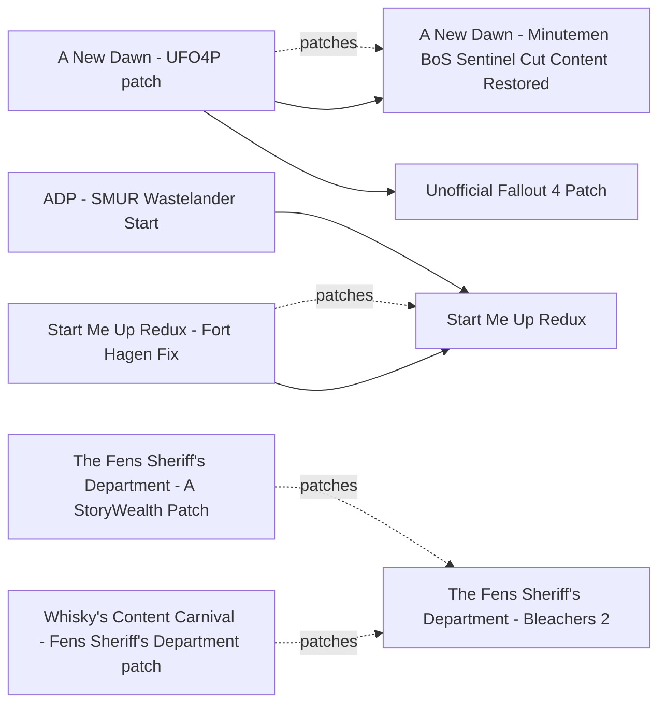

# Factions, endings and starts

How a playthrough begins and ends: fast and alternate starts, restored ending content, post-ending dialogue fixes and neutral play. Almost everything here is plugin only and independent of 1.11.240; Start Me Up Redux 9.2 (2026-07-31) and SKK Fast Start New Game 021 are maintained. No mod gives a true "no faction" ending: the Minutemen ending, with A New Dawn keeping the Brotherhood allied, is the practical independent ending. The main risk is an ending lock: Main Questline With Maximum Content forces the Minutemen ending, and No main quest - Wasteland Operator blocks the main quest.

## Pick one

| Choose between | Difference | Our pick |
| --- | --- | --- |
| Start: SKK Fast Start New Game, MS Fast Start - Skip Sanctuary Prologue, Start Me Up Redux, Synthetic Player (SKK) | All hook the opening quests (MQ101/MQ102). SKK Fast Start New Game edits no base-game scripts and waits for Sim Settlements 2 setup. Start Me Up Redux edits most main quests and is not story-compatible with SS2, which assumes the canon Nate or Nora | Vanilla start |
| BoS after a Minutemen ending: A New Dawn or Ending Epilogue Restored | A New Dawn restores the cut Sentinel promotion through a Paladin quest; Ending Epilogue Restored is the older take, through notes | A New Dawn |
| Synth Shaun: A New Dawn or No More Synth Shaun (main file) | Both edit the MQ302 quests. To have both, use No More Synth Shaun's A New Dawn add-on file | A New Dawn |

## Suggested stacks

| Profile | Take | Skip |
| --- | --- | --- |
| BoS and Minutemen, ending open | A New Dawn + A New Dawn - UFO4P patch, Minutemen Ending Dialogue Fix, (BoS) Brotherhood Post-Minutemen Ending Dialogue Removal | Main Questline With Maximum Content, No main quest - Wasteland Operator |
| No SS2, role-play freedom | Start Me Up Redux + Start Me Up Redux - Fort Hagen Fix, or SKK Fast Start Location for a different spawn point | SKK Fast Start New Game, MS Fast Start - Skip Sanctuary Prologue |
| Neutral, no-faction run | A New Dawn for the Minutemen ending, Gunners Overhaul - Initially Friendly Gunners, Friendly Children of Atom, Covenant Peaceful Solution, Curie - No Main Quest, Codsworth - No Main Quest | Main Questline With Maximum Content, unless you have already chosen the Minutemen ending |
| Replay with a fast opening | SKK Fast Start New Game, SKK Fast Start Reunions, Skip Kellogg's Memories | Start Me Up Redux |

## Our choice

The reference playthrough keeps the ending open. It takes A New Dawn with its UFO4P patch: a Minutemen ending then keeps the Brotherhood as an ally, with the cut Sentinel promotion. Delay Tactical Thinking (Railroad page) keeps the BoS/Railroad fork open longer. We left out Start Me Up Redux because its story clashes with Sim Settlements 2.

<!-- BEGIN GENERATED: do not edit, run scripts/build_catalog.py -->
30 mods: 4 recommended, 20 optional, 6 avoid. Plugin slots if you take everything not marked avoid: 0 full.

### Recommended

| | Mod | What it does | Fit | Cost | Links |
| --- | --- | --- | --- | --- | --- |
|  | **[A New Dawn - Minutemen BoS Sentinel Cut Content Restored](https://www.nexusmods.com/fallout4/mods/64195)** by ashjay101 · v1.0 · updated 2022-09-11 · 425 endorsements · 8 KB | After a Minutemen Nuclear Option, a BoS Paladin still gets A New Dawn and the Sentinel rank, with Minutemen-aware Maxson dialogue *2022-09-11; Opens an ending (Minutemen ending plus a BoS career) instead of locking one; Report 01: Recommended if the Minutemen ending is likely; report 03: Core for us; Edits the MQ302 family: the main file of No More Synth Shaun is incompatible (use its A New Dawn add-on); Overlap with Who's The General on MQ302Min unverified; Start Me Up Redux lists it as compatible* | `recommended` 1.11.240: plugin only | perf low | patches: A New Dawn - UFO4P patch |
|  | **[Minutemen Ending Dialogue Fix](https://www.nexusmods.com/fallout4/mods/45737)** by bluechipmunk1225 · v1.1 · updated 2020-06-22 · 279 endorsements · 3 KB | Fixes Haylen's Danse lines after a Minutemen ending, plus a Glory line *1.1 (2020-06-22); Whether UFO4P already fixes this is unverified: check in xEdit* | `recommended` 1.11.240: plugin only | perf low |  |
|  | **[SKK Fast Start New Game](https://www.nexusmods.com/fallout4/mods/29227)** by SKKmods · v021 · updated 2025-04-24 · 9,507 endorsements · 33 KB | From the main menu to outside Vault 111 in under two minutes, with full character creation and the vanilla story intact *021 (2025-04-24); Author: works with any version including OG, NG, AE 1.11.1xx; BA2 rebuilt; No base-game script edits; v021 detects Workshop Framework (SS2) and waits for setup: let SS2/WSFW finish at the prompt; Do not combine with other alternate starts* | `recommended` 1.11.240: yes | perf low | conflicts: MS Fast Start - Skip Sanctuary Prologue, Start Me Up Redux |
|  | **[A New Dawn - UFO4P patch](https://www.nexusmods.com/fallout4/mods/65696)** by Dashboarderian · v1.0 · updated 2022-11-02 · 250 endorsements · 4 KB | UFO4P compatibility patch for A New Dawn *2022-11-02* | `recommended` 1.11.240: plugin only | perf  | needs: A New Dawn - Minutemen BoS Sentinel Cut Content Restored, Unofficial Fallout 4 Patch |

### Optional

| | Mod | What it does | Fit | Cost | Links |
| --- | --- | --- | --- | --- | --- |
|  | **[Covenant Peaceful Solution](https://www.nexusmods.com/fallout4/mods/11051)** by Seekingthesun · updated 2016-04-28 · 2,425 endorsements · 14 KB | Adds a peaceful resolution for Covenant *2016; Only named in the report's neutral-run suggestions; not evaluated in its tables* | `optional` 1.11.240: plugin only | perf  |  |
|  | **[Ending Epilogue Restored](https://www.nexusmods.com/fallout4/mods/12183)** by Seekingthesun · v1.0 · updated 2016-04-20 · 3,343 endorsements · 34 KB | Older take on A New Dawn: BoS epilogue after a Minutemen ending via notes on the Prydwen *1.0 (2016-04-20); Superseded by A New Dawn; Rewards the neutral ending; cross-check with the BoS report* | `optional` 1.11.240: plugin only | perf low | conflicts: A New Dawn - Minutemen BoS Sentinel Cut Content Restored |
|  | **[Faction Quartermasters](https://www.nexusmods.com/fallout4/mods/104288)** by KnightBeforeDawn · v1.1 · updated 2026-06-01 · 6 endorsements · 19 KB | Buildable tiered vendor stalls for all four factions, unlocked by quest progress *ESL, 2026; Lunar sets vendor prices* | `optional` 1.11.240: plugin only | perf low 0 full / 1 light |  |
|  | **[Friendly Children of Atom](https://www.nexusmods.com/fallout4/mods/22989)** by eskanonen · v1.0 · updated 2017-03-24 · 450 endorsements · 2 KB | Makes the Children of Atom non-hostile *2017; Only named in the report's neutral-run suggestions; not evaluated in its tables* | `optional` 1.11.240: plugin only | perf  |  |
|  | **[Main Questline With Maximum Content](https://www.nexusmods.com/fallout4/mods/84877)** by Malistroth · v1.4 · updated 2024-06-27 · 55 endorsements · 31 KB | Lets you do almost every Institute, BoS, Railroad and Minutemen quest without betrayal *1.4 (2024-06-27), 55 endorsements; The Minutemen ending becomes the only available ending; Avoid while the ending is undecided; Optional for readers who have settled on Minutemen; Edits main quests, so it likely conflicts with Start Me Up Redux and other quest-touching mods (inferred)* | `optional` 1.11.240: plugin only locks ending: minutemen | perf low |  |
|  | **[No More Synth Shaun](https://www.nexusmods.com/fallout4/mods/110140)** by KayEvSki · v1.0 · updated 2026-10-14 · 6 endorsements · 31 KB | Removes synth Shaun from the Minutemen and BoS endings *1.0 (2026-10-14), 6 endorsements; Taste; Main file is incompatible with mods editing MQ302 / MQ302Min / MQ302BoS, including A New Dawn; the page ships an add-on file for A New Dawn (take it instead of the main file if you use both; exact file name not checked)* | `optional` 1.11.240: plugin only | perf low |  |
|  | **[Start Me Up Redux](https://www.nexusmods.com/fallout4/mods/56984)** by Dashboarderian and Oddlittleturtle · v9.2 · updated 2026-07-31 · 11,317 endorsements | Alternate starts (including Wastelander), a dialogue overhaul that removes the parent role, and traits *9.2 (2026-07-31); current build is for NG/AE (old-gen needs Archive Loader); Confirmed compatible with Lunar, A New Dawn and Danse Dilemma; SS2 is technically compatible but not story-compatible (SS2 assumes canon Nate/Nora; the SS2 dialogue patch is in hiatus); Edits most vanilla main quests, very prone to mod conflict; Ending slides do not change; Not for us (SS2 story clash); the best pick for readers without SS2* | `optional` 1.11.240: plugin only SS2: conflict | perf low | patches: Start Me Up Redux - Fort Hagen Fix conflicts: SKK Fast Start New Game, MS Fast Start - Skip Sanctuary Prologue |
|  | **[The Fens Sheriff's Department - Bleachers 2](https://www.nexusmods.com/fallout4/mods/68276)** by MunkySpunk · v2.7.8 · updated 2026-02-08 · 5,118 endorsements · 3053.6 MB | About 50 quests, a Bleachers district, a companion, and the Fens Sheriff's Department replacing Diamond City Security *2.7.8 (2026-02-08); the author has stopped work; Its 'Diamond City Wins' path neutralises factions; the author says it can be turned off: disable it until the ending is chosen; Lunar patch is in Whisky's Lunar Fallout Content Carnival (61804); Testers report SS2 and Subversion OK; With Diamond City Expansion use A StoryWealth Location - Diamond City; Likely conflicts with Improved Guards (unverified); Optional 'Diamond City Wins' ending neutralises faction HQs and their companions: keep it OFF on the holotape (default off per Reddit; check in game); Includes The Bleachers: never both, don't switch mid-save; Load before DCE; Ships a DCE patch (v0.9, old); Heavy CPU in Diamond City; skip on M3; Writing is polarising* | `optional` 1.11.240: plugin only Lunar: patch | perf med | patches: The Fens Sheriff's Department - A StoryWealth Patch, Whisky's Content Carnival - Fens Sheriff's Department patch conflicts: The Bleachers - A Diamond City Story |
|  | **[You And What Army - But It's Other Factions](https://www.nexusmods.com/fallout4/mods/41998)** by Rylasasin And Glitchfinder · v1.2 · updated 2021-03-20 · 707 endorsements · 0.3 MB | YAWA-style settlement patrols for BoS, Railroad, Institute, Gunners, Raiders or Mechanist *1.2 (2021); Each faction stops at its own betrayal point (no ending lock); Built on the original YAWA; compatibility with YAWA2 untested; Railroad variant needs Automatron; BoS patrols start after Shadow of Steel; Choose at most two patrol sources (YAWA2, this, NPCs Travel patrols) on the M3* | `optional` 1.11.240: plugin only | perf med scripts light NPCs many |  |
|  | **[(BoS) Brotherhood Post-Minutemen Ending Dialogue Removal](https://www.nexusmods.com/fallout4/mods/107120)** by RagingRoyal · v1 · updated 2026-07-19 · 6 endorsements | Stops repetitive BoS idle chatter about the Minutemen victory *2026-07-19, 6 endorsements; Idle dialogue conditions only; Pairs with A New Dawn* | `optional` 1.11.240: plugin only | perf low |  |
|  | **[ADP - SMUR Wastelander Start](https://www.nexusmods.com/fallout4/mods/78631)** by CaptainCrackhorse · v1.0.9 · updated 2025-09-29 · 587 endorsements · 62.6 MB | More neutral dialogue for Start Me Up Redux Wastelander starts *1.0.9 (2025-09-29); Author has left; built on pre-NG; At your own risk* | `optional` 1.11.240: plugin only | perf low | needs: Start Me Up Redux |
|  | **[Codsworth - No Main Quest](https://www.nexusmods.com/fallout4/mods/92589)** by d4em · v1.1 · updated 2025-05-07 · 40 endorsements · 6 KB | Makes Codsworth available without doing the main quest *2025, ESL; Load after dialogue mods* | `optional` 1.11.240: plugin only | perf low |  |
|  | **[Curie - No Main Quest](https://www.nexusmods.com/fallout4/mods/92131)** by d4em · v1 · updated 2025-03-18 · 101 endorsements · 3 KB | Makes Curie available without doing the main quest *2025, ESL; Load after dialogue mods* | `optional` 1.11.240: plugin only | perf low |  |
|  | **[Faction Maintenance - Manage Your Factions](https://www.nexusmods.com/fallout4/mods/13231)** by SmithyPete · v3.10 · updated 2017-04-25 · 1,336 endorsements · 56 KB | Holotape to join, leave or change relations with any of 850 factions and fix angry companions *3.10 (2017-04-25); Emergency tool only: the author calls it very dangerous and it can block quests; Prefer the console command setally* | `optional` 1.11.240: plugin only | perf low |  |
|  | **[MS Fast Start - Skip Sanctuary Prologue](https://www.nexusmods.com/fallout4/mods/57101)** by msalaba · v1.4.0 · updated 2025-11-01 · 3,668 endorsements · 0.5 MB | Wake in the cryopod right after character creation *1.4.0 (2025-11-01); Optional SS2 prepopulation handling; Incompatible with other alternate starts and MQ101 edits; 1.4.0 (2025-11); Triggers the SS2 prebuild menu; Exclusive with Start Me Up Redux: pick one start mod* | `optional` 1.11.240: plugin only | perf low | conflicts: SKK Fast Start New Game, Start Me Up Redux |
|  | **[SKK Fast Start Institute](https://www.nexusmods.com/fallout4/mods/38049)** by SKKmods · v003 · updated 2019-09-24 · 499 endorsements · 27 KB | Relays you into the Institute early *No changes to base game scripts; Institute report may own the final call* | `optional` 1.11.240: plugin only | perf low |  |
|  | **[SKK Fast Start Location](https://www.nexusmods.com/fallout4/mods/31198)** by SKKmods · v012 · updated 2025-07-03 · 882 endorsements · 8 KB | Start the game at a chosen workshop *No changes to base game scripts; Interplay with SS2 not verified; Readers without SS2 can pair it with Start Me Up Redux for a different spawn point* | `optional` 1.11.240: plugin only | perf low |  |
|  | **[SKK Fast Start Reunions](https://www.nexusmods.com/fallout4/mods/30926)** by SKKmods · v008 · updated 2018-10-11 · 1,107 endorsements · 70 KB | Jump the main quest ahead to Fort Hagen *No changes to base game scripts* | `optional` 1.11.240: plugin only | perf low |  |
|  | **[Skip Kellogg's Memories](https://www.nexusmods.com/fallout4/mods/73643)** by Yeti · v1.2 · updated 2023-08-20 · 1,526 endorsements · 41 KB | Option to skip the Kellogg memory sequence *1.2 (2023-08-20), ESL; Replay QoL* | `optional` 1.11.240: plugin only | perf low |  |
|  | **[Start Me Up Redux - Fort Hagen Fix](https://www.nexusmods.com/fallout4/mods/93284)** by TheGamerX20 · v1.0.0 · updated 2025-04-24 · 168 endorsements · 6 KB | Fixes a locked Fort Hagen door caused by SMUR's outdated UFO4P script *1.0.0 (2025-04-24), built against UFO4P 2.1.8; Whether SMUR 9.2 already includes it is unverified* | `optional` 1.11.240: plugin only | perf low | needs: Start Me Up Redux |

### Avoid

| | Mod | What it does | Fit | Cost | Links |
| --- | --- | --- | --- | --- | --- |
|  | **[Alternate Start - Infinite Answer](https://www.nexusmods.com/fallout4/mods/13762)** by Glacknarf · v3.2 · updated 2016-10-26 · 5,089 endorsements · 10.5 MB | Older alternate start mod *2016-2018, unmaintained; superseded* | `avoid` 1.11.240: plugin only | perf low |  |
|  | **[Another Life](https://www.nexusmods.com/fallout4/mods/14253)** by Vawser · v1.08 · updated 2016-06-13 · 16,002 endorsements · 0.2 MB | Older alternate start mod *2016-2018, unmaintained; superseded* | `avoid` 1.11.240: plugin only | perf low |  |
|  | **[No main quest - Wasteland Operator](https://www.nexusmods.com/fallout4/mods/33088)** by GhostFc3s · v3.1 · updated 2019-03-11 · 466 endorsements · 0.3 MB | Sandbox play before the BoS arrives; locks Vault 114 and blocks the main quest *3.1 (2019-03-11); Blocks the main quest (not one of our ending values); Works with Another Life and other alternate starts; Precombine impact unknown* | `avoid` 1.11.240: plugin only | perf low |  |
|  | **[Public Works Maintenance](https://www.nexusmods.com/fallout4/mods/21761)** by DavidTheFalcon · v0.5beta · updated 2017-02-03 · 264 endorsements · 45 KB | Shortcut into the Institute *0.5beta (2017-02-03); Beta; Precombine impact unknown* | `avoid` 1.11.240: plugin only | perf low |  |
|  | **[Search for the main quest](https://www.nexusmods.com/fallout4/mods/94239)** by BaleaMen · v1.0 · updated 2025-06-05 · 39 endorsements · 0.8 MB | Rewrites the pacing of When Freedom Calls *1.0 (2025-06-05), 39 endorsements; Edits a vanilla Minutemen quest, so it will collide with our Minutemen stack (inferred)* | `avoid` 1.11.240: plugin only | perf low |  |
|  | **[Start Me Up](https://www.nexusmods.com/fallout4/mods/18946)** by TinyManticore · v6.1 · updated 2018-10-04 · 69,027 endorsements · 28.8 MB | Original alternate start mod *2016-2018, unmaintained; replaced by Start Me Up Redux; Verdict is from the settlement angle only: SS2 wiki says avoid settlement-altering mods where you use a City Plan and warns about mods that skip the Concord rescue; Start Me Up Redux (56984) is the maintained update, not reviewed here* | `avoid` 1.11.240: plugin only | perf low | conflicts: Start Me Up Redux |

### Dependencies and patches

<!-- END GENERATED -->
