# Gameplay overhaul and enemies

The balance layer: one overhaul for perks, gear, leveled lists and NPCs, then combat AI, enemy variety, needs and fast travel. Lunar Fallout Overhaul is maintained again (113 to 114f between 2026-08-12 and 2026-10-18, new game required since 113), plugin only, and the one overhaul that works with Sim Settlements 2. Combat AI moved most in 2026: Adaptive Combat Tactics (ESL, no scripts) and Modern Combat AI (F4SE, edits no records). The main risk is the Lunar patch ecosystem: Lunar - UFO4P (2023-10), Lunar - SS2 (2024-02) and Lunar - Tales from the Commonwealth (2024-07) predate Lunar 111-114 and need an FO4Edit check against 114f. Most perk overhauls either clash with Lunar or do not run on 1.11.240.

## Pick one

| Choose between | Difference | Our pick |
| --- | --- | --- |
| Lunar Fallout Overhaul Deluxe, Horizon, or a piecemeal vanilla+ set (Loot Logic and Reduction, Complex Vendors, SPARS - Simple Power Armor Reduction System) | Lunar has no scripts and works with SS2. Horizon conflicts with SS2 and its own UI files clash with FallUI. Piecemeal needs fewer patches but has no single balance pass | Lunar Fallout Overhaul Deluxe |
| Combat styles: Adaptive Combat Tactics, Combat AI Empowered, REAL.AI, Arbitration, Advanced AI Tweaks | All rewrite combat styles or game settings. Modern Combat AI edits no records and stacks with any of them | Adaptive Combat Tactics |
| Feral ghouls: FGEP - Feral Ghouls Expansion Pack or D.E.C.A.Y. | More Feral Ghouls can join FGEP | Neither |
| Super mutants: Super Mutant Redux AWKCR-Free Lite or Super Mutant Redux | Only the Lite version is aimed at Lunar; the original needs AWKCR | Neither |
| Perks on top of Lunar: Lunar alone, True Perks + True Perks - Lunar Fallout Overhaul, or Creative Perks | Only True Perks ships an official Lunar patch; Creative Perks needs a hand-made one | Lunar alone |
| Speech: Roleplayer's Expanded Dialogue or Binary Speech Checks | Perk- and SPECIAL-gated options (needs XDI), or deterministic New Vegas-style checks | Neither |
| Needs: Advanced Needs 76 or Hunger and Hydration on normal difficulty, or Survival with Survival Mode Tweaks - Updated or Unlimited Survival Mode - F4SE | Advanced Needs 76 does not run in Survival. Lunar was designed for non-Survival play | Neither |

## Suggested stacks

| Profile | Take | Skip |
| --- | --- | --- |
| Lunar on a light machine | Lunar Fallout Overhaul Deluxe + Lunar - UFO4P + Lunar NPC Travel Patch, Encounter Zone Recalculation, Adaptive Combat Tactics, Customizable Combat AI Nearby Object Search | Better Locational Damage, TRUE DAMAGE, SCOURGE, Hardcore Health Overhaul, Leveled Item Fixes (LIF), Mutant Menagerie - Life Finds A Way |
| Real Survival | Lunar, Survival Mode Tweaks - Updated (or Unlimited Survival Mode - F4SE), Survival Configuration Menu + Lunar - Survival Configuration Menu, Safe Travels, SKK Dynamic Damage Manager | Advanced Needs 76 |
| No Lunar, vanilla+ | Loot Logic and Reduction, Complex Vendors, SPARS - Simple Power Armor Reduction System, Encounter Zone Recalculation, Safe Travels, Reinforcements and Retribution, Perk Up or Creative Perks | Every Lunar patch |
| Maximum chaos, strong CPU | Chemfluence - AI Combat Dynamics, NPCs Use Items, SKK Combat Stalkers, Mutant Menagerie - Life Finds A Way, Modern Combat AI | D.E.C.A.Y. (if FGEP is in), stacking several spawners |

## Our choice

The reference playthrough takes Lunar Fallout Overhaul Deluxe 114f with Lunar - UFO4P and Lunar NPC Travel Patch, Encounter Zone Recalculation, Adaptive Combat Tactics so enemies flank and take cover, and Customizable Combat AI Nearby Object Search so settlers leave parked power armor alone. Lunar won because it is maintained again, plugin only, script-free and works with Sim Settlements 2. We left out Modern Combat AI for now: it is four weeks old and its in-combat CPU cost under Wine is unmeasured.

<!-- BEGIN GENERATED: do not edit, run scripts/build_catalog.py -->
102 mods: 12 recommended, 56 optional, 34 avoid. Plugin slots if you take everything not marked avoid: 1 full.

### Recommended

| | Mod | What it does | Fit | Cost | Links |
| --- | --- | --- | --- | --- | --- |
|  | **[Customizable Combat AI Nearby Object Search](https://www.nexusmods.com/fallout4/mods/91400)** by LarannKiar · v3.1 · updated 2026-08-20 · 595 endorsements · 0.2 MB | Keeps settlers out of containers and parked power armor in settlements *Matters with SS2; In LitR; 3.1 (2026-08-20), explicit 1.11.137-1.11.240; Edits no records; On STEP* | `recommended` 1.11.240: yes F4SE DLL | perf low | needs: Fallout 4 Script Extender |
|  | **[Encounter Zone Recalculation](https://www.nexusmods.com/fallout4/mods/45674)** by Ea6t · v5.0 · updated 2026-08-25 · 10,817 endorsements · 81 KB | Visited zones keep scaling with the player *5.0 (2026-08-25), explicit 1.11.240 (TMR switched back to it); Recommended by the Lunar author; on STEP* | `recommended` 1.11.240: yes F4SE DLL | perf low |  |
|  | **[Simple Offence Suppression F4](https://www.nexusmods.com/fallout4/mods/75292)** by powerofthree · v1.2.1 · updated 2025-11-30 · 3,940 endorsements · 0.2 MB | Neutral NPCs no longer turn hostile from stray hits *AE 1.2.1 (2025-11-30) says 1.11.137+ without naming 1.11.240: check f4se.log* | `recommended` 1.11.240: unknown F4SE DLL | perf low |  |
|  | **[Lunar Fallout Overhaul Deluxe](https://www.nexusmods.com/fallout4/mods/34769)** by Moonracer · v114f · updated 2026-10-18 · 1,749 endorsements · 254.7 MB | All-in-one rebalance of perks, gear, leveled lists, NPCs, food and settlements *114f (2026-10-18); new game required since 113; Needs the free Next-Gen CC items; No scripts, no vanilla location edits (precombines not re-verified for 114f); ESM flag of 114f unverified; Designed for non-Survival; Whether 114f re-covers CC Enclave Remnants is unverified (else Lunar - CC Remnants); Avoid locational-damage, dismemberment and NPC-health mods* | `recommended` 1.11.240: plugin only SS2: patch | perf low | patches: Lunar - UFO4P, Lunar - SS2, Lunar - Tales from the Commonwealth, Lunar NPC Travel Patch, Lunar - Community Fixes Merged Patch, Lunar - SMR - Scaling Tweaks, Lunar - Survival Configuration Menu, Lunar Fallout Munitions Patch, True Perks - Lunar Fallout Overhaul, LFO DECAY patch conflicts: Horizon |
|  | **[Advanced Needs 76](https://www.nexusmods.com/fallout4/mods/58440)** by FlashyJoer · vv1.8.9 · updated 2023-11-26 · 4,062 endorsements · 22.7 MB | Hunger, thirst, sleep, hygiene, disease and wounds on non-Survival difficulties *1.8.9 (2023-11); On the Lunar author's recommended list; New game required; Adds 1 cell, previs intact per author; Does not run in Survival; Enable only hunger/thirst/sleep modules to save CPU* | `recommended` 1.11.240: plugin only | perf med scripts heavy | needs: Mod Configuration Menu |
|  | **[Reinforcements and Retribution](https://www.nexusmods.com/fallout4/mods/98034)** by Glitchfinder · v1.01 · updated 2026-09-22 · 933 endorsements · 86 KB | Reinforcements during dungeon assaults and hit squads afterwards *1.01 (2026-09-22), ESL; Safe mid-game; Untested with Lunar; Whether BoS retaliates once allied is unverified* | `recommended` 1.11.240: plugin only | perf med scripts light NPCs few 0 full / 1 light |  |
|  | **[Roleplayer's Expanded Dialogue](https://www.nexusmods.com/fallout4/mods/69389)** by ProfMajkowski · v2.8.2 · updated 2024-06-12 · 3,487 endorsements · 10.7 MB | Hundreds of perk- and SPECIAL-gated dialogue options *2.8.2 (2024-06), tested on 1.10.984; Dialogue only, no Lunar overlap; Overlap with SS2/TftC dialogue and effect on faction quests unverified; Pick RED or Binary Speech Checks* | `recommended` 1.11.240: plugin only | perf low | needs: Extended Dialogue Interface |
|  | **[Safe Travels](https://www.nexusmods.com/fallout4/mods/102931)** by bp42s · v1.3.1 · updated 2026-08-25 · 272 endorsements · 39 KB | Earn fast travel between settlements and ride with provisioners in Survival *1.3.1 (2026-08-25), ESL-flagged ESM; Survival-only (report 07: N/A without Survival); Handles mod-added settlements automatically* | `recommended` 1.11.240: plugin only | perf low scripts light 0 full / 1 light |  |
|  | **[Adaptive Combat Tactics](https://www.nexusmods.com/fallout4/mods/107069)** by o14 · v1.1.0 · updated 2026-10-08 · 320 endorsements · 2.3 MB | Archetype accuracy, suppression, cover-to-cover and retreat via combat styles *1.1.0 (2026-10-08); Use the Tested profile; 151 GMST + 57 CSTY overrides: load after Lunar; Pick one CSTY/GMST AI mod* | `recommended` 1.11.240: plugin only | perf low 0 full / 1 light |  |
|  | **[Campsite](https://www.nexusmods.com/fallout4/mods/11734)** by fadingsignal · v1.0.4 · updated 2022-05-26 · 29,634 endorsements · 82.3 MB | Portable tents, bedrolls, fire and cooking pot *Sleep spot for Survival or Advanced Needs 76* | `recommended` 1.11.240: plugin only | perf low |  |
|  | **[Survival Mode Tweaks - Updated](https://www.nexusmods.com/fallout4/mods/12794)** by AkihiroKytori · v1 · updated 2026-09-23 · 3,350 endorsements · 20 KB | Console, fast travel and timed autosaves in Survival *2026-09-23, 'OG, NG, AE 1.11.x'; Survival path only; Lunar does not touch HC_Manager* | `recommended` 1.11.240: plugin only | perf low |  |
|  | **[Lunar - UFO4P](https://www.nexusmods.com/fallout4/mods/62679)** by WhiskyTangoFox · v3.1 · updated 2026-03-13 · 256 endorsements · 10 KB | Forwards UFO4P fixes into Lunar's overridden records *From Lunar Gameplay Patch Bodega; another report may own it; v3.2 (2023-10-11) from Gameplay Patch Bodega; predates Lunar 111-114; Check in xEdit: drop records where it loses Lunar 114f values UFO4P does not change* | `recommended` 1.11.240: plugin only | perf low | needs: Lunar Fallout Overhaul Deluxe, Unofficial Fallout 4 Patch |

### Optional

| | Mod | What it does | Fit | Cost | Links |
| --- | --- | --- | --- | --- | --- |
|  | **[LevelUpMenuEx](https://www.nexusmods.com/fallout4/mods/28822)** by Neanka · v1.11.240 · updated 2026-09-06 · 14,192 endorsements · 0.3 MB | Perk-menu framework for skill mods *1.11.240 file (2026-09-06); Only needed by skill mods; report gives no verdict (framework)* | `optional` 1.11.240: yes F4SE DLL | perf low |  |
|  | **[Modern Combat AI](https://www.nexusmods.com/fallout4/mods/109544)** by Zzyxzz · v1.2.0 · updated 2026-10-04 · 545 endorsements · 0.6 MB | Squad tactics for NPCs: leaders, flanking, cover, grenade discipline and unused voiced orders *Created 2026-10-01: too new; test after the list is stable; CPU cost under Wine unmeasured; No plugin, sits on top of Lunar; 1.2.0 (2026-10-04), 'OG, NG and AE'; released after 1.11.240 but does not name it; No ESP, no scripts, no edited records: stacks with Lunar and ACT; Four weeks old; in-combat CPU cost under Wine unmeasured* | `optional` 1.11.240: yes F4SE DLL | perf med | needs: Fallout 4 Script Extender, Runtime Database |
|  | **[PerkPointsPerLevel](https://www.nexusmods.com/fallout4/mods/3938)** by TheLich · v1.5.6.11240 · updated 2026-08-22 · 11,267 endorsements · 0.1 MB | Changes perk points granted per level *1.5.6.11240 (2026-08-22); Changes Lunar's pacing (perks gated to 75+)* | `optional` 1.11.240: yes F4SE DLL | perf low |  |
|  | **[Unlimited Survival Mode - F4SE](https://www.nexusmods.com/fallout4/mods/26163)** by Kassent · vv1.6.0 · updated 2025-12-29 · 18,547 endorsements · 0.1 MB | Fast travel, console, saves and vanilla stim/ammo weight in Survival *1.6.0 (2025-12-29) predates 1.11.240; unverified; Survival path only* | `optional` 1.11.240: unknown F4SE DLL | perf low |  |
|  | **[Customize Legendary Enemy Spawning](https://www.nexusmods.com/fallout4/mods/218)** by The Iron Rose · v2.3 · updated 2016-05-08 · 14,231 endorsements · 9 KB | Changes the legendary enemy spawn rate *Lunar has its own legendary system: load before Lunar* | `optional` 1.11.240: plugin only | perf  |  |
|  | **[Creative Perks](https://www.nexusmods.com/fallout4/mods/28192)** by GraffitiNoise · v23.0 · updated 2024-08-15 · 2,687 endorsements · 0.5 MB | Modular perk rewrites without level requirements *The Lunar author praised it with a patch in 2024; no current patch found, so it overrides Lunar perks; Needs xEdit care* | `optional` 1.11.240: plugin only Lunar: conflict | perf low |  |
|  | **[Crime and Punishment](https://www.nexusmods.com/fallout4/mods/58429)** by FlashyJoer · vv1.1.3 · updated 2022-03-05 · 3,848 endorsements · 353.0 MB | Karma and crime system *RED has an optional plugin for it; Precombine impact unknown* | `optional` 1.11.240: plugin only | perf med scripts light |  |
|  | **[D.E.C.A.Y.](https://www.nexusmods.com/fallout4/mods/2500)** by Thumblesteen · v2.2 · updated 2020-02-21 · 23,440 endorsements · 198.1 MB | Feral ghoul overhaul *Pick D.E.C.A.Y; or FGEP* | `optional` 1.11.240: plugin only | perf low | patches: LFO DECAY patch |
|  | **[FGEP - Feral Ghouls Expansion Pack](https://www.nexusmods.com/fallout4/mods/57181)** by Ethganz - Ethnet and Arroganz- · v1.7.2 · updated 2024-02-21 · 6,709 endorsements · 677.3 MB | New feral ghoul archetypes and bosses *1.7.2 (2024-02); Use the script-injected option over Lunar; Quests involving ferals may break; Needs Far Harbor and Nuka-World; Pick FGEP or D.E.C.A.Y* | `optional` 1.11.240: plugin only | perf med |  |
|  | **[FGEP Legendary Addition](https://www.nexusmods.com/fallout4/mods/62184)** by Exoclyps · v2.2.2 · updated 2024-10-09 · 1,347 endorsements · 28 KB | Legendary feral ghouls for FGEP | `optional` 1.11.240: plugin only | perf  | needs: FGEP - Feral Ghouls Expansion Pack |
|  | **[Immersive Fast Travel](https://www.nexusmods.com/fallout4/mods/10157)** by Cole Robinette · v5.6 · updated 2016-03-30 · 4,713 endorsements · 6.5 MB | Build teleporters, cars and vertibirds; can disable vanilla fast travel on any difficulty *Fast-travel limiter for non-Survival play; vertibird option after visiting the Prydwen; Report 07 rates it avoid (2016, scripted)* | `optional` 1.11.240: plugin only | perf low scripts light |  |
|  | **[Lightweight More Spawns](https://www.nexusmods.com/fallout4/mods/82233)** by ThreatUnprofiled · v0.94 · updated 2025-04-27 · 315 endorsements · 2.2 MB | Hand-placed doubling of most enemy spawns with properly hidden ambush creatures, no scripts *0.94 (2025-04-27); Desktop CPUs only; avoid on the M3 next to SS2; Precombine impact not stated* | `optional` 1.11.240: plugin only | perf high NPCs many |  |
|  | **[Lone Wanderer fast travel](https://www.nexusmods.com/fallout4/mods/17736)** by LoneRaptor · v2.0.2 · updated 2026-08-01 · 3,714 endorsements | Fuel-driven motorcycle fast travel on any difficulty | `optional` 1.11.240: plugin only | perf low |  |
|  | **[More Deathclaw Variety](https://www.nexusmods.com/fallout4/mods/19067)** by Hopper31 · v1.10 · updated 2016-12-27 · 2,071 endorsements · 43 KB | About 20 script-injected deathclaw variants *Edits Nuka-World quantum spawns; Lunar already buffs deathclaws, so the stack is harder* | `optional` 1.11.240: plugin only | perf low |  |
|  | **[More Feral Ghouls](https://www.nexusmods.com/fallout4/mods/43441)** by Oynlen and DeathByKitty · v3.5 · updated 2022-11-15 · 7,691 endorsements · 403.2 MB | Feral ghoul visual and attack variety without extra spawns *Works with FGEP (script version); not Lunar-tuned* | `optional` 1.11.240: plugin only | perf low |  |
|  | **[Mutant Menagerie - Life Finds A Way](https://www.nexusmods.com/fallout4/mods/68187)** by StamperDoesMods · v1.42 · updated 2024-05-20 · 3,897 endorsements · 5758.9 MB | 60+ lore-friendly creatures plus hunting, foraging, trophies and bounty quests *1.42 (2024-05), author says complete; Script-injects into creature leveled lists, so it survives Lunar; creature stats not Lunar-tuned, no Lunar patch; Bounty quests may target settlements (SS2 risk unverified); incompatible with quest-limiter mods; SKK kill-by-script mods may CTD; No PRP patch: check in xEdit* | `optional` 1.11.240: plugin only | perf high scripts light NPCs many |  |
|  | **[Plutonium Creatures](https://www.nexusmods.com/fallout4/mods/32647)** by Hopper31 and Callie · v1.10 · updated 2023-12-26 · 3,242 endorsements · 176.2 MB | Top-tier creatures at levels 80-120 *Fits Lunar's long progression; untested* | `optional` 1.11.240: plugin only | perf low |  |
|  | **[Power Armor to the People](https://www.nexusmods.com/fallout4/mods/50819)** by Skiesbleed · v2.15.1 · updated 2025-04-09 · 2,613 endorsements · 12.7 MB | Power-armored faction enemies and power armor legendary effects *2.15.1 (2025-04), ESL plugins; F4SE needed for the PA enemies, DLL version support unverified; Lunar has its own PA balance; Patchapalooza has a Lunar file for it* | `optional` 1.11.240: unknown F4SE DLL | perf med |  |
|  | **[Random Encounter Manager by SKK](https://www.nexusmods.com/fallout4/mods/42081)** by SKKmods · v013 · updated 2026-09-26 · 3,770 endorsements · 0.2 MB | Scripted manager that spawns up to 4 extra friendly or hostile encounters at free RE triggers *v013 (2026-09-26); Compatible with REF per REF's FAQ, overlaps CEP in purpose; Caps at 64 spawned actors; Too much for the M3 next to SS2; fine on desktop CPUs; Optional MCM menu: Nexus 56580* | `optional` 1.11.240: plugin only | perf high scripts heavy NPCs many |  |
|  | **[SKK Combat Stalkers](https://www.nexusmods.com/fallout4/mods/57842)** by SKKmods · v26.1 · updated 2022-03-13 · 2,469 endorsements · 41 KB | Scripted leveled ambush and stalker groups *Overlaps Random Encounter Framework and Commonwealth Encounter Pack; too many spawners cost CPU on the Mac* | `optional` 1.11.240: plugin only | perf med scripts light NPCs many |  |
|  | **[Starts Dead Alive](https://www.nexusmods.com/fallout4/mods/62509)** by WasteTheLand · v017 · updated 2026-08-10 · 200 endorsements | Revives most placed corpses (ferals, mutants, raiders, traders, uniques) as live actors and fills several dungeons with dozens of NPCs *017 (2026-08-10), 200 endorsements; Author lists 1.11.240; ESL+ESM flagged; no previs/precombine edits; new game required; For us: perf-test Super Duper Mart, College Square, Jamaica Plain and Mass Pike Tunnel first; first mod to drop if FPS suffers; Never stack with More Gunners, Raider Gangs Extended or Unique Raider Gangs (report 03); Effect on quest-adjacent corpses unverified; Skip the older CC_013 file (adds NG/AE Creation content)* | `optional` 1.11.240: yes | perf high NPCs many 0 full / 1 light |  |
|  | **[Super Mutant Redux AWKCR-Free Lite](https://www.nexusmods.com/fallout4/mods/61206)** by WhiskyTangoFox · v2.0.1 · updated 2024-10-15 · 1,271 endorsements · 191.3 MB | Super Mutant Redux without AWKCR, scaling reverted to vanilla, streamlined *2.0.1 (2024-10-15); Its description says it is the version compatible with Lunar; Needs Super Mutant Redux assets per its page (unverified); Precombine impact unknown; 2.0.1 (2024-10); Author (the Lunar patch maker): 'if you want a version compatible with Lunar, you want this one'; Precombines unverified; In Life in the Ruins* | `optional` 1.11.240: plugin only | perf med | patches: Lunar - SMR - Scaling Tweaks conflicts: Super Mutant Redux |
|  | **[True Perks](https://www.nexusmods.com/fallout4/mods/49400)** by WhiskyTangoFox · v9.7 · updated 2024-09-15 · 1,848 endorsements · 4.2 MB | Deep perk-tree rework with SPECIAL-gated ranks *9.7 (2024-09); The only perk overhaul with an official Lunar patch; Life in the Ruins runs Lunar + True Perks* | `optional` 1.11.240: plugin only Lunar: patch | perf low | patches: True Perks - Lunar Fallout Overhaul |
|  | **[Chemfluence - AI Combat Dynamics](https://www.nexusmods.com/fallout4/mods/73741)** by Zzyxzz · v1.2.3 · updated 2026-09-20 · 3,753 endorsements · 12 KB | NPC chem use changes their combat style *Script CPU cost; needs NPCs Use Items; untested with Lunar's chem changes; 1.2.3 (2026-09-20); Whether it ships a DLL is unverified; Assigns CSTYs, so pair with at most one GMST-only AI mod; Best with NPCs Use Items* | `optional` 1.11.240: unknown F4SE DLL | perf med scripts light | needs: RobCo Patcher, Mod Configuration Menu |
|  | **[Legendary Effect Overhaul](https://www.nexusmods.com/fallout4/mods/66900)** by Dank Rafft · v2.1.3 · updated 2026-10-02 · 7,063 endorsements · 20.7 MB | Craft, detach and swap legendary effects; FO76 effects *2.1.3 (2026-10-02), ESL; Incompatible with mods that modify vanilla legendary effects; Lunar has its own legendary system, so an xEdit patch is needed; Advanced users* | `optional` 1.11.240: plugin only Lunar: conflict | perf low 0 full / 1 light |  |
|  | **[Arbitration](https://www.nexusmods.com/fallout4/mods/2037)** by JackArbiter · v0.4.3 · updated 2016-04-28 · 12,139 endorsements · 0.2 MB | Modular AI, stealth, damage and speed changes *Legacy (2016); Damage and speed modules conflict with Lunar balance* | `optional` 1.11.240: plugin only | perf low |  |
|  | **[Barter - A Vendor and Economy Overhaul](https://www.nexusmods.com/fallout4/mods/72654)** by WhiskyTangoFox · v2.0.1 · updated 2024-07-29 · 96 endorsements · 4 KB | FO4Edit patcher: vendors only buy what they sell, 30-50 caps, partial restocks *2.0.1 (2024-07); By WhiskyTangoFox (Life in the Ruins), detects Lunar; TMR swapped back to Complex Vendors: 'too hardcore, patching not user friendly'; Hardcore readers only* | `optional` 1.11.240: plugin only | perf low scripts light | needs: FO4Edit conflicts: Wasteland Economics - Vendor Overhaul |
|  | **[Binary Speech Checks](https://www.nexusmods.com/fallout4/mods/2100)** by Henke · vV.4 · updated 2015-12-04 · 5,993 endorsements · 1 KB | New Vegas-style deterministic speech checks *V.4 edits Lady Killer / Black Widow perks: check vs Lunar; Overlaps RED* | `optional` 1.11.240: plugin only | perf low |  |
|  | **[Combat AI Empowered](https://www.nexusmods.com/fallout4/mods/72678)** by Rantanplan76 · v1.1.6 · updated 2024-04-28 · 806 endorsements · 55 KB | Combat style, GMST and detection rework *1.1.6 (2024-04); Alternative to Adaptive Combat Tactics (same slot)* | `optional` 1.11.240: plugin only | perf low |  |
|  | **[Complex Vendors](https://www.nexusmods.com/fallout4/mods/47364)** by Zzyxzz · v1.0.0 · updated 2023-07-16 · 3,681 endorsements · 9 KB | Vendors only buy their specialty *On the Lunar author's experimental list; Overlaps Wasteland Economics: pick one* | `optional` 1.11.240: plugin only | perf low |  |
|  | **[Critical Hits Outside of VATS](https://www.nexusmods.com/fallout4/mods/12653)** by NotSure700 · v1.1.3 · updated 2016-05-18 · 9,169 endorsements · 2 KB | Crit perk for non-VATS play *Lunar author mentions it as an option for the Luck perks* | `optional` 1.11.240: plugin only | perf low |  |
|  | **[Hunger and Hydration](https://www.nexusmods.com/fallout4/mods/109663)** by Chrismassy · v1 · updated 2026-10-07 · 18 endorsements · 0.1 MB | FO76-style food and water meters with buffs only *1.1 (2026-10-07), 5 days old, unproven; Lunar foods untested* | `optional` 1.11.240: unknown F4SE DLL | perf low | needs: Garden of Eden Papyrus Script Extender, RobCo Patcher |
|  | **[Intimidation Perk Extend](https://www.nexusmods.com/fallout4/mods/51119)** by LarannKiar · v2.3 · updated 2025-02-09 · 306 endorsements · 8.2 MB | Intimidated NPCs become commandable followers *Lunar left Intimidation untouched with this kind of mod in mind (author lists it)* | `optional` 1.11.240: plugin only | perf low scripts light 0 full / 1 light |  |
|  | **[JOURNEY](https://www.nexusmods.com/fallout4/mods/12685)** by Maduin81 · v1.6.1 · updated 2016-06-01 · 8,457 endorsements · 19 KB | Settlement-only fast travel in Survival *Alternative to Safe Travels* | `optional` 1.11.240: plugin only | perf low |  |
|  | **[Longer Area Respawn](https://www.nexusmods.com/fallout4/mods/1371)** by Puma · v1.1 · updated 2016-03-13 · 3,448 endorsements · 1 KB | Longer respawn timers so cleared locations stay cleared *1.1 (2016), GMST-only; 'Longer Cleared Cell Respawn' keeps 1-week normal cells and 4-month cleared cells; Also delays loot respawn; Check whether Lunar edits the same GMSTs; Can be ESL-flagged* | `optional` 1.11.240: plugin only | perf low 1 full / 0 light |  |
|  | **[NPCs Use Items](https://www.nexusmods.com/fallout4/mods/73717)** by Zzyxzz · v1.2.1 · updated 2023-09-03 · 3,817 endorsements · 9 KB | NPCs use stims and chems in combat *Enemies use Lunar's scarcer chems, so harder; untested with Lunar* | `optional` 1.11.240: plugin only | perf med scripts light |  |
|  | **[REAL.AI](https://www.nexusmods.com/fallout4/mods/72923)** by Thumblesteen · vV1.1 · updated 2023-07-26 · 2,771 endorsements · 3 KB | 207 GMST changes for more organic AI *GMST overlap with ACT: pick one* | `optional` 1.11.240: plugin only | perf low |  |
|  | **[Reduce Grenade Spam](https://www.nexusmods.com/fallout4/mods/72951)** by Rantanplan76 · v1.0.1 · updated 2024-04-27 · 360 endorsements · 1 KB | NPCs only throw grenades they carry *Companion to Combat AI Empowered* | `optional` 1.11.240: plugin only | perf low |  |
|  | **[SKK Dynamic Damage Manager](https://www.nexusmods.com/fallout4/mods/37963)** by SKKmods · v016 · updated 2020-09-06 · 1,275 endorsements | Damage in/out and XP multipliers on demand *Lunar author suggests 2:2 or 3:3 for Survival players* | `optional` 1.11.240: plugin only | perf  |  |
|  | **[SURVIVAL QUICK SAVE](https://www.nexusmods.com/fallout4/mods/12593)** by Gopher · v1.2.1 · updated 2016-05-29 · 19,957 endorsements · 3 KB | Quick saves in Survival *Survival only; not applicable without Survival* | `optional` 1.11.240: unknown | perf  |  |
|  | **[Sleep Or Save](https://www.nexusmods.com/fallout4/mods/12262)** by Loganbacca · v2.2 · updated 2018-10-22 · 3,475 endorsements · 0.5 MB | Survival save alternative *Survival only; not applicable without Survival* | `optional` 1.11.240: unknown | perf  |  |
|  | **[Survival Configuration Menu](https://www.nexusmods.com/fallout4/mods/37599)** by Zzyxzz · v1.0.0 · updated 2023-04-13 · 4,584 endorsements · 0.1 MB | Tunes Survival hunger, thirst, disease, fatigue and carry weight *Survival only; Hard saves need Unlimited Survival Mode* | `optional` 1.11.240: plugin only Lunar: patch | perf low | needs: Mod Configuration Menu patches: Lunar - Survival Configuration Menu |
|  | **[Survival Options](https://www.nexusmods.com/fallout4/mods/14650)** by Jekod · v1.7.1 · updated 2017-11-17 · 27,124 endorsements · 0.1 MB | Holotape toggles for Survival *Legacy (2017); edits HC_Manager (Lunar does not)* | `optional` 1.11.240: plugin only | perf low |  |
|  | **[Vendor Caps](https://www.nexusmods.com/fallout4/mods/2832)** by Ominus · v1.5.2 · updated 2019-09-15 · 8,571 endorsements · 0.1 MB | Holotape to set vendor caps, injected by script *1.5.2 (2019); Pick one vendor-caps mod* | `optional` 1.11.240: plugin only | perf low scripts light | conflicts: Wasteland Economics - Vendor Overhaul |
|  | **[Wasteland Economics - Vendor Overhaul](https://www.nexusmods.com/fallout4/mods/106720)** by JAG337 · v1.2 · updated 2026-07-11 · 15 endorsements | Regional vendor cap pools and a 10% sell bonus at specialised vendors *1.2 (2026-07-11), ESL, 15 endorsements; Does not edit item values, leveled lists or barter perks; Overlap with Lunar's vendor edits unverified (Lunar article 403): load after Lunar and compare vendor records in FO4Edit; Higher caps loosen Lunar's economy; Pick one vendor mod; with Lunar, Complex Vendors is the proven choice; Use All In One or Base + DLC Add-On, not both* | `optional` 1.11.240: plugin only | perf low 0 full / 1 light | conflicts: Complex Vendors, Vendor Caps, Barter - A Vendor and Economy Overhaul, Rich Merchants |
|  | **[Worthwhile Caps Stashes](https://www.nexusmods.com/fallout4/mods/23464)** by LeahTheUnknown · v4.3 · updated 2026-07-29 · 2,106 endorsements | Caps stashes hold more caps *4.3 (2026-07-29), 'OG, NG and AE'; Probably edits leveled lists: check vs Lunar and Wasteland Economics in xEdit* | `optional` 1.11.240: unknown | perf  |  |
|  | **[LFO DECAY patch](https://www.nexusmods.com/fallout4/mods/57459)** by Moonracer · v1.1 · updated 2022-01-20 · 15 endorsements · 3 KB | Reconciles Lunar and D.E.C.A.Y. *2022, likely stale against Lunar 114f: check in xEdit* | `optional` 1.11.240: plugin only | perf  | needs: Lunar Fallout Overhaul Deluxe, D.E.C.A.Y. |
|  | **[Lunar - CC Remnants](https://www.nexusmods.com/fallout4/mods/61804)** by WhiskyTangoFox · v3.0.4 · updated 2025-05-24 · 166 endorsements · 37 KB | Restores Lunar compatibility with the CC Enclave Remnants *Released 2025-05 after 112d.1 dropped Remnants support; Whether Lunar 114f covers Remnants again is unverified: check the Lunar FOMOD first* | `optional` 1.11.240: plugin only | perf  | needs: Lunar Fallout Overhaul Deluxe |
|  | **[Lunar - Fix for Power Armor Repair Requirements](https://www.nexusmods.com/fallout4/mods/88349)** by WhiskyTangoFox · v3 · updated 2026-04-11 · 52 endorsements · 46 KB | Fixes the power armor repair-requirement display in Lunar *v4 (2026-04-11) from Power Armor Patchapalooza, which also has Lunar patches for PA mods; From Lunar Power Armor Patchapalooza; Its script attaches to PA workbenches: if added mid-game, put the PA back in the workbench* | `optional` 1.11.240: plugin only | perf low | needs: Lunar Fallout Overhaul Deluxe |
|  | **[Lunar - SMR - Scaling Tweaks](https://www.nexusmods.com/fallout4/mods/62679)** by WhiskyTangoFox · v3.1 · updated 2026-03-13 · 256 endorsements · 10 KB | Lunar scaling tweaks for Super Mutant Redux Lite | `optional` 1.11.240: plugin only | perf  | needs: Lunar Fallout Overhaul Deluxe, Super Mutant Redux AWKCR-Free Lite |
|  | **[Lunar - Survival Configuration Menu](https://www.nexusmods.com/fallout4/mods/62679)** by WhiskyTangoFox · v3.1 · updated 2026-03-13 · 256 endorsements · 10 KB | Reconciles Lunar and Survival Configuration Menu *Only for Survival players using SCM* | `optional` 1.11.240: plugin only | perf  | needs: Lunar Fallout Overhaul Deluxe, Survival Configuration Menu |
|  | **[Lunar Fallout Munitions Patch](https://www.nexusmods.com/fallout4/mods/109327)** by moonracer · v1 · updated 2026-09-26 · 3 endorsements · 3 KB | Munitions ammo drops at Lunar rarity *By moonracer (2026-09-26); Only if Munitions is installed* | `optional` 1.11.240: plugin only | perf low | needs: Lunar Fallout Overhaul Deluxe |
|  | **[Lunar NPC Travel Patch](https://www.nexusmods.com/fallout4/mods/43832)** by Zeanzil · v1 · updated 2020-03-11 · 91 endorsements · 0 KB | Fixes NPCs Travel outfits under Lunar's armor-slot changes *2020-03-11, ESL; Low risk; 2020-03-11, ESL, untested in game by its author; Built against NPCs Travel 2.9.x; 3.0 is 'not compatible with previous versions', so its outfit overrides may not match; Run FO4Edit Check for Errors with NPCs Travel 3.0.1 + Lunar; skip it if records do not line up (symptom without it is cosmetic: half-dressed travellers); Report 13 disagrees with the earlier core tier* | `optional` 1.11.240: plugin only Lunar: patch | perf low 0 full / 1 light | needs: Lunar Fallout Overhaul Deluxe, NPCs Travel |
|  | **[No Far Harbor Creatures for MM-LFAW](https://www.nexusmods.com/fallout4/mods/80452)** by Turtington · v1.01beta · updated 2025-05-30 · 81 endorsements · 34 KB | Keeps Far Harbor creatures out of the mainland *1.01beta, for lore purists* | `optional` 1.11.240: plugin only | perf low | needs: Mutant Menagerie - Life Finds A Way |
|  | **[No Legendary Effects for LFO](https://www.nexusmods.com/fallout4/mods/62231)** by Moonracer · v1 · updated 2022-07-15 · 7 endorsements · 3 KB | Removes all legendary effects under Lunar *Made for an old Lunar version; niche* | `optional` 1.11.240: plugin only | perf low | needs: Lunar Fallout Overhaul Deluxe |
|  | **[True Perks - Lunar Fallout Overhaul](https://www.nexusmods.com/fallout4/mods/49400)** by WhiskyTangoFox · v9.7 · updated 2024-09-15 · 1,848 endorsements · 4.2 MB | Official True Perks patch for Lunar *9.4.1 (2024-07) predates Lunar 113/114: check in xEdit* | `optional` 1.11.240: plugin only | perf  | needs: True Perks, Lunar Fallout Overhaul Deluxe |

### Avoid

| | Mod | What it does | Fit | Cost | Links |
| --- | --- | --- | --- | --- | --- |
|  | **[Hostile NPC Respawn Fix](https://www.nexusmods.com/fallout4/mods/79726)** by LarannKiar · v1.4 · updated 2024-08-04 · 1,949 endorsements · 18 KB | Fixes hostile NPCs that never respawn after cell resets *1.4 (2024-08); Needs Garden of Eden; TMR removed it: 'still broken after being updated'; Goes against the cleared-stays-cleared goal anyway* | `avoid` 1.11.240: unknown F4SE DLL | perf low | needs: Garden of Eden Papyrus Script Extender |
|  | **[SCOURGE](https://www.nexusmods.com/fallout4/mods/60917)** by GELUXRUM · v1.0.5 · updated 2024-07-18 · 3,754 endorsements · 3.1 MB | Reworked NPC stat formula *OG/NG only; Flattens NPC stats, which the Lunar author advises against* | `avoid` 1.11.240: **no** F4SE DLL Lunar: conflict | perf low |  |
|  | **[Silent Protagonist F4SE](https://www.nexusmods.com/fallout4/mods/61732)** by carxt · v0.3 · updated 2022-07-03 · 1,876 endorsements · 6 KB | Removes the player voice *Pre-NG DLL* | `avoid` 1.11.240: **no** F4SE DLL | perf  |  |
|  | **[Unleveled World - F4SE](https://www.nexusmods.com/fallout4/mods/72784)** by GELUXRUM · v1.1 · updated 2024-08-25 · 923 endorsements · 0.1 MB | Removes level gating from leveled lists and zones *OG/NG only; fights Lunar progression* | `avoid` 1.11.240: **no** F4SE DLL Lunar: conflict | perf  |  |
|  | **[Horizon](https://www.nexusmods.com/fallout4/mods/17374)** by Zawinul · v1.9.4d · updated 2025-12-13 · 24,680 endorsements · 1440.6 MB | Survival-centric total overhaul *1.9.4d; NG CC patch does not cover Anniversary CC; Incompatible with SS2; its swf UI clashes with FallUI; Author ignores PMs* | `avoid` 1.11.240: plugin only Lunar: conflict SS2: conflict | perf med | conflicts: Lunar Fallout Overhaul Deluxe |
|  | **[Be Exceptional](https://www.nexusmods.com/fallout4/mods/28222)** by Rcollpc · v0.97d · updated 2018-03-18 · 7,938 endorsements · 53 KB | Skill system via LevelUpMenuEx *Abandoned; replaces the perk chart, double work with Lunar* | `avoid` 1.11.240: unknown | perf low | needs: LevelUpMenuEx |
|  | **[Commonwealth Spawns Extended](https://www.nexusmods.com/fallout4/mods/9845)** by Engager · v2.0 · updated 2016-04-30 · 1,739 endorsements · 42.9 MB | Thousands of extra spawn points with a scripted menu *2.0 (2016); Edits encounter zones; far too heavy for the M3* | `avoid` 1.11.240: plugin only | perf high scripts heavy NPCs many |  |
|  | **[Hot Diggity](https://www.nexusmods.com/fallout4/mods/44075)** by Fishfiend · v1.0.5 · updated 2021-07-06 · 860 endorsements · 0.2 MB | Skill system via LevelUpMenuEx *Replaces the perk chart, double work with Lunar* | `avoid` 1.11.240: unknown | perf low | needs: LevelUpMenuEx |
|  | **[More Spawns](https://www.nexusmods.com/fallout4/mods/4253)** by varx · v2.2.3 · updated 2016-04-12 · 7,772 endorsements · 1.8 MB | Places thousands of additional hostile NPCs *2.2.3 (2016); Far too heavy for the M3* | `avoid` 1.11.240: plugin only | perf high NPCs many |  |
|  | **[Mutant Menagerie Legacy (BGH)](https://www.nexusmods.com/fallout4/mods/53550)** by StamperDoesMods · v1.31 · updated 2022-08-14 · 5,625 endorsements · 1314.7 MB | Old split version of Mutant Menagerie *Superseded by LFAW; author: never mix old patches with LFAW* | `avoid` 1.11.240: plugin only | perf high |  |
|  | **[No Place is Safe - Hunted Encounters](https://www.nexusmods.com/fallout4/mods/23358)** by WOTmodsproductions · v2.2 · updated 2017-07-18 · 2,991 endorsements · 0.5 MB | Scripted bandits, cannibals and stealth hunters that track the player anywhere *2.2 (2017); Abandoned, not REF-based, high-level enemies from a new game, clean installs on upgrade; Clashes with Lunar's difficulty curve* | `avoid` 1.11.240: plugin only | perf high scripts heavy NPCs many |  |
|  | **[Perk Up](https://www.nexusmods.com/fallout4/mods/62843)** by SpringHeelJon · v2.1 · updated 2025-10-11 · 1,283 endorsements · 12 KB | Light perk rebalance *Edits the same PERK records as Lunar; An option for vanilla+ lists without Lunar* | `avoid` 1.11.240: plugin only Lunar: conflict | perf low |  |
|  | **[Radiant Caravans](https://www.nexusmods.com/fallout4/mods/97828)** by WasteTheLand · v007 · updated 2026-09-25 · 11 endorsements · 24 KB | Removes the four Bunker Hill caravan merchants and puts hostile ambushes on their routes *Does the opposite of its name: Carla, Cricket, Doc Weathers and Lucas Miller no longer trade on the road; The Diamond City super mutant group forces Piper's gate scene to be skipped; County Crossing and Covenant can be wiped out; 11 endorsements, 252 downloads, new game required; Drop it; keep the caravans and use Caravan AI Tweak or Protected Unique Brahmin instead* | `avoid` 1.11.240: yes | perf low NPCs few 0 full / 1 light |  |
|  | **[Raider Overhaul](https://www.nexusmods.com/fallout4/mods/9103)** by MadMAX713 - Joemitchell320 - Thirdstorm - KKthebeast - MunkySpunk · v12.4 · updated 2016-12-21 · 23,156 endorsements · 0.2 MB | Raider gear variety *Needs AWKCR; 12.4 (2016-12-21), abandoned; Requires AWKCR; Big leveled-list rewrite; Precombine impact unknown* | `avoid` 1.11.240: plugin only | perf low | needs: Armor and Weapon Keywords Community Resource (AWKCR) |
|  | **[Respawnable Legendary Bosses](https://www.nexusmods.com/fallout4/mods/10124)** by Charrisx · v7.0 · updated 2016-04-24 · 4,142 endorsements · 3.6 MB | 27 hand-placed legendary bosses *Places actors in the world: precombine impact unknown; Stale (2016), not Lunar-tuned* | `avoid` 1.11.240: plugin only | perf low |  |
|  | **[Super Mutant Redux](https://www.nexusmods.com/fallout4/mods/11853)** by MadMAX713 -  joemitchell320 - kkthebeast - Thirdstorm · v2.5 · updated 2018-10-25 · 23,755 endorsements · 726.4 MB | Full super mutant faction rework *2.5 (2018-10-25); Requires AWKCR; use the AWKCR-Free Lite version instead; Precombine impact unknown; Needs AWKCR and edits vanilla mutant records; Use the AWKCR-Free Lite version* | `avoid` 1.11.240: plugin only Lunar: conflict | perf med | needs: Armor and Weapon Keywords Community Resource (AWKCR) |
|  | **[Unique NPCs - Creatures and Monsters](https://www.nexusmods.com/fallout4/mods/24357)** by Thirdstorm · v2.1 · updated 2018-12-30 · 11,006 endorsements · 3708.6 MB | Size and texture variants per creature *Touches nearly every creature NPC record and overrides Lunar creature stats* | `avoid` 1.11.240: plugin only Lunar: conflict | perf low |  |
|  | **[War of the Commonwealth](https://www.nexusmods.com/fallout4/mods/12395)** by Engager and Corey Carcano · v1.4 · updated 2017-04-25 · 13,649 endorsements · 89.6 MB | Extra spawns, custom loadouts and faction vertibirds *1.4 (2017), abandoned; removed from our list earlier* | `avoid` 1.11.240: plugin only | perf high scripts heavy NPCs many |  |
|  | **[You Are Exceptional](https://www.nexusmods.com/fallout4/mods/76739)** by Augoeides · vv1.21n · updated 2026-09-28 · 897 endorsements · 18.4 MB | Skills, traits and 1,000+ perks *'Only compatible with v1.10.163'; LoreOut pairs it with Lunar on another game version (contradiction unresolved)* | `avoid` 1.11.240: **no** | perf med | needs: LevelUpMenuEx |
|  | **[Zetans - Alien invaders](https://www.nexusmods.com/fallout4/mods/64499)** by RascalArt · v2.1 · updated 2022-10-01 · 1,611 endorsements · 71.3 MB | Alien invader faction *Author reports SS2 incompatibility* | `avoid` 1.11.240: plugin only SS2: conflict | perf med |  |
|  | **[Better Locational Damage](https://www.nexusmods.com/fallout4/mods/3815)** by Zzyxzz · v7.8.1 · updated 2026-02-13 · 20,865 endorsements · 5 KB | Scripted headshots, bleeding and stagger plus perk and leveled-list overhauls *Scripts run on every hit; overhauls perks, leveled lists and damage, fighting Lunar; CTD with Children of Ug-Qualtoth; Needs F4SE and RobCo Patcher; The Lunar author advises against locational-damage mods* | `avoid` 1.11.240: unknown F4SE DLL Lunar: conflict | perf high scripts heavy | needs: Fallout 4 Script Extender, RobCo Patcher conflicts: Lunar Fallout Overhaul Deluxe |
|  | **[Legendary Modification](https://www.nexusmods.com/fallout4/mods/4042)** by teaLz · v1.75 · updated 2015-12-31 · 91,026 endorsements · 1.9 MB | Craftable legendary effects *Superseded by LEO; conflicts with Lunar* | `avoid` 1.11.240: plugin only Lunar: conflict | perf  |  |
|  | **[Advanced AI Tweaks](https://www.nexusmods.com/fallout4/mods/27763)** by KeyC0de · v1.2 · updated 2021-06-09 · 2,438 endorsements · 9 KB | GMST and CSTY detection and combat tweaks *Superseded; overlaps ACT* | `avoid` 1.11.240: plugin only | perf low |  |
|  | **[Distributed DLC Leveled Lists](https://www.nexusmods.com/fallout4/mods/44122)** by Otellino · v1.1.0 · updated 2020-06-13 · 1,394 endorsements · 22 KB | Adds DLC gear to Commonwealth leveled lists | `avoid` 1.11.240: plugin only Lunar: conflict | perf  |  |
|  | **[Fallout 4 AI Overhaul](https://www.nexusmods.com/fallout4/mods/57741)** by SpiderAkira · v1.3 · updated 2024-04-13 · 4,177 endorsements · 36 KB | Combat AI changes *Lunar already rebalances combat; clash probable but unverified* | `avoid` 1.11.240: plugin only Lunar: conflict | perf low |  |
|  | **[Hardcore Health Overhaul](https://www.nexusmods.com/fallout4/mods/68655)** by ItsYaBoyBrandyBoy · v1.05.1 · updated 2024-07-24 · 1,301 endorsements · 0.8 MB | NPC health overhaul *Against Lunar's design (anti-bullet-sponge)* | `avoid` 1.11.240: plugin only Lunar: conflict | perf  |  |
|  | **[Leveled Item Fixes (LIF)](https://www.nexusmods.com/fallout4/mods/63914)** by Dank Rafft · v3.1.3 · updated 2026-10-02 · 7,667 endorsements · 68 KB | Leveled item list fixes and standardisation *Edits the same LVLI forms Lunar rebuilds; no Lunar patch found; Fine without Lunar (on STEP)* | `avoid` 1.11.240: plugin only Lunar: conflict | perf  |  |
|  | **[Loot Logic and Reduction](https://www.nexusmods.com/fallout4/mods/21366)** by Moonracer · v1.5.3.1 · updated 2022-04-06 · 4,013 endorsements · 12 KB | Less ammo, meds and pins; logical container loot *Edits the same container leveled lists as Lunar and stacks scarcity; A TMR core pick for vanilla+ lists without Lunar* | `avoid` 1.11.240: plugin only Lunar: conflict | perf low |  |
|  | **[NPC Level Scaling](https://www.nexusmods.com/fallout4/mods/15961)** by Genamine · v2.1.0 · updated 2024-04-28 · 5,511 endorsements · 0.4 MB | Changes NPC level scaling *Conflicts with Lunar's progression design* | `avoid` 1.11.240: plugin only Lunar: conflict | perf  |  |
|  | **[Rich Merchants](https://www.nexusmods.com/fallout4/mods/2727)** by OverClocked56 · v1.1 · updated 2015-11-28 · 35,715 endorsements · 1 KB | Gives merchants large cap pools *1.1 (2015); Undoes Lunar's economy balance* | `avoid` 1.11.240: plugin only Lunar: conflict | perf low | conflicts: Wasteland Economics - Vendor Overhaul |
|  | **[Search and Destroy](https://www.nexusmods.com/fallout4/mods/5852)** by mm137 · v1 · updated 2016-01-06 · 3,026 endorsements · 0 KB | Longer enemy search times *Redundant with ACT* | `avoid` 1.11.240: plugin only | perf  |  |
|  | **[Stealth and Detection System](https://www.nexusmods.com/fallout4/mods/62140)** by URANIEM · v5 · updated 2022-10-02 · 2,359 endorsements · 1 KB | Detection GMST changes *Redundant with ACT* | `avoid` 1.11.240: plugin only | perf  |  |
|  | **[TRUE DAMAGE](https://www.nexusmods.com/fallout4/mods/66071)** by eclix · v1.09 · updated 2022-12-17 · 2,771 endorsements · 0.4 MB | Damage overhaul *Against Lunar's design* | `avoid` 1.11.240: plugin only Lunar: conflict | perf  |  |
|  | **[Weightless Junk and Other Items](https://www.nexusmods.com/fallout4/mods/2481)** by ToxicWhiteout · v1.2 · updated 2023-07-29 · 24,207 endorsements · 0.2 MB | Junk and aid items weigh nothing *Overrides MISC/ALCH records over Lunar; Use Complex Item Sorter's weightless option instead* | `avoid` 1.11.240: plugin only Lunar: conflict | perf  |  |

### Dependencies and patches

```mermaid
graph LR
  advanced_needs_76["Advanced Needs 76"]
  awkcr["Armor and Weapon Keywords Community Resource (AWKCR)"]
  barter_economy_overhaul["Barter - A Vendor and Economy Overhaul"]
  be_exceptional["Be Exceptional"]
  better_locational_damage["Better Locational Damage"]
  chemfluence["Chemfluence - AI Combat Dynamics"]
  combat_ai_nearby_object_search["Customizable Combat AI Nearby Object Search"]
  decay["D.E.C.A.Y."]
  f4se["Fallout 4 Script Extender"]
  fgep["FGEP - Feral Ghouls Expansion Pack"]
  fgep_legendary_addition["FGEP Legendary Addition"]
  fo4edit["FO4Edit"]
  garden_of_eden["Garden of Eden Papyrus Script Extender"]
  hostile_npc_respawn_fix["Hostile NPC Respawn Fix"]
  hot_diggity["Hot Diggity"]
  hunger_and_hydration["Hunger and Hydration"]
  levelupmenuex["LevelUpMenuEx"]
  lfo_decay_patch["LFO DECAY patch"]
  lunar["Lunar Fallout Overhaul Deluxe"]
  lunar_cc_remnants_patch["Lunar - CC Remnants"]
  lunar_cfm_patch["Lunar - Community Fixes Merged Patch"]
  lunar_munitions_patch["Lunar Fallout Munitions Patch"]
  lunar_npc_travel_patch["Lunar NPC Travel Patch"]
  lunar_pa_repair_fix["Lunar - Fix for Power Armor Repair Requirements"]
  lunar_scm_patch["Lunar - Survival Configuration Menu"]
  lunar_smr_scaling_tweaks["Lunar - SMR - Scaling Tweaks"]
  lunar_ss2_patch["Lunar - SS2"]
  lunar_tftc_patch["Lunar - Tales from the Commonwealth"]
  lunar_ufo4p_patch["Lunar - UFO4P"]
  mcm["Mod Configuration Menu"]
  modern_combat_ai["Modern Combat AI"]
  mutant_menagerie["Mutant Menagerie - Life Finds A Way"]
  no_fh_creatures_mm["No Far Harbor Creatures for MM-LFAW"]
  no_legendary_effects_lfo["No Legendary Effects for LFO"]
  npcs_travel["NPCs Travel"]
  raider_overhaul["Raider Overhaul"]
  robco_patcher["RobCo Patcher"]
  roleplayers_expanded_dialogue["Roleplayer's Expanded Dialogue"]
  runtime_database["Runtime Database"]
  smr_awkcr_free_lite["Super Mutant Redux AWKCR-Free Lite"]
  super_mutant_redux["Super Mutant Redux"]
  survival_configuration_menu["Survival Configuration Menu"]
  true_perks["True Perks"]
  true_perks_lunar_patch["True Perks - Lunar Fallout Overhaul"]
  ufo4p["Unofficial Fallout 4 Patch"]
  xdi["Extended Dialogue Interface"]
  you_are_exceptional["You Are Exceptional"]
  advanced_needs_76 --> mcm
  combat_ai_nearby_object_search --> f4se
  lunar_ufo4p_patch --> lunar
  lunar_ufo4p_patch --> ufo4p
  lunar_ufo4p_patch -. patches .-> lunar
  lunar_ss2_patch -. patches .-> lunar
  lunar_tftc_patch -. patches .-> lunar
  lunar_npc_travel_patch -. patches .-> lunar
  lunar_cfm_patch -. patches .-> lunar
  lunar_smr_scaling_tweaks -. patches .-> lunar
  lunar_scm_patch -. patches .-> lunar
  lunar_munitions_patch -. patches .-> lunar
  true_perks_lunar_patch -. patches .-> lunar
  lfo_decay_patch -. patches .-> lunar
  roleplayers_expanded_dialogue --> xdi
  barter_economy_overhaul --> fo4edit
  chemfluence --> robco_patcher
  chemfluence --> mcm
  lfo_decay_patch -. patches .-> decay
  fgep_legendary_addition --> fgep
  hunger_and_hydration --> garden_of_eden
  hunger_and_hydration --> robco_patcher
  lfo_decay_patch --> lunar
  lfo_decay_patch --> decay
  lunar_cc_remnants_patch --> lunar
  lunar_pa_repair_fix --> lunar
  lunar_smr_scaling_tweaks --> lunar
  lunar_smr_scaling_tweaks --> smr_awkcr_free_lite
  lunar_scm_patch --> lunar
  lunar_scm_patch --> survival_configuration_menu
  lunar_munitions_patch --> lunar
  lunar_npc_travel_patch --> lunar
  lunar_npc_travel_patch --> npcs_travel
  modern_combat_ai --> f4se
  modern_combat_ai --> runtime_database
  no_fh_creatures_mm --> mutant_menagerie
  no_legendary_effects_lfo --> lunar
  lunar_smr_scaling_tweaks -. patches .-> smr_awkcr_free_lite
  survival_configuration_menu --> mcm
  lunar_scm_patch -. patches .-> survival_configuration_menu
  true_perks_lunar_patch -. patches .-> true_perks
  true_perks_lunar_patch --> true_perks
  true_perks_lunar_patch --> lunar
  be_exceptional --> levelupmenuex
  better_locational_damage --> f4se
  better_locational_damage --> robco_patcher
  hostile_npc_respawn_fix --> garden_of_eden
  hot_diggity --> levelupmenuex
  raider_overhaul --> awkcr
  super_mutant_redux --> awkcr
  you_are_exceptional --> levelupmenuex
```

<!-- END GENERATED -->
