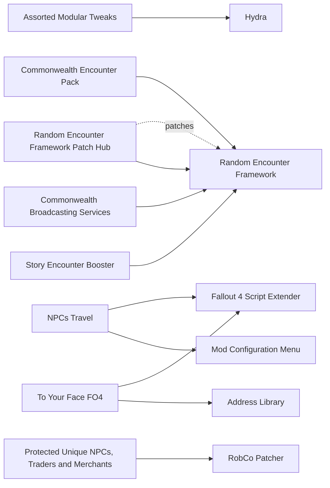

# Immersion and quality of life

NPC names and faces, sound and radio, lockpicking and trading shortcuts, fast travel and small friction removers. Since 1.11.240 landed in August 2026 the maintained DLLs have caught up (Classic Holstered Weapons 1.10 ships a 1.11.240 file), while several stalled on an earlier build and do not work: Baka Wait Anywhere, Remember Lockpick Angle and Vertibird Jump. Addictol already contains Sprint Stuttering Fix, Faster Workshop and Long Save Bug Fix, so never add those separately. The main risk is Lunar: NPC-variety mods such as Unique NPCs touch NPC and leveled-list records that Lunar owns.

## Pick one

| Choose between | Difference | Our pick |
| --- | --- | --- |
| Generic NPC faces: Diverse Wasteland AIO (main file), Unique NPCs - LITE, Unique NPCs | Unique NPCs conflicts with Lunar. Unique NPCs - LITE has Lunar patches. Diverse Wasteland adds memory load rather than script load | Neither |
| Settler dialogue: Settler and Companion Dialogue Overhaul or Icebreaker - Settler Dialogue | Both rewrite settler lines | Neither yet |
| Reverb: LOST Audio Tweaks or Reverb and Ambiance Overhaul | Both set per-cell reverb | Neither yet |

## Suggested stacks

| Profile | Take | Skip |
| --- | --- | --- |
| Lunar on a light machine | We Have Names (and more) - All In One, LOST Audio Tweaks, Ambient Tunnels, Get Out Of My Face, Fast Travel From Quest Hubs, Classic Holstered Weapons. Load the cell-editing ones before PRP | Unique NPCs, Alias - dynamic NPC names, QuickTrade Redux (script load) |
| Vanilla-plus speed, no Lunar | The Mobile Mechanic, No Door Animations, Easy Lockpicking, Weightless Junk and Other Items | Baka Wait Anywhere (no 1.11.240 build) |
| Radio lovers | Old World Radio - Boston, Old World Radio 2, Radium | Reverb and Ambiance Overhaul |
| Face variety | Diverse Wasteland AIO (main file only), or Unique NPCs - LITE with its Lunar patches | Unique NPCs |

## Our choice

The reference playthrough takes nothing from this page yet. These are light mods that can be added mid-game, so they come in a later batch, measured like the others. The research shortlist for that batch starts with We Have Names (forward Lunar's NPC edits in FO4Edit if they overlap), LOST Audio Tweaks and Get Out Of My Face.

<!-- BEGIN GENERATED: do not edit, run scripts/build_catalog.py -->
68 mods: 12 recommended, 41 optional, 15 avoid. Plugin slots if you take everything not marked avoid: 0 full.

### Recommended

| | Mod | What it does | Fit | Cost | Links |
| --- | --- | --- | --- | --- | --- |
|  | **[Classic Holstered Weapons](https://www.nexusmods.com/fallout4/mods/46101)** by shavkacagarikia · v1.10 · updated 2026-08-29 · 32,365 endorsements · 0.2 MB | Shows the holstered weapon on actors *1.10 (2026-08-29), '1.11.240 and F4SE 0.7.9'; One extra weapon model per actor; Lunar and modded weapons may need ini presets (unverified)* | `recommended` 1.11.240: yes F4SE DLL | perf med |  |
|  | **[To Your Face FO4](https://www.nexusmods.com/fallout4/mods/73259)** by underthesky and PK0 · v1.2 · updated 2025-12-02 · 3,220 endorsements · 0.1 MB | NPCs stop greeting you when they are behind you *Take the AE file; In 11 of 24 Wabbajack lists (2026-10); Gap audit 2026-10-29* | `recommended` 1.11.240: yes F4SE DLL | perf low | needs: Fallout 4 Script Extender, Address Library |
|  | **[Random Encounter Framework](https://www.nexusmods.com/fallout4/mods/60074)** by Glitchfinder · v1.02 · updated 2025-12-17 · 8,180 endorsements · 5 KB | Reorganizes the vanilla random-encounter story manager so mods can add encounters without overwriting each other *1.02 (2025-12-17), in The Midnight Ride; Dependency of CEP, CBS, Story Encounter Booster and the Warsaw Improved series; Side effect: fewer Nuka-World/Automatron encounters in the Commonwealth; Compatible with SKK Random Encounter Manager (REF FAQ); Plugin type (ESL or not) not stated* | `recommended` 1.11.240: plugin only | perf low | patches: Random Encounter Framework Patch Hub |
|  | **[Commonwealth Encounter Pack](https://www.nexusmods.com/fallout4/mods/77948)** by Glitchfinder · v1.03 · updated 2026-08-02 · 2,974 endorsements | Adds 422 random encounters across the Commonwealth, Far Harbor, Nuka-World and Automatron *1.03 (2026-08-02), ESL; Uses vanilla RE trigger points through REF, so it adds variety rather than more simultaneous spawns (inferred, not measured); Lunar interaction not checked in xEdit* | `recommended` 1.11.240: plugin only | perf low NPCs few 0 full / 1 light | needs: Random Encounter Framework |
|  | **[NPCs Travel](https://www.nexusmods.com/fallout4/mods/16987)** by aiueoooo · v3.0.1 · updated 2026-09-06 · 31,675 endorsements · 1.1 MB | Persistent travellers, traders and faction patrols that roam the Commonwealth, Far Harbor and Nuka-World *3.0.1 is a rewrite, not save-compatible with 2.x: new game; Main file 'Requires F4SE and MCM' (DLL not stated; a Non-F4SE 3.0.0a main file exists); For the M3: Large Group OFF (+10-15 actors per group), Fast Respawn OFF, hostile groups at 0 (default), optionally Wanderers 6 to 4; BoS patrol after the Prydwen arrives; Minutemen patrols at Castle + 6/12/18 settlements; Do not scrap its NPCs or corpses with other mods; Lunar NPC Travel patch was built for 2.9.x: check it in FO4Edit before adding; Anecdotal stutter report with Diverse Wasteland* | `recommended` 1.11.240: plugin only Lunar: patch | perf med scripts light NPCs many | needs: Fallout 4 Script Extender, Mod Configuration Menu conflicts: NPCs Travel - MCM Settings Menu, NPCs Travel - Fixes |
|  | **[We Have Names (and more) - All In One](https://www.nexusmods.com/fallout4/mods/74287)** by rsm000rsm · v15 · updated 2026-04-05 · 846 endorsements · 0.4 MB | Names, heights and settler functions for ~300 generic NPCs; restores 5 cut NPCs *v15 (2026-04-05); Overlaps Lunar NPC edits: check in xEdit and forward Lunar stats; Touches Bunker Hill caravan workers (check vs Radiant Caravans); Ships a BDR patch; The old plan link 74408 was wrong; Restored NPCs vs precombines not checked* | `recommended` 1.11.240: plugin only | perf low |  |
|  | **[Ambient Tunnels](https://www.nexusmods.com/fallout4/mods/66713)** by CalicoDE · v1.3 · updated 2024-05-14 · 1,278 endorsements · 15.6 MB | Dynamic tunnel ambience *Load before PRP (cell edits, unverified)* | `recommended` 1.11.240: plugin only | perf low |  |
|  | **[Fast Travel From Quest Hubs](https://www.nexusmods.com/fallout4/mods/60543)** by Glitchfinder · v1.04 · updated 2025-12-29 · 1,191 endorsements · 73 KB | Fast travel straight into hubs such as the Prydwen and the Castle *1.04 (2025-12); Fewer load screens helps on Wine; Load faction-location mods after it* | `recommended` 1.11.240: plugin only | perf  |  |
|  | **[Get Out Of My Face](https://www.nexusmods.com/fallout4/mods/20353)** by CDante · v2.21 · updated 2026-10-24 · 8,441 endorsements · 17.6 MB | Push perk for NPCs blocking doors *2.21 (2026-10-24), 'every game version; Anniversary'; Runs on key press* | `recommended` 1.11.240: yes | perf low |  |
|  | **[LOST Audio Tweaks](https://www.nexusmods.com/fallout4/mods/38448)** by Mortercotic · v7.1 · updated 2026-09-13 · 5,155 endorsements · 129.3 MB | Many sound fixes and per-cell reverb *7.1 (2026-09-13); Edits cells: load before PRP; Includes the useful part of RAO* | `recommended` 1.11.240: plugin only | perf low |  |
|  | **[Random Encounter Cell Reset Fix](https://www.nexusmods.com/fallout4/mods/107194)** by Glitchfinder · v1.00 · updated 2026-09-07 · 175 endorsements | Makes every RE spawn point ignore cell resets so encounters cannot stack on the same spot *1.00 (2026-09-07) by Glitchfinder, ESL, safe mid-game; Fixes all Far Harbor and Nuka-World points and three base-game ones; Preventive only* | `recommended` 1.11.240: plugin only | perf low 0 full / 1 light |  |
|  | **[Random Encounter Framework Patch Hub](https://www.nexusmods.com/fallout4/mods/67757)** by Glitchfinder · v1.06 · updated 2026-08-16 · 2,539 endorsements · 34 KB | Patches other random-encounter mods to use REF so their encounters stop overwriting each other *1.06 (2026-08-16), ESL patches; FOMOD auto-detects supported mods; patched-mod list is in the Nexus comments (not read); Only needed when a non-REF RE mod is installed* | `recommended` 1.11.240: plugin only | perf low | needs: Random Encounter Framework |

### Optional

| | Mod | What it does | Fit | Cost | Links |
| --- | --- | --- | --- | --- | --- |
|  | **[Holstered Weapon Light Fix](https://www.nexusmods.com/fallout4/mods/107059)** by Zzyxzz · v2.0.1 · updated 2026-09-28 · 313 endorsements · 0.4 MB | Fixes lights on holstered weapons *2.0.1 (2026-09-28); Companion to CHW; AE file published after 1.11.240; support inferred from date only* | `optional` 1.11.240: unknown F4SE DLL | perf low |  |
|  | **[Castle to Spectacle Island Ferry](https://www.nexusmods.com/fallout4/mods/47091)** by El Ha · v1.2 · updated 2021-10-09 · 659 endorsements · 1.1 MB | Repairable ferry between the Castle and Spectacle Island *2021, niche; Castle cell overlap with Castle Walls Restored unverified* | `optional` 1.11.240: unknown | perf  |  |
|  | **[Commonwealth Broadcasting Services](https://www.nexusmods.com/fallout4/mods/85536)** by Glitchfinder · v1.01 · updated 2026-07-21 · 561 endorsements | Random encounters with wandering eyebots that play the radio stations you have *1.01 (2026-07-21), ESL; Pure flavour (Classical, Diamond City Radio, Radio Freedom, emergency broadcast, Silver Shroud); negligible cost* | `optional` 1.11.240: plugin only | perf low NPCs few 0 full / 1 light | needs: Random Encounter Framework |
|  | **[Commonwealth Small Wildlife](https://www.nexusmods.com/fallout4/mods/101256)** by 2GTANDKNIVES · v1 · updated 2026-02-11 · 161 endorsements · 93.7 MB | Harvestable background critters: chickens, rabbits, radcoons, iguanas, rodents *1 (2026-02-11), ESL; Light alternative to Mutant Menagerie; Precombine impact not stated* | `optional` 1.11.240: plugin only | perf low NPCs few 0 full / 1 light |  |
|  | **[Diverse Wasteland AIO](https://www.nexusmods.com/fallout4/mods/86316)** by rsm000rsm · v23 · updated 2026-04-05 · 1,042 endorsements · 4.7 MB | 4,130 face templates for generic NPC pools *v23 (2026-04-05); The Immersion Pack rewrites faction outfit leveled lists that Lunar owns; WATM patches exist; One anecdotal crash/stutter report with NPCs Travel; Pick this or Unique NPCs LITE* | `optional` 1.11.240: plugin only | perf med |  |
|  | **[Icebreaker - Settler Dialogue](https://www.nexusmods.com/fallout4/mods/25972)** by Blocky · v1.0.3 · updated 2017-12-29 · 6,406 endorsements · 4.8 MB | 400+ recombined settler lines *Overlaps SCDO on settlers: pick one* | `optional` 1.11.240: plugin only | perf low |  |
|  | **[Level 4 Merchants Improved](https://www.nexusmods.com/fallout4/mods/40747)** by Drag0nRex · v1.0.5 · updated 2020-10-06 · 627 endorsements | Random-encounter level 4 merchants can also be found at the Dugout Inn; holotape for remote barter *1.0.5 (2020); Edits around the Dugout Inn: check vs Diamond City Expansion; precombine impact not stated* | `optional` 1.11.240: plugin only | perf low scripts light NPCs few |  |
|  | **[Nomads (Wandering Settlers and Lost Robots)](https://www.nexusmods.com/fallout4/mods/59938)** by RlBaxter · v4.5 · updated 2026-03-13 · 391 endorsements · 0.7 MB | Rare wandering recruitable settlers, scavengers, some hostiles and lost robots from 300 spawn points *4.5 (2026-03-13); Slow spawn rate by design; Recruitment vs SS2 untested; precombine impact not stated; Holotape stats can be wrong (known issue)* | `optional` 1.11.240: plugin only | perf low scripts light NPCs few |  |
|  | **[Scavver faction RedRocket workshops](https://www.nexusmods.com/fallout4/mods/51448)** by SKKmods · v007 · updated 2026-08-10 · 507 endorsements · 17.0 MB | A Scavver faction holds four Red Rocket workshops with outposts and patrols *v007 (2026-08-10) by SKK; SS2 v2 'not tested'; registers new workshops (removing it later corrupts the workshop system); roof navmesh touches neighbour cells; Not for our SS2 list* | `optional` 1.11.240: plugin only | perf med scripts light NPCs many |  |
|  | **[Story Encounter Booster](https://www.nexusmods.com/fallout4/mods/86193)** by Glitchfinder · v1.00 · updated 2024-07-29 · 903 endorsements · 2 KB | Makes Bethesda's story and quest tie-in random encounters easier to find *1.00 (2024-07-29), ESL; Three files (Interesting / Story / Tie-In), usable together; With CEP's 422 encounters, the Story file keeps vanilla stories from being drowned out (my reasoning, not tested)* | `optional` 1.11.240: plugin only | perf low 0 full / 1 light | needs: Random Encounter Framework |
|  | **[Unique NPCs - LITE](https://www.nexusmods.com/fallout4/mods/61205)** by WhiskyTangoFox · v1.5 · updated 2024-06-18 · 917 endorsements · 0.6 MB | Lighter Unique NPCs with face variety *Ships Lunar patches (Lunar, Lunar+Fresh Facials); Overlaps Diverse Wasteland: pick one* | `optional` 1.11.240: plugin only Lunar: patch | perf med |  |
|  | **[WRVR - radio plus DJ companion](https://www.nexusmods.com/fallout4/mods/12377)** by Casey Mongillo · v1.6b · updated 2016-12-27 · 4,374 endorsements · 56.1 MB | Radio station with a female DJ companion *1.6b 'preview' (2016); untested* | `optional` 1.11.240: plugin only | perf low |  |
|  | **[Alias - dynamic NPC names](https://www.nexusmods.com/fallout4/mods/66355)** by WhiskyTangoFox · v2.7 · updated 2024-10-13 · 1,200 endorsements · 0.4 MB | Random names for raiders, settlers and creatures *Needs F4 SPID; its 1.11.240 status not checked; A script per spawned NPC (CPU flag); Zero patching via quest aliases* | `optional` 1.11.240: unknown | perf med scripts light |  |
|  | **[Ambient Wasteland](https://www.nexusmods.com/fallout4/mods/25343)** by Spifferino · v1.0.0 · updated 2017-07-07 · 7,278 endorsements · 14.1 MB | Region ambience sounds | `optional` 1.11.240: plugin only | perf low |  |
|  | **[Assorted Modular Tweaks](https://www.nexusmods.com/fallout4/mods/84440)** by bp42s - SoleVaultBoy · v1.6.2 · updated 2026-05-25 · 1,987 endorsements · 1 KB | ESP-less pack of micro tweaks (no ironsight blur, faster terminals, ragdoll force, brass, tutorial) *Requires Hydra (104159, already in catalogue); TMR config file available; In 9 of 24 Wabbajack lists (2026-10); Gap audit 2026-10-29* | `optional` 1.11.240: plugin only | perf low | needs: Hydra |
|  | **[AtomRadio111 BoS Scribe Relay](https://www.nexusmods.com/fallout4/mods/105403)** by AtomRadio76 · v1 · updated 2026-05-27 · 5 endorsements · 158.7 MB | 100-song Brotherhood morale radio station from FO76 *Report verdict: unverified, too small to rate (5 end., 2026-05); Tier set to optional by default* | `optional` 1.11.240: plugin only | perf  0 full / 1 light |  |
|  | **[Auto Lockpick](https://www.nexusmods.com/fallout4/mods/45145)** by tesnexus8 · v1.2 · updated 2020-05-23 · 1,462 endorsements · 2 KB | Skips the lockpicking minigame *Taste; Interaction with Lunar perk balance not checked* | `optional` 1.11.240: plugin only | perf low |  |
|  | **[Automatically Lowered Weapons](https://www.nexusmods.com/fallout4/mods/20093)** by pauderek · v1.4 · updated 2017-08-03 · 20,710 endorsements · 4 KB | Lowers the weapon when out of combat *In 12 of 24 Wabbajack lists (2026-10); Gap audit 2026-10-29* | `optional` 1.11.240: plugin only | perf low scripts light |  |
|  | **[Caravan AI Tweak](https://www.nexusmods.com/fallout4/mods/29326)** by Mr Jose  Cuervo · v1.0 · updated 2018-01-23 · 656 endorsements · 1 KB | Caravan leaders and guards sandbox a wider area (bars, campfires) in settlements *1.0 (2018); Pointless with Radiant Caravans; We Have Names also edits Bunker Hill caravan workers: check order in FO4Edit* | `optional` 1.11.240: plugin only | perf low |  |
|  | **[Easy Lockpicking](https://www.nexusmods.com/fallout4/mods/227)** by The Iron Rose · v1.0 · updated 2015-11-12 · 33,240 endorsements · 0 KB | Makes the lockpicking minigame easier *Taste; Interaction with Lunar perk balance not checked* | `optional` 1.11.240: plugin only | perf low |  |
|  | **[Immersive Generic Dialogues](https://www.nexusmods.com/fallout4/mods/14108)** by Anbeegod · v1.03c · updated 2016-07-29 · 5,287 endorsements · 21 KB | Reputation-based generic NPC greetings *No scripts, no world edits* | `optional` 1.11.240: plugin only | perf low |  |
|  | **[Loot Detector](https://www.nexusmods.com/fallout4/mods/4380)** by xatmos · v3800 · updated 2018-06-07 · 20,299 endorsements · 89 KB | Lootables glow with the Scrapper perk *Touches a perk (unverified vs Lunar perks)* | `optional` 1.11.240: plugin only | perf low |  |
|  | **[Minutemen Radio Extended](https://www.nexusmods.com/fallout4/mods/5062)** by TheButlerFinch · v1.0 · updated 2015-12-08 · 3,007 endorsements · 0.5 MB | More songs on Radio Freedom | `optional` 1.11.240: plugin only | perf low |  |
|  | **[Musical Lore](https://www.nexusmods.com/fallout4/mods/14531)** by Nir Shor · v1.6 · updated 2020-05-24 · 2,793 endorsements · 19.8 MB | 7 lore-friendly music tracks | `optional` 1.11.240: plugin only | perf low |  |
|  | **[No Door Animations](https://www.nexusmods.com/fallout4/mods/63224)** by Bunslinger · v4.0 · updated 2025-11-18 · 1,563 endorsements · 0.8 MB | Doors open instantly *Less immersive* | `optional` 1.11.240: plugin only | perf low |  |
|  | **[Old World Radio - Boston](https://www.nexusmods.com/fallout4/mods/9048)** by Brandoman neeher and cdante · v6.02 · updated 2021-05-31 · 32,016 endorsements · 132.3 MB | 29 voiced radio stations and craftable radios *Mixed lore fit (celebrity, comedy and NIN stations): pick stations in the FOMOD; Craftables only, no world edits found* | `optional` 1.11.240: plugin only | perf low |  |
|  | **[Old World Radio 2](https://www.nexusmods.com/fallout4/mods/28711)** by Brandoman CDante and Neeher · v1.3 · updated 2018-12-30 · 4,790 endorsements · 1294.1 MB | Sequel radio stations *Mixed lore fit; precombine impact unknown* | `optional` 1.11.240: plugin only | perf low |  |
|  | **[Pip-Boy Flashlight](https://www.nexusmods.com/fallout4/mods/10840)** by AKcelsior · v5.0.2 · updated 2018-08-06 · 66,485 endorsements · 31.2 MB | Replaces the Pip-Boy light with a real wide or spot light *Shadow-casting variants cost GPU frames on an M3: pick a non-shadow option; Untested with Lunar* | `optional` 1.11.240: plugin only | perf med |  |
|  | **[Player Comments and Head Tracking](https://www.nexusmods.com/fallout4/mods/22166)** by Gargorias · v2.65 · updated 2025-09-07 · 14,807 endorsements · 4.0 MB | Player character comments on events and tracks NPCs with head movement *In 3 of 24 Wabbajack lists (2026-10); Gap audit 2026-10-29* | `optional` 1.11.240: plugin only | perf med scripts heavy |  |
|  | **[Protected Unique Brahmin](https://www.nexusmods.com/fallout4/mods/41205)** by Nix · v1 · updated 2019-09-19 · 615 endorsements · 3 KB | Unique brahmin, including Trashcan Carla's, are protected and respawn *1 (2019), ESL* | `optional` 1.11.240: plugin only | perf low 0 full / 1 light |  |
|  | **[Protected Unique NPCs, Traders and Merchants](https://www.nexusmods.com/fallout4/mods/69941)** by Aurelianis · v1.1 · updated 2023-03-25 · 666 endorsements · 1 KB | Merchants cannot be killed by NPCs *Depends on RobCo Patcher (STEP: unstable on AE, March 2026); Only if RobCo Patcher is kept* | `optional` 1.11.240: unknown F4SE DLL | perf low | needs: RobCo Patcher |
|  | **[Publick Occurrences Expanded](https://www.nexusmods.com/fallout4/mods/15804)** by doswillrule · v3.6.2 · updated 2026-01-16 · 4,397 endorsements · 1.2 MB | Diamond City newspaper with issues reacting to your progress *In 5 of 24 Wabbajack lists (2026-10); Gap audit 2026-10-29* | `optional` 1.11.240: plugin only | perf low scripts light 0 full / 1 light |  |
|  | **[QuickTrade Redux](https://www.nexusmods.com/fallout4/mods/41101)** by Dylbill · v1.9.2 · updated 2019-10-23 · 3,379 endorsements | Adds a Trade option when activating merchants *Injects the menu on nearby merchants as you approach; Untested with Lunar* | `optional` 1.11.240: plugin only | perf med scripts light |  |
|  | **[Radiant Birds](https://www.nexusmods.com/fallout4/mods/2397)** by Indipindi · vv0.5 · updated 2016-03-25 · 9,134 endorsements · 0.7 MB | Real bird sounds with volume and distance fixes *0.5 (2016); Sound only; A quieter add-on exists (16296)* | `optional` 1.11.240: plugin only | perf low |  |
|  | **[Radium](https://www.nexusmods.com/fallout4/mods/58864)** by Jared Alexander Johnson · v2.7.1 · updated 2023-08-21 · 1,650 endorsements · 113.8 MB | 31 lore-friendly ambient music tracks | `optional` 1.11.240: plugin only | perf low |  |
|  | **[Recruit Random Encounter Settlers and Farmers](https://www.nexusmods.com/fallout4/mods/59098)** by LarannKiar · v1.0 · updated 2022-03-25 · 1,047 endorsements · 5.5 MB | Lets you recruit random-encounter settlers and farmers *1.0 (2022); Author: overwrites no vanilla record, works with RE mods and UFO4P* | `optional` 1.11.240: plugin only | perf low scripts light |  |
|  | **[SAICC](https://www.nexusmods.com/fallout4/mods/43147)** by gyashaa · v1 · updated 2026-10-15 · 271 endorsements · 9 KB | No spouse comments during character creation *Pointless with an alternate start* | `optional` 1.11.240: plugin only | perf  |  |
|  | **[Settlers Go Shopping](https://www.nexusmods.com/fallout4/mods/47971)** by LarannKiar · v2.7 · updated 2023-11-21 · 3,651 endorsements · 20.8 MB | Settlers visit settlement stores and chat with vendors; adds store and shopping mats *2.7 (2023); Behaviour with SS2 shops untested* | `optional` 1.11.240: plugin only | perf low scripts light |  |
|  | **[Simple Wait Anywhere](https://www.nexusmods.com/fallout4/mods/55597)** by m8r98a4f2 · v1.1 · updated 2022-06-01 · 3,200 endorsements · 2 KB | Wait anywhere via an item | `optional` 1.11.240: plugin only | perf low |  |
|  | **[Sound of Silence](https://www.nexusmods.com/fallout4/mods/9472)** by franchiceddhu90 · v2.2 · updated 2026-08-01 · 2,485 endorsements | Mutes chosen music themes *Taste* | `optional` 1.11.240: plugin only | perf low |  |
|  | **[The Mobile Mechanic](https://www.nexusmods.com/fallout4/mods/18262)** by fadingsignal · v2.0.2 · updated 2026-10-26 · 6,443 endorsements · 37.7 MB | Portable workbenches *2.0.2 (2026-10-26), 'Anniversary Edition'; Weakens scarcity under Lunar; Author says it works with the Anniversary Edition (1.11.240 not named); Gated behind Local Leader + Scrapper; a convenience against Lunar's balance* | `optional` 1.11.240: yes | perf low |  |

### Avoid

| | Mod | What it does | Fit | Cost | Links |
| --- | --- | --- | --- | --- | --- |
|  | **[Baka Wait Anywhere](https://www.nexusmods.com/fallout4/mods/52723)** by shad0wshayd3 · v3.0.0 · updated 2025-11-21 · 2,346 endorsements · 2.8 MB | Wait without a seat *3.0.0 file says 1.11.159.0; treat as not working on 1.11.240; Use Simple Wait Anywhere* | `avoid` 1.11.240: **no** F4SE DLL | perf low |  |
|  | **[Remember Lockpick Angle](https://www.nexusmods.com/fallout4/mods/42421)** by battlebrother13 · v1.10.163 · updated 2019-12-11 · 3,090 endorsements · 0.1 MB | Keeps the lockpick angle between attempts *DLL for 1.10.163 only* | `avoid` 1.11.240: **no** F4SE DLL | perf  |  |
|  | **[Unlimited Fast Travel - F4SE](https://www.nexusmods.com/fallout4/mods/26161)** by Kassent · vv1.5.0 · updated 2024-05-11 · 5,189 endorsements · 0.1 MB | Fast travel from anywhere *1.5.0 (2024-05) claims all versions but predates AE; Breaks immersion* | `avoid` 1.11.240: unknown F4SE DLL | perf  |  |
|  | **[Vertibird Jump](https://www.nexusmods.com/fallout4/mods/20190)** by registrator2000 · v1.9.9 · updated 2019-12-11 · 4,313 endorsements · 0.2 MB | Jump out of vertibirds *DLL for 1.10.163 only* | `avoid` 1.11.240: **no** F4SE DLL | perf  |  |
|  | **[Immersive Vendors](https://www.nexusmods.com/fallout4/mods/10039)** by Xgrufijury · v3.00 · updated 2017-07-02 · 39,151 endorsements · 8.9 MB | Shop goods displayed on shelves *Places refs in shop cells (Diamond City market): precombines unverified; overlaps Diamond City Expansion* | `avoid` 1.11.240: plugin only | perf  scripts light |  |
|  | **[More Wildlife](https://www.nexusmods.com/fallout4/mods/51503)** by El Ha · v1.2 · updated 2025-08-24 · 1,002 endorsements · 0.7 MB | More creature spawns *1.2 (2025-08); Its own author points to Mutant Menagerie as better* | `avoid` 1.11.240: plugin only | perf med NPCs many |  |
|  | **[Populated Diamond City](https://www.nexusmods.com/fallout4/mods/36180)** by King_Derpy101 · v1.0.0 · updated 2018-12-01 · 348 endorsements · 12 KB | Adds cloned residents and extra workbenches to the Diamond City market *1.0.0 (2018); Edits the same space as Diamond City Expansion and its eXoPatch; precombine impact unknown* | `avoid` 1.11.240: plugin only | perf med NPCs many | conflicts: Diamond City Expansion |
|  | **[Scavengers](https://www.nexusmods.com/fallout4/mods/33098)** by i73fi · vv3 · updated 2018-07-14 · 628 endorsements · 0.5 MB | Places scavenger groups around the Commonwealth and Far Harbor *v3 (2018); Author warns low-end PCs slow down; precombine impact unknown; overlaps Starts Dead Alive's scavengers* | `avoid` 1.11.240: plugin only | perf high NPCs many |  |
|  | **[Unique NPCs](https://www.nexusmods.com/fallout4/mods/21248)** by Thirdstorm and DOZENS of contributors · vv2.1 · updated 2018-08-28 · 12,273 endorsements · 6770.4 MB | Bodies, skins, faces for 2,700 NPCs plus outfit leveled lists *Heavy clash with Lunar's leveled lists; 300+ skin textures* | `avoid` 1.11.240: plugin only Lunar: conflict | perf high |  |
|  | **[Caravan Trading Post - Enhanced](https://www.nexusmods.com/fallout4/mods/23602)** by 5like · v1.0a · updated 2017-04-19 · 559 endorsements · 3.7 MB | Buildable per-caravan trading posts and guard markers *1.0a (2017); Part of Thematic and Practical; SS2 caravan plots cover the need* | `avoid` 1.11.240: plugin only | perf low scripts light |  |
|  | **[Music Mods Merged](https://www.nexusmods.com/fallout4/mods/20361)** by Multiple Authors--see credits · v4.0 · updated 2024-12-07 · 1,114 endorsements · 69 KB | Merge of music mods *Not save safe and excludes other music mods* | `avoid` 1.11.240: plugin only | perf low |  |
|  | **[NPCs Travel - MCM Settings Menu](https://www.nexusmods.com/fallout4/mods/56311)** by m8r98a4f2 · v1.0 · updated 2021-12-05 · 3,625 endorsements · 1.8 MB | External MCM menu for NPCs Travel 2.x *2021; Obsolete: NPCs Travel 3.0.1 ships its own MCM* | `avoid` 1.11.240: plugin only | perf low scripts light | conflicts: NPCs Travel |
|  | **[Reverb and Ambiance Overhaul](https://www.nexusmods.com/fallout4/mods/10189)** by mm137 · v1.6e · updated 2016-09-06 · 44,797 endorsements · 45 KB | Reverb and ambience per cell *LOST Audio Tweaks already includes the useful part; cell edits that PRP must win* | `avoid` 1.11.240: plugin only | perf low |  |
|  | **[NPCs Travel - Fixes](https://www.nexusmods.com/fallout4/mods/48951)** by Sedevacantist · v1 · updated 2020-12-16 · 1,528 endorsements · 1 KB | Two small fixes for NPCs Travel 2.x actors *2020; Targets 2.x records; NPCs Travel 3.0 is a rewrite; Same for the ESL repack 89132* | `avoid` 1.11.240: plugin only | perf low | conflicts: NPCs Travel |
|  | **[Random Encounters Cooldown](https://www.nexusmods.com/fallout4/mods/36383)** by Ingvion · v1.3 · updated 2019-10-07 · 178 endorsements · 24 KB | Adds a real cooldown between random encounters by replacing two vanilla scripts *1.3 (2019), loose script overrides (rescript, reparentscript); Untested with UFO4P and REF; superseded by the REF ecosystem* | `avoid` 1.11.240: plugin only | perf low scripts light |  |

### Dependencies and patches

<!-- END GENERATED -->
