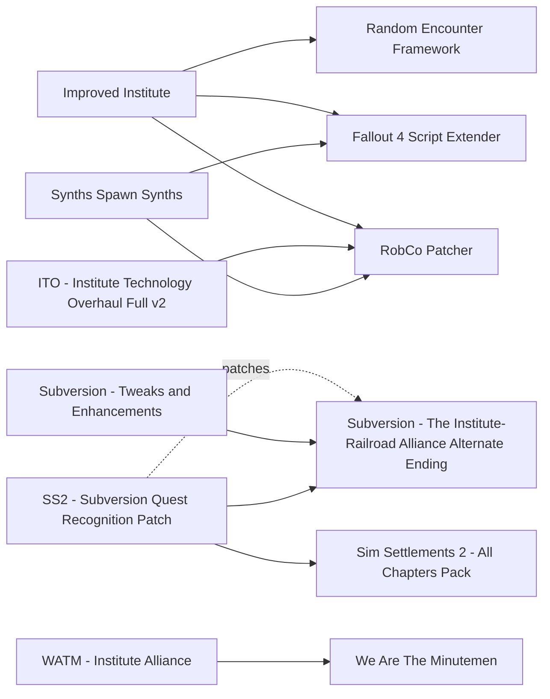

# The Institute

Synth and Courser combat, Institute gear, endings and the Institute interior. One maintained overhaul exists in late 2026, Improved Institute 3.1.1 (2026-08-30), built on F4SE and RobCo Patcher like the rest of the "Improved" series; everything else is plugin only and mostly frozen between 2016 and 2023. The value is in the endings: Subversion (2023) is the only mod that lets an Institute or Railroad run end with the other factions alive. The main risk is Lunar: synth gear packs (Synth Overhaul - C.A.S.T., Synthetic Variations, ITO - Institute Technology Overhaul Full v2) and Improved Institute's synth templates override Lunar's balance.

## Pick one

| Choose between | Difference | Our pick |
| --- | --- | --- |
| Relay-grenade backup: Improved Institute or Synths Spawn Synths | Both give synths and Coursers relay grenades through RobCo Patcher | Neither |
| Courser AI: Deadly Coursers (Simplified Courser Crusher) or Courser Crusher | Deadly Coursers is the AI only; Courser Crusher adds the V3N rifle. Both edit Courser NPC records | Neither |
| Synth gear and variety: Lunar or Improved Institute, versus Synth Overhaul - C.A.S.T., Synthetic Variations, ITO - Institute Technology Overhaul Full v2 | All edit the same synth leveled lists and templates | Lunar |
| Alternate endings: Subversion (+ Father Companion - Alternate Ending Option), America Rising 2, Diary of a Madman | Subversion and America Rising 2 do not recognise each other (Reddit, 2025-11): play one at a time | America Rising 2 (quests page) |
| Factionless access: Radiant Institute or Factionless Institute Access | Radiant Institute is the 2026 one | Neither |
| Start: Synthetic Player (SKK) or any alternate start (Start Me Up Redux, SKK Fast Start New Game) | The author says they are not compatible | Neither |

## Suggested stacks

| Profile | Take | Skip |
| --- | --- | --- |
| BoS or Minutemen run on Lunar | Deadly Coursers (Simplified Courser Crusher), Recruit Institute Scientists and Synths as Settlers, Father Companion - Alternate Ending Option, Defective Synths | Synth Overhaul - C.A.S.T., Synthetic Variations, ITO - Institute Technology Overhaul Full v2, Phase 4 - An Institute Expansion (previs risk) |
| Institute Director | Improved Institute, ITO - Institute Technology Overhaul Full v2 + Institute Power Armor HD Reboot, Subversion + Subversion - Tweaks and Enhancements, Father Companion - Alternate Ending Option, Move Shaun - Institute Ending Settlement Relocation, Phase 4 - An Institute Expansion, Faction Housing Overhaul - Director's Quarters, Better Synth Relay Grenades, Allow Companions Into Institute, Institute Radiant Quests Are Side Quests | Synths Spawn Synths |
| Hard anti-Institute run | Improved Institute (all modules), Courser Crusher, Synth Settler Detector | Synths Spawn Synths (duplicates Improved Institute's grenades), Deadly Coursers |
| Light touch | Institute Pulse Carbine, Deadly Coursers (Simplified Courser Crusher), Deeper Thoughts - Curie | Improved Institute |

## Our choice

The reference playthrough takes nothing from this page. The ending stays open through A New Dawn and Delay Tactical Thinking, and Improved Institute stays out with the rest of the RobCo-based "Improved" series. Our sources disagree on Subversion: the Institute research ranks it first because it keeps a non-destructive ending available, the Railroad research skips it because its BoS "peace" replaces Maxson with a synth. Take it if you want an Institute ending that spares the other factions, and save before Airship Down.

<!-- BEGIN GENERATED: do not edit, run scripts/build_catalog.py -->
44 mods: 5 recommended, 29 optional, 10 avoid. Plugin slots if you take everything not marked avoid: 0 full.

### Recommended

| | Mod | What it does | Fit | Cost | Links |
| --- | --- | --- | --- | --- | --- |
|  | **[Deadly Coursers (Simplified Courser Crusher)](https://www.nexusmods.com/fallout4/mods/88843)** by WhiskyTangoFox · v1 · updated 2024-11-01 · 166 endorsements · 29 KB | Courser Crusher's teleport and overcharge AI only, without the new weapon *Our pick over Courser Crusher; No leveled-list edits, so Lunar-safe (inferred, not checked in xEdit); Skip if Improved Institute already makes Coursers hard enough* | `recommended` 1.11.240: plugin only | perf low | conflicts: Courser Crusher |
|  | **[Improved Institute](https://www.nexusmods.com/fallout4/mods/76757)** by Warsaw · v3.1.1 · updated 2026-08-30 · 1,537 endorsements · 6.3 MB | Overhauls Institute synths and Coursers: armored synths, relay-grenade backup, new elite units, faction perks and REF assault encounters *Tier depends on the RobCo Patcher test run for Improved Minutemen (same author and stack); Dependencies claim AE (RobCo 6.0.6 OG/NG/AE; SPID AE 3.1.1 1.11.137+, only for some FOMOD options) but 1.11.240 is not confirmed and STEP 1.1 called RobCo unstable on AE; Its ESP edits vanilla synth templates and overrides Lunar: load Lunar after it or install only the Encounters + Faction Boss modules (our plan at first); xEdit check pending; Pick one with Synths Spawn Synths; Teleport feature in the summary is not in the current description (unverified)* | `recommended` 1.11.240: unknown F4SE DLL Lunar: conflict | perf med NPCs few | needs: Fallout 4 Script Extender, RobCo Patcher, Random Encounter Framework conflicts: Synths Spawn Synths |
|  | **[Recruit Institute Scientists and Synths as Settlers](https://www.nexusmods.com/fallout4/mods/70989)** by LarannKiar · v1.1 · updated 2023-05-25 · 334 endorsements · 39.6 MB | After the Institute is destroyed, 30+ voiced survivors at Fraternal Post 115 can be recruited as settlers *Gives Institute survivors a place after a BoS, Minutemen or Railroad ending; Lunar-neutral; no vanilla quest overwritten; Adds NPCs at an exterior site: check Fraternal Post 115 in xEdit for precombine edits* | `recommended` 1.11.240: plugin only | perf low NPCs many |  |
|  | **[Subversion - The Institute-Railroad Alliance Alternate Ending](https://www.nexusmods.com/fallout4/mods/50975)** by Toro Montana · v4.0B · updated 2023-04-04 · 3,962 endorsements · 723.6 MB | Alternate ending allying the Institute and the Railroad *Changes the faction ending: avoid for a BoS + Minutemen run; Only named in the report's conflict list; Opens endings rather than locking one: the BoS survives under a synth Elder (or an armistice with the West Coast BoS); Activates only at the end of the main quest; save before Airship Down (the skip works only before talking to Madison Li or Evan Watson); Railroad report: Optional for us, since it opens only through the Institute route and its BoS peace means a synth Maxson; Not tested on 1.11.x (Reddit 2026-01: 'should be fine'); Alters vanilla scripts; Do not combine with America Rising 2 or other keep-all-factions mods; coexists with Project Valkyrie but only one ending can be completed; Check PAM terminal overlap with Delay Tactical Thinking* | `recommended` 1.11.240: unknown SS2: patch | perf low | patches: SS2 - Subversion Quest Recognition Patch |
|  | **[Subversion - Tweaks and Enhancements](https://www.nexusmods.com/fallout4/mods/74173)** by ashjay101 · v1.0 · updated 2023-08-24 · 304 endorsements · 0.4 MB | Stops the BoS attacking the Railroad after a peaceful Tactical Thinking and fixes companion reactions after Subversion endings *Add with Subversion; The peaceful Tactical Thinking route relies on Danse Dilemma or the deleted Spare Railroad mod* | `recommended` 1.11.240: plugin only | perf low | needs: Subversion - The Institute-Railroad Alliance Alternate Ending |

### Optional

| | Mod | What it does | Fit | Cost | Links |
| --- | --- | --- | --- | --- | --- |
|  | **[Allow Companions Into Institute](https://www.nexusmods.com/fallout4/mods/12683)** by EternalLegend · vV1.1 · updated 2016-11-11 · 1,004 endorsements · 32 KB | Companions can follow you into the Institute *Author: minimal conflicts; New Director's Quarters reportedly conflicts* | `optional` 1.11.240: plugin only | perf low |  |
|  | **[Better Synth Relay Grenades](https://www.nexusmods.com/fallout4/mods/6485)** by StiffyWoods · v10.1 · updated 2026-05-09 · 2,438 endorsements · 15 KB | Craftable relay grenades that summon levelled synth squads commanded by holotape *Author: should be compatible with everything; Updated 2026-05* | `optional` 1.11.240: plugin only | perf med NPCs few |  |
|  | **[Courser Crusher](https://www.nexusmods.com/fallout4/mods/24981)** by Trainwiz and Niero · v1.2 · updated 2017-11-20 · 4,025 endorsements · 86.9 MB | Coursers teleport, dodge and overcharge, with boss mechanics and the V3N Courser bio-rifle *Best boss-Courser mod, but its rifle and leveled-list entries pull against Lunar's weapon balance; Edits Courser NPC records: load after other Courser edits; Diverse Coursers needs a patch (status unknown); ITO v2 ships a patch; 2017* | `optional` 1.11.240: plugin only | perf low | conflicts: Deadly Coursers (Simplified Courser Crusher) |
|  | **[Defective Synths](https://www.nexusmods.com/fallout4/mods/61040)** by EvTital · v3.1 · updated 2025-08-04 · 2,008 endorsements · 134.0 MB | Adds zombie-like failed synths that spawn alongside feral ghouls *Injected into ghoul lists by script; author says compatible with most ghoul mods; Cheap enemy variety* | `optional` 1.11.240: plugin only | perf low NPCs few |  |
|  | **[Diary of a Madman](https://www.nexusmods.com/fallout4/mods/45546)** by Project Valkyrie Discord Server · v1.0 · updated 2020-07-03 · 2,451 endorsements · 13 KB | Six quests to finish the game without any faction by destroying each faction's base *Avoid for us: adds destructive outcomes (Castle, Railroad HQ, Diamond City, Institute, Prydwen); Precombine impact unknown; Do not combine with Subversion or America Rising 2* | `optional` 1.11.240: plugin only | perf low |  |
|  | **[Diverse Coursers](https://www.nexusmods.com/fallout4/mods/78724)** by rsm000rsm · v10 · updated 2026-02-28 · 170 endorsements · 59 KB | Gives generic Coursers a pool of 50 faces *Cosmetic; Edits Courser actor records, so it conflicts with Courser Crusher unless patched (patch status unknown)* | `optional` 1.11.240: plugin only | perf low |  |
|  | **[Faction Housing Overhaul - All In One](https://www.nexusmods.com/fallout4/mods/15814)** by Elianora · v1.2 · updated 2016-07-12 · 9,711 endorsements · 90.3 MB | Faction player quarters in the Institute, Prydwen, Vault 81, Railroad HQ and a General's room in the Castle tunnels *More useful than the Director-only file for a BoS + Minutemen player; Touches the Castle tunnels: check against Castle mods (unverified); Its Railroad HQ part is reported defective (empty worldspace, r/fo4 2026-02): use the standalone Railroad HQ file instead; Not compatible with Railroad HQ Redux; Cell edits vs PRP unchecked* | `optional` 1.11.240: plugin only | perf low | conflicts: Railroad HQ Redux |
|  | **[Faction Housing Overhaul - Director's Quarters](https://www.nexusmods.com/fallout4/mods/15767)** by Elianora · v1.1 · updated 2016-06-30 · 4,620 endorsements · 22.8 MB | Functional Director's quarters in the Institute *2016; Cell edits: check against PRP (unverified)* | `optional` 1.11.240: plugin only | perf low |  |
|  | **[Father Companion - Alternate Ending Option](https://www.nexusmods.com/fallout4/mods/35198)** by Toro Montana · v6.0B · updated 2022-04-18 · 3,104 endorsements · 1304.8 MB | Cure Father and recruit him as a companion; Shaun escapes on anti-Institute paths; extra ending slides *By the Subversion author and designed alongside it; works on every faction path; No vanilla forms edited; Partial support for Project Valkyrie, Conquer the Institute and Galac-Tac* | `optional` 1.11.240: plugin only | perf low |  |
|  | **[Institute Centaurs](https://www.nexusmods.com/fallout4/mods/41476)** by HcG x Grill TheFriedturkey · v1.0 · updated 2019-10-08 · 5,029 endorsements · 63.0 MB | Restores the cut FEV centaur creature alongside super mutants *Injected into super mutant leveled lists; by the Capital Wasteland team* | `optional` 1.11.240: plugin only | perf low |  |
|  | **[Institute Old Robotics Overhaul](https://www.nexusmods.com/fallout4/mods/47171)** by Homodemiks · v1.0 · updated 2020-09-01 · 188 endorsements · 0.1 MB | Repopulates the abandoned Old Robotics division as a synth factory *Edits the Robotics lab door: precombine risk, not checked; The promised redux never shipped* | `optional` 1.11.240: plugin only | perf low |  |
|  | **[Institute Radiant Quests Are Side Quests](https://www.nexusmods.com/fallout4/mods/86488)** by Malistroth · v1.0 · updated 2024-08-08 · 75 endorsements · 5 KB | Turns repeating Institute radiants into one-off quests with fixed locations *Possible overlap with UFO4P quest fixes (unchecked)* | `optional` 1.11.240: plugin only | perf low |  |
|  | **[Move Shaun - Institute Ending Settlement Relocation](https://www.nexusmods.com/fallout4/mods/14959)** by mooglechick fka friendlyyan · vV2 · updated 2019-10-14 · 310 endorsements · 44 KB | Lets synth Shaun leave the Institute for a settlement after an Institute ending *Only does anything after an Institute ending* | `optional` 1.11.240: plugin only | perf low |  |
|  | **[Phase 4 - An Institute Expansion](https://www.nexusmods.com/fallout4/mods/42647)** by Luciferdiva · v1.2 · updated 2020-12-13 · 3,855 endorsements · 6.1 MB | New areas in the Institute Concourse and divisions, synth zoo, FEV lab and craftable cyber-modules *Avoid for us: edits Institute interior cells and no PRP patch was found (precombine risk inferred, not checked in xEdit); Institute fans should test previs in the Concourse* | `optional` 1.11.240: plugin only | perf med |  |
|  | **[Radiant Institute](https://www.nexusmods.com/fallout4/mods/103853)** by WasteTheLand · v002 · updated 2026-04-25 · 29 endorsements · 26 KB | Lets you reach the Institute and skip Institute-related quests without joining a faction *Author states no previs or precombine impact; New game required; Changes the main-quest path* | `optional` 1.11.240: plugin only | perf low | conflicts: Factionless Institute Access |
|  | **[Synth 'Soldier' Relay Grenades](https://www.nexusmods.com/fallout4/mods/91454)** by RLBaxter · v1.0 · updated 2025-11-12 · 10 endorsements · 58 KB | Scarce synth guard grenades sold by a new Institute vendor *Unproven (10 endorsements)* | `optional` 1.11.240: plugin only | perf low |  |
|  | **[Synth Overhaul - C.A.S.T.](https://www.nexusmods.com/fallout4/mods/9525)** by Maaro07 · v3.0.4 · updated 2018-07-03 · 16,277 endorsements · 427.2 MB | 70 synth armour sets, 77 helmets, uniforms and 2 weapons *Avoid for us: author says mods editing the synth leveled list are incompatible (Lunar, Improved Institute); Optional on a non-Lunar list; Texture weight* | `optional` 1.11.240: plugin only Lunar: conflict | perf low | conflicts: Improved Institute |
|  | **[Synth Settler Detector](https://www.nexusmods.com/fallout4/mods/56644)** by LarannKiar · v1.4 · updated 2022-02-22 · 477 endorsements · 20 KB | Detect synth infiltrators among settlers and turn them against the Institute *For anti-Institute runs; Overlap with SS2's own settler handling unverified* | `optional` 1.11.240: plugin only | perf low |  |
|  | **[Synthetic Player (SKK)](https://www.nexusmods.com/fallout4/mods/47908)** by SKKmods · v009 · updated 2023-06-19 · 890 endorsements · 1.6 MB | Start as a Gen 3 Institute agent with relay fast travel that factions may detect *Author: totally not compatible with any other alternate or fast start touching MQ101/MQ102 (Start Me Up, SKK Fast Start); Skips main-quest stages; all vanilla endings remain possible* | `optional` 1.11.240: plugin only | perf low | conflicts: Start Me Up |
|  | **[Synthetic Variations](https://www.nexusmods.com/fallout4/mods/54755)** by JFSherry · v2 · updated 2021-10-20 · 1,609 endorsements · 179.2 MB | Adds female Gen 1/2 synths, a Gen2X class and uniform variety *Avoid for us: edits the synth leveled lists, Gen 2 race and uniforms, clashing with Lunar and Improved Institute; Fine on a non-Lunar list* | `optional` 1.11.240: plugin only Lunar: conflict | perf low | conflicts: Improved Institute |
|  | **[Synths Spawn Synths](https://www.nexusmods.com/fallout4/mods/74993)** by bp42s · v1.0 · updated 2023-10-02 · 504 endorsements · 2 KB | Gen 1 synths and Coursers carry disposable relay grenades and call backup *Use only without Improved Institute, which has the same relay-grenade feature; RobCo-dependent: 1.11.240 not confirmed; ESL* | `optional` 1.11.240: unknown F4SE DLL | perf med NPCs few 0 full / 1 light | needs: Fallout 4 Script Extender, RobCo Patcher conflicts: Improved Institute |
|  | **[WATM - Institute Alliance](https://www.nexusmods.com/fallout4/mods/60818)** by Vinovin · v1.0 · updated 2022-05-28 · 46 endorsements · 0 KB | Arms We Are The Minutemen troops with Institute lasers and Institute-painted power armor *Only for runs where you are both General and Director; 2022, not needed* | `optional` 1.11.240: plugin only | perf low | needs: We Are The Minutemen |
|  | **[CROSS Institute Expeditionary Suit](https://www.nexusmods.com/fallout4/mods/30857)** by Niero · v090b · updated 2018-04-08 · 20,918 endorsements · 104.9 MB | Scripted multi-style field suit with faction arm patches *Standalone armour; not balanced for Lunar* | `optional` 1.11.240: plugin only | perf low |  |
|  | **[Heavy Institute Armor - Corpus Praesidium](https://www.nexusmods.com/fallout4/mods/28023)** by Scail · v1.0.1 · updated 2017-11-24 · 3,627 endorsements · 88.8 MB | Heavy synth and Courser armour sold at the Institute after Mass Fusion *Author: possible conflicts with mods changing Synth Leaders and Coursers* | `optional` 1.11.240: plugin only | perf low |  |
|  | **[ITO - Institute Technology Overhaul Full v2](https://www.nexusmods.com/fallout4/mods/86958)** by Warsaw and micalov · v2.18 · updated 2025-09-19 · 1,338 endorsements · 535.0 MB | About 25 Institute weapons, Railroad jury-rigged versions, Institute chems and ammo, Bulwark power-armor synths and a new workshop cell *Avoid for us: heavy overlap with Lunar weapons, ammo, chems and synth lists; Basic ESP is plugin-only; Full needs RobCo (1.11.240 unconfirmed); Edits the Secondary Relay cell door and a map marker (precombine risk); Ships patches for Subversion, Courser Crusher, Pulse Carbine and Munitions; recommends Improved Institute* | `optional` 1.11.240: unknown F4SE DLL Lunar: conflict | perf med | needs: RobCo Patcher |
|  | **[Institute Power Armor (m150)](https://www.nexusmods.com/fallout4/mods/18315)** by m · updated 2016-09-11 · 8,306 endorsements · 25.5 MB | Lore-styled Institute power armor *Textures cost VRAM* | `optional` 1.11.240: plugin only | perf low |  |
|  | **[Institute Power Armor HD Reboot](https://www.nexusmods.com/fallout4/mods/85947)** by dpillari · v1 · updated 2024-07-21 · 913 endorsements · 375.6 MB | New meshes and paints for the m150 Institute power armor, used by ITO v2 Bulwarks *Add-on to the m150 IPA (2024)* | `optional` 1.11.240: plugin only | perf low |  |
|  | **[Institute Pulse Carbine](https://www.nexusmods.com/fallout4/mods/58521)** by Degenerate Dak · v1.0.1 · updated 2022-03-02 · 3,724 endorsements · 80.8 MB | One lore-friendly plasma-tier carbine carried by synths from level 20 and sold by Institute vendors *Lightest Institute weapon add; Script injection works with Lunar, but stats follow vanilla plasma, not Lunar's balance* | `optional` 1.11.240: plugin only | perf low |  |
|  | **[SS2 - Subversion Quest Recognition Patch](https://www.nexusmods.com/fallout4/mods/97206)** by BlazeBlue32 · v1.0 · updated 2025-10-11 · 43 endorsements · 4 KB | Makes SS2 Chapter 3 recognise Subversion, Project Valkyrie and Danse Dilemma faction outcomes *Only if both SS2 and an alternate-ending mod are used and SS2 Ch3 is reached with that ending; Author: lightly tested, 'held together with hopes and dreams'; Auto-skips the BoS envoy scene* | `optional` 1.11.240: plugin only | perf low | needs: Sim Settlements 2 - All Chapters Pack, Subversion - The Institute-Railroad Alliance Alternate Ending |

### Avoid

| | Mod | What it does | Fit | Cost | Links |
| --- | --- | --- | --- | --- | --- |
|  | **[Director of the Institute](https://www.nexusmods.com/fallout4/mods/40157)** by fsgkunreal · v0.1a · updated 2019-07-21 · 73 endorsements · 82 KB | Early attempt at a playable Institute Director role *Abandoned alpha (0.1a, 2019); the author calls it raw* | `avoid` 1.11.240: plugin only | perf low |  |
|  | **[Factionless Institute Access](https://www.nexusmods.com/fallout4/mods/7755)** by AlturDrake · v1.2 · updated 2016-01-10 · 325 endorsements · 0 KB | Completes The Molecular Level without a faction *Superseded by Radiant Institute (2016)* | `avoid` 1.11.240: plugin only | perf low | conflicts: Radiant Institute |
|  | **[Institute Overhaul (TheSymianPhysicist)](https://www.nexusmods.com/fallout4/mods/69719)** by TheSymianPhysicist · v1.0 · updated 2023-03-15 · 101 endorsements · 0.2 MB | Connected Concourse workbenches, de-levelled Coursers, stronger Kellogg and better-equipped Institute staff *Crude leveled-list and stat edits that fight Lunar; superseded by Improved Institute; Adds benches in the Concourse (precombine impact unknown)* | `avoid` 1.11.240: plugin only Lunar: conflict | perf low |  |
|  | **[Institute Settlements (SS1)](https://www.nexusmods.com/fallout4/mods/35795)** by Argyuile AKA MrTrust · v1.3.0 · updated 2019-01-03 · 513 endorsements · 27.7 MB | Institute plots for the original Sim Settlements *Built for Sim Settlements 1, not SS2 (dead framework)* | `avoid` 1.11.240: plugin only | perf  |  |
|  | **[Nora Inspiration - Alternative ending](https://www.nexusmods.com/fallout4/mods/31338)** by Ostap · v1.10.64.0 · updated 2018-05-26 · 57 endorsements · 12.7 MB | Alternative ending keeping every faction but the Institute alive *Unfinished and machine-translated (2018)* | `avoid` 1.11.240: plugin only | perf  |  |
|  | **[Sim Settlements Conqueror Faction Pack - The Institute](https://www.nexusmods.com/fallout4/mods/38995)** by Countyboar · v1.03b · updated 2019-07-24 · 588 endorsements · 36.3 MB | Institute as a Sim Settlements Conqueror faction *Needs SS1 + Conqueror; SS2 wiki lists Conqueror as not compatible with SS2* | `avoid` 1.11.240: plugin only | perf  |  |
|  | **[The Institute Settlement](https://www.nexusmods.com/fallout4/mods/80451)** by GoArray · v0.1.2 · updated 2024-07-22 · 24 endorsements · 29.8 MB | Six starter Institute-themed settlements *Early version (0.1.2), 24 endorsements* | `avoid` 1.11.240: plugin only | perf  |  |
|  | **[ITO - Institute Technology Overhaul - Weapons (v1)](https://www.nexusmods.com/fallout4/mods/70352)** by micalov · v1.26 · updated 2023-07-11 · 2,700 endorsements · 254.3 MB | 30+ Institute weapons; Railroad agents get jury-rigged versions and a hybrid Stealth Boy *Superseded by ITO v2; Requires Munitions (ammo overhaul, clash with Lunar unverified); Railroad report rates it Optional for non-Lunar readers* | `avoid` 1.11.240: plugin only | perf low |  |
|  | **[Institute Arsenal Overhaul](https://www.nexusmods.com/fallout4/mods/63035)** by Alexerator · v1.7.0 · updated 2022-08-12 · 313 endorsements · 324.5 MB | Four Institute weapons plus four uniques *Author: no longer receiving updates* | `avoid` 1.11.240: plugin only | perf low |  |
|  | **[Institute Heavy Weapons](https://www.nexusmods.com/fallout4/mods/2441)** by Cosique · v2.1 · updated 2016-03-23 · 1,194 endorsements · 11.8 MB | Institute-styled heavy weapons *2016; covered by ITO v2* | `avoid` 1.11.240: plugin only | perf low |  |

### Dependencies and patches

<!-- END GENERATED -->
