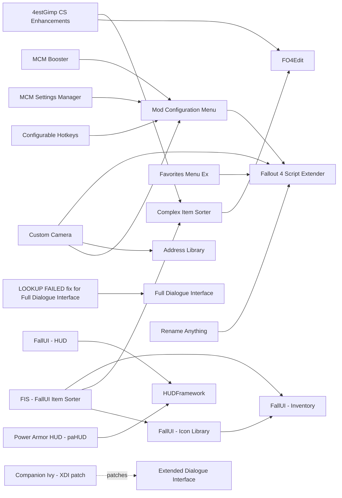

# Interface

Menus, HUD, dialogue, item sorting and map markers. Interface mods split into Scaleform files, which do not depend on the game version (FallUI dates from 2022), and F4SE DLLs, which must state 1.11.240 support: Mod Configuration Menu and Extended Dialogue Interface both ship 1.11.240 files dated 2026-09-01. Some DLLs stalled on an earlier build and do not work on 1.11.240, such as Baka Fullscreen Pip-Boy and Aspect Ratio Fix - F4SE; LooksMenu's status is unclear. The main risks are two mods replacing the same menu file, and item sorting that must be re-run after every load-order change.

## Pick one

| Choose between | Difference | Our pick |
| --- | --- | --- |
| Extended Dialogue Interface or Full Dialogue Interface | XDI has a 1.11.240 DLL and shows full lines and more than four options; FDI is the older plugin-only UI | Extended Dialogue Interface |
| Complex Item Sorter + FIS - FallUI Item Sorter, or VIS-G Item Sorting, Valdacil's Item Sorting, Ruddy88's Simple Sorter | Complex Item Sorter is an xEdit script that tags every item in your load order, Lunar's included, with no per-mod patch. VIS-G overrides item records and needs a patch per mod | None yet |
| FallUI - Map or Simply Smaller Map Markers | Same swf file | FallUI - Map |
| Cartographers Map Markers or Unused Map Markers | Both add map markers; Cartographers scales its icons through FallUI - Map | Neither yet |
| Power Armor HUD - paHUD or HoloHUD for Power Armor | Both replace the power armor helmet display | Neither |
| Ultra Wide Interface (21x9) or TRUBY9 Ultrawidescreen | UWI 4.4 (2026-01-21) ships built-in patches for FallUI, HUDFramework and XDI; TRUBY9 is the old replacer | Ultra Wide Interface (21x9) |

## Suggested stacks

| Profile | Take | Skip |
| --- | --- | --- |
| Minimal, 16:9 screen | Mod Configuration Menu, Extended Dialogue Interface, HUDFramework, FallUI - HUD, FallUI - Inventory | Baka Fullscreen Pip-Boy, Aspect Ratio Fix - F4SE (no 1.11.240 build) |
| Ultrawide screen | The minimal stack plus Ultra Wide Interface (21x9). FallUI - Map is not in UWI's patch list: check it at 21:9 | TRUBY9 Ultrawidescreen |
| Tidy inventory | Complex Item Sorter, FIS - FallUI Item Sorter, 4estGimp CS Enhancements, FallUI - Workbench. Re-run the sorter after any change; xEdit under CrossOver is untested | VIS-G Item Sorting, Valdacil's Item Sorting |
| Explorer | FallUI - Map, Cartographers Map Markers, Radiant Quest Marker, Friendly NPCs On Compass | Simply Smaller Map Markers, Unused Map Markers |

## Our choice

The reference playthrough takes Mod Configuration Menu, Extended Dialogue Interface for full dialogue lines, HUDFramework, FallUI - HUD, FallUI - Inventory, FallUI - Map and Ultra Wide Interface (21x9) for a 3440x1440 display. We have not added an item sorter: Complex Item Sorter has to be re-run after every load-order change, and FO4Edit under CrossOver is untested.

<!-- BEGIN GENERATED: do not edit, run scripts/build_catalog.py -->
42 mods: 1 core, 18 recommended, 13 optional, 10 avoid. Plugin slots if you take everything not marked avoid: 1 full.

### Core

| | Mod | What it does | Fit | Cost | Links |
| --- | --- | --- | --- | --- | --- |
|  | **[Mod Configuration Menu](https://www.nexusmods.com/fallout4/mods/21497)** by reg2k - Neanka - shadowslasher410 · v1.11.240 · updated 2026-09-01 · 162,442 endorsements · 0.4 MB | In-game settings menu for mods *1.11.240 main file dated 2026-09-01; old 1.39/1.40 files do not work* | `core` 1.11.240: yes F4SE DLL | perf low scripts light | needs: Fallout 4 Script Extender |

### Recommended

| | Mod | What it does | Fit | Cost | Links |
| --- | --- | --- | --- | --- | --- |
|  | **[Crafting Highlight Fix](https://www.nexusmods.com/fallout4/mods/27479)** by registrator2000 · v1.11.240 · updated 2026-09-06 · 37,864 endorsements · 0.1 MB | Removes the workbench glow that hides items *2026-09-06 file '1.11.240'* | `recommended` 1.11.240: yes F4SE DLL | perf low |  |
|  | **[Extended Dialogue Interface](https://www.nexusmods.com/fallout4/mods/27216)** by reg2k and Neanka · v1.11.240 · updated 2026-09-01 · 51,854 endorsements · 0.3 MB | Shows full dialogue lines and more than four options *Main file 'Extended Dialogue Interface 1.11.240' (2026-09-01)* | `recommended` 1.11.240: yes F4SE DLL | perf low | patches: Companion Ivy - XDI patch conflicts: Full Dialogue Interface |
|  | **[HUDFramework](https://www.nexusmods.com/fallout4/mods/20309)** by registrator2000 · v1.0f · updated 2026-09-04 · 108,345 endorsements · 0.3 MB | Framework for custom HUD widgets *Keep; Report 08 does not give its 1.11.240 status; UWI ships a built-in HUDFramework patch* | `recommended` 1.11.240: plugin only | perf  1 full / 0 light |  |
|  | **[Cartographers Map Markers](https://www.nexusmods.com/fallout4/mods/12581)** by Feyawen · v5.0.1 · updated 2026-04-28 · 5,784 endorsements · 57 KB | Hundreds of map markers that scale via FallUI Map *v5 2026-04 rewrite, ESL; Adds refs to cells: load before PRP; Not compatible with v4 saves; Pick this or Unused Map Markers* | `recommended` 1.11.240: plugin only | perf  0 full / 1 light |  |
|  | **[FIS - FallUI Item Sorter](https://www.nexusmods.com/fallout4/mods/60580)** by m8r98a4f2 · v2.1 · updated 2022-06-04 · 16,963 endorsements · 1.1 MB | Tag and icon config for FallUI Inventory *Use with Complex Item Sorter* | `recommended` 1.11.240: plugin only | perf low | needs: FallUI - Inventory, Complex Item Sorter, FallUI - Icon Library |
|  | **[FallUI - Confirm Boxes](https://www.nexusmods.com/fallout4/mods/48958)** by m8r98a4f2 · v2.2.3 · updated 2022-11-01 · 16,189 endorsements · 1.5 MB | Replaces confirm and message boxes to match FallUI, incl. Yes Im Sure *In 20 of 24 Wabbajack lists (2026-10); Gap audit 2026-10-29* | `recommended` 1.11.240: plugin only | perf low |  |
|  | **[FallUI - HUD](https://www.nexusmods.com/fallout4/mods/51813)** by m8r98a4f2 · v1.7.1 · updated 2022-11-16 · 28,106 endorsements · 2.4 MB | Configurable HUD *2022 Scaleform, version-independent; UWI ships a built-in patch* | `recommended` 1.11.240: plugin only | perf  | needs: HUDFramework |
|  | **[FallUI - Icon Library](https://www.nexusmods.com/fallout4/mods/60579)** by m8r98a4f2 · v1.0 · updated 2022-06-22 · 16,988 endorsements · 0.4 MB | Icon library used by FIS - FallUI Item Sorter *Needed by fis-fallui-item-sorter (check its requires); In 20 of 24 Wabbajack lists (2026-10); Gap audit 2026-10-29* | `recommended` 1.11.240: plugin only | perf low | needs: FallUI - Inventory |
|  | **[FallUI - Inventory](https://www.nexusmods.com/fallout4/mods/48758)** by m8r98a4f2 · v2.2.1 · updated 2022-10-28 · 31,662 endorsements · 2.8 MB | Readable inventory with sorting tags and icons *2022 Scaleform, version-independent; UWI ships a built-in patch; Pair with Complex Item Sorter + FIS* | `recommended` 1.11.240: plugin only | perf  |  |
|  | **[FallUI - Map](https://www.nexusmods.com/fallout4/mods/49920)** by m8r98a4f2 · v2.1 · updated 2022-05-18 · 19,284 endorsements · 1.0 MB | Readable map with icon scaling *Not in UWI's ultrawide patch list (behaviour at 21:9 unverified); Pair with Cartographers Map Markers v5; Same swf as Simply Smaller Map Markers* | `recommended` 1.11.240: plugin only | perf  | conflicts: Simply Smaller Map Markers |
|  | **[FallUI - Sleep and Wait](https://www.nexusmods.com/fallout4/mods/49070)** by m8r98a4f2 · v1.4 · updated 2022-11-12 · 17,766 endorsements · 0.8 MB | Sleep and wait menu with direct hour selection, FallUI style *In 20 of 24 Wabbajack lists (2026-10); Gap audit 2026-10-29* | `recommended` 1.11.240: plugin only | perf low |  |
|  | **[FallUI - Workbench](https://www.nexusmods.com/fallout4/mods/49300)** by m8r98a4f2 · v1.4.1-r2 · updated 2022-11-02 · 20,757 endorsements · 1.0 MB | Bigger workbench UI with columns, search and tag icons *SWF; text search uses F4SE; Part of the FallUI family on our list (may be covered by the UI report); Picked 2026-10-30: with Sim Settlements 2 the workbench lists get long; UWI has a Workbench option* | `recommended` 1.11.240: plugin only | perf low |  |
|  | **[Faster Terminal Displays](https://www.nexusmods.com/fallout4/mods/937)** by Old Nick · v3.0 · updated 2016-04-27 · 47,449 endorsements · 1 KB | Terminal text scrolls 20 times faster | `recommended` 1.11.240: plugin only | perf low |  |
|  | **[MCM Booster](https://www.nexusmods.com/fallout4/mods/56997)** by m8r98a4f2 · v1.0 · updated 2022-01-01 · 13,949 endorsements · 0.6 MB | Caches MCM config files so the MCM menu opens almost instantly *Incompatible with main menu replacers that ship MainMenu.swf; In 16 of 24 Wabbajack lists (2026-10); Gap audit 2026-10-29* | `recommended` 1.11.240: plugin only | perf low | needs: Mod Configuration Menu |
|  | **[MCM Settings Manager](https://www.nexusmods.com/fallout4/mods/56195)** by m8r98a4f2 · v1.2 · updated 2022-11-16 · 12,401 endorsements · 0.1 MB | Save, load and transfer all MCM settings at once *In 19 of 24 Wabbajack lists (2026-10); Gap audit 2026-10-29* | `recommended` 1.11.240: plugin only | perf low scripts light | needs: Mod Configuration Menu |
|  | **[Power Armor HUD - paHUD](https://www.nexusmods.com/fallout4/mods/21622)** by Gopher · v1.0 · updated 2024-05-15 · 4,064 endorsements · 2.3 MB | Clean power armor HUD instead of the helmet dashboard *In LitR; Interplay with FallUI-HUD unverified* | `recommended` 1.11.240: plugin only | perf low | needs: HUDFramework conflicts: HoloHUD for Power Armor |
|  | **[Ultra Wide Interface (21x9)](https://www.nexusmods.com/fallout4/mods/65677)** by Aigni · v4.4 · updated 2026-01-21 · 2,107 endorsements · 19.1 MB | Fixes HUD, menus, VATS, workshop and scopes for 21:9 screens *4.4 (2026-01-21), ESL-flagged ESP; Built-in patches for FallUI Inventory/HUD/Workbench/Sleep/Confirm Boxes, HUDFramework, XDI, DEF_UI, LooksMenu, MCM Booster, Baka Interface; FallUI Map not listed; Author says the aspect fix is version-independent: not verified on 1.11.240; A Smaller UI Size variant exists* | `recommended` 1.11.240: unknown F4SE DLL | perf  0 full / 1 light | conflicts: TRUBY9 Ultrawidescreen |
|  | **[Complex Item Sorter](https://www.nexusmods.com/fallout4/mods/48826)** by m8r98a4f2 · v1.12.0 · updated 2023-08-23 · 6,444 endorsements · 0.2 MB | xEdit script that tags every item in the load order for sorting *Generates one patch after Lunar and all item mods, before PRP; Re-run after any add or remove; 1.12.0 public; 1.13 beta on the Collective Modding Discord; Can apply weightless junk without overriding Lunar values; xEdit under CrossOver untested* | `recommended` 1.11.240: plugin only | perf low | needs: FO4Edit |

### Optional

| | Mod | What it does | Fit | Cost | Links |
| --- | --- | --- | --- | --- | --- |
|  | **[Configurable Hotkeys](https://www.nexusmods.com/fallout4/mods/46419)** by Dank Rafft · v2.1.8 · updated 2026-10-02 · 2,708 endorsements · 27 KB | MCM hotkeys for saving, using items and console commands *2.1.8 (2026-10-02), actively updated; DLL and version status not checked; Gives a hard-save hotkey* | `optional` 1.11.240: unknown | perf low | needs: Mod Configuration Menu |
|  | **[Custom Camera](https://www.nexusmods.com/fallout4/mods/29905)** by Qudix · v0.5.5 · updated 2026-09-10 · 10,884 endorsements · 4.6 MB | MCM-configurable third-person camera *In 7 of 24 Wabbajack lists (2026-10); Gap audit 2026-10-29* | `optional` 1.11.240: yes F4SE DLL | perf low | needs: Fallout 4 Script Extender, Address Library, Mod Configuration Menu |
|  | **[Favorites Menu Ex](https://www.nexusmods.com/fallout4/mods/66690)** by Neanka · v1.11.240 · updated 2026-09-06 · 2,513 endorsements · 0.2 MB | New Vegas companion-wheel style favourites menu *In 2 of 24 Wabbajack lists (2026-10); Gap audit 2026-10-29* | `optional` 1.11.240: yes F4SE DLL | perf low | needs: Fallout 4 Script Extender |
|  | **[Friendly NPCs On Compass](https://www.nexusmods.com/fallout4/mods/95776)** by shavkcagarikia · v1.03 · updated 2026-08-29 · 86 endorsements · 0.2 MB | FO3/NV-style NPC compass dots by Perception | `optional` 1.11.240: yes F4SE DLL | perf low |  |
|  | **[LooksMenu](https://www.nexusmods.com/fallout4/mods/12631)** by Expired6978 · v1.7.0.4 · updated 2026-09-01 · 153,621 endorsements · 0.5 MB | Character appearance editor *Page shows 1.7.0.4 (2026-09-01) but the file text still says F4SE 0.7.8 / 1.11.221; does not use Address Library; Verify in f4se.log and with 'slm 14' before relying on it* | `optional` 1.11.240: unknown F4SE DLL | perf  |  |
|  | **[PipboyTabs](https://www.nexusmods.com/fallout4/mods/29568)** by Neanka · v1.11.240 · updated 2026-09-06 · 6,820 endorsements · 0.2 MB | Framework that adds new tabs to the Pip-Boy *File names 1.11.240; Install only as a dependency* | `optional` 1.11.240: yes F4SE DLL | perf  |  |
|  | **[Rename Anything](https://www.nexusmods.com/fallout4/mods/22105)** by registrator2000 · v1.11.240 · updated 2026-09-06 · 10,879 endorsements · 0.2 MB | Rename items and objects in inventory or the world *In 5 of 24 Wabbajack lists (2026-10); Gap audit 2026-10-29* | `optional` 1.11.240: yes F4SE DLL | perf low | needs: Fallout 4 Script Extender |
|  | **[Smart Selection](https://www.nexusmods.com/fallout4/mods/109243)** by Zzyxzz · v1.3.3 · updated 2026-09-30 · 322 endorsements · 0.4 MB | Better object targeting with target cycling and outline *1.3.3 (2026-09-30), 'OG, NG and AE'; 1.11.240 inferred from release date; Too new to rely on* | `optional` 1.11.240: unknown F4SE DLL | perf low |  |
|  | **[Companion Command Menu Overhaul](https://www.nexusmods.com/fallout4/mods/54908)** by Aigni · v2.2 · updated 2025-12-03 · 667 endorsements · 2.0 MB | XDI-style companion command wheel *Replaces MultiActivateMenu.swf; XDI uses another swf (probably fine, unverified)* | `optional` 1.11.240: plugin only | perf low |  |
|  | **[HoloHUD for Power Armor](https://www.nexusmods.com/fallout4/mods/29969)** by Doppeltganger · v2.22 · updated 2026-06-17 · 8,221 endorsements · 0.3 MB | Holographic power armor gauges without visor fog or rain drops *Alternative to paHUD: pick one* | `optional` 1.11.240: plugin only | perf low | conflicts: Power Armor HUD - paHUD |
|  | **[Radiant Quest Marker](https://www.nexusmods.com/fallout4/mods/20401)** by SilentNightxxx · v2.2 · updated 2019-11-14 · 703 endorsements · 0.7 MB | Map markers for radiant quest targets *2019, untested* | `optional` 1.11.240: plugin only | perf  |  |
|  | **[Unused Map Markers](https://www.nexusmods.com/fallout4/mods/64009)** by Crash · v1.0 · updated 2022-09-05 · 1,250 endorsements · 17 KB | Restores 50+ cut map markers *Probable overlap with CMM: pick one* | `optional` 1.11.240: plugin only | perf  |  |
|  | **[4estGimp CS Enhancements](https://www.nexusmods.com/fallout4/mods/51307)** by 4estGimp · v2.8.1 · updated 2025-07-04 · 3,690 endorsements · 1.4 MB | Extra rules and icons for Complex Item Sorter *2.8.2 (2025-07); Needs the CS 1.13 beta and xEdit 4.1.5f; take the No-AWKCR build; Power users* | `optional` 1.11.240: plugin only | perf low | needs: Complex Item Sorter, FO4Edit |

### Avoid

| | Mod | What it does | Fit | Cost | Links |
| --- | --- | --- | --- | --- | --- |
|  | **[Aspect Ratio Fix - F4SE](https://www.nexusmods.com/fallout4/mods/98899)** by Aigni · v1.11.191.0 · updated 2025-12-17 · 20 endorsements · 0.1 MB | Fixes AE's hard-coded 16:9 aspect bug *Labelled 1.11.191 only; avoid unless updated; UWI 4.4 ships its own aspect fix* | `avoid` 1.11.240: **no** F4SE DLL | perf  |  |
|  | **[Baka Fullscreen Pip-Boy](https://www.nexusmods.com/fallout4/mods/73560)** by shad0wshayd3 · v2.1.0 · updated 2026-01-04 · 2,081 endorsements · 3.6 MB | Fullscreen or Quick-Boy Pip-Boy *2.1.0 stops at 1.11.191; avoid until updated* | `avoid` 1.11.240: **no** F4SE DLL | perf  |  |
|  | **TRUBY9 Ultrawidescreen**  | Old 21:9 UI replacer *Use Ultra Wide Interface instead; Main Nexus page not found by API search (only its patches); nexus_id left blank* | `avoid` 1.11.240: unknown | perf  | conflicts: Ultra Wide Interface (21x9) |
|  | **[DEF_UI](https://www.nexusmods.com/fallout4/mods/10654)** by Neanka and Valdacil and Old Nick and ParasiteX and sekoms · v1.6.0 · updated 2024-05-09 · 96,201 endorsements · 68.5 MB | Older inventory and HUD UI overhaul *In 2 of 24 Wabbajack lists (2026-10); Gap audit 2026-10-29* | `avoid` 1.11.240: plugin only | perf low | conflicts: FallUI - Inventory, FallUI - HUD |
|  | **[Full Dialogue Interface](https://www.nexusmods.com/fallout4/mods/1235)** by Cirosan and shadwar · vBeta12 · updated 2016-09-13 · 179,988 endorsements · 73.3 MB | Older full-line dialogue UI *Incompatible with XDI, which we use* | `avoid` 1.11.240: plugin only | perf low | conflicts: Extended Dialogue Interface |
|  | **[LOOKUP FAILED fix for Full Dialogue Interface](https://www.nexusmods.com/fallout4/mods/26575)** by deathclay · v1.11.221 · updated 2026-08-28 · 8,557 endorsements · 3.0 MB | Fixes LOOKUP FAILED lines in FDI *Updated 2026-08-28 for 1.11.240, but only useful with FDI, which we avoid* | `avoid` 1.11.240: yes | perf  | needs: Full Dialogue Interface |
|  | **[Simply Smaller Map Markers](https://www.nexusmods.com/fallout4/mods/92505)** by Spifferino · v1.0.0 · updated 2025-03-26 · 842 endorsements · 92 KB | Smaller map icons *Edits Pipboy_MapPage.swf, the same file as FallUI Map* | `avoid` 1.11.240: plugin only | perf  | conflicts: FallUI - Map |
|  | **[Ruddy88's Simple Sorter](https://www.nexusmods.com/fallout4/mods/33983)** by Ruddy88 · v1.0 · updated 2019-02-01 · 3,638 endorsements · 5 KB | xEdit tagger for DEF_UI *Made for DEF_UI; we use FallUI* | `avoid` 1.11.240: plugin only | perf  |  |
|  | **[VIS-G Item Sorting](https://www.nexusmods.com/fallout4/mods/33383)** by Gambit77 - Gernash - Valdacil - Neanka - Thirdstorm - Omega9380 - Spherikal - Khaibit · vv2.9.0 · updated 2026-02-03 · 10,325 endorsements · 25 KB | Pre-made item sorting plugin *Overrides item records and needs a patch per mod, Lunar included; Use Complex Item Sorter instead* | `avoid` 1.11.240: plugin only Lunar: patch | perf  |  |
|  | **[Valdacil's Item Sorting](https://www.nexusmods.com/fallout4/mods/3877)** by Valdacil · v11.0.3 · updated 2024-10-28 · 52,892 endorsements · 2.3 MB | Original pre-made item sorter *Same patch burden as VIS-G* | `avoid` 1.11.240: plugin only | perf  |  |

### Dependencies and patches

<!-- END GENERATED -->
