# Minutemen

Who the Minutemen are, how their radiant quests reach you, patrols and garrisons, the Castle and Nuka-World. On 1.11.240 the scene runs on four maintained plugin-only mods: You And What Army 2 (v1.08, March 2026), Who's The General (v1.16, December 2025), their two patch hubs (updated in October 2026) and Minuteman Watchtowers (v1.2.1, May 2026). We Are The Minutemen is frozen at 7.7 (March 2022) and maintained through its eXoPatch. The main risk is stacking: Lunar, We Are The Minutemen and Improved Minutemen all rewrite the same Minutemen NPC records, and Sim Settlements 2 Chapter 3 already provides an army. No mod here locks a faction ending.

## Pick one

| Choose between | Difference | Our pick |
| --- | --- | --- |
| Who the Minutemen NPCs are: Lunar's own tables, We Are The Minutemen + eXoPatch, Improved Minutemen, Organized Militia, Liberty Reborn 7.0, Buffed Minutemen Militia, Ragged Thunder, MO - New Commonwealth Republic | All edit the same leveled lists or NPC records. No published patch merges We Are The Minutemen with Lunar | Lunar's own tables |
| Radiant throttling: Who's The General, Configurable Minutemen Radiant Quest Limits, Preston Garvey No Radiant Settlement Quests | Who's The General gives quests when you ask Preston and drops the report-backs | Who's The General |
| Radiants in the Commonwealth: Keeper of the Commonwealth Radiants or Keep Radiants in the Commonwealth (UFO4P version) | The Who's The General Patch Hub and the WATM eXoPatch's WTG option expect Keeper | Neither yet |
| Patrols: You And What Army 2, Minutemen Patrol the roads, Minutemen Vertibird Patrols | Keep one patrol system | You And What Army 2 |
| Army management: Sim Settlements 2 Chapter 3, the We Are The Minutemen Command Table, Minutemen (Radiant) Squads | Keep one army system | Sim Settlements 2 |
| Castle walls: Restoring The Castle (+ Restoring the Castle Extended), Rebuild The Castle, Castle Walls Repaired Ultimate Vanilla Edition, Castle walls restored (Bicknos), or an SS2 Castle plan (Minutemen Castle Command, Castle Rebuilt - MM HQ) | Same geometry. Restoring the Castle Extended ships a PRP previs patch. Do not confuse Restoring The Castle with the 2019 Castle walls restored (Bicknos) | Restoring The Castle + Restoring the Castle Extended |
| Artillery: Configurable Artillery, Full Artillery System Overhaul, Artillery Commander | Each replaces the artillery script. Artillery Commander is a DLL with unknown 1.11.240 status | None |

## Suggested stacks

| Profile | Take | Skip |
| --- | --- | --- |
| Light: any overhaul, low-spec or Mac under Wine | Who's The General + Who's The General Patch Hub (Keeper option), Keeper of the Commonwealth Radiants, You And What Army 2 + You And What Army 2 Patch Hub, Minuteman Watchtowers, Restoring The Castle + Restoring the Castle Extended | We Are The Minutemen, Improved Minutemen |
| Medium: a visible Minutemen identity without touching NPC records | The light stack plus Minutemen Takeover - Nuka World, The Minutemen Outfit Pack (Militia), Tumbajamba's Minutemen Armor Collection (leveled-list option), Faction Housing Overhaul - The Castle, C.R.P Minutemen Radio Relay Network | We Are The Minutemen, Improved Minutemen |
| Heavy: no Lunar, strong CPU | The medium stack plus We Are The Minutemen + We Are The Minutemen eXoPatch (WTG option), Minute's Notice, Bunkerhill Patrols - Redux + Bunkerhill Patrols - Redux WATM patch | Lunar Fallout Overhaul Deluxe (no published WATM patch) |
| One author for Minutemen and BoS | Improved Minutemen + Improved Brotherhood of Steel, with RobCo Patcher and Runtime Database | We Are The Minutemen, or add JOTC WATM - Improved Minutemen LL fix if you keep both |

## Our choice

The reference playthrough takes Who's The General, You And What Army 2 with its Patch Hub, Minuteman Watchtowers, Restoring The Castle with Restoring the Castle Extended, and Minutemen Takeover - Nuka World. Sim Settlements 2 provides the army and Lunar sets the Minutemen's strength; the stack needs no F4SE DLL. We left out We Are The Minutemen (it rewrites Lunar's spawn tables with no patch, duplicates SS2's army and gates the Castle at level 20) and Improved Minutemen (RobCo Patcher).

<!-- BEGIN GENERATED: do not edit, run scripts/build_catalog.py -->
56 mods: 13 recommended, 30 optional, 13 avoid. Plugin slots if you take everything not marked avoid: 0 full.

### Recommended

| | Mod | What it does | Fit | Cost | Links |
| --- | --- | --- | --- | --- | --- |
|  | **[C.R.P Minutemen Radio Relay Network](https://www.nexusmods.com/fallout4/mods/67365)** by MissWinter77 · v3.5 · updated 2023-03-10 · 310 endorsements · 80 KB | Minutemen garrisons, notes and loot at relay towers, a Castle terminal and an opt-in button *3.5 (2023-03-10); Author: no precombine break since 3.0; YAWA2 hub has a patch; Recommended if you want radio towers (optional on our shortlist)* | `recommended` 1.11.240: plugin only | perf low | patches: C.R.P Minutemen Radio Relay Network - Face Fixes addon |
|  | **[Faction Housing Overhaul - The Castle](https://www.nexusmods.com/fallout4/mods/15504)** by Elianora · v1.1 · updated 2016-06-24 · 8,279 endorsements · 31.2 MB | General's quarters behind a new door, without touching Castle geometry *1.1 (2016-06-24); Player home; pairs with Castle Tunnel Restoration* | `recommended` 1.11.240: plugin only | perf low |  |
|  | **[Minuteman Watchtowers](https://www.nexusmods.com/fallout4/mods/67115)** by Spifferino · v1.2.1 · updated 2026-05-11 · 3,083 endorsements · 1.3 MB | Minutemen watchtowers garrisoned across the Commonwealth after the Castle is retaken *1.2.1 (2026-05-11), ESL; Author: does not break precombines, edits navmesh in affected cells; YAWA2 hub has a patch; A third-party PRP 81.5 patch exists (QnLO PRP patches) but the author says it is not required* | `recommended` 1.11.240: plugin only | perf  |  |
|  | **[Minutemen Takeover - Nuka World](https://www.nexusmods.com/fallout4/mods/30509)** by hxhunter15 · v0.6 · updated 2018-03-23 · 6,883 endorsements · 0.1 MB | Call the Minutemen to storm Nuka-World during Open Season and set the gangs on each other *0.6 (2018-03-23), abandoned but self-contained; CPU spike only during the battle (about 25 Minutemen and 15 raiders per gang at once): turn the corpse-banish option on; Needs Open Season started via Mackenzie/Preston; Load it above any Minutemen overhaul; Untested together with Nuka-World Reborn; Pairs with Improved Nuka Raiders for a harder siege; v0.6 from 2018, abandoned; no 1.11.240 report; Up to 3 gangs x 15 raiders + 25 Minutemen with respawn waves: CPU-heavy on M3, save before ordering the attack and keep companions minimal; Keep corpse banish ON (loot goes to a War Chest); Must load ABOVE Minutemen mods (WATM etc.) or troops don't appear; without WATM/YAWA2 the troops are weak; Precombine effect not verified (adds a War Chest ref); Load first among content plugins (author: above other Minutemen mods). Summoned Minutemen are weak without a gear mod* | `recommended` 1.11.240: plugin only | perf high NPCs many | conflicts: Nuka World Plus, Nuka-World Reborn |
|  | **[Restoring The Castle](https://www.nexusmods.com/fallout4/mods/76753)** by Mutrey · v2.3.0 · updated 2025-06-08 · 548 endorsements · 10.6 MB | Quest-gated restoration of the Castle walls after Old Guns, with an uninstaller holotape *2.3.0 (2025-06-08); Listed in our plan as 'Castle Walls Restored', but the Nexus name is still Restoring The Castle (Castle walls restored is a different 2019 mod); Treat it as not PRP-safe without Extended's previs patch (inferred); Incompatible with The Rebuild Series - The Castle* | `recommended` 1.11.240: plugin only | perf low | patches: Restoring the Castle Extended conflicts: Rebuild The Castle, Castle Walls Repaired Ultimate Vanilla Edition, Castle walls restored (Bicknos) |
|  | **[Who's The General](https://www.nexusmods.com/fallout4/mods/59019)** by Glitchfinder · v1.16 · updated 2025-12-19 · 7,325 endorsements · 0.4 MB | Minutemen quests come from asking Preston 'How are you doing?', no report-backs, Radio Freedom fixes *1.16 (2025-12-19); Included in STEP and The Midnight Ride; Conflicts with WATM radiant edits (WATM eXoPatch has a WTG option)* | `recommended` 1.11.240: plugin only | perf low | patches: Who's The General Patch Hub, We Are The Minutemen eXoPatch |
|  | **[You And What Army 2](https://www.nexusmods.com/fallout4/mods/78925)** by Glitchfinder · v1.08 · updated 2026-03-07 · 5,972 endorsements · 2.0 MB | Adds 30 small Minutemen locations unlocked by quest progress, patrols, provisioner escorts and three workshop objects *1.08 (2026-03-07); Author: precombines preserved; Safe on an existing save; Included in The Midnight Ride's 1.11.240 build; No known Lunar/SS2 patch need (not tested); Patrols occasionally reported glitched into terrain* | `recommended` 1.11.240: plugin only | perf med NPCs many | patches: You And What Army 2 Patch Hub |
|  | **[The Minutemen Outfit Pack (Militia)](https://www.nexusmods.com/fallout4/mods/97011)** by Commonwealth Weaponry · v1.0.2.1 · updated 2025-10-11 · 998 endorsements · 108.5 MB | 25 vanilla-style Minutemen apparel items injected into leveled lists *1.0.2.1 (2025-10-11), ESL; Injection, so it coexists with Lunar and WATM* | `recommended` 1.11.240: plugin only | perf low |  |
|  | **[Tumbajamba's Minutemen Armor Collection](https://www.nexusmods.com/fallout4/mods/86697)** by tumbajamba and shreddah4 · v1.0 · updated 2025-04-13 · 2,208 endorsements · 167.7 MB | Minutemen outfits, a Minutemen power armor and a unique weapon, with optional leveled-list injection *1.0 (2025-04-13), ESL; Pick the 'inject into leveled list' FOMOD option (conflict-free); No Lunar patch: balance unpatched; Pick one Minutemen look* | `recommended` 1.11.240: plugin only | perf low |  |
|  | **[Keeper of the Commonwealth Radiants](https://www.nexusmods.com/fallout4/mods/79369)** by Exoclyps · v1.0.1 · updated 2025-09-03 · 1,165 endorsements · 24 KB | Keeps radiant quests inside the Commonwealth through a parent-location check, with no location or DLC edits *1.0.1 (2025-09-03); Required by the WATM eXoPatch WTG option; STEP's WTG hub pick; Drop any KRIC version* | `recommended` 1.11.240: plugin only | perf low | conflicts: Keep Radiants in the Commonwealth (UFO4P version) |
|  | **[C.R.P Minutemen Radio Relay Network - Face Fixes addon](https://www.nexusmods.com/fallout4/mods/67365)** by MissWinter77 · v3.5 · updated 2023-03-10 · 310 endorsements · 80 KB | Face fixes add-on for C.R.P Minutemen Radio Relay Network *Exact file name not checked* | `recommended` 1.11.240: plugin only | perf  | needs: C.R.P Minutemen Radio Relay Network |
|  | **[You And What Army 2 Patch Hub](https://www.nexusmods.com/fallout4/mods/95428)** by Glitchfinder · v1.05 · updated 2026-10-21 · 693 endorsements · 96.8 MB | FOMOD of 41 ESL compatibility patches for You And What Army 2 *1.05 (2026-10-21); Tick Minuteman Watchtowers (plus CRP Radio Relay and Bunkerhill Patrols if used); No SS2, Lunar or WATM patch inside; Tick Minuteman Watchtowers - ESL and America Rising 2 (YAWA2_AmericaRising2_Patch.esp); install after AR2* | `recommended` 1.11.240: plugin only | perf low | needs: You And What Army 2 |
|  | **[Restoring the Castle Extended](https://www.nexusmods.com/fallout4/mods/106767)** by CyberDanz · v1 · updated 2026-07-07 · 7 endorsements | 7-day failsafe that rebuilds the Castle walls, plus a PRP previs patch for all 8 Castle exterior cells *1 (2026-07-07); PRP patch built against PRP 81.8: re-check if PRP changes the Castle cells after 81.8; Load after Restoring The Castle; the previs plugin goes right after prp.esp; Only 7 endorsements, barely tested* | `recommended` 1.11.240: plugin only | perf low | needs: Restoring The Castle, Previsibines Repair Pack |

### Optional

| | Mod | What it does | Fit | Cost | Links |
| --- | --- | --- | --- | --- | --- |
|  | **[At A Minute's Notice - Recruitable Minutemen](https://www.nexusmods.com/fallout4/mods/75356)** by rsm000rsm · v5 · updated 2025-08-18 · 186 endorsements · 64 KB | 18 unique recruitable Minutemen settlers *5 (2025-08-18); Lightly overlaps SS2 recruitment; Precombine impact unknown* | `optional` 1.11.240: plugin only | perf low NPCs few |  |
|  | **[Bunkerhill Patrols - Redux](https://www.nexusmods.com/fallout4/mods/67897)** by Babaloo321 · vv1.0 · updated 2023-01-17 · 156 endorsements · 38 KB | Protected Minutemen patrols around Bunker Hill *1.0 (2023-01-17); YAWA2 hub has a patch; Precombine impact unknown* | `optional` 1.11.240: plugin only | perf med NPCs few | patches: Bunkerhill Patrols - Redux WATM patch |
|  | **[Castle Rebuilt - MM HQ](https://www.nexusmods.com/fallout4/mods/58850)** by Tarkkh · v2 · updated 2022-03-18 · 570 endorsements · 67 KB | SS2 city plan for the Castle *2 (2022); Needs several SS2 add-on packs; Built for vanilla walls, so likely clipping with Castle walls mods (unverified)* | `optional` 1.11.240: plugin only | perf high | needs: Sim Settlements 2 - All Chapters Pack |
|  | **[Castle Tunnel Restoration](https://www.nexusmods.com/fallout4/mods/14782)** by b0bulat0r · v3 · updated 2016-06-16 · 3,076 endorsements · 14.6 MB | Makes the Castle tunnels usable as stronghold space *3 (2016-06-16); Requires the DLCs; Load after Faction Housing Overhaul - The Castle; Interiors; precombine impact unknown* | `optional` 1.11.240: plugin only | perf low |  |
|  | **[Configurable Artillery](https://www.nexusmods.com/fallout4/mods/44511)** by Zzyxzz · v1.1 · updated 2020-04-19 · 2,757 endorsements · 16 KB | MCM settings for artillery rate of fire, range and radius *1.1 (2020-04-19); No DLL stated on its page (unverified)* | `optional` 1.11.240: plugin only | perf low | needs: Mod Configuration Menu conflicts: Full Artillery System Overhaul, Artillery Commander |
|  | **[Full Artillery System Overhaul](https://www.nexusmods.com/fallout4/mods/70476)** by Sars99 · v1.3.0 · updated 2025-01-14 · 477 endorsements · 3 KB | Reworked artillery barrage logic *1.3.0 (2025-01-14); Incompatible with Configurable, Angry and Simple Artillery* | `optional` 1.11.240: plugin only | perf med | conflicts: Configurable Artillery, Artillery Commander |
|  | **[Improved Minutemen](https://www.nexusmods.com/fallout4/mods/76755)** by Warsaw · v2.1.0-1 · updated 2026-07-22 · 1,491 endorsements | Continental-Army style ranks, T-45 dragoons, legendary Minutemen, faction perks and REF assault encounters *2.1.0-1 (2026-07-22), under test in our list; Report verdict: Avoid for us now (heavy-plus stack only); Runtime support comes from RobCo Patcher 6.0.6 + Runtime Database, which list 1.11.240; SPID (some options) on 1.11.240 unverified; Edits Minutemen records through RobCo at runtime, which overrides Lunar whatever the load order (inference, not tested); Author recommends DirectHit, which Lunar advises against; No independent reviews; Archive contains an imp_REAssaultV03_FactionMMvsBoS encounter whose trigger conditions are unverified; Pairs with Improved Brotherhood of Steel (same author)* | `optional` 1.11.240: unknown F4SE DLL Lunar: conflict | perf med | needs: RobCo Patcher, Random Encounter Framework patches: JOTC WATM - Improved Minutemen LL fix |
|  | **[Minute's Notice](https://www.nexusmods.com/fallout4/mods/76494)** by CaptLaserBeam · v1.2.1 · updated 2025-10-07 · 177 endorsements · 19 KB | Minutemen units, loadouts and uniforms for SS2 Chapter 3 *Needs SS2 3.4.8a+ and all DLC; Deluxe option ties in We Are The Minutemen; Verdict owned by the Minutemen report; 1.2.1 (2025-10-07); Needs SS2 3.4.8a or later, all DLC, and We Are The Minutemen and/or Far West Minutemen; Heavy stack only* | `optional` 1.11.240: plugin only | perf low | needs: Sim Settlements 2 - All Chapters Pack |
|  | **[Minutemen (Radiant) Squads](https://www.nexusmods.com/fallout4/mods/44355)** by bitwise · v0.4 · updated 2020-05-23 · 1,638 endorsements · 15.3 MB | Recruit Minutemen squads to handle radiant quests, with a voiced female NPC *0.4 (2020-05-23); Edits Minutemen quests; author advises against radiant reducers; WTG and YAWA2 hubs have patches; Overlaps SS2 soldiers; Precombine impact unknown* | `optional` 1.11.240: plugin only | perf med |  |
|  | **[Minutemen Castle Command](https://www.nexusmods.com/fallout4/mods/59145)** by GavMan · v1.2 · updated 2023-08-01 · 661 endorsements · 79 KB | SS2 city plan for the Castle *1.2 (2023); Needs several SS2 add-on packs; heavy script load; Built for vanilla walls, so likely clipping with Castle walls mods (unverified): not with walls mods* | `optional` 1.11.240: plugin only | perf high | needs: Sim Settlements 2 - All Chapters Pack |
|  | **[Rebuild The Castle](https://www.nexusmods.com/fallout4/mods/71201)** by Aurelianis · v3.1 · updated 2024-05-06 · 1,744 endorsements · 3.4 MB | Repair the Castle walls as you go, with a scrappable shack *3.1 (2024-05-06), ESL; Regenerated previs for PRP stable (2024), may lag current PRP (unverified); Author no longer supports it; Alternative to Restoring The Castle* | `optional` 1.11.240: plugin only | perf low | conflicts: Restoring The Castle |
|  | **[We Are The Minutemen](https://www.nexusmods.com/fallout4/mods/6443)** by TheFirstEnD · v7.7 · updated 2022-03-01 · 64,663 endorsements · 205.6 MB | Reworks Minutemen NPC levels and gear, adds a Command Table to craft Minutemen settlers and followers, throttles radiants and gates the Castle at level 20 *7.7 (2022-03-01), frozen; maintained through the eXoPatch (required); Optional for the heavy stack only; report recommends dropping it from our list; Rewrites LCharMinutemen and outfits, the same records Lunar changes, with no published patch (you would make an xEdit merge); Command Table duplicates SS2 chapter 3 soldiers and outposts; Conflicts with Who's The General radiant edits (eXoPatch WTG option fixes it); The level-20 Castle gate delays the Castle walls quest, Watchtower garrisons and YAWA2 unlocks; Performance and save bloat claims unmeasured* | `optional` 1.11.240: plugin only Lunar: conflict | perf med | patches: We Are The Minutemen eXoPatch, JOTC WATM - Improved Minutemen LL fix, Bunkerhill Patrols - Redux WATM patch |
|  | **[MNO - Minutemen NCR Overhaul](https://www.nexusmods.com/fallout4/mods/26520)** by LibertyBull · v5.6.2 · updated 2025-12-30 · 1,284 endorsements · 84.9 MB | NCR-themed Minutemen *5.6.2 (2025-12-30); Many asset requirements; YAWA2 hub has a patch; Not Commonwealth lore* | `optional` 1.11.240: plugin only | perf low |  |
|  | **[MO - New Commonwealth Republic](https://www.nexusmods.com/fallout4/mods/98945)** by superpug200 · v1.2.2 · updated 2025-12-29 · 159 endorsements · 100.3 MB | Full Minutemen armor leveled-list replacer with combat-armor-tier outfits *1.2.2 (2025-12-29); Likely incompatible with other Minutemen armor leveled-list mods* | `optional` 1.11.240: plugin only Lunar: conflict | perf low |  |
|  | **[Militarized Minutemen](https://www.nexusmods.com/fallout4/mods/29853)** by Corvalho · v1.1.2 · updated 2018-02-20 · 23,005 endorsements · 119.4 MB | 15+ modular military items for the Minutemen *1.1.2 (2018); Heavy assets (VRAM), too heavy for our M3; WATM patches exist; No Lunar patch; its leveled-list edits override Lunar; A WATM compatibility patch exists (44596)* | `optional` 1.11.240: plugin only Lunar: conflict | perf med | needs: Militarized Minutemen Rolled Sleeve Crash Fix |
|  | **[Militarized Minutemen - Uniforms addon](https://www.nexusmods.com/fallout4/mods/32369)** by Zachtan1234 · v2.3-Final · updated 2025-04-26 · 5,934 endorsements · 824.9 MB | Uniform add-on for Militarized Minutemen *2.3-Final (2025-04-26); Only with Militarized Minutemen* | `optional` 1.11.240: plugin only | perf med | needs: Militarized Minutemen |
|  | **[Ragged Thunder](https://www.nexusmods.com/fallout4/mods/93104)** by Tannerick · v2.3.1 · updated 2025-11-08 · 283 endorsements · 282.4 MB | 30+ partisan-style Minutemen outfits in three tiers *2.3.1 (2025-11-08); Edits Minutemen leveled lists directly; a RobCo edition exists; Cosmetic; Recommended as the master for the Lunar armband-only patch; Which main file (Main Version or Outfits Only) the patch needs is unverified* | `optional` 1.11.240: plugin only Lunar: conflict | perf low | patches: Lunar - Ragged Thunder (Armband Only) |
|  | **[Forces Ronnie Shaw to Show](https://www.nexusmods.com/fallout4/mods/44054)** by Septpas · v1.01 · updated 2020-03-25 · 124 endorsements · 16 KB | Brings Ronnie Shaw to the Castle when she never appears, so Old Guns can start *1.01 (2020-03-25), ESL, 124 endorsements; Emergency only: install if Ronnie Shaw has not shown up after a few days, then setstage aa778 50 per the author; Matters for us because Restoring The Castle is gated on Old Guns; Does not fix her vendor bug; UFO4P overlap unverified* | `optional` 1.11.240: plugin only | perf  0 full / 1 light |  |
|  | **[Minimal Minutemen](https://www.nexusmods.com/fallout4/mods/74107)** by Glitchfinder · v1.03 · updated 2025-01-29 · 647 endorsements · 38 KB | Radiants only trigger near the source settlement; artillery defense quest gets a one-week cooldown *1.03 (2025-01-29), ESL; Same author as WTG/YAWA2; joint use with WTG not documented; Warns that fully disabling radiants can block peaceful settlement unlocks* | `optional` 1.11.240: plugin only | perf low |  |
|  | **[Minuteman Watchtowers - Survey Addon](https://www.nexusmods.com/fallout4/mods/90200)** by bp42s · v1.0.0 · updated 2025-01-05 · 1,061 endorsements · 26 KB | Add-on for Minuteman Watchtowers *ESL-flagged ESM with no vanilla edits* | `optional` 1.11.240: plugin only | perf  | needs: Minuteman Watchtowers |
|  | **[SKK Fast Start Minutemen](https://www.nexusmods.com/fallout4/mods/37740)** by SKKmods · v004 · updated 2019-03-16 · 1,113 endorsements · 18 KB | Auto-completes the early Minutemen quests *004 (2019-03-16); No changes to base game scripts; Clashes in spirit with WATM's level-20 Castle gate; interplay with WTG / SS2 untested* | `optional` 1.11.240: plugin only | perf low |  |
|  | **[Taking Independence Quest Fix](https://www.nexusmods.com/fallout4/mods/33305)** by DKhanno · v1 · updated 2018-07-16 · 116 endorsements · 3 KB | Force-starts Taking Independence when it never starts after the dialogue *1 (2018-07-16), 116 endorsements; Author: do not use unless you actually have the bug; it forces the quest to start on game load whatever your progress; remove it once the quest is running; UFO4P overlap unverified* | `optional` 1.11.240: plugin only | perf  |  |
|  | **[Bunkerhill Patrols - Redux WATM patch](https://www.nexusmods.com/fallout4/mods/67897)** by Babaloo321 · vv1.0 · updated 2023-01-17 · 156 endorsements · 38 KB | Compatibility patch between Bunkerhill Patrols Redux and We Are The Minutemen *File on the Bunkerhill Patrols page; exact file name not checked* | `optional` 1.11.240: plugin only | perf  | needs: Bunkerhill Patrols - Redux, We Are The Minutemen |
|  | **[JOTC - You and What Army 2 - PRP](https://www.nexusmods.com/fallout4/mods/102876)** by CyberGarrus · v1 · updated 2026-03-24 · 8 endorsements · 13 KB | Small JOTC patch for You And What Army 2 labelled PRP *Only forwards an EDID; YAWA2 already preserves precombines, so not needed for previs* | `optional` 1.11.240: plugin only | perf  | needs: You And What Army 2, Previsibines Repair Pack |
|  | **[JOTC WATM - Improved Minutemen LL fix](https://www.nexusmods.com/fallout4/mods/102840)** by CyberGarrus · v1 · updated 2026-03-23 · 6 endorsements · 4 KB | Leveled-list fix for running We Are The Minutemen and Improved Minutemen together *Built for 1.10.163 (plugin only); Heavy-plus stack only* | `optional` 1.11.240: plugin only | perf  | needs: We Are The Minutemen, Improved Minutemen |
|  | **[Militarized Minutemen Rolled Sleeve Crash Fix](https://www.nexusmods.com/fallout4/mods/55301)** by CaptainRalh · v1 · updated 2021-10-27 · 691 endorsements · 16.7 MB | Fixes a crash caused by Militarized Minutemen's rolled-sleeve outfits | `optional` 1.11.240: plugin only | perf  | needs: Militarized Minutemen |
|  | **[We Are The Minutemen eXoPatch](https://www.nexusmods.com/fallout4/mods/83776)** by Exoclyps · v1.2.5 · updated 2026-04-17 · 691 endorsements · 0.4 MB | Rebalances WATM to 1x player level, fixes the Command Table crash and offers a Who's The General patch *1.2.5 (2026-04-17); Required if WATM is used; Its WTG patch option reverts WATM's story-manager edits and requires Who's The General plus Keeper of the Commonwealth Radiants; Optional bonus files use RobCo Patcher* | `optional` 1.11.240: plugin only | perf low | needs: We Are The Minutemen |
|  | **[Who's The General Patch Hub](https://www.nexusmods.com/fallout4/mods/99080)** by Glitchfinder · v1.04 · updated 2026-10-23 · 796 endorsements · 0.1 MB | FOMOD of ESL patches between Who's The General and 10 radiant/Minutemen mods *1.04 (2026-10-23); Tick Keeper of the Commonwealth Radiants (or KRIC-UFO4P), as in STEP's recipe* | `optional` 1.11.240: plugin only | perf low | needs: Who's The General |
|  | **[QnLO PRP patches](https://www.nexusmods.com/fallout4/mods/103474)** by AlexintheVerse · v1 · updated 2026-04-19 · 156 endorsements · 10.3 MB | Third-party PRP patches, including one for Minuteman Watchtowers built on PRP 81.5 *Watchtowers' author says no PRP patch is required* | `optional` 1.11.240: plugin only | perf  | needs: Previsibines Repair Pack |
|  | **[Configurable Minutemen Radiant Quest Limits](https://www.nexusmods.com/fallout4/mods/39575)** by SMB92 · v2.41 · updated 2022-02-03 · 1,233 endorsements · 67 KB | MCM control of the Minutemen radiant queue and patrol chance *2.41 (2022-02-03); Short-circuits MinutemenCentralScript (script override); WTG hub has a patch; For control freaks only* | `optional` 1.11.240: plugin only | perf low | needs: Mod Configuration Menu |

### Avoid

| | Mod | What it does | Fit | Cost | Links |
| --- | --- | --- | --- | --- | --- |
|  | **[Artillery Commander](https://www.nexusmods.com/fallout4/mods/90218)** by morita_K · v3.1.4 · updated 2025-12-21 · 224 endorsements · 10.3 MB | New artillery system with HUD and five fire modes *3.1.4 (2025-12-21); DLL labelled 'AE edition' without the exact build: avoid until 1.11.240 is confirmed* | `avoid` 1.11.240: unknown F4SE DLL | perf low | conflicts: Configurable Artillery, Full Artillery System Overhaul |
|  | **[Buffed Minutemen Militia](https://www.nexusmods.com/fallout4/mods/19744)** by Dragonovith · v3.0 · updated 2017-07-01 · 3,252 endorsements · 64 KB | Stronger Minutemen units and gear *3.0 (2017-07-01); Leveled-list conflict with Lunar; YAWA2 hub has a patch* | `avoid` 1.11.240: plugin only Lunar: conflict | perf low |  |
|  | **[Castle Walls Repaired Ultimate Vanilla Edition](https://www.nexusmods.com/fallout4/mods/27889)** by Wonimal · v3 · updated 2018-02-23 · 5,449 endorsements · 0.4 MB | Full vanilla-asset rebuild of the Castle walls *3 (2018-02-23); Breaks precombines; only an alpha PRP 81 patch exists (3 endorsements)* | `avoid` 1.11.240: plugin only | perf low **breaks precombines** | needs: Castle Walls Repaired - Taking Independence Quest Fix patches: Castle Walls Repaired Ultimate Vanilla Edition - PRP 81 Patch (alpha) conflicts: Restoring The Castle |
|  | **[Castle walls restored (Bicknos)](https://www.nexusmods.com/fallout4/mods/24703)** by Bicknos · v1.7 · updated 2019-04-28 · 2,443 endorsements · 12.9 MB | Repaired Castle walls and a room; must be placed last *1.7 (2019-04-28); Name collision with our pick; Precombine impact unknown* | `avoid` 1.11.240: plugin only | perf low | conflicts: Restoring The Castle |
|  | **[For the Minutemen - Rise of Independence](https://www.nexusmods.com/fallout4/mods/54468)** by Dinelen DarkStar · v1.2 · updated 2022-01-25 · 347 endorsements · 1920.3 MB | 96 SS2 plots and quests for the Minutemen *1.2 (2022-01-25); Also needs the paid Creation Club Coffee and Donut pack; Adds a new worldspace* | `avoid` 1.11.240: plugin only | perf med | needs: Sim Settlements 2 - All Chapters Pack, We Are The Minutemen, Militarized Minutemen |
|  | **[Liberty Reborn - Ultimate Edition](https://www.nexusmods.com/fallout4/mods/63828)** by Montrose · v1.0 · updated 2024-05-31 · 229 endorsements · 332.6 MB | Minutemen buff plus workshop perk gating *1.0 (2024-05-31); Edits Minutemen leveled lists and workshop perk requirements, doubling Lunar's settlement changes; New save only; Precombine impact unknown* | `avoid` 1.11.240: plugin only Lunar: conflict | perf low | conflicts: Liberty Reborn 7.0 |
|  | **[Liberty Reborn 7.0](https://www.nexusmods.com/fallout4/mods/37060)** by Sucide5612 · v7.0 · updated 2022-01-15 · 383 endorsements · 83.5 MB | Earlier Liberty Reborn: Minutemen buff plus workshop perk gating *Same issues as the Ultimate Edition* | `avoid` 1.11.240: plugin only Lunar: conflict | perf low | conflicts: Liberty Reborn - Ultimate Edition |
|  | **[Minutemen Patrol the roads](https://www.nexusmods.com/fallout4/mods/53056)** by o_0 · v1.01 · updated 2021-08-09 · 326 endorsements · 0.1 MB | Minutemen road patrols *2021; Redundant with You And What Army 2; Precombine impact unknown* | `avoid` 1.11.240: plugin only | perf med |  |
|  | **[Minutemen Vertibird Patrols](https://www.nexusmods.com/fallout4/mods/53299)** by o_0 · v1.00 · updated 2021-07-16 · 279 endorsements · 22 KB | Minutemen vertibird patrols *2021; Redundant with You And What Army 2; Precombine impact unknown* | `avoid` 1.11.240: plugin only | perf med |  |
|  | **[Organized Militia](https://www.nexusmods.com/fallout4/mods/66905)** by Spifferino · v1.3.0 · updated 2022-12-14 · 492 endorsements · 1 KB | Vanilla-asset Minutemen uniform and weapon list rework *1.3.0 (2022-12-14); Direct leveled-list replacer that fights Lunar* | `avoid` 1.11.240: plugin only Lunar: conflict | perf low |  |
|  | **[Preston Garvey No Radiant Settlement Quests](https://www.nexusmods.com/fallout4/mods/24940)** by Wild1234 · v1.0 · updated 2017-06-17 · 2,708 endorsements · 19 KB | No Preston radiant quests after the Castle *1.0 (2017-06-17); Who's The General does it better; Full disabling can block peaceful settlement unlocks* | `avoid` 1.11.240: plugin only | perf low |  |
|  | **[Castle Walls Repaired - Taking Independence Quest Fix](https://www.nexusmods.com/fallout4/mods/103946)** by RemixFlare01 · v1.0.0 · updated 2026-04-22 · 2 endorsements · 17 KB | Quest fix needed by Castle Walls Repaired UVE | `avoid` 1.11.240: plugin only | perf  | needs: Castle Walls Repaired Ultimate Vanilla Edition |
|  | **[Castle Walls Repaired Ultimate Vanilla Edition - PRP 81 Patch (alpha)](https://www.nexusmods.com/fallout4/mods/105704)** by 1glxck1 · v1 · updated 2026-06-03 · 3 endorsements · 10.2 MB | Alpha PRP 81 previs patch for Castle Walls Repaired UVE *Alpha, 3 endorsements* | `avoid` 1.11.240: plugin only | perf  | needs: Castle Walls Repaired Ultimate Vanilla Edition, Previsibines Repair Pack |

### Dependencies and patches

```mermaid
graph LR
  bunkerhill_patrols_redux["Bunkerhill Patrols - Redux"]
  bunkerhill_patrols_watm_patch["Bunkerhill Patrols - Redux WATM patch"]
  castle_rebuilt_mm_hq["Castle Rebuilt - MM HQ"]
  castle_walls_repaired_uve["Castle Walls Repaired Ultimate Vanilla Edition"]
  castle_walls_uve_prp_patch["Castle Walls Repaired Ultimate Vanilla Edition - PRP 81 Patch (alpha)"]
  castle_walls_uve_quest_fix["Castle Walls Repaired - Taking Independence Quest Fix"]
  cmrql["Configurable Minutemen Radiant Quest Limits"]
  configurable_artillery["Configurable Artillery"]
  crp_minutemen_radio_relay["C.R.P Minutemen Radio Relay Network"]
  crp_radio_relay_face_fix["C.R.P Minutemen Radio Relay Network - Face Fixes addon"]
  for_the_minutemen_rise_of_independence["For the Minutemen - Rise of Independence"]
  improved_minutemen["Improved Minutemen"]
  jotc_watm_im_ll_fix["JOTC WATM - Improved Minutemen LL fix"]
  jotc_yawa2_prp["JOTC - You and What Army 2 - PRP"]
  lunar_ragged_thunder_armband_patch["Lunar - Ragged Thunder (Armband Only)"]
  mcm["Mod Configuration Menu"]
  militarized_minutemen["Militarized Minutemen"]
  militarized_minutemen_sleeve_fix["Militarized Minutemen Rolled Sleeve Crash Fix"]
  militarized_minutemen_uniforms["Militarized Minutemen - Uniforms addon"]
  minuteman_watchtowers["Minuteman Watchtowers"]
  minutemen_castle_command["Minutemen Castle Command"]
  minutes_notice["Minute's Notice"]
  prp["Previsibines Repair Pack"]
  qnlo_prp_patches["QnLO PRP patches"]
  ragged_thunder["Ragged Thunder"]
  random_encounter_framework["Random Encounter Framework"]
  restoring_the_castle["Restoring The Castle"]
  restoring_the_castle_extended["Restoring the Castle Extended"]
  robco_patcher["RobCo Patcher"]
  sim_settlements_2["Sim Settlements 2 - All Chapters Pack"]
  watchtowers_survey_addon["Minuteman Watchtowers - Survey Addon"]
  watm_exopatch["We Are The Minutemen eXoPatch"]
  we_are_the_minutemen["We Are The Minutemen"]
  whos_the_general["Who's The General"]
  wtg_patch_hub["Who's The General Patch Hub"]
  yawa2_patch_hub["You And What Army 2 Patch Hub"]
  you_and_what_army_2["You And What Army 2"]
  crp_radio_relay_face_fix -. patches .-> crp_minutemen_radio_relay
  crp_radio_relay_face_fix --> crp_minutemen_radio_relay
  restoring_the_castle_extended -. patches .-> restoring_the_castle
  restoring_the_castle_extended --> restoring_the_castle
  restoring_the_castle_extended --> prp
  wtg_patch_hub -. patches .-> whos_the_general
  watm_exopatch -. patches .-> whos_the_general
  yawa2_patch_hub -. patches .-> you_and_what_army_2
  yawa2_patch_hub --> you_and_what_army_2
  bunkerhill_patrols_watm_patch -. patches .-> bunkerhill_patrols_redux
  bunkerhill_patrols_watm_patch --> bunkerhill_patrols_redux
  bunkerhill_patrols_watm_patch --> we_are_the_minutemen
  castle_rebuilt_mm_hq --> sim_settlements_2
  configurable_artillery --> mcm
  cmrql --> mcm
  improved_minutemen --> robco_patcher
  improved_minutemen --> random_encounter_framework
  jotc_watm_im_ll_fix -. patches .-> improved_minutemen
  jotc_yawa2_prp --> you_and_what_army_2
  jotc_yawa2_prp --> prp
  jotc_watm_im_ll_fix --> we_are_the_minutemen
  jotc_watm_im_ll_fix --> improved_minutemen
  militarized_minutemen --> militarized_minutemen_sleeve_fix
  militarized_minutemen_uniforms --> militarized_minutemen
  militarized_minutemen_sleeve_fix --> militarized_minutemen
  minutes_notice --> sim_settlements_2
  watchtowers_survey_addon --> minuteman_watchtowers
  minutemen_castle_command --> sim_settlements_2
  qnlo_prp_patches --> prp
  lunar_ragged_thunder_armband_patch -. patches .-> ragged_thunder
  watm_exopatch -. patches .-> we_are_the_minutemen
  jotc_watm_im_ll_fix -. patches .-> we_are_the_minutemen
  bunkerhill_patrols_watm_patch -. patches .-> we_are_the_minutemen
  watm_exopatch --> we_are_the_minutemen
  wtg_patch_hub --> whos_the_general
  castle_walls_uve_quest_fix --> castle_walls_repaired_uve
  castle_walls_repaired_uve --> castle_walls_uve_quest_fix
  castle_walls_uve_prp_patch -. patches .-> castle_walls_repaired_uve
  castle_walls_uve_prp_patch --> castle_walls_repaired_uve
  castle_walls_uve_prp_patch --> prp
  for_the_minutemen_rise_of_independence --> sim_settlements_2
  for_the_minutemen_rise_of_independence --> we_are_the_minutemen
  for_the_minutemen_rise_of_independence --> militarized_minutemen
```

<!-- END GENERATED -->
