# Quests and locations

Voiced quest mods, new locations and worldspaces, and the Diamond City, Goodneighbor and Bunker Hill expansions. Almost all are plugin only, so the 1.11.240 executable is not the problem; precombines and patch chains are. The active large mods in 2025-2026 are America Rising 2 - Legacy of the Enclave, The Fens Sheriff's Department - Bleachers 2, Fourville and the Modding for Charity quests, while the Thuggysmurf series has been frozen since 2017-2020. The main risk is patch age: PRP is at 81.9 but many third-party previs patches were built for PRP 0.74. Every NPC-heavy Diamond City mod also adds CPU load in downtown Boston, where an M3 under Wine has the least headroom.

## Pick one

| Choose between | Difference | Our pick |
| --- | --- | --- |
| Goodneighbor: Goodneighbor Expanded or Welcome to Goodneighbor | Stated incompatible. eXofied Goodneighbor stacks on Goodneighbor Expanded; for Better Goodneighbor the reports disagree (one says it stacks, another calls it an overlap) | Goodneighbor Expanded |
| The Fens Sheriff's Department - Bleachers 2 or The Bleachers - A Diamond City Story | FSD includes The Bleachers. Never both, and do not switch mid-save | Neither |
| Diamond City on an M3: Diamond City Expansion plus at most one of The Fens Sheriff's Department - Bleachers 2, CSEP Presents Loaded Bases 2.0, Gun For Hire - Commonwealth Mercenary Jobs | Running more than one requires A StoryWealth Location - Diamond City, which pulls in all of them and Extended Dialogue Interface | Diamond City Expansion alone |
| Subways: Subway Runner - Revival or Subway Runner Revised | Two remakes of the same mod | Neither |
| The Thuggysmurf series (Fusion City Rising, Outcasts and Remnants, Project Valkyrie, Depravity - A Harmless Bit of Fun) or the Sim Settlements 2 story | Reddit: "if you're a big fan of SS2, don't combine with the Thuggyverse". Project Valkyrie and Depravity change the endings | Sim Settlements 2 |

## Suggested stacks

| Profile | Take | Skip |
| --- | --- | --- |
| Lore-friendly on a light machine | America Rising 2 - Legacy of the Enclave + America Rising 2 - The Remnants Patch, Caves Of The Commonwealth, Ashland Station, Jurttu's Interiors, Vanilla Locations Plus, Vanilla Locations Plus 2, More Diamond City Bounties, The Rooftops - For Jumpers and Snipers, The Sewers, People Live In - A StoryWealth World | The Beantown Interiors Project (no PRP 81 patch), Fallout 4 Northern Springs DLC (breaks previs) |
| Biggest pile of voiced content, adult humour fine | Fusion City Rising, Outcasts and Remnants, Project Valkyrie, Depravity - A Harmless Bit of Fun, Optimization and Tweaks for Thuggysmurf's Quest Mods, Outcasts and Remnants - Sim Settlements 2 Immersion Patch, Project Valkyrie - Sim Settlements 2 Immersion Patch, Depravity - Sim Settlements 2 Immersion Patch | Brothers in Arms - Return of the Outcasts (CSEP) |
| Diamond City as a capital, strong CPU | The Fens Sheriff's Department - Bleachers 2, CSEP Presents Loaded Bases 2.0, Fourville, Diamond City Expansion + Diamond City Expansion - eXoPatch, A StoryWealth Location - Diamond City | The Bleachers - A Diamond City Story |
| New worldspaces and horror | Fallout 4 - Point Lookout + Point Lookout - Essential Fixes and Additions (needs Extended Dialogue Interface), Xander's Aid - DLC, The Wilderness, The Marshland DLC, Old Time Religion, The Kelly Manor Horror, Children of Ug-Qualtoth, In The Flesh - A Horror Quest Mod, Vault 117 - A Horror Quest Mod | Maxwell's World (performance) |

## Our choice

The reference playthrough takes America Rising 2 with The Remnants Patch (we own the free Enclave Remnants content), Tales from the Commonwealth with its eXoPatch and Lunar patch, Goodneighbor Expanded with its PRP 81 patch, and Diamond City Expansion with its eXoPatch. America Rising 2 breaks previs in one cell near Tucker Memorial Bridge and does not lock the Minutemen or BoS endings. The Fens Sheriff's Department is left out for its Diamond City CPU cost and its ending toggle: revisit it on a stronger machine.

<!-- BEGIN GENERATED: do not edit, run scripts/build_catalog.py -->
138 mods: 41 recommended, 82 optional, 15 avoid. Plugin slots if you take everything not marked avoid: 1 full.

### Recommended

| | Mod | What it does | Fit | Cost | Links |
| --- | --- | --- | --- | --- | --- |
|  | **[America Rising 2 - Legacy of the Enclave](https://www.nexusmods.com/fallout4/mods/75767)** by Otellino · v1.1.7 · updated 2026-09-01 · 8,285 endorsements · 991.1 MB | 24-quest Enclave storyline with new worldspaces, companions and a radio station *Breaks previs in 1 cell near Tucker Memorial Bridge (Emiral); NBPD previs built in since 1.1.5; Enclave route locks if you reach Mass Fusion with another faction first; you can destroy the Enclave with MM/BoS/Institute; does not lock MM/BoS endings; Incompatible with America Rising 1; REF Patch Hub has an AR2 patch; Official CC gear patches are optional files on 75795; Skip the official DLC PreVis Patch when PRP loads after it (inference). No plain Lunar patch exists: the Content Carnival AR2 file needs Lunar Fallout Arsenal, so Enclave gear is not Lunar-balanced. The Enclave route locks once you reach Mass Fusion with another faction: finish Act 1 (up to The Remnants) before Liberty Reprimed on a BoS run* | `recommended` 1.11.240: plugin only Lunar: patch | perf med | patches: America Rising 2 - The Remnants Patch, Emirals America Rising 2 DLC and Previs Patch, Random Encounter Framework Patch Hub, XDI - America Rising 2 (AR2) Patch |
|  | **[Ashland Station](https://www.nexusmods.com/fallout4/mods/78033)** by Tenhats and Shreddah4 · v1.03.1 · updated 2025-02-23 · 2,389 endorsements · 81.6 MB | Voiced quest, subway settlement and dungeon in the Glowing Sea *Persistent-cell technique, no vanilla records changed; Optional Subway Runner integration* | `recommended` 1.11.240: plugin only Lunar: patch | perf low | patches: Whisky's Content Carnival - Ashland Station patch |
|  | **[Attack of the Lobotomites](https://www.nexusmods.com/fallout4/mods/51787)** by THE BONE ZONE team · v1.1.0 · updated 2024-04-24 · 2,725 endorsements · 1351.0 MB | Dungeon and quest at the Braintree rehab center *Does not edit precombines since 1.0.5; PRP-compatible; Optional SS2 city plan* | `recommended` 1.11.240: plugin only | perf low |  |
|  | **[Caves Of The Commonwealth](https://www.nexusmods.com/fallout4/mods/75647)** by shreddah4 · v1.3 · updated 2025-07-04 · 2,975 endorsements · 63.6 MB | Five caves with five quests and custom audio *Objects in the persistent cell: does not conflict with precombine mods; Tested with SS2 Ch2, TftC, moreXplore, Inside Jobs, DCE; PreVisiBow patch optional* | `recommended` 1.11.240: plugin only | perf low |  |
|  | **[Children of Ug-Qualtoth](https://www.nexusmods.com/fallout4/mods/43527)** by D1v1ne122 - RokMod - DanielVictory · v2.1 · updated 2024-07-08 · 4,738 endorsements · 690.6 MB | Lovecraftian dungeon quest *If you like horror; Previs patches: Emirals (.74), PreVisiBow; CTD with Better Locational Damage* | `recommended` 1.11.240: plugin only | perf med |  |
|  | **[Diamond City Expansion](https://www.nexusmods.com/fallout4/mods/21853)** by Statsmakten · v1.6.2 · updated 2020-07-23 · 31,380 endorsements · 375.6 MB | Expands Diamond City with new buildings and NPCs *DCE 1.6.2 is from 2020; the eXoPatch (incl; previs) is required; Load order: DCE, eXoPatch, other Diamond City mods, PRP, DiamondCity-PreVis.esp; The Bleachers/FSD must load before DCE; Caps what else goes in Diamond City: keep at most one NPC-heavy DC quest mod on M3* | `recommended` 1.11.240: plugin only | perf  | patches: Diamond City Expansion - eXoPatch |
|  | **[Fallout 4 - Point Lookout](https://www.nexusmods.com/fallout4/mods/60330)** by The Capital Wasteland Team · v1.14 · updated 2022-07-02 · 8,998 endorsements · 4520.8 MB | Full recreation of the Fallout 3 Point Lookout DLC worldspace and quests *Recommended if XDI works on 1.11.240 (verify); Requires all DLC; Separate worldspace; Commonwealth untouched (not checked cell by cell); No Lunar patch found* | `recommended` 1.11.240: plugin only | perf med | needs: Fallout 4 Script Extender, Extended Dialogue Interface patches: Point Lookout - Essential Fixes and Additions |
|  | **[Fourville](https://www.nexusmods.com/fallout4/mods/43979)** by Seddon4494 · v1.16 · updated 2026-05-08 · 8,359 endorsements · 667.2 MB | New town near Salem with 10 main and 36 side quests, voiced player, companion and 40 interiors *Recommended if performance holds (Reddit 2024: bugs and loading issues on older hardware); Part of the StoryWealth Diamond City patch chain (Fourville touching Diamond City is inferred)* | `recommended` 1.11.240: plugin only Lunar: patch | perf high | patches: Fourville - eXoPatch, Fourville - PreVis, Whisky's Content Carnival - Fourville patch |
|  | **[Goodneighbor Expanded](https://www.nexusmods.com/fallout4/mods/37961)** by Transient3292 · v3.2.1 · updated 2026-07-30 · 4,574 endorsements | Expands Goodneighbor with new buildings and content *3.2.1 (2026-07-30); Incompatible with Welcome to Goodneighbor; Compatible with Better Goodneighbor, Depravity, TftC and PRP* | `recommended` 1.11.240: plugin only | perf  | patches: Goodneighbor Expanded - Patch for PRP 81 conflicts: Welcome to Goodneighbor |
|  | **[Inside Jobs - Commonwealth Interiors Add-On](https://www.nexusmods.com/fallout4/mods/27320)** by payl0ad - BabyBearington · v4.01 · updated 2022-01-04 · 3,986 endorsements · 30.0 MB | Unmarked interiors behind boarded doors *All precombined meshes stay intact; Needs Far Harbor, Automatron, Nuka-World; Dynamic lights* | `recommended` 1.11.240: plugin only | perf med |  |
|  | **[Jurttu's Interiors](https://www.nexusmods.com/fallout4/mods/81783)** by Jurttu · v1.5 · updated 2025-10-29 · 808 endorsements · 50.1 MB | Seven dungeons and two unmarked spots *Purely additive; Needs Far Harbor + Nuka-World; Used as radiant-quest targets* | `recommended` 1.11.240: plugin only | perf low | needs: Jurttu's Mods Shared Assets |
|  | **[Modding for Charity - Double Feature](https://www.nexusmods.com/fallout4/mods/106571)** by Modding for Charity · v1.0.3 · updated 2026-07-17 · 351 endorsements | Short voiced questlines with Wes Johnson, Jan Johns and Leer Leary *Needs 1.10.163 or later; PreVisiBow Modding for Charity patch* | `recommended` 1.11.240: plugin only | perf low |  |
|  | **[Modding for Charity - Shady Motives](https://www.nexusmods.com/fallout4/mods/84389)** by Modding for Charity · v1.0.5a · updated 2026-06-28 · 1,301 endorsements | Short questline voiced by Wes Johnson with a player home by Elianora *Needs 1.10.163 or later; PreVisiBow has a Modding for Charity patch; The Lunar patch needs the Shady Motives eXoPatch (ID not given)* | `recommended` 1.11.240: plugin only Lunar: patch | perf low | patches: Whisky's Content Carnival - Shady Motives patch |
|  | **[Modding for Charity - Transmission Zeta](https://www.nexusmods.com/fallout4/mods/94745)** by Modding for Charity · v1.0.4a · updated 2026-06-28 · 975 endorsements | Short voiced questline (Wes Johnson) written by SS2's lead writer *Needs 1.10.163 or later; PreVisiBow Modding for Charity patch* | `recommended` 1.11.240: plugin only | perf low |  |
|  | **[More Diamond City Bounties](https://www.nexusmods.com/fallout4/mods/95047)** by Glitchfinder · v1.04 · updated 2026-06-05 · 1,432 endorsements · 68 KB | Repeatable Diamond City bounties with new targets, up to four active *1.04 (2026-06-05), ESL; Listed in The Midnight Ride; Author: PRP may need load-order consideration; Load it high, above Diamond City mods and PRP previs (author: PRP may need load-order consideration); In The Midnight Ride* | `recommended` 1.11.240: plugin only | perf low |  |
|  | **[People Live In - Dark Hollow Pond](https://www.nexusmods.com/fallout4/mods/60329)** by Glitchfinder · v1.02 · updated 2026-03-16 · 1,411 endorsements · 1.5 MB | Makes a raider site look lived-in *Rebuilt cells: ships a previs file that loads after PRP* | `recommended` 1.11.240: plugin only | perf low 0 full / 1 light | patches: People Live In - A StoryWealth World |
|  | **[People Live In - Federal Ration Stockpile](https://www.nexusmods.com/fallout4/mods/78638)** by Glitchfinder · v1.00 · updated 2024-06-17 · 911 endorsements · 44 KB | Makes a raider site look lived-in *Nexus ID found by name search (the report names the pack only)* | `recommended` 1.11.240: plugin only | perf low 0 full / 1 light | patches: People Live In - A StoryWealth World |
|  | **[People Live In - Harbormaster Hotel](https://www.nexusmods.com/fallout4/mods/71059)** by Glitchfinder · v1.00 · updated 2023-05-05 · 1,145 endorsements · 84 KB | Makes a raider site look lived-in *Nexus ID found by name search (the report names the pack only)* | `recommended` 1.11.240: plugin only | perf low 0 full / 1 light | patches: People Live In - A StoryWealth World |
|  | **[People Live In - Parkview Apartments](https://www.nexusmods.com/fallout4/mods/107786)** by Glitchfinder · v1.01 · updated 2026-09-30 · 122 endorsements · 3.1 MB | Makes a raider site look lived-in | `recommended` 1.11.240: plugin only | perf low 0 full / 1 light | patches: People Live In - A StoryWealth World |
|  | **[People Live In - Roadside Pines Motel](https://www.nexusmods.com/fallout4/mods/60711)** by Glitchfinder · v1.02 · updated 2025-05-19 · 1,426 endorsements · 0.8 MB | Makes a raider site look lived-in *Rebuilt cells: ships a previs file that loads after PRP; Nexus ID found by name search (the report names the pack only)* | `recommended` 1.11.240: plugin only | perf low 0 full / 1 light | patches: People Live In - A StoryWealth World |
|  | **[People Live In - USAF Satellite Station Olivia](https://www.nexusmods.com/fallout4/mods/59993)** by Glitchfinder · v1.03 · updated 2025-06-06 · 1,684 endorsements · 85 KB | Makes a raider site look lived-in *Rebuilt cells: ships a previs file that loads after PRP* | `recommended` 1.11.240: plugin only | perf low 0 full / 1 light | patches: People Live In - A StoryWealth World |
|  | **[Tales from the Commonwealth](https://www.nexusmods.com/fallout4/mods/8704)** by Kris Takahashi · v3.02 · updated 2021-01-26 · 30,721 endorsements · 119.0 MB | Lore-friendly quests and companions spread across the Commonwealth *Nexus 8704 bundles Atomic Radio, Tales from the Commonwealth and Settlers of the Commonwealth as separate main files: take the ones you want; Previs options: Emirals TftC previs patch (PRP .74 era) or PreVisiBow 3DNPC (needs DLC Consistency Patch + DISASTER); PRP 81: the QnLO ExoEm patch (needs Emirals Fixes) or Emiral's Tales PRP v81 (also needs the Fixes): pick one* | `recommended` 1.11.240: plugin only Lunar: patch | perf  | patches: Tales from the Commonwealth - eXoPatch, Lunar - Tales from the Commonwealth |
|  | **[The Rooftops - For Jumpers and Snipers](https://www.nexusmods.com/fallout4/mods/73192)** by El Ha · v1.50 · updated 2025-08-03 · 1,265 endorsements · 15.2 MB | A rooftop network across the city *Author: does not touch precombines* | `recommended` 1.11.240: plugin only | perf low |  |
|  | **[The Sewers](https://www.nexusmods.com/fallout4/mods/45663)** by El Ha · v2.50 · updated 2026-01-16 · 2,691 endorsements · 179.9 MB | Interconnected sewers for levels 25-50 *Only doors and markers outside; PRP patch in the Cannibal Toast compendium if issues* | `recommended` 1.11.240: plugin only | perf low |  |
|  | **[Vanilla Locations Plus](https://www.nexusmods.com/fallout4/mods/92733)** by Jurttu · v1.2.2 · updated 2026-09-07 · 728 endorsements · 90.4 MB | Interiors for six empty vanilla location markers | `recommended` 1.11.240: plugin only | perf low | needs: Jurttu's Mods Shared Assets |
|  | **[Vanilla Locations Plus 2](https://www.nexusmods.com/fallout4/mods/109045)** by Jurttu · v1.0.1 · updated 2026-09-16 · 209 endorsements · 56.9 MB | Interiors for six more empty vanilla location markers *Released 2026-09 (6 weeks old)* | `recommended` 1.11.240: plugin only | perf low | needs: Jurttu's Mods Shared Assets |
|  | **[Diamond City Ambience](https://www.nexusmods.com/fallout4/mods/39267)** by El Ha · v1.21 · updated 2024-05-12 · 2,876 endorsements · 3.4 MB | 40+ placed ambient sounds in Diamond City | `recommended` 1.11.240: plugin only | perf low | patches: Diamond City Expansion - eXoPatch: Diamond City Ambience patch |
|  | **[People Live In - Unmarked Raider Camps Pack 1](https://www.nexusmods.com/fallout4/mods/64563)** by Glitchfinder · v1.02 · updated 2025-03-19 · 1,943 endorsements · 0.3 MB | Environmental storytelling detail in current and former raider camps *1.02 (2025-03-19), ESL; Precombines preserved; StoryWealth all-in-one patch is PRP-aware* | `recommended` 1.11.240: plugin only | perf low 0 full / 1 light | patches: People Live In - A StoryWealth World |
|  | **[People Live In - Unmarked Raider Camps Pack 2](https://www.nexusmods.com/fallout4/mods/76096)** by Glitchfinder · v1.00 · updated 2025-03-19 · 1,400 endorsements · 43 KB | More environmental detail in raider camps *1.00 (2025-03-19), ESL; Precombines preserved; StoryWealth all-in-one patch is PRP-aware; Nexus ID found by name search (the report names the pack only)* | `recommended` 1.11.240: plugin only | perf low 0 full / 1 light | patches: People Live In - A StoryWealth World |
|  | **[America Rising 2 - The Remnants Patch](https://www.nexusmods.com/fallout4/mods/75795)** by Otellino · v1.0.0 · updated 2026-07-03 · 1,717 endorsements · 1 KB | Compatibility patch between AR2 and the free Enclave Remnants Creation Club content *Needed because we own the free Enclave Remnants CC* | `recommended` 1.11.240: plugin only | perf  | needs: America Rising 2 - Legacy of the Enclave |
|  | **[Diamond City Expansion - eXoPatch](https://www.nexusmods.com/fallout4/mods/66724)** by Exoclyps · v1.4.3 · updated 2026-07-05 · 2,156 endorsements | Fixes and previs for Diamond City Expansion *1.4.3 (2026-07); DiamondCity-PreVis.esp loads after PRP* | `recommended` 1.11.240: plugin only | perf  | needs: Diamond City Expansion |
|  | **[Emirals Tales From The Commonwealth Fixes](https://www.nexusmods.com/fallout4/mods/88016)** by emiral · v1.3 · updated 2026-03-03 · 452 endorsements · 0.9 MB | Bug, typo and UFO4P-compatibility fixes for Tales from the Commonwealth, with a CC navmesh patch *Load before tftc-exopatch; required by tftc-prp-patch (ExoEm) per 103474; optional navmesh file targets two Creation Club items (which ones not checked); its own PRP 81 previs file is an alternative to the ExoEm patch, use one; In 7 of 24 Wabbajack lists (2026-10); Gap audit 2026-10-29; Load before the eXoPatch; skip its own PRP v81 file when using the QnLO ExoEm patch* | `recommended` 1.11.240: plugin only | perf low scripts light | needs: Tales from the Commonwealth, Unofficial Fallout 4 Patch |
|  | **[Fourville - eXoPatch](https://www.nexusmods.com/fallout4/mods/61080)** by Exoclyps · v1.16.16 · updated 2026-06-24 · 1,613 endorsements · 24.7 MB | Fixes and compatibility for Fourville *Has an optional Depravity patch* | `recommended` 1.11.240: plugin only | perf  | needs: Fourville |
|  | **[Lunar - Tales from the Commonwealth](https://www.nexusmods.com/fallout4/mods/61804)** by WhiskyTangoFox · v3.0.4 · updated 2025-05-24 · 166 endorsements · 37 KB | Lunar balance patch for Tales from the Commonwealth *From Whisky's Content Carnival (2025-05; not checked against Lunar 114f); 1.2 (2024-07-30); predates 113/114; Order: TftC, eXoPatch, then this patch; Check in xEdit; Does not master Lunar (3DNPC + eXoPatch only), so it cannot revert Lunar records* | `recommended` 1.11.240: plugin only | perf low | needs: Lunar Fallout Overhaul Deluxe, Tales from the Commonwealth, Tales from the Commonwealth - eXoPatch |
|  | **[Point Lookout - Essential Fixes and Additions](https://www.nexusmods.com/fallout4/mods/86304)** by HautdenLukas · v1.3 · updated 2024-08-06 · 652 endorsements · 7.4 MB | Bug fixes and additions for Point Lookout *Tested on old-gen only* | `recommended` 1.11.240: plugin only | perf  | needs: Fallout 4 - Point Lookout |
|  | **[Tales from the Commonwealth - eXoPatch](https://www.nexusmods.com/fallout4/mods/72111)** by Exoclyps · v1.2.8 · updated 2025-08-13 · 1,263 endorsements · 0.2 MB | Compatibility and fix patch for Tales from the Commonwealth *The report keeps TftC + eXoPatch but gives no ID or details: 72111 found by Nexus name search; contents not reviewed* | `recommended` 1.11.240: plugin only | perf  | needs: Tales from the Commonwealth |
|  | **[Whisky's Content Carnival - America Rising 2 patch](https://www.nexusmods.com/fallout4/mods/61804)** by WhiskyTangoFox · v3.0.4 · updated 2025-05-24 · 166 endorsements · 37 KB | Lunar balance patch for America Rising 2 *The Carnival file is named 'Lunar Arsenal - America Rising 2' and Lunar Fallout Arsenal also has an optional 'LunarArsenal - America Rising 2' file: which one applies to plain Lunar vs Arsenal is unverified; Page says it needs the Lunar power armor fix; Carnival last updated 2025-05, not checked against Lunar 114f* | `recommended` 1.11.240: plugin only | perf  | needs: Lunar Fallout Overhaul Deluxe, America Rising 2 - Legacy of the Enclave, Lunar Fallout Arsenal |
|  | **[XDI - America Rising 2 (AR2) Patch](https://www.nexusmods.com/fallout4/mods/76204)** by sordac · v1.0.3 · updated 2024-03-19 · 997 endorsements · 4 KB | Makes America Rising 2 dialogue work with Extended Dialogue Interface *Only when both XDI and AR2 are installed; add to america-rising-2 patches; In 5 of 24 Wabbajack lists (2026-10); Gap audit 2026-10-29* | `recommended` 1.11.240: plugin only | perf low | needs: Extended Dialogue Interface, America Rising 2 - Legacy of the Enclave |
|  | **[Fourville - PreVis](https://www.nexusmods.com/fallout4/mods/61080)** by Exoclyps · v1.16.16 · updated 2026-06-24 · 1,613 endorsements · 24.7 MB | Previs file for Fourville *With PRP the eXoPatch says to use Emirals' PRP .74 Fourville previs instead (79497); PRP 81.9 match unverified* | `recommended` 1.11.240: plugin only | perf  | needs: Fourville, Fourville - eXoPatch |
|  | **[Goodneighbor Expanded - Patch for PRP 81](https://www.nexusmods.com/fallout4/mods/37961)** by Transient3292 · v3.2.1 · updated 2026-07-30 · 4,574 endorsements | PRP 81 previs patch for Goodneighbor Expanded *Author's own Patch for PRP 81 v3.2.1 on the Goodneighbor Expanded page; masters PPF.esm and PRP.esp* | `recommended` 1.11.240: plugin only | perf  | needs: Goodneighbor Expanded, Previsibines Repair Pack |
|  | **[People Live In - A StoryWealth World](https://www.nexusmods.com/fallout4/mods/66512)** by Exoclyps · v1.2.1 · updated 2026-07-02 · 522 endorsements | All-in-one PRP-aware patch for the People Live In series | `recommended` 1.11.240: plugin only | perf  | needs: Previsibines Repair Pack |

### Optional

| | Mod | What it does | Fit | Cost | Links |
| --- | --- | --- | --- | --- | --- |
|  | **[20 Leagues Under the Sea - Vault 120](https://www.nexusmods.com/fallout4/mods/58514)** by MinitelRouge · v1.0 · updated 2023-07-17 · 4,458 endorsements | Underwater vault metropolis settlement *Author warns shadow-casting lights kill FPS; PRP's dedicated Vault120 module is deprecated* | `optional` 1.11.240: plugin only | perf high |  |
|  | **[Amelia and Honest Dan at Bunker Hill](https://www.nexusmods.com/fallout4/mods/46944)** by Texashokies · v1.0.0 · updated 2020-08-20 · 944 endorsements · 8.0 MB | Sends Amelia and Honest Dan to Bunker Hill after Human Error *1.0.0 (2020-08-20); Precombine impact unknown; 1.0.0 (2020); Become settlers if you control Bunker Hill* | `optional` 1.11.240: plugin only | perf low NPCs few |  |
|  | **[Atomic Radio](https://www.nexusmods.com/fallout4/mods/8704)** by Kris Takahashi · v3.02 · updated 2021-01-26 · 30,721 endorsements · 119.0 MB | Adds the Atomic Radio station *Same Nexus page as TftC, not a separate mod; Skip it if you don't want another station next to Commonwealth Broadcasting Services* | `optional` 1.11.240: plugin only | perf  |  |
|  | **[Atomic World](https://www.nexusmods.com/fallout4/mods/28713)** by Leo1515 · v2.0 · updated 2024-04-29 · 3,530 endorsements · 14.4 MB | Small exterior locations *Cannibal Toast and PreVisiBow previs patches* | `optional` 1.11.240: plugin only | perf med |  |
|  | **[Better Goodneighbor](https://www.nexusmods.com/fallout4/mods/16594)** by Mika999 · v1.00 · updated 2017-01-08 · 15,642 endorsements · 17.2 MB | Older Goodneighbor overhaul *2017; Overlaps Goodneighbor Expanded; Stacks on Goodneighbor Expanded* | `optional` 1.11.240: plugin only | perf med | conflicts: Goodneighbor Expanded |
|  | **[Boon Island - Isles Of New England](https://www.nexusmods.com/fallout4/mods/84449)** by Tenhats and Shreddah4 · v1.1.2 · updated 2026-10-16 · 2,037 endorsements · 46.3 MB | New island worldspace with a short lore-friendly quest and a repairable settlement *Separate worldspace; SS2 settlement support not checked; In 10 of 24 Wabbajack lists (2026-10); Gap audit 2026-10-29* | `optional` 1.11.240: plugin only | perf low scripts light NPCs few |  |
|  | **[Bunker Hill - Living Township](https://www.nexusmods.com/fallout4/mods/90635)** by Retr0Nexus · v1.0 · updated 2025-01-31 · 64 endorsements · 0.5 MB | Builds Bunker Hill out as a market town *Low signal (64 endorsements); Bunker Hill is used by vanilla quests and caravans (NPCs Travel, Radiant Caravans); SS2 impact unverified; Precombine effect unknown* | `optional` 1.11.240: plugin only | perf med |  |
|  | **[Bunker Stories](https://www.nexusmods.com/fallout4/mods/98465)** by Glitchfinder · v1.01 · updated 2025-11-25 · 473 endorsements · 1.0 MB | Six environmental-story interiors | `optional` 1.11.240: plugin only | perf low |  |
|  | **[CSEP Presents Commonwealth Killer](https://www.nexusmods.com/fallout4/mods/61305)** by Commonwealth Story Expansion Project · v1.2 · updated 2022-06-26 · 1,220 endorsements · 42.6 MB | Short voiced bounty quest mod *Cannibal Toast 4NG previs patch; CSEP recommends XDI* | `optional` 1.11.240: plugin only | perf low |  |
|  | **[CSEP Presents Detour](https://www.nexusmods.com/fallout4/mods/109732)** by Pig · v1.1.0 · updated 2026-10-16 · 455 endorsements · 182.2 MB | New town and quest mod *Released 2026-10: too new to judge; performance unknown* | `optional` 1.11.240: plugin only | perf  |  |
|  | **[CSEP Presents Loaded Bases 2.0](https://www.nexusmods.com/fallout4/mods/70031)** by Commonwealth Story Expansion Project · v2.0.1 · updated 2024-11-13 · 1,713 endorsements · 177.4 MB | Noir detective questline with Diamond City Security (about 3 hours) *Has FSD conflict fixes; Loaded Bases eXoPatch exists (ID not given); part of the StoryWealth Diamond City chain* | `optional` 1.11.240: plugin only | perf med | needs: Extended Dialogue Interface |
|  | **[CSEP Presents The Experiment](https://www.nexusmods.com/fallout4/mods/79022)** by Commonwealth Story Expansion Project · v1.1 · updated 2024-03-31 · 932 endorsements · 274.1 MB | Short voiced quest mod *CSEP recommends XDI* | `optional` 1.11.240: plugin only | perf low |  |
|  | **[Commonwealth Weaponry Vendors](https://www.nexusmods.com/fallout4/mods/91989)** by Commonwealth Weaponry · v1.0.8 · updated 2025-03-17 · 1,842 endorsements · 43.9 MB | Five new weapon vendors across the Commonwealth *Precombines and Lunar vendor interplay not checked; In 8 of 24 Wabbajack lists (2026-10); Gap audit 2026-10-29* | `optional` 1.11.240: plugin only | perf low scripts light NPCs few |  |
|  | **[Concord Resurrected - No Longer A Ghost Town](https://www.nexusmods.com/fallout4/mods/70536)** by El Ha · v1.6 · updated 2026-01-12 · 894 endorsements · 17.4 MB | Drifters and vendors move into Concord after Preston leaves *Does not touch precombined meshes; Check against SS2/Minutemen mods using Concord (unverified)* | `optional` 1.11.240: plugin only | perf med |  |
|  | **[Diamond City Exterior Town](https://www.nexusmods.com/fallout4/mods/97517)** by BaleaMen · v1.0 · updated 2025-10-29 · 248 endorsements · 173.6 MB | Shops and homes outside Diamond City *Precombines untouched; Young; untested with DCE/FSD* | `optional` 1.11.240: plugin only | perf med |  |
|  | **[Diamond City Supplements](https://www.nexusmods.com/fallout4/mods/75054)** by bp42s · v2.0.0 · updated 2024-08-06 · 2,262 endorsements · 19 KB | Shacks in the empty Diamond City stadium seats *2.0.0 (2024-08-06); Author: performance friendly, no broken precombines, ESL-flagged ESM, no vanilla edits; Overlap with Diamond City Expansion / Bleachers seats unverified; Targets setups without a Diamond City overhaul: test for clipping with DCE (unverified)* | `optional` 1.11.240: plugin only | perf low 0 full / 1 light |  |
|  | **[Goodneighbor View](https://www.nexusmods.com/fallout4/mods/72021)** by Glitchfinder · v1.00 · updated 2023-06-09 · 2,966 endorsements · 53 KB | Aligns Goodneighbor interior and exterior so views match, preserving precombines *Load high; compatibility with Goodneighbor Expanded and its PRP patch untested; In 10 of 24 Wabbajack lists (2026-10); Gap audit 2026-10-29* | `optional` 1.11.240: plugin only | perf low 0 full / 1 light |  |
|  | **[Gun For Hire - Commonwealth Mercenary Jobs](https://www.nexusmods.com/fallout4/mods/58431)** by FlashyJoer · vv1.1.8 · updated 2023-08-26 · 5,636 endorsements · 295.0 MB | Mercenary business near Diamond City with endless voiced jobs and a squad *Overlaps More Diamond City Bounties; PRP patch only in the Cannibal Toast compendium (old); NPC-heavy Diamond City mod: at most one on M3* | `optional` 1.11.240: plugin only SS2: patch | perf med | patches: Gun For Hire - eXoPatch (Sim Settlements 2 Compat) |
|  | **[Immersive Covenant Compound](https://www.nexusmods.com/fallout4/mods/31345)** by MLVic · v1.2b · updated 2025-09-25 · 1,383 endorsements · 16 KB | More guards and detail at the Covenant Compound *1.2b (2025-09-25); Precombine impact unknown: check in xEdit first* | `optional` 1.11.240: plugin only | perf low |  |
|  | **[Immersive and Extended Lexington](https://www.nexusmods.com/fallout4/mods/34368)** by MLVic · v1.8b · updated 2025-10-21 · 1,799 endorsements · 0.3 MB | Denser, harder version of a town site *For challenge seekers; built for higher difficulty; ESL options; Emirals .74 previs patch* | `optional` 1.11.240: plugin only | perf med |  |
|  | **[Immersive and Extended Nahant](https://www.nexusmods.com/fallout4/mods/36636)** by MLVic · v1.0b · updated 2026-07-19 · 902 endorsements | Denser, harder version of a town site *For challenge seekers; built for higher difficulty; ESL options* | `optional` 1.11.240: plugin only | perf med |  |
|  | **[Immersive and Extended Quincy](https://www.nexusmods.com/fallout4/mods/108579)** by MLVic · v1.1 · updated 2026-09-04 · 60 endorsements · 0.1 MB | Denser, harder version of a town site *For challenge seekers; built for higher difficulty; ESL options* | `optional` 1.11.240: plugin only | perf med |  |
|  | **[In The Flesh - A Horror Quest Mod](https://www.nexusmods.com/fallout4/mods/78628)** by RascalArt · v1.4 · updated 2024-03-04 · 1,667 endorsements · 100.0 MB | Horror dungeon quest *Needs all DLC* | `optional` 1.11.240: plugin only | perf low |  |
|  | **[Jurttu's Mods Shared Assets](https://www.nexusmods.com/fallout4/mods/92701)** by Jurttu · v3 · updated 2026-09-06 · 787 endorsements · 3.3 MB | Shared materials, static collections, containers and hazards used by Jurttu's location mods *v3 (2026-09-06), made for Vanilla Locations Plus 2; Dependency only: required by Jurttu's Interiors, Jurttu's Interiors - Far Harbor, Vanilla Locations Plus 1 and 2; Loose-file variant available* | `optional` 1.11.240: plugin only | perf low |  |
|  | **[Lima Detachment](https://www.nexusmods.com/fallout4/mods/29042)** by MrColonelMustard · v3.2 · updated 2022-04-02 · 6,995 endorsements · 671.6 MB | Enclave-themed bunker chain and paints *Skip if you take America Rising 2 (thematic overlap); Precombine effect unknown* | `optional` 1.11.240: plugin only | perf low |  |
|  | **[Maxwell's World](https://www.nexusmods.com/fallout4/mods/18949)** by Trainwiz - DarthVitrial · v2.3.0 · updated 2025-01-22 · 9,140 endorsements · 758.6 MB | DLC-sized haunted amusement park with companions *Not on M3: author warns of slowdowns and lag; Author says it is not lore-friendly; PRP patches: Emirals (.74) and Cannibal Toast 4NG; Shares a radio frequency with Sector Five* | `optional` 1.11.240: plugin only | perf high | patches: Maxwell's World XDI Patch |
|  | **[Mind Games - Prologue Demo](https://www.nexusmods.com/fallout4/mods/89801)** by OscarN1N7 · v0.2.11 · updated 2024-12-21 · 626 endorsements · 1647.3 MB | Prologue demo of an upcoming DLC-sized quest mod *Report verdict: wait; The full mod is not released; revisit then* | `optional` 1.11.240: unknown | perf  |  |
|  | **[Misery Island - Isles Of New England](https://www.nexusmods.com/fallout4/mods/87983)** by Tenhats and Shreddah4 · v1.0.8 · updated 2025-12-15 · 1,978 endorsements · 947.0 MB | Second Isles of New England island: worldspace, quest and settlement *In 7 of 24 Wabbajack lists (2026-10); Gap audit 2026-10-29* | `optional` 1.11.240: plugin only | perf low scripts light NPCs few |  |
|  | **[Mysteries of the Commonwealth - Chapter One Luxi](https://www.nexusmods.com/fallout4/mods/72935)** by PanConKeso · v1.1.3 · updated 2025-02-20 · 399 endorsements · 242.7 MB | Quests and a follower with AI voices | `optional` 1.11.240: plugin only | perf low | patches: Mysteries of the Commonwealth - Chapter I Luxi - PRP Patches |
|  | **[Nordic Europa Research Facility](https://www.nexusmods.com/fallout4/mods/70207)** by Vitaplex · v1.5 · updated 2023-07-21 · 1,462 endorsements · 33.7 MB | Six-interior ghoul dungeon for the endgame *Cannibal Toast patch; SS2/workshop compat added in 1.5* | `optional` 1.11.240: plugin only | perf low |  |
|  | **[Old Time Religion](https://www.nexusmods.com/fallout4/mods/50089)** by jaggedjosh · v1.3 · updated 2022-07-11 · 3,533 endorsements · 316.2 MB | Voiced quest with a new worldspace and companion *1.3 redid precombines and previs; Has a patch for Children of Ug-Qualtoth* | `optional` 1.11.240: plugin only | perf low |  |
|  | **[Oppressive and Extended Concord](https://www.nexusmods.com/fallout4/mods/77991)** by MLVic · v1.1b · updated 2025-09-25 · 289 endorsements · 45 KB | Denser, harder version of a town site *For challenge seekers; built for higher difficulty; ESL options; Additive, no vanilla objects moved; SS2 compatible* | `optional` 1.11.240: plugin only | perf med |  |
|  | **[Oppressive and Extended Corvega Assembly Plant](https://www.nexusmods.com/fallout4/mods/98413)** by MLVic · v1.0 · updated 2025-11-21 · 254 endorsements · 72 KB | Denser, harder version of a town site *For challenge seekers; built for higher difficulty; ESL options; Additive, no vanilla objects moved* | `optional` 1.11.240: plugin only | perf med |  |
|  | **[Outcasts and Remnants](https://www.nexusmods.com/fallout4/mods/21469)** by Thuggysmurf Recluse and Formado721 · v1.51 · updated 2020-05-31 · 32,635 endorsements · 888.9 MB | About 40 h of voiced quests (with Project Valkyrie), companions and alternate endings around the BoS and Outcasts *2020; Optional for readers; not for us (edgy tone, patch burden, CPU); PRP 81.9 status unverified; Avoid for us: same tone issues; root of a 4-mod chain (required by Project Valkyrie and Depravity); Reddit: don't combine with SS2's story* | `optional` 1.11.240: plugin only SS2: patch | perf high NPCs many | needs: Optimization and Tweaks for Thuggysmurf's Quest Mods patches: Outcasts and Remnants - Sim Settlements 2 Immersion Patch, Outcasts and Remnants - T5VPatch, Optimization and Tweaks for Thuggysmurf's Quest Mods conflicts: Brothers in Arms - Return of the Outcasts (CSEP) |
|  | **[Project Valkyrie](https://www.nexusmods.com/fallout4/mods/28085)** by Thuggysmurf Sybsidian and Formado721 · v1.3 · updated 2020-01-07 · 23,098 endorsements · 60.2 MB | Sequel to Outcasts and Remnants: Maxson, Haylen and Liberty Prime as companions, alternate endings where factions coexist *2020; Alters endings through optional paths (factions coexist, reformed Institute); Optional for readers; not for us (tone, patch burden, CPU); Rewrites the endings we want to keep open (Reformed Institute alternate ending, optional coup)* | `optional` 1.11.240: plugin only locks ending: institute SS2: patch | perf high NPCs many | needs: Outcasts and Remnants, Optimization and Tweaks for Thuggysmurf's Quest Mods patches: Project Valkyrie - Sim Settlements 2 Immersion Patch, Project Valkyrie SRD Patch, Optimization and Tweaks for Thuggysmurf's Quest Mods conflicts: Brothers in Arms - Return of the Outcasts (CSEP) |
|  | **[Ransacked Relays and Shuddersome Subways](https://www.nexusmods.com/fallout4/mods/12101)** by Trainwiz · v2.0 · updated 2022-01-17 · 7,939 endorsements · 13.2 MB | Quest with bosses and subway locations *Conflicts with mods editing the same two areas; Precombine effect unknown* | `optional` 1.11.240: plugin only | perf med |  |
|  | **[Rebuild Bunker Hill](https://www.nexusmods.com/fallout4/mods/80999)** by Aurelianis · v3.0 · updated 2024-04-28 · 334 endorsements · 22.8 MB | Rebuild the main Bunker Hill building *3.0 (2024-04-28); Regenerated previs for use with or without PRP* | `optional` 1.11.240: plugin only | perf  |  |
|  | **[Rsiyo's Location Pack](https://www.nexusmods.com/fallout4/mods/38501)** by rsiyo · v1.0 · updated 2019-04-18 · 2,835 endorsements · 87 KB | Small exterior locations *Cannibal Toast and PreVisiBow previs patches; Clipping with moreXplore* | `optional` 1.11.240: plugin only | perf med |  |
|  | **[Senki's America Rising 2 Expansion](https://www.nexusmods.com/fallout4/mods/77752)** by Senki01 · v5.8 · updated 2025-12-20 · 325 endorsements · 213.0 MB | Enclave checkpoints and points of interest appear across the Commonwealth as AR2 progresses *Adds world NPC load: skip on M3; PRP patch in Rowan Skye's compendium (96305); Overlaps Lima Detachment thematically* | `optional` 1.11.240: plugin only | perf high NPCs many | needs: America Rising 2 - Legacy of the Enclave |
|  | **[South of the Sea - Atoms Storm](https://www.nexusmods.com/fallout4/mods/63152)** by Baerthe Cryptdick Carnagefiend Wanaming0 HaplessAccreditation · v1.96 · updated 2024-08-15 · 4,441 endorsements · 508.6 MB | Glowing Sea and Quincy expansion with new enemies *Edits Glowing Sea cells; PreVisiBow patch* | `optional` 1.11.240: plugin only Lunar: patch | perf med | patches: Whisky's Content Carnival - South of the Sea patch |
|  | **[Stumble Upon Interiors](https://www.nexusmods.com/fallout4/mods/15539)** by Chiaro22 · v4.2 · updated 2019-12-07 · 4,613 endorsements · 0.4 MB | 11 atmospheric interiors *Minimal exterior edits; Cannibal Toast PRP patch; Conflicts with Commonwealth Express Courier (Fenway)* | `optional` 1.11.240: plugin only | perf low |  |
|  | **[Subway Runner - Revival](https://www.nexusmods.com/fallout4/mods/83405)** by haplessAccreditation ghostfc3s and Tenhats · v2.02 · updated 2024-08-25 · 1,930 endorsements · 182.6 MB | Subway network with stations and a subway town *Restored vanilla precombines, PRP-style previs for new cells; PreVisiBow patch; Pick one: Revival, Subway Runner Revised or Subways of the Commonwealth; 2.02 (2024-08); Ships restored vanilla and PRP-style precombines for new cells; PRP 81 compatibility unverified; Pick one Subway Runner* | `optional` 1.11.240: plugin only | perf med |  |
|  | **[Subway Runner Revised](https://www.nexusmods.com/fallout4/mods/77522)** by Ghostfc3s - WasteTheLand · v021 · updated 2025-01-08 · 727 endorsements · 4.7 MB | Alternative Subway Runner remake *PRP must load before; door changes; Pick one Subway Runner* | `optional` 1.11.240: plugin only | perf  |  |
|  | **[The Kelly Manor Horror](https://www.nexusmods.com/fallout4/mods/27657)** by neeher · v1.1 · updated 2018-10-31 · 3,366 endorsements · 28.1 MB | Short voiced horror quest in a small worldspace *PreVisiBow patch* | `optional` 1.11.240: plugin only | perf low |  |
|  | **[The Machine And Her](https://www.nexusmods.com/fallout4/mods/30488)** by NikaCola · v1.1 · updated 2020-06-15 · 8,934 endorsements · 462.7 MB | 4-5 hour story with voiced companion Kit and a radio station *Author: XDI unsupported (we run XDI); AFT also unsupported* | `optional` 1.11.240: plugin only | perf med | patches: The Machine and Her XDI patch |
|  | **[The Machine and Her Revival](https://www.nexusmods.com/fallout4/mods/84847)** by emiral85 · v1.0 · updated 2024-06-29 · 451 endorsements · 295.0 MB | Revival of The Machine and Her with rebuilt navmesh and previs *Separate PRP previs file (PRP .74 era); Whether the TMaH XDI patch works with the Revival ESP is unverified* | `optional` 1.11.240: plugin only | perf med |  |
|  | **[The Marshland DLC](https://www.nexusmods.com/fallout4/mods/48628)** by El Ha · v2.43 · updated 2026-03-22 · 1,815 endorsements · 1657.5 MB | New swamp worldspace with horror quests and settlements | `optional` 1.11.240: plugin only | perf med |  |
|  | **[The Rebuild Collection - Shared Resources](https://www.nexusmods.com/fallout4/mods/80606)** by Aurelianis · v2.7 · updated 2024-05-13 · 4,640 endorsements · 43.2 MB | Shared assets and repair scripts for Aurelianis's Rebuild mods *2.7 (2024-05-13), true ESM; Dependency only (Rebuild Longfellow's Cabin and the rest of the Rebuild series); The older Rebuild - Shared Resources (71734) is obsolete; Author no longer supports Rebuild mods* | `optional` 1.11.240: plugin only | perf low scripts light 1 full / 0 light |  |
|  | **[The Wilderness](https://www.nexusmods.com/fallout4/mods/53128)** by El Ha · v2.6 · updated 2025-01-19 · 2,195 endorsements · 1407.4 MB | New worldspace with horror quests and settlements *Edits one border cell; Cannibal Toast patch* | `optional` 1.11.240: plugin only | perf med |  |
|  | **[Vault 117 - A Horror Quest Mod](https://www.nexusmods.com/fallout4/mods/96501)** by RascalArt · v1.2 · updated 2026-03-07 · 730 endorsements · 73.6 MB | Horror vault quest *Needs all DLC incl; Vault-Tec Workshop* | `optional` 1.11.240: plugin only | perf low |  |
|  | **[Vault 28 - The Absent Ghoul](https://www.nexusmods.com/fallout4/mods/34311)** by GAZArts · v2 · updated 2018-08-24 · 2,650 endorsements · 41.6 MB | Voiced vault quest *With the eXoPatch it is the safest of the vault quests* | `optional` 1.11.240: plugin only | perf low | patches: Vault 28 - eXoPatch |
|  | **[Vault 494 - A Vault-Tec Story](https://www.nexusmods.com/fallout4/mods/23651)** by Seddon4494 · v1.3 · updated 2018-06-03 · 3,150 endorsements · 147.7 MB | Voiced vault quest | `optional` 1.11.240: plugin only | perf low |  |
|  | **[Vault 83 The Librarian](https://www.nexusmods.com/fallout4/mods/29417)** by GAZArts · v2 · updated 2018-02-03 · 2,552 endorsements · 34.4 MB | Voiced vault quest | `optional` 1.11.240: plugin only | perf low |  |
|  | **[We People Can Live In](https://www.nexusmods.com/fallout4/mods/99373)** by KCisSICKnasty · v1.1.8 · updated 2026-08-31 · 167 endorsements · 102.5 MB | Third-party merge of the People Live In packs *Merge by a third party; replaces the individual packs* | `optional` 1.11.240: plugin only | perf  |  |
|  | **[Xander's Aid - DLC](https://www.nexusmods.com/fallout4/mods/17050)** by neeher · v3.0 · updated 2020-05-23 · 6,638 endorsements · 1178.3 MB | New worldspace and quest *Author notes FPS drops in the vault; Previs patches: Emirals (.74), PreVisiBow* | `optional` 1.11.240: plugin only | perf med |  |
|  | **[moreXplore](https://www.nexusmods.com/fallout4/mods/28733)** by Synpathy · v12 · updated 2018-01-25 · 2,205 endorsements · 2.2 MB | Small exterior locations *Exterior edits mean previs patch burden; Fencing/vehicle clipping with Rsiyo's Location Pack; An SS2 relocation patch exists (ID not given)* | `optional` 1.11.240: plugin only SS2: patch | perf med |  |
|  | **[Bunker Hill Vendors Fix](https://www.nexusmods.com/fallout4/mods/68536)** by Babaloo321 · vv1.1 · updated 2023-02-15 · 228 endorsements · 0 KB | Doctor Kay and Joe Savoldi actually sell things *1.1 (2023-02-15); 1.1 (2023); May edit the same vendor records as Wasteland Economics: check in FO4Edit* | `optional` 1.11.240: plugin only | perf low |  |
|  | **[Getting a Clue Quest Fix](https://www.nexusmods.com/fallout4/mods/41471)** by Sorrywerefull · v1.1 · updated 2019-10-08 · 163 endorsements · 8 KB | Fixes Valentine sitting in the wrong chair so Getting a Clue never begins *1.1 (2019-10-08), 163 endorsements; Emergency only; author says the console may still be needed: setstage MQ105 30 (try that first); UFO4P overlap unverified* | `optional` 1.11.240: plugin only | perf  |  |
|  | **[Radiant Here There Be Monsters](https://www.nexusmods.com/fallout4/mods/91226)** by WasteTheLand · v005 · updated 2026-10-14 · 28 endorsements · 27 KB | Small tweak that removes an NPC; not a quest mod *Report says skip: not the quest mod named in the brief; ESL, lists 1.11.240* | `optional` 1.11.240: yes | perf  0 full / 1 light |  |
|  | **[A StoryWealth Location - Diamond City](https://www.nexusmods.com/fallout4/mods/64140)** by Exoclyps · v3.4.0 · updated 2026-06-24 · 916 endorsements | Glue patch that makes Diamond City Expansion, Fourville, Bleachers 2 and SS2 work together, with regenerated precombines *3.4.0 (2026-06-24); Required if Bleachers 2 or Fourville joins Diamond City Expansion; All-or-nothing: use only if you take all of them (also needs the Loaded Bases eXoPatch, ID not given)* | `optional` 1.11.240: plugin only | perf  | needs: Diamond City Expansion, Diamond City Expansion - eXoPatch, Fourville, Fourville - eXoPatch, The Fens Sheriff's Department - Bleachers 2, Diamond City Ambience, Extended Dialogue Interface, CSEP Presents Loaded Bases 2.0 |
|  | **[America Rising 2 - Delayed Start](https://www.nexusmods.com/fallout4/mods/92318)** by DBZWarrior360 · v1.0 · updated 2025-03-18 · 155 endorsements · 3 KB | Delays the start of America Rising 2 *In 7 of 24 Wabbajack lists (2026-10); Gap audit 2026-10-29* | `optional` 1.11.240: plugin only | perf low | needs: America Rising 2 - Legacy of the Enclave |
|  | **[America Rising 2 - Hellfire (Creation Club) patch](https://www.nexusmods.com/fallout4/mods/75795)** by Otellino · v1.0.0 · updated 2026-07-03 · 1,717 endorsements · 1 KB | Official AR2 patch for the free CC Hellfire power armor *As wanted (report); Replacer variants also exist on the page* | `optional` 1.11.240: plugin only | perf  | needs: America Rising 2 - Legacy of the Enclave |
|  | **[America Rising 2 - Tesla Cannon (Creation Club) patch](https://www.nexusmods.com/fallout4/mods/75795)** by Otellino · v1.0.0 · updated 2026-07-03 · 1,717 endorsements · 1 KB | Official AR2 patch for the free CC Tesla Cannon *As wanted (report)* | `optional` 1.11.240: plugin only | perf  | needs: America Rising 2 - Legacy of the Enclave |
|  | **[America Rising 2 - X-02 (Creation Club) patch](https://www.nexusmods.com/fallout4/mods/75795)** by Otellino · v1.0.0 · updated 2026-07-03 · 1,717 endorsements · 1 KB | Official AR2 patch for the free CC X-02 power armor *As wanted (report); Replacer variants also exist on the page* | `optional` 1.11.240: plugin only | perf  | needs: America Rising 2 - Legacy of the Enclave |
|  | **[America Rising 2 - eXoCompat Patches](https://www.nexusmods.com/fallout4/mods/76732)** by Exoclyps · v1.0.0 · updated 2026-08-28 · 988 endorsements · 15 KB | Compatibility patches between America Rising 2 and other mods *Contents vs our list not reviewed; In 6 of 24 Wabbajack lists (2026-10); Gap audit 2026-10-29* | `optional` 1.11.240: plugin only | perf low | needs: America Rising 2 - Legacy of the Enclave |
|  | **[Depravity - Sim Settlements 2 Immersion Patch](https://www.nexusmods.com/fallout4/mods/58872)** by Martend · v1.1.6 · updated 2023-07-05 · 1,222 endorsements · 65 KB | SS2 compatibility for Depravity *Only if you install Depravity* | `optional` 1.11.240: plugin only | perf  | needs: Depravity - A Harmless Bit of Fun, Sim Settlements 2 - All Chapters Pack |
|  | **[Diamond City Expansion - eXoPatch: Diamond City Ambience patch](https://www.nexusmods.com/fallout4/mods/66724)** by Exoclyps · v1.4.3 · updated 2026-07-05 · 2,156 endorsements | Makes Diamond City Ambience work with Diamond City Expansion | `optional` 1.11.240: plugin only | perf  | needs: Diamond City Expansion - eXoPatch, Diamond City Ambience |
|  | **[Gun For Hire - eXoPatch (Sim Settlements 2 Compat)](https://www.nexusmods.com/fallout4/mods/71877)** by Exoclyps · v1.0.3 · updated 2026-08-28 · 716 endorsements · 2.5 MB | Moves Gun For Hire's door for SS2 and disables GNN jobs *Needs F4SE + Workshop Framework* | `optional` 1.11.240: plugin only | perf  | needs: Fallout 4 Script Extender, Workshop Framework, Gun For Hire - Commonwealth Mercenary Jobs |
|  | **[Maxwell's World XDI Patch](https://www.nexusmods.com/fallout4/mods/57010)** by unit537 · v0.1 · updated 2022-01-01 · 914 endorsements · 10 KB | XDI compatibility patch for Maxwell's World | `optional` 1.11.240: plugin only | perf  | needs: Maxwell's World, Extended Dialogue Interface |
|  | **[Project Valkyrie - Sim Settlements 2 Immersion Patch](https://www.nexusmods.com/fallout4/mods/72599)** by Exoclyps · v1.1.3 · updated 2024-07-08 · 690 endorsements · 4 KB | Compatibility patch between Project Valkyrie and Sim Settlements 2 *Only if you install Project Valkyrie* | `optional` 1.11.240: plugin only | perf  | needs: Project Valkyrie, Sim Settlements 2 - All Chapters Pack |
|  | **[The Fens Sheriff's Department - A StoryWealth Patch](https://www.nexusmods.com/fallout4/mods/69474)** by Exoclyps · v1.7.7 · updated 2026-01-04 · 560 endorsements · 0.5 MB | Compatibility patch for FSD with SS2, Depravity and Settlers of the Commonwealth *Moves an SS2 holotape* | `optional` 1.11.240: plugin only | perf  | needs: The Fens Sheriff's Department - Bleachers 2 |
|  | **[The Machine and Her XDI patch](https://www.nexusmods.com/fallout4/mods/41194)** by EnvyDeveloper - pra · v1.03 · updated 2020-04-19 · 1,573 endorsements · 0.2 MB | XDI compatibility patch for The Machine and Her *Made for the original ESP; Revival compatibility unverified* | `optional` 1.11.240: plugin only | perf  | needs: The Machine And Her, Extended Dialogue Interface |
|  | **[Whisky's Content Carnival - Ashland Station patch](https://www.nexusmods.com/fallout4/mods/61804)** by WhiskyTangoFox · v3.0.4 · updated 2025-05-24 · 166 endorsements · 37 KB | Lunar balance patch for Ashland Station | `optional` 1.11.240: plugin only | perf  | needs: Lunar Fallout Overhaul Deluxe, Ashland Station |
|  | **[Whisky's Content Carnival - Fens Sheriff's Department patch](https://www.nexusmods.com/fallout4/mods/61804)** by WhiskyTangoFox · v3.0.4 · updated 2025-05-24 · 166 endorsements · 37 KB | Lunar balance patch for The Fens Sheriff's Department | `optional` 1.11.240: plugin only | perf  | needs: Lunar Fallout Overhaul Deluxe, The Fens Sheriff's Department - Bleachers 2 |
|  | **[Whisky's Content Carnival - Fourville patch](https://www.nexusmods.com/fallout4/mods/61804)** by WhiskyTangoFox · v3.0.4 · updated 2025-05-24 · 166 endorsements · 37 KB | Lunar balance patch for Fourville | `optional` 1.11.240: plugin only | perf  | needs: Lunar Fallout Overhaul Deluxe, Fourville |
|  | **[Whisky's Content Carnival - Shady Motives patch](https://www.nexusmods.com/fallout4/mods/61804)** by WhiskyTangoFox · v3.0.4 · updated 2025-05-24 · 166 endorsements · 37 KB | Lunar balance patch for Shady Motives *Needs the Shady Motives eXoPatch* | `optional` 1.11.240: plugin only | perf  | needs: Lunar Fallout Overhaul Deluxe, Modding for Charity - Shady Motives |
|  | **[Whisky's Content Carnival - South of the Sea patch](https://www.nexusmods.com/fallout4/mods/61804)** by WhiskyTangoFox · v3.0.4 · updated 2025-05-24 · 166 endorsements · 37 KB | Lunar balance patch for South of the Sea | `optional` 1.11.240: plugin only | perf  | needs: Lunar Fallout Overhaul Deluxe, South of the Sea - Atoms Storm |
|  | **[Emirals America Rising 2 DLC and Previs Patch](https://www.nexusmods.com/fallout4/mods/96540)** by emiral · v1.0 · updated 2026-06-19 · 147 endorsements | PRP-81 previs patch for America Rising 2 *Disable AmericaRising2-NBPD.esp (built for vanilla previs). Made for AR2 1.1.2: check in FO4Edit that it only edits cell headers* | `optional` 1.11.240: plugin only | perf  | needs: America Rising 2 - Legacy of the Enclave, Previsibines Repair Pack |
|  | **[Mysteries of the Commonwealth - Chapter I Luxi - PRP Patches](https://www.nexusmods.com/fallout4/mods/79939)** by MarinaKha · v1.0 · updated 2024-04-05 · 31 endorsements · 0.2 MB | PRP patches for Luxi | `optional` 1.11.240: plugin only | perf  | needs: Mysteries of the Commonwealth - Chapter One Luxi, Previsibines Repair Pack |
|  | **[Vault 28 - eXoPatch](https://www.nexusmods.com/fallout4/mods/77228)** by Exoclyps · v1.0.7 · updated 2026-08-06 · 413 endorsements · 13.6 MB | Restores vanilla precombines and adds interior previs for Vault 28 | `optional` 1.11.240: plugin only | perf  | needs: Vault 28 - The Absent Ghoul |
|  | **[eXofied Depravity - Fallons](https://www.nexusmods.com/fallout4/mods/61767)** by Exoclyps · v3.0.6 · updated 2026-08-06 · 960 endorsements · 94 KB | Rebuilds Fallon's for Depravity, incl. precombines *Only if you install Depravity* | `optional` 1.11.240: plugin only | perf  | needs: Depravity - A Harmless Bit of Fun |
|  | **[eXofied Goodneighbor](https://www.nexusmods.com/fallout4/mods/96182)** by Exoclyps · v1.0.3 · updated 2026-07-31 · 287 endorsements | Upgrade patch that replaces Goodneighbor Expanded's previs file *Ships its own Goodneighbor-PreVis.esp after prp.esp; PreVisiBow patch exists* | `optional` 1.11.240: plugin only | perf  | needs: Goodneighbor Expanded, Better Goodneighbor |

### Avoid

| | Mod | What it does | Fit | Cost | Links |
| --- | --- | --- | --- | --- | --- |
|  | **[Beyond the Borders - New Lands Mod](https://www.nexusmods.com/fallout4/mods/17255)** by WOTmodsproductions · v4 · updated 2016-08-15 · 2,922 endorsements · 82.9 MB | Extends the map to the north *Bugged worldspace data, CTDs; needs an ini tweak* | `avoid` 1.11.240: plugin only | perf high |  |
|  | **[Combat Zone Restored](https://www.nexusmods.com/fallout4/mods/21498)** by Barbariccia · v1.02 · updated 2017-10-29 · 13,859 endorsements · 18.7 MB | Restores cut Combat Zone content *Ships 2017 precombines; no PRP 81 patch found; In 2 of 24 Wabbajack lists (2026-10); Gap audit 2026-10-29* | `avoid` 1.11.240: plugin only | perf low scripts light NPCs few **breaks precombines** |  |
|  | **[Depravity - A Harmless Bit of Fun](https://www.nexusmods.com/fallout4/mods/35513)** by Project Valkyrie Discord Server · v1.0 · updated 2020-07-02 · 16,961 endorsements · 1142.4 MB | 40 evil quests, 13 companions and slavery options *Lore and tone; needs all DLC + Outcasts and Remnants; Adds evil alternatives to main-quest steps (ending effect not detailed); Strongly polarising* | `avoid` 1.11.240: plugin only SS2: patch | perf med | needs: Outcasts and Remnants patches: Depravity - Sim Settlements 2 Immersion Patch, eXofied Depravity - Fallons, Optimization and Tweaks for Thuggysmurf's Quest Mods |
|  | **[Fallout 4 Northern Springs DLC](https://www.nexusmods.com/fallout4/mods/32911)** by Modular Illusions · vBeta-1B · updated 2019-01-31 · 7,407 endorsements · 6.7 MB | Beta worldspace larger than Nuka-World *Still Beta; Broken previs in Commonwealth cells (NW of Vault 111, Natick Banks, Salem, DC Security office) per the update author; micro-stutter; load-order caveats with PRP; PreVisiBow patch exists* | `avoid` 1.11.240: plugin only | perf high **breaks precombines** | patches: mdkd's Northern Springs Update |
|  | **[Fallout Vermont](https://www.nexusmods.com/fallout4/mods/86755)** by Yogibird111 · v1.4 · updated 2024-08-19 · 371 endorsements · 183.1 MB | Zombie-apocalypse worldspace with AI-generated voices *Not lore-friendly; AI voices; requires Far Harbor* | `avoid` 1.11.240: plugin only | perf  |  |
|  | **[Fusion City Rising](https://www.nexusmods.com/fallout4/mods/16423)** by Recluse and Thuggysmurf · v1.0 · updated 2017-01-13 · 34,691 endorsements · 926.5 MB | DLC-size quest mod with new factions, Fusion City and 3 voiced companions *Avoid for us: not lore-friendly, frozen since 2017, loose files slow loading; Readers who want lots of voiced content: Thuggyverse + Optimization pack (PRP variant) + SS2 Immersion patches* | `avoid` 1.11.240: plugin only | perf high **breaks precombines** | patches: Optimization and Tweaks for Thuggysmurf's Quest Mods |
|  | **[Hearts of Darkness](https://www.nexusmods.com/fallout4/mods/52397)** by Kahsah · v1.1 · updated 2026-01-28 · 1,031 endorsements · 106.8 MB | 15-hour voiced anti-Gunner campaign *Disables precombines (Egret Tours Marina and others per author); edits Diamond City Market, Vault 81, Boston Public Library; Reddit: conflicts a bit with SS2, locks you out of areas, not uninstallable (unverified)* | `avoid` 1.11.240: plugin only | perf med **breaks precombines** |  |
|  | **[The Beantown Interiors Project](https://www.nexusmods.com/fallout4/mods/4612)** by Chucksteel · vv9.3.2 · updated 2018-03-20 · 24,300 endorsements · 145.3 MB | Opens many boarded buildings in Boston *Unmaintained; previs patches exist only for vanilla and PRP 74.x, none for PRP 81; Breaks previs per TMR* | `avoid` 1.11.240: plugin only | perf med **breaks precombines** | patches: The Beantown Interiors Project - Precombined Visibility Patches |
|  | **[The Bleachers - A Diamond City Story](https://www.nexusmods.com/fallout4/mods/40267)** by MunkySpunk · v1.1 · updated 2022-06-13 · 8,380 endorsements · 170.2 MB | Earlier Diamond City quest mod now included in The Fens Sheriff's Department *FSD includes it: never install both; Bleachers FAQ: Diamond City flickers if it loads after DCE; The report gives no standalone verdict* | `avoid` 1.11.240: plugin only | perf  | conflicts: The Fens Sheriff's Department - Bleachers 2 |
|  | **[Vault 1080](https://www.nexusmods.com/fallout4/mods/18172)** by Nvidia · v15 · updated 2016-09-21 · 11,399 endorsements · 106.2 MB | Vault quest with volumetric lighting *2016, abandoned; A lore-friendly patch exists* | `avoid` 1.11.240: plugin only | perf med |  |
|  | **[Welcome to Goodneighbor](https://www.nexusmods.com/fallout4/mods/15702)** by X · v1.8 · updated 2020-12-20 · 8,818 endorsements · 179.1 MB | Older Goodneighbor overhaul *2020; Goodneighbor Expanded states it is not compatible; Incompatible with Goodneighbor Expanded, which we chose* | `avoid` 1.11.240: plugin only | perf low | conflicts: Goodneighbor Expanded |
|  | **[Whispering Hills](https://www.nexusmods.com/fallout4/mods/46871)** by Mangaclub · v7.05 · updated 2024-01-04 · 3,387 endorsements · 664.0 MB | Silent Hill horror overhaul *Not lore-friendly; v7.05 from 2024-01* | `avoid` 1.11.240: unknown | perf  |  |
|  | **[Tales from the Commonwealth Visual Fixes](https://www.nexusmods.com/fallout4/mods/43974)** by evilzer2 · v1.2 · updated 2020-06-26 · 2,357 endorsements · 31.3 MB | Fixes floating objects and visual issues in TftC *Not part of the ExoEm PRP patch inputs; In 6 of 24 Wabbajack lists (2026-10); Gap audit 2026-10-29* | `avoid` 1.11.240: plugin only | perf low **breaks precombines** | needs: Tales from the Commonwealth |
|  | **[mdkd's Northern Springs Update](https://www.nexusmods.com/fallout4/mods/71883)** by mdkd99 · v1.2 · updated 2025-12-20 · 420 endorsements · 113.3 MB | Unofficial update for Northern Springs *Only relevant with Northern Springs, which we avoid* | `avoid` 1.11.240: plugin only | perf  | needs: Fallout 4 Northern Springs DLC |
|  | **[The Beantown Interiors Project - Precombined Visibility Patches](https://www.nexusmods.com/fallout4/mods/53894)** by Chucksteel · v3.4 · updated 2024-05-22 · 609 endorsements · 145.6 MB | Previs patches for Beantown Interiors *Built for vanilla and PRP 74.x only* | `avoid` 1.11.240: plugin only | perf  | needs: The Beantown Interiors Project |

### Dependencies and patches

```mermaid
graph LR
  america_rising_2["America Rising 2 - Legacy of the Enclave"]
  ar2_cc_hellfire_patch["America Rising 2 - Hellfire (Creation Club) patch"]
  ar2_cc_tesla_cannon_patch["America Rising 2 - Tesla Cannon (Creation Club) patch"]
  ar2_cc_x02_patch["America Rising 2 - X-02 (Creation Club) patch"]
  ar2_delayed_start["America Rising 2 - Delayed Start"]
  ar2_emirals_prp_patch["Emirals America Rising 2 DLC and Previs Patch"]
  ar2_exocompat["America Rising 2 - eXoCompat Patches"]
  ar2_remnants_patch["America Rising 2 - The Remnants Patch"]
  ashland_station["Ashland Station"]
  beantown_interiors["The Beantown Interiors Project"]
  beantown_previs_patches["The Beantown Interiors Project - Precombined Visibility Patches"]
  better_goodneighbor["Better Goodneighbor"]
  csep_loaded_bases["CSEP Presents Loaded Bases 2.0"]
  dce_exopatch["Diamond City Expansion - eXoPatch"]
  dce_exopatch_dc_ambience["Diamond City Expansion - eXoPatch: Diamond City Ambience patch"]
  depravity["Depravity - A Harmless Bit of Fun"]
  depravity_ss2_patch["Depravity - Sim Settlements 2 Immersion Patch"]
  diamond_city_ambience["Diamond City Ambience"]
  diamond_city_expansion["Diamond City Expansion"]
  emirals_tftc_fixes["Emirals Tales From The Commonwealth Fixes"]
  exofied_fallons["eXofied Depravity - Fallons"]
  exofied_goodneighbor["eXofied Goodneighbor"]
  f4se["Fallout 4 Script Extender"]
  fens_sheriffs_department["The Fens Sheriff's Department - Bleachers 2"]
  fourville["Fourville"]
  fourville_exopatch["Fourville - eXoPatch"]
  fourville_previs["Fourville - PreVis"]
  fsd_storywealth_patch["The Fens Sheriff's Department - A StoryWealth Patch"]
  fusion_city_rising["Fusion City Rising"]
  goodneighbor_expanded["Goodneighbor Expanded"]
  goodneighbor_expanded_prp_patch["Goodneighbor Expanded - Patch for PRP 81"]
  gun_for_hire["Gun For Hire - Commonwealth Mercenary Jobs"]
  gun_for_hire_exopatch["Gun For Hire - eXoPatch (Sim Settlements 2 Compat)"]
  jurttus_interiors["Jurttu's Interiors"]
  jurttus_shared_assets["Jurttu's Mods Shared Assets"]
  lunar["Lunar Fallout Overhaul Deluxe"]
  lunar_ar2_patch["Whisky's Content Carnival - America Rising 2 patch"]
  lunar_ashland_station_patch["Whisky's Content Carnival - Ashland Station patch"]
  lunar_fallout_arsenal["Lunar Fallout Arsenal"]
  lunar_fourville_patch["Whisky's Content Carnival - Fourville patch"]
  lunar_fsd_patch["Whisky's Content Carnival - Fens Sheriff's Department patch"]
  lunar_shady_motives_patch["Whisky's Content Carnival - Shady Motives patch"]
  lunar_south_of_the_sea_patch["Whisky's Content Carnival - South of the Sea patch"]
  lunar_tftc_patch["Lunar - Tales from the Commonwealth"]
  luxi_prp_patches["Mysteries of the Commonwealth - Chapter I Luxi - PRP Patches"]
  maxwells_world["Maxwell's World"]
  maxwells_world_xdi_patch["Maxwell's World XDI Patch"]
  mfc_shady_motives["Modding for Charity - Shady Motives"]
  mysteries_of_the_commonwealth_luxi["Mysteries of the Commonwealth - Chapter One Luxi"]
  northern_springs["Fallout 4 Northern Springs DLC"]
  northern_springs_update["mdkd's Northern Springs Update"]
  oar_ss2_patch["Outcasts and Remnants - Sim Settlements 2 Immersion Patch"]
  oar_t5v_patch["Outcasts and Remnants - T5VPatch"]
  outcasts_and_remnants["Outcasts and Remnants"]
  people_live_in_dark_hollow_pond["People Live In - Dark Hollow Pond"]
  people_live_in_harbormaster_hotel["People Live In - Harbormaster Hotel"]
  people_live_in_olivia["People Live In - USAF Satellite Station Olivia"]
  people_live_in_parkview["People Live In - Parkview Apartments"]
  people_live_in_raider_camps_1["People Live In - Unmarked Raider Camps Pack 1"]
  people_live_in_raider_camps_2["People Live In - Unmarked Raider Camps Pack 2"]
  people_live_in_ration_stockpile["People Live In - Federal Ration Stockpile"]
  people_live_in_roadside_pines["People Live In - Roadside Pines Motel"]
  people_live_in_storywealth_patch["People Live In - A StoryWealth World"]
  point_lookout["Fallout 4 - Point Lookout"]
  point_lookout_essential_fixes["Point Lookout - Essential Fixes and Additions"]
  project_valkyrie["Project Valkyrie"]
  prp["Previsibines Repair Pack"]
  pv_srd_patch["Project Valkyrie SRD Patch"]
  pv_ss2_patch["Project Valkyrie - Sim Settlements 2 Immersion Patch"]
  ref_patch_hub["Random Encounter Framework Patch Hub"]
  senkis_ar2_expansion["Senki's America Rising 2 Expansion"]
  sim_settlements_2["Sim Settlements 2 - All Chapters Pack"]
  south_of_the_sea["South of the Sea - Atoms Storm"]
  storywealth_diamond_city["A StoryWealth Location - Diamond City"]
  tales_from_the_commonwealth["Tales from the Commonwealth"]
  tftc_exopatch["Tales from the Commonwealth - eXoPatch"]
  tftc_visual_fixes["Tales from the Commonwealth Visual Fixes"]
  the_machine_and_her["The Machine And Her"]
  thuggysmurf_optimization["Optimization and Tweaks for Thuggysmurf's Quest Mods"]
  tmah_xdi_patch["The Machine and Her XDI patch"]
  ufo4p["Unofficial Fallout 4 Patch"]
  vanilla_locations_plus["Vanilla Locations Plus"]
  vanilla_locations_plus_2["Vanilla Locations Plus 2"]
  vault_28["Vault 28 - The Absent Ghoul"]
  vault_28_exopatch["Vault 28 - eXoPatch"]
  workshop_framework["Workshop Framework"]
  xdi["Extended Dialogue Interface"]
  xdi_ar2_patch["XDI - America Rising 2 (AR2) Patch"]
  ar2_remnants_patch -. patches .-> america_rising_2
  ar2_emirals_prp_patch -. patches .-> america_rising_2
  ref_patch_hub -. patches .-> america_rising_2
  xdi_ar2_patch -. patches .-> america_rising_2
  ar2_remnants_patch --> america_rising_2
  lunar_ashland_station_patch -. patches .-> ashland_station
  dce_exopatch_dc_ambience -. patches .-> diamond_city_ambience
  dce_exopatch -. patches .-> diamond_city_expansion
  dce_exopatch --> diamond_city_expansion
  emirals_tftc_fixes --> tales_from_the_commonwealth
  emirals_tftc_fixes --> ufo4p
  point_lookout --> f4se
  point_lookout --> xdi
  point_lookout_essential_fixes -. patches .-> point_lookout
  fourville_exopatch -. patches .-> fourville
  fourville_previs -. patches .-> fourville
  lunar_fourville_patch -. patches .-> fourville
  fourville_exopatch --> fourville
  fourville_previs --> fourville
  fourville_previs --> fourville_exopatch
  goodneighbor_expanded_prp_patch -. patches .-> goodneighbor_expanded
  goodneighbor_expanded_prp_patch --> goodneighbor_expanded
  goodneighbor_expanded_prp_patch --> prp
  jurttus_interiors --> jurttus_shared_assets
  lunar_tftc_patch --> lunar
  lunar_tftc_patch --> tales_from_the_commonwealth
  lunar_tftc_patch --> tftc_exopatch
  lunar_shady_motives_patch -. patches .-> mfc_shady_motives
  people_live_in_storywealth_patch --> prp
  people_live_in_storywealth_patch -. patches .-> people_live_in_dark_hollow_pond
  people_live_in_storywealth_patch -. patches .-> people_live_in_ration_stockpile
  people_live_in_storywealth_patch -. patches .-> people_live_in_harbormaster_hotel
  people_live_in_storywealth_patch -. patches .-> people_live_in_parkview
  people_live_in_storywealth_patch -. patches .-> people_live_in_roadside_pines
  people_live_in_storywealth_patch -. patches .-> people_live_in_raider_camps_1
  people_live_in_storywealth_patch -. patches .-> people_live_in_raider_camps_2
  people_live_in_storywealth_patch -. patches .-> people_live_in_olivia
  point_lookout_essential_fixes --> point_lookout
  tftc_exopatch -. patches .-> tales_from_the_commonwealth
  lunar_tftc_patch -. patches .-> tales_from_the_commonwealth
  tftc_exopatch --> tales_from_the_commonwealth
  vanilla_locations_plus --> jurttus_shared_assets
  vanilla_locations_plus_2 --> jurttus_shared_assets
  lunar_ar2_patch --> lunar
  lunar_ar2_patch --> america_rising_2
  lunar_ar2_patch --> lunar_fallout_arsenal
  xdi_ar2_patch --> xdi
  xdi_ar2_patch --> america_rising_2
  storywealth_diamond_city --> diamond_city_expansion
  storywealth_diamond_city --> dce_exopatch
  storywealth_diamond_city --> fourville
  storywealth_diamond_city --> fourville_exopatch
  storywealth_diamond_city --> fens_sheriffs_department
  storywealth_diamond_city --> diamond_city_ambience
  storywealth_diamond_city --> xdi
  storywealth_diamond_city --> csep_loaded_bases
  ar2_delayed_start --> america_rising_2
  ar2_exocompat --> america_rising_2
  ar2_cc_hellfire_patch --> america_rising_2
  ar2_cc_tesla_cannon_patch --> america_rising_2
  ar2_cc_x02_patch --> america_rising_2
  csep_loaded_bases --> xdi
  depravity_ss2_patch --> depravity
  depravity_ss2_patch --> sim_settlements_2
  dce_exopatch_dc_ambience --> dce_exopatch
  dce_exopatch_dc_ambience --> diamond_city_ambience
  ar2_emirals_prp_patch --> america_rising_2
  ar2_emirals_prp_patch --> prp
  exofied_fallons --> depravity
  exofied_goodneighbor --> goodneighbor_expanded
  exofied_goodneighbor --> better_goodneighbor
  gun_for_hire_exopatch -. patches .-> gun_for_hire
  gun_for_hire_exopatch --> f4se
  gun_for_hire_exopatch --> workshop_framework
  gun_for_hire_exopatch --> gun_for_hire
  maxwells_world_xdi_patch -. patches .-> maxwells_world
  maxwells_world_xdi_patch --> maxwells_world
  maxwells_world_xdi_patch --> xdi
  luxi_prp_patches --> mysteries_of_the_commonwealth_luxi
  luxi_prp_patches --> prp
  luxi_prp_patches -. patches .-> mysteries_of_the_commonwealth_luxi
  outcasts_and_remnants --> thuggysmurf_optimization
  oar_ss2_patch -. patches .-> outcasts_and_remnants
  oar_t5v_patch -. patches .-> outcasts_and_remnants
  thuggysmurf_optimization -. patches .-> outcasts_and_remnants
  project_valkyrie --> outcasts_and_remnants
  project_valkyrie --> thuggysmurf_optimization
  pv_ss2_patch -. patches .-> project_valkyrie
  pv_srd_patch -. patches .-> project_valkyrie
  thuggysmurf_optimization -. patches .-> project_valkyrie
  pv_ss2_patch --> project_valkyrie
  pv_ss2_patch --> sim_settlements_2
  senkis_ar2_expansion --> america_rising_2
  lunar_south_of_the_sea_patch -. patches .-> south_of_the_sea
  fsd_storywealth_patch --> fens_sheriffs_department
  tmah_xdi_patch -. patches .-> the_machine_and_her
  tmah_xdi_patch --> the_machine_and_her
  tmah_xdi_patch --> xdi
  vault_28_exopatch --> vault_28
  vault_28_exopatch -. patches .-> vault_28
  lunar_ashland_station_patch --> lunar
  lunar_ashland_station_patch --> ashland_station
  lunar_fsd_patch --> lunar
  lunar_fsd_patch --> fens_sheriffs_department
  lunar_fourville_patch --> lunar
  lunar_fourville_patch --> fourville
  lunar_shady_motives_patch --> lunar
  lunar_shady_motives_patch --> mfc_shady_motives
  lunar_south_of_the_sea_patch --> lunar
  lunar_south_of_the_sea_patch --> south_of_the_sea
  depravity --> outcasts_and_remnants
  depravity_ss2_patch -. patches .-> depravity
  exofied_fallons -. patches .-> depravity
  thuggysmurf_optimization -. patches .-> depravity
  northern_springs_update -. patches .-> northern_springs
  thuggysmurf_optimization -. patches .-> fusion_city_rising
  northern_springs_update --> northern_springs
  tftc_visual_fixes --> tales_from_the_commonwealth
  beantown_previs_patches -. patches .-> beantown_interiors
  beantown_previs_patches --> beantown_interiors
```

<!-- END GENERATED -->
