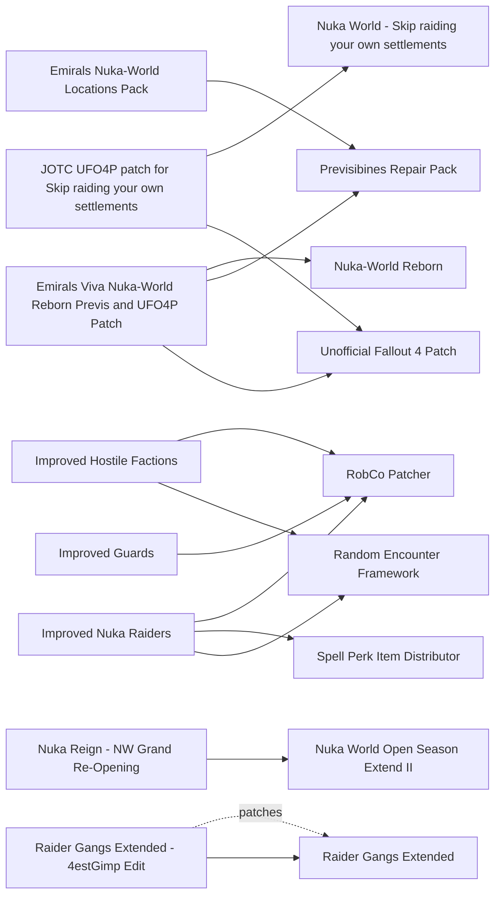

# Raiders and hostile factions

Raiders, Gunners, the Children of Atom, city guards and the raider path through Nuka-World (super mutants and creatures are on the gameplay page). Hostile-faction modding on 1.11.240 is led by Improved Hostile Factions (2.2.2-1, 2026-10-22) and Improved Guards, which work through RobCo Patcher. The classic overhauls (4estGimp - Raider Overhaul ONE, More Gunners, The Deadly Commonwealth Expansion) date from 2016-2021 and rewrite leveled lists that Lunar balances. The raider path itself is thinly modded: small Nuka-World and Preston fixes, no "reformed raider" overhaul. The main risk is CPU: each roaming-gang mod adds NPCs, and stacking them is a problem on a base M3.

## Pick one

| Choose between | Difference | Our pick |
| --- | --- | --- |
| Roaming raider gangs: Improved Hostile Factions (Encounters module), Unique Raider Gangs And Patrols, Raider Gangs Extended | All add roaming groups; stacking them costs CPU | None |
| Raider gear: 4estGimp - Raider Overhaul ONE or The Deadly Commonwealth Expansion, or Lunar | The first two rewrite the leveled lists Lunar balances. With Lunar, prefer mods that put new NPCs on their own lists, and accept those NPCs are not Lunar-tuned | Lunar |
| Nuka-World route: Minutemen Takeover - Nuka World (siege), Nuka-World Reborn + Viva Nuka-World (quests), the raider route, Nuka World Plus (post-clear upgrades) | Nuka World Plus is stated incompatible with Nuka-World Reborn and Viva Nuka-World. Nuka-World Reborn's Nuka-World Brotherhood ends up hostile to Maxson's | Minutemen Takeover - Nuka World |
| Children of Atom: Church of Atom Overhaul or South of the Sea - Atoms Storm | Stated incompatible | Neither |
| Guards: Improved Guards or The Fens Sheriff's Department - Bleachers 2 | FSD replaces Diamond City Security; a conflict is likely but unverified | Neither |
| Gunners: Gunners Overhaul - Initially Friendly Gunners or Gunners Overhaul - No Conflicts | Two variants of the same mod | Neither |

## Suggested stacks

| Profile | Take | Skip |
| --- | --- | --- |
| Lunar on a light machine | People Live In - Unmarked Raider Camps Pack 1 and Pack 2, More Diamond City Bounties, Nuka World Open Season Extend II | 4estGimp - Raider Overhaul ONE, The Deadly Commonwealth Expansion, More Gunners |
| Accepts RobCo Patcher | Improved Hostile Factions (Expanded + Encounters), Improved Guards (new game for its stat changes), Improved Nuka Raiders | The Fens Sheriff's Department - Bleachers 2 |
| Raider or evil playthrough | Nuka World - Skip raiding your own settlements + JOTC UFO4P patch for Skip raiding your own settlements, Nuka World All Gangs Live, Nuka-World No Forced Hatred (Deal With It Preston Reboot), Loyal Porter Gage, Reduced Raiders - Less Commonwealth Nuka-World Attacks, Nuka World Open Season Extend II + Nuka Reign - NW Grand Re-Opening, Preston is killable by SKK | Minutemen Takeover - Nuka World |
| Harder, denser Commonwealth on strong hardware, no Lunar | 4estGimp - Raider Overhaul ONE, Raider Gangs Extended + Raider Gangs Extended - 4estGimp Edit, Locked and Loaded - Gunners Addon, Forced Evolution - Super Mutant Addons, Church of Atom Overhaul | Lunar Fallout Overhaul Deluxe |

## Our choice

The reference playthrough takes nothing from this page: Nuka-World goes through Minutemen Takeover (Minutemen page) and Nuka World Open Season Extend II (DLC page). Improved Hostile Factions and Improved Guards are the maintained options here, but they run on RobCo Patcher, which this playthrough keeps out, and their new NPCs use their own leveled lists, so Lunar's balance does not apply to them.

<!-- BEGIN GENERATED: do not edit, run scripts/build_catalog.py -->
32 mods: 3 recommended, 25 optional, 4 avoid. Plugin slots if you take everything not marked avoid: 0 full.

### Recommended

| | Mod | What it does | Fit | Cost | Links |
| --- | --- | --- | --- | --- | --- |
|  | **[Improved Guards](https://www.nexusmods.com/fallout4/mods/77115)** by Warsaw · v1.3.1 · updated 2026-10-25 · 1,058 endorsements · 12.9 MB | Diamond City Security, Goodneighbor Watch and caravan guards scale to high level with automatic weapons *1.3.1 (2026-10-25); Recommended if Improved Hostile Factions is used; Not compatible with other mods editing Diamond City / Goodneighbor guard NPCs; stat changes need a new game; Likely clashes with Bleachers 2, which replaces Diamond City Security (unverified)* | `recommended` 1.11.240: unknown F4SE DLL | perf low | needs: RobCo Patcher |
|  | **[Improved Hostile Factions](https://www.nexusmods.com/fallout4/mods/77916)** by Warsaw · v2.2.2-1 · updated 2026-10-22 · 1,523 endorsements · 78.1 MB | Gunner Spec Ops and bosses, five roaming raider gangs via REF, Sons of Atom, super mutant variants, tougher Behemoths and Queens; optional Forged and Rust Devils gangs *2.2.2-1 (2026-10-22), modular FOMOD (Expanded / Encounters) by Warsaw; Edits vanilla records through RobCo (no own DLL); its runtime support follows RobCo Patcher; New NPCs use their own leveled lists, so Lunar's balance does not apply to them (no Lunar patch); Don't copy the author's DirectHit setup; Precombines likely safe (no cell edits described, unverified); Roaming gangs can reach Diamond City: pair with Improved Guards; Perf-test with Starts Dead Alive; Pick its Encounters module or Unique Raider Gangs, not both* | `recommended` 1.11.240: unknown F4SE DLL | perf med NPCs many | needs: RobCo Patcher, Random Encounter Framework |
|  | **[JOTC UFO4P patch for Skip raiding your own settlements](https://www.nexusmods.com/fallout4/mods/99872)** by Jewel of the Commonwealth Modding · v1.0 · updated 2026-01-07 · 10 endorsements · 5 KB | UFO4P compatibility patch for Nuka World - Skip raiding your own settlements *2026-01* | `recommended` 1.11.240: plugin only | perf  | needs: Nuka World - Skip raiding your own settlements, Unofficial Fallout 4 Patch |

### Optional

| | Mod | What it does | Fit | Cost | Links |
| --- | --- | --- | --- | --- | --- |
|  | **[4estGimp - Raider Overhaul ONE](https://www.nexusmods.com/fallout4/mods/51658)** by 4estGimp · v3.8 · updated 2024-12-30 · 2,867 endorsements · 1340.5 MB | No-AWKCR one-download repack of Raider Overhaul with fixes *3.8 (2024-12-30); Rewrites raider leveled lists and gear, which conflicts with Lunar; A StoryWealth has a balance patch (64005) but not for Lunar; Avoid for our Lunar list; Optional for non-Lunar lists; Precombine impact unknown* | `optional` 1.11.240: plugin only Lunar: conflict | perf med | conflicts: Raider Overhaul |
|  | **[Church of Atom Overhaul](https://www.nexusmods.com/fallout4/mods/26173)** by Carnagefiend · v1.04a · updated 2024-11-10 · 7,435 endorsements · 37.0 MB | Boston's Children of Atom become an aggressive cabal with new gear *1.04a (2024-11-10); Not compatible with South of the Sea; Author says future versions will likely require AWKCR; Precombine impact unknown* | `optional` 1.11.240: plugin only | perf med |  |
|  | **[Commonwealth Hit Squads](https://www.nexusmods.com/fallout4/mods/60452)** by SabutaiKhan · v1.261 · updated 2026-04-07 · 675 endorsements · 0.1 MB | Faction hit squads that hunt the player *1.261 (2026-04-07); Adds hostile spawns; check whether BoS squads fit a BoS run* | `optional` 1.11.240: plugin only | perf med |  |
|  | **[Forced Evolution - Super Mutant Addons](https://www.nexusmods.com/fallout4/mods/79308)** by RascalArt · v1.0 · updated 2024-03-04 · 1,914 endorsements · 17.7 MB | New hand-placed super mutant enemies, including airborne suiciders and mutant rats *1.0 (2024-03-04); Own NPCs, no Lunar patch; Hand-placed references: precombine impact unknown; Suicider launch is scripted* | `optional` 1.11.240: plugin only | perf med |  |
|  | **[Gunners Overhaul - Initially Friendly Gunners](https://www.nexusmods.com/fallout4/mods/15054)** by BangBangYouAreDead · v1.3 · updated 2016-12-20 · 3,307 endorsements · 6.0 MB | Gunners start neutral and act as a real mercenary faction *1.3 (2016-12-20); Loose 2016 script fragments; author mentions a past precombine issue at Vault 95; A 'No Conflicts' variant exists (73737); Niche: neutral-mercenary runs* | `optional` 1.11.240: plugin only | perf low |  |
|  | **[Gunners Overhaul - No Conflicts](https://www.nexusmods.com/fallout4/mods/73737)** by IceBlue4040 · v2.0 · updated 2023-08-14 · 40 endorsements · 10 KB | Lower-conflict variant of Gunners Overhaul - Initially Friendly Gunners *Only mentioned as a variant in the report; not evaluated* | `optional` 1.11.240: plugin only | perf  | conflicts: Gunners Overhaul - Initially Friendly Gunners |
|  | **[Immersive Gunners Plaza](https://www.nexusmods.com/fallout4/mods/30985)** by MLVic · v5.1 · updated 2025-09-25 · 2,213 endorsements · 77 KB | Gunners HQ with many high-level Gunners and barricades *5.1 (2025-09-25); Downtown Boston cell with added barricades: precombine status not stated, check in xEdit first; Author points to a 2026 remake, True Gunners Plaza* | `optional` 1.11.240: plugin only | perf med NPCs many |  |
|  | **[Improved Nuka Raiders](https://www.nexusmods.com/fallout4/mods/77616)** by Warsaw · v2.1.0 · updated 2026-07-25 · 990 endorsements | Enforcer and Slayer per Nuka-World gang, unique legendaries, optional levelled gang bosses, Pack Ghoulrillas and new encounters *2.1.0 (2026-07-25); Worth it with Minutemen Takeover (harder siege); pointless if you take the raider path; Own leveled lists, same Lunar caveat as IHF; Precombines likely safe (unverified); Needs RobCo Patcher + SPID: AE builds unverified (STEP 1.1: RobCo not yet stable on Anniversary update; report 06 says RobCo 6.0.6 + Runtime Database support 1.11.240); Its leveled-list option conflicts with Lunar's NPC armor lists: skip it* | `optional` 1.11.240: unknown F4SE DLL | perf low | needs: RobCo Patcher, Spell Perk Item Distributor, Random Encounter Framework |
|  | **[Locked and Loaded - Gunners Addon](https://www.nexusmods.com/fallout4/mods/91724)** by RascalArt · v1.1 · updated 2025-02-22 · 1,171 endorsements · 19.3 MB | New Gunner robots: Scrappers, MULEs, Heavy Assaultrons and a Warmaster *1.1 (2025-02-22); Own NPCs; Precombine impact unknown* | `optional` 1.11.240: plugin only | perf med |  |
|  | **[Loyal Porter Gage](https://www.nexusmods.com/fallout4/mods/22710)** by cadero2 · v0.2 · updated 2017-10-27 · 543 endorsements · 3 KB | Gage doesn't turn hostile when you do Open Season *0.2 (2017-10-27); Script edit; author says not every script path is guarded; UFO4P overlap unverified; Listed under raider runs in the report, but it only matters when you turn on the raiders; Author calls it primitive, with known glitches; Edits the Open Season script: may clash with Minutemen Takeover or NWR (unverified)* | `optional` 1.11.240: plugin only | perf low |  |
|  | **[Nuka World All Gangs Live](https://www.nexusmods.com/fallout4/mods/90106)** by love7732851 · v1.0 · updated 2025-06-26 · 66 endorsements · 32 KB | Power Play keeps all three gangs alive *1.0 (2025-06-26), ESL, 66 endorsements (low signal); Compatible with Skip raiding your own settlements* | `optional` 1.11.240: plugin only | perf low |  |
|  | **[Nuka World Glory](https://www.nexusmods.com/fallout4/mods/18393)** by SlacksNawfSide · v1.5 · updated 2026-06-01 · 1,703 endorsements · 2239.7 MB | Strips raider clutter and restores the park *1.5 (2026-06-01); Requires Far Harbor; Cleans cells: precombine impact unknown; Cosmetic restoration after clearing* | `optional` 1.11.240: plugin only | perf low |  |
|  | **[Nuka World Let Be Friend Preston](https://www.nexusmods.com/fallout4/mods/19018)** by dragonsborn · v1.0 · updated 2016-10-05 · 456 endorsements · 2 KB | Preston returns as a companion after Open Season *1.0 (2016-10-05), old* | `optional` 1.11.240: plugin only | perf low |  |
|  | **[Nuka-World No Forced Hatred (Deal With It Preston Reboot)](https://www.nexusmods.com/fallout4/mods/40784)** by ElysianMods · vbeta.4 · updated 2020-10-30 · 378 endorsements | Removes Preston's forced hatred so you can play Minutemen and Nuka raiders in one run *beta.4 (2020-10-30); Removes a lock; Overrides a compiled vanilla script; UFO4P overlap unverified* | `optional` 1.11.240: plugin only | perf low |  |
|  | **[Preston is killable by SKK](https://www.nexusmods.com/fallout4/mods/30575)** by SKKmods · v002 · updated 2019-02-26 · 772 endorsements · 15 KB | Removes Preston's essential status *002 (2019-02-26); Kills a whole questline if used; Avoid for us; for true villain runs only* | `optional` 1.11.240: plugin only | perf low |  |
|  | **[Rags Pirates](https://www.nexusmods.com/fallout4/mods/77416)** by Spifferino · v1.2.0 · updated 2024-01-13 · 379 endorsements · 33 KB | Lightweight overhaul of one vanilla raider gang *1.2.0 (2024-01-13); Conflicts only with direct record edits; Precombine impact unknown* | `optional` 1.11.240: plugin only | perf low |  |
|  | **[Raider Gangs Extended](https://www.nexusmods.com/fallout4/mods/42414)** by Specific · v0.84 · updated 2021-04-27 · 5,348 endorsements · 0.4 MB | Hostile raider gangs with named bosses and survivor groups in many areas *0.84 (2021-04-27), stale; Author warns extra spawns may cause frame dips and some optional files cause CTDs; Avoid for us (Improved Hostile Factions covers the need); readers on strong hardware without Lunar may use it with the 4estGimp edit; Precombine impact unknown; Does not edit leveled lists; 4estGimp patch recommended; Page mentions a PRP interaction (text truncated): check in xEdit* | `optional` 1.11.240: plugin only | perf high NPCs many | patches: Raider Gangs Extended - 4estGimp Edit |
|  | **[Raiders of the Pink Paste](https://www.nexusmods.com/fallout4/mods/63477)** by StiffyWoods · v1.7 · updated 2026-05-09 · 947 endorsements · 23.0 MB | Small side quest: help or seal in raiders at Suffolk County Charter School *1.7 (2026-05-09), ESL option; Interior only; Uses vanilla outfits, so leveled-list mods apply; Good small 'grey' raider content* | `optional` 1.11.240: plugin only | perf low |  |
|  | **[Reduced Raiders - Less Commonwealth Nuka-World Attacks](https://www.nexusmods.com/fallout4/mods/41993)** by ScottyDoesKnow · v1.1.0 · updated 2019-11-08 · 46 endorsements · 0.2 MB | Reduces or disables Nuka raider attacks on the Commonwealth *1.1.0 (2019-11-08)* | `optional` 1.11.240: plugin only | perf low |  |
|  | **[Unique Raider Gangs And Patrols](https://www.nexusmods.com/fallout4/mods/80123)** by PrecisionTacos · v1.0.0 · updated 2024-04-25 · 1,367 endorsements · 336.4 MB | Four new raider gangs with patrols and 40+ new armors *1.0.0 (2024-04-25), ESL; No leveled-list edits, no scripts; its own armor list is not Lunar-balanced; Claims SS2 and NPCs Travel compatibility; Author: place above PRP, below worldspace edits (adds references; precombine impact unverified); Pick this or the IHF Encounters module, not both* | `optional` 1.11.240: plugin only | perf med |  |
|  | **[Diverse Forged](https://www.nexusmods.com/fallout4/mods/79209)** by rsm000rsm · v7 · updated 2025-07-05 · 148 endorsements · 0.1 MB | Dedicated face pool for the Forged *7 (2025-07-05); Conflicts with mods editing Forged actors (IHF's optional Forged module: unverified)* | `optional` 1.11.240: plugin only | perf low |  |
|  | **[Nuka Reign - NW Grand Re-Opening](https://www.nexusmods.com/fallout4/mods/108232)** by xYamiSorax · v1 · updated 2026-08-21 · 2 endorsements · 1 KB | Lets raiders and settlers coexist in Nuka-World without Open Season *2026-08; Open Season Extend II variant with no Open Season requirement* | `optional` 1.11.240: plugin only | perf  | needs: Nuka World Open Season Extend II |
|  | **[Raider Gangs Extended - 4estGimp Edit](https://www.nexusmods.com/fallout4/mods/57675)** by 4estGimp · v1.0.1 · updated 2024-11-25 · 1,018 endorsements · 83 KB | Leveled-list fixes for Raider Gangs Extended, with an SS2 Concord patch *Named in the report as the fixed way to run Raider Gangs Extended* | `optional` 1.11.240: plugin only | perf  | needs: Raider Gangs Extended |
|  | **[Emirals Nuka-World Locations Pack](https://www.nexusmods.com/fallout4/mods/90652)** by emiral · v1.0 · updated 2025-01-11 · 21 endorsements · 160.0 MB | Combined PRP patch for several Nuka-World settlement and quest mods *2025-01-11; Probably the replacement for Emiral's NWR/VNW previs patch (not confirmed); PRP base vs 81.9 unchecked* | `optional` 1.11.240: plugin only | perf  | needs: Previsibines Repair Pack |
|  | **[Emirals Viva Nuka-World Reborn Previs and UFO4P Patch](https://www.nexusmods.com/fallout4/mods/80489)** by emiral85 · v1.3 · updated 2025-01-26 · 114 endorsements · 0.2 MB | PRP previs and UFO4P patch for Nuka-World Reborn and Viva Nuka-World *1.3 (2025-01-26); Required if NWR/VNW is used; Built on PRP .74 (we run 81.9); Author says a newer combined Nuka-World patch replaces it, probably Emirals Nuka-World Locations Pack (match not confirmed)* | `optional` 1.11.240: plugin only | perf  | needs: Nuka-World Reborn, Previsibines Repair Pack, Unofficial Fallout 4 Patch conflicts: Nuka World Plus |

### Avoid

| | Mod | What it does | Fit | Cost | Links |
| --- | --- | --- | --- | --- | --- |
|  | **[Friendly Vanilla Raider Settlements](https://www.nexusmods.com/fallout4/mods/76147)** by RandomPlayer97 · v1.0 · updated 2023-11-28 · 23 endorsements · 127.3 MB | Friendly raider settlers at Outpost Zimonja and Hangman's Alley *1.0 (2023-11-28), 23 endorsements (low signal); Possible overlap with SS2 settlement handling (unverified); Precombine impact unknown* | `avoid` 1.11.240: plugin only | perf low |  |
|  | **[More Gunners](https://www.nexusmods.com/fallout4/mods/53494)** by o_0 · v1.02 · updated 2021-08-04 · 568 endorsements · 0.5 MB | 10 new Gunner bases with patrols and vertibirds, 100-150 respawning Gunners *1.02 (2021-08-04); Too costly for our CPU; Adds bases: precombine impact unknown* | `avoid` 1.11.240: plugin only | perf high NPCs many |  |
|  | **[Nuka world - Becoming Overboss worth it](https://www.nexusmods.com/fallout4/mods/18879)** by Smarjeon · v1 · updated 2016-09-29 · 135 endorsements · 28 KB | More caps from Nuka-World outposts and vassals *1 (2016-09-29); Stale 2016 vanilla script override* | `avoid` 1.11.240: plugin only | perf low |  |
|  | **[The Deadly Commonwealth Expansion](https://www.nexusmods.com/fallout4/mods/24980)** by Dark Claw Raven · v8 · updated 2017-06-30 · 3,705 endorsements · 368.5 MB | New variants for every enemy faction *8 (2017-06-30), stale; Leveled-list overhaul that conflicts with Lunar; Precombine impact unknown* | `avoid` 1.11.240: plugin only Lunar: conflict | perf med |  |

### Dependencies and patches

<!-- END GENERATED -->
