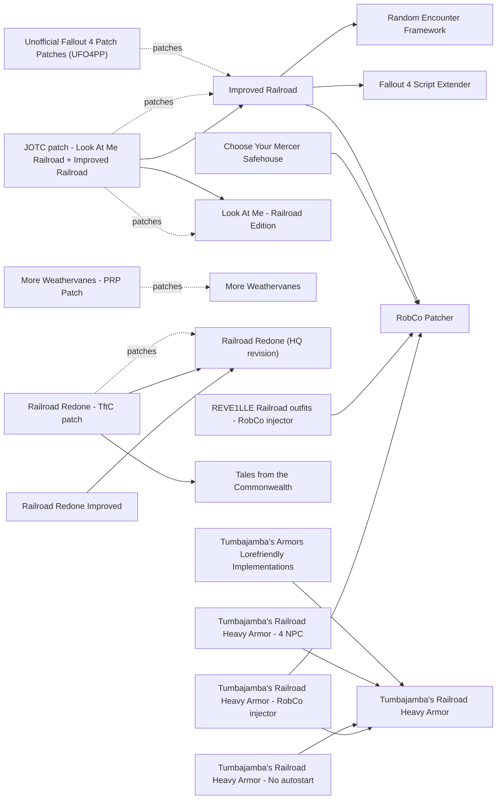

# The Railroad

Railroad agents, the synth-escape radiants, Railroad HQ, ballistic weave, and the endings that destroy or spare the Railroad. It is the least-modded major faction: one maintained gameplay overhaul, Improved Railroad 2.1.0 (2026-07-25, RobCo Patcher), no mod that extends the Railroad story, and small 2025-2026 plugins such as No Railroad Checkpoints, Railroad HQ Redux and Switchboard Reborn. The best-known "spare the Railroad" mod for BoS players was removed from Nexus in 2024. The main risk is the ending itself: the vanilla Railroad path destroys the Prydwen, and the vanilla BoS path destroys the Railroad.

## Pick one

| Choose between | Difference | Our pick |
| --- | --- | --- |
| HQ cell: Railroad HQ Redux, Railroad Redone (HQ revision) + Railroad Redone Improved, Railroad HQ Cleanup | All edit the HQ cell; load after PRP and check against Tales from the Commonwealth. Railroad HQ Redux conflicts with Faction Housing Overhaul - All In One | None |
| Mercer Safehouse: Choose Mercer Safehouse Location, Choose Your Mercer Safehouse, No Random Mercer Safehouse Location, Railroad Radiant Quests Are Side Quests | In-game menu, RobCo Patcher, one plugin per location, or a fixed location | None |
| Railroad leveled lists: Improved Railroad, Covert Sidearm and Railroad Fixes, Better Railroad Equipment | All rewrite agent gear | None |
| Post-ending checkpoints: No Railroad Checkpoints or The Railroad Gives Credit to the Minutemen | Remove the checkpoints, or have Minutemen garrison them | None |
| Weave without the Railroad: Ballistic Weave Unlocked or No Rail Road Ballistic Weave | Same unlock; Railroad HQ Redux also unlocks it | None |
| Tumbajamba heavy armor distribution: Tumbajamba's Armors Lorefriendly Implementations, Tumbajamba's Railroad Heavy Armor - 4 NPC, Tumbajamba's Railroad Heavy Armor - RobCo injector, Tumbajamba's Railroad Heavy Armor - No autostart | Sold at Tinker Tom, worn by agents, injected by RobCo, or simply not added on load | None |

## Suggested stacks

| Profile | Take | Skip |
| --- | --- | --- |
| BoS or Minutemen run that keeps the fork open | Delay Tactical Thinking, Railroad Glory Bug Fix, Lost Soul Quest Tweak - No Faction Hostility, Rescued Synths Go to Mercer Safehouse, Choose Mercer Safehouse Location, A Cleaner Equation | Improved Railroad, No Railroad Checkpoints |
| Railroad loyalist | Improved Railroad, Settler and Companion Dialogue Overhaul (Deacon's quest), Switchboard Reborn, Railroad Redone (HQ revision) + Railroad Redone Improved + Railroad Redone - TftC patch, Look At Me - Railroad Edition + JOTC patch - Look At Me Railroad + Improved Railroad, Railroad Settlers, No Railroad Checkpoints, Railroad Travel Agent | Railroad HQ Redux, The Railroad Gives Credit to the Minutemen |
| Minutemen general who likes the Railroad | Lost Soul Quest Tweak - No Faction Hostility, The Railroad Gives Credit to the Minutemen (its author says it is untested), A Cleaner Equation, Ending Epilogue Restored | No Railroad Checkpoints |
| BoS player who never joins the Railroad | More Weaves - No Railroad or Ballistic Weave Unlocked | The rest of this page |

## Our choice

The reference playthrough takes Delay Tactical Thinking: starting Tactical Thinking no longer locks out PAM, so the BoS/Railroad fork stays open longer, though the Railroad's destruction is only delayed. Improved Railroad stays out with the RobCo-based "Improved" series. Subversion, the only alternate Railroad ending, opens through the Institute route and spares the BoS by replacing Maxson with a synth, so it is not in this playthrough.

<!-- BEGIN GENERATED: do not edit, run scripts/build_catalog.py -->
56 mods: 12 recommended, 35 optional, 9 avoid. Plugin slots if you take everything not marked avoid: 0 full.

### Recommended

| | Mod | What it does | Fit | Cost | Links |
| --- | --- | --- | --- | --- | --- |
|  | **[A Cleaner Equation](https://www.nexusmods.com/fallout4/mods/48571)** by oracus0 · v1.0 · updated 2020-11-22 · 60 endorsements | Stops PAM's post-game kill-the-BoS radiants unless Rockets' Red Glare is done *Only useful with a Minutemen or neutral ending that keeps both the BoS and the Railroad; Author does not know how it interacts with UFO4P: check in xEdit* | `recommended` 1.11.240: plugin only | perf low |  |
|  | **[Choose Mercer Safehouse Location](https://www.nexusmods.com/fallout4/mods/85348)** by adbenj · v1.0.4 · updated 2024-07-04 · 102 endorsements · 10 KB | Pip-Boy menu to pick which of the 12 candidates becomes the Mercer Safehouse *Stops Mercer from taking a site planned for SS2; Install before the quest starts; Pick one Mercer chooser* | `recommended` 1.11.240: plugin only | perf low | conflicts: Choose Your Mercer Safehouse, No Random Mercer Safehouse Location, Railroad Radiant Quests Are Side Quests |
|  | **[Delay Tactical Thinking](https://www.nexusmods.com/fallout4/mods/86927)** by Exoclyps · v1.0.0 · updated 2024-08-21 · 221 endorsements · 36 KB | Starting Tactical Thinking no longer locks out PAM, and telling Kells you're not ready really delays the kick-out *Keeps the BoS and Railroad paths open longer; only delays the Railroad's destruction; Touches PAM and Kells dialogue: check against Subversion (edits PAM's terminal)* | `recommended` 1.11.240: plugin only | perf low |  |
|  | **[Improved Railroad](https://www.nexusmods.com/fallout4/mods/76749)** by Warsaw · v2.1.0 · updated 2026-07-25 · 1,388 endorsements | Overhauls Railroad agents: new leveled lists, legendary and synth agents, ranks, quest-progress perks and REF encounters *Core if Improved Minutemen stays (same author and stack, no extra framework); drop it if the RobCo test fails; Dependencies claim AE (RobCo 6.0.6 OG/NG/AE; SPID 3.1.1 AE for some FOMOD options only, skip those unless SPID is in the list); 1.11.240 not confirmed; Needs Automatron, Far Harbor and Nuka-World; Does not change faction NPC stats; Lunar compatibility unverified, test a Railroad encounter and Glory's level; Legacy ESP 1.9.5 still offered* | `recommended` 1.11.240: unknown F4SE DLL | perf med NPCs few | needs: Fallout 4 Script Extender, RobCo Patcher, Random Encounter Framework patches: Unofficial Fallout 4 Patch Patches (UFO4PP), JOTC patch - Look At Me Railroad + Improved Railroad conflicts: Better Railroad Equipment, Covert Sidearm and Railroad Fixes |
|  | **[Lost Soul Quest Tweak - No Faction Hostility](https://www.nexusmods.com/fallout4/mods/59070)** by Babaloo321 · vv2.5 · updated 2024-10-10 · 233 endorsements · 6 KB | Lost Soul synths drop the Institute faction, get disguises and stop fighting Minutemen at checkpoints *Built to work with Rescued Synths Go to Mercer Safehouse; ships patches for WATM-Tweaks and Rescued Synths; Likely conflict with Railroad Radiant Quests Are Side Quests (unverified); Institute report rates it Optional* | `recommended` 1.11.240: plugin only | perf low |  |
|  | **[More Weathervanes](https://www.nexusmods.com/fallout4/mods/89596)** by Glitchfinder · v1.01 · updated 2026-07-24 · 1,107 endorsements | Adds 42 targets to the Weathervane radiant quest and avoids the cannot-finish bug *TMR Content; PRP 81.5x patch on 103474 (needs DLCNukaWorld.esm); In 6 of 24 Wabbajack lists (2026-10); Gap audit 2026-10-29* | `recommended` 1.11.240: plugin only | perf low 0 full / 1 light | patches: More Weathervanes - PRP Patch |
|  | **[No Railroad Checkpoints](https://www.nexusmods.com/fallout4/mods/104699)** by Glitchfinder · v1.00 · updated 2026-05-12 · 119 endorsements · 8 KB | The Railroad never sets up post-ending checkpoints and existing ones are reset *Only if you end with the Railroad and want them covert; By Glitchfinder (REF/CEP author); ESL; Interaction with WATM checkpoints unverified* | `recommended` 1.11.240: plugin only | perf low 0 full / 1 light | conflicts: The Railroad Gives Credit to the Minutemen |
|  | **[Railroad Glory Bug Fix](https://www.nexusmods.com/fallout4/mods/6389)** by MissionCtrl · v1.0 · updated 2015-12-19 · 224 endorsements · 6 KB | Makes Glory essential during Memory Interrupted so her death cannot softlock the Railroad questline *Install before Memory Interrupted; Edits Glory's NPC record: probably fine with Improved Railroad (it changes Glory via RobCo), unverified; Whether UFO4P already fixes this is unverified* | `recommended` 1.11.240: plugin only | perf low |  |
|  | **[Rescued Synths Go to Mercer Safehouse](https://www.nexusmods.com/fallout4/mods/73648)** by adbenj · v1.2.2 · updated 2024-07-03 · 145 endorsements · 0.1 MB | Restores cut code so Lost Soul synths can become Mercer Safehouse settlers with unused voiced lines *Institute report rates it Optional; Conflicts with other Lost Soul edits except Lost Soul Quest Tweak; Optional RobCo file exists* | `recommended` 1.11.240: plugin only | perf low |  |
|  | **[Tumbajamba's Armors Lorefriendly Implementations](https://www.nexusmods.com/fallout4/mods/109935)** by TotalArmature · vE1 · updated 2026-10-15 · 5 endorsements · 1 KB | Sells the Railroad heavy armor at Tinker Tom with weave support instead of auto-adding it *Author: built for AE game version 240 (2026-10-15); Pick one distribution add-on* | `recommended` 1.11.240: yes | perf  | needs: Tumbajamba's Railroad Heavy Armor conflicts: Tumbajamba's Railroad Heavy Armor - 4 NPC, Tumbajamba's Railroad Heavy Armor - RobCo injector, Tumbajamba's Railroad Heavy Armor - No autostart |
|  | **[Tumbajamba's Railroad Heavy Armor](https://www.nexusmods.com/fallout4/mods/84146)** by tumbajamba · v1.1 · updated 2024-06-08 · 790 endorsements · 8.9 MB | New Railroad heavy armor, added to your inventory on load by default *Use one distribution add-on (Lore-friendly Implementations recommended; or 4 NPC, RobCo injector, No autostart); Built with the newest CK, so fine on AE; Stats not balanced for Lunar* | `recommended` 1.11.240: plugin only | perf  |  |
|  | **[Railroad HQ Redux](https://www.nexusmods.com/fallout4/mods/100382)** by slavomirperun · v1.1 · updated 2026-05-19 · 83 endorsements · 53 KB | Cleans up Railroad HQ with linked workstations, loot, NPC beds, a ballistic-weave unlock for other factions and an opt-in faction menu *Our HQ pick (pick one HQ overhaul); No previs, has occlusion planes: load after PRP; Works with ELFX and Elianora's standalone Railroad HQ file, not the FHO All-In-One; TftC overlap unverified: check in xEdit; Unlocks weave for BoS players* | `recommended` 1.11.240: plugin only | perf low | conflicts: Railroad Redone (HQ revision), Railroad Redone Improved, Railroad HQ Cleanup, Faction Housing Overhaul - All In One |

### Optional

| | Mod | What it does | Fit | Cost | Links |
| --- | --- | --- | --- | --- | --- |
|  | **[Abandoned Hub - Underground Railroad ReRedux](https://www.nexusmods.com/fallout4/mods/52227)** by WhiskyTangoFox · v3.3 · updated 2024-05-20 · 723 endorsements · 1.7 MB | 18 manholes forming a tunnel fast-travel network and a settlement hub *Built for Survival mode (we don't use it); Exterior manhole previs impact unknown* | `optional` 1.11.240: plugin only | perf low |  |
|  | **[Choose Your Mercer Safehouse](https://www.nexusmods.com/fallout4/mods/72074)** by Yabo · v1.0 · updated 2023-06-11 · 110 endorsements · 1.5 MB | Pick the Mercer Safehouse location in a FOMOD, applied through RobCo Patcher *Alternative to the in-game chooser; Needs RobCo 2.8+ (AE build claimed; 1.11.240 unconfirmed)* | `optional` 1.11.240: unknown F4SE DLL | perf low | needs: RobCo Patcher conflicts: Choose Mercer Safehouse Location, No Random Mercer Safehouse Location, Railroad Radiant Quests Are Side Quests |
|  | **[Faction Housing Overhaul - Railroad HQ](https://www.nexusmods.com/fallout4/mods/13490)** by Elianora · v1.2 · updated 2016-06-25 · 5,795 endorsements · 55.7 MB | Separate player wing in Railroad HQ with mirror, storage and a cat *Least invasive layout change; Use this standalone file, not the FHO All-In-One version (reported defective: empty worldspace, r/fo4 2026-02); Previs unknown; locksmith issues reported* | `optional` 1.11.240: plugin only | perf low |  |
|  | **[Glory's Grave](https://www.nexusmods.com/fallout4/mods/20574)** by Swindlefingers · v1.0 · updated 2016-12-11 · 118 endorsements · 6 KB | Adds a grave for Glory in Railroad HQ next to Patriot's *Already part of Railroad Redone* | `optional` 1.11.240: plugin only | perf  |  |
|  | **[No Random Mercer Safehouse Location](https://www.nexusmods.com/fallout4/mods/12082)** by EmberQuill · v1.0.1 · updated 2017-08-27 · 1,397 endorsements · 7 KB | Fixes the Mercer Safehouse to one location, one ESP per choice *The original (2017); its author points to the two newer choosers* | `optional` 1.11.240: plugin only | perf low | conflicts: Choose Mercer Safehouse Location, Choose Your Mercer Safehouse, Railroad Radiant Quests Are Side Quests |
|  | **[Old North Church Player Home](https://www.nexusmods.com/fallout4/mods/82671)** by Penguinsrockrgr8 · v0.9 · updated 2024-05-12 · 13 endorsements · 26 KB | Turns the Old North Church steeple into a small Railroad hideout *Untested and tiny (v0.9, 13 endorsements); Precombine impact unknown* | `optional` 1.11.240: plugin only | perf  |  |
|  | **[RR101 Instant Unlock](https://www.nexusmods.com/fallout4/mods/110090)** by ehbrmqUb · v1 · updated 2026-10-13 · 31 endorsements · 1 KB | Skips the Freedom Trail password puzzle *Spoils the puzzle; 2026-10* | `optional` 1.11.240: plugin only | perf low |  |
|  | **[Railroad HQ - Direct Entrance via Manhole](https://www.nexusmods.com/fallout4/mods/14546)** by rcavanah · v1.0 · updated 2016-06-02 · 486 endorsements · 23 KB | Manhole entrance next to the Railroad HQ map marker *Author: objects added to an exterior cell, no precombined mesh conflicts; previs not regenerated (unverified); Railroad HQ Redux lists it in its load order* | `optional` 1.11.240: plugin only | perf low |  |
|  | **[Railroad Radiant Quests Are Side Quests](https://www.nexusmods.com/fallout4/mods/86491)** by Malistroth · v1.1 · updated 2024-08-08 · 99 endorsements · 11 KB | Turns Railroad radiants into one-time quests at fixed locations *Hard-sets Mercer at Taffington Boathouse; Also changes Lost Soul: likely conflict with Lost Soul mods (unverified)* | `optional` 1.11.240: plugin only | perf low | conflicts: Choose Mercer Safehouse Location, Choose Your Mercer Safehouse, No Random Mercer Safehouse Location |
|  | **[Railroad Redefined](https://www.nexusmods.com/fallout4/mods/38325)** by MrNeedles · v1.0 · updated 2019-04-04 · 30 endorsements · 29 KB | Lets players who took the Institute ending repair relations with the Railroad *Niche; overlaps Subversion* | `optional` 1.11.240: plugin only | perf low |  |
|  | **[Railroad Redemption - Life of a Secret Agent](https://www.nexusmods.com/fallout4/mods/17560)** by Chakka · v1.1 · updated 2016-09-15 · 358 endorsements · 17 KB | Note-driven spy backstory quest with six early legendaries *Dated (2016); needs Settlement Shelters; Precombine impact unknown* | `optional` 1.11.240: plugin only | perf low |  |
|  | **[Railroad Redone (HQ revision)](https://www.nexusmods.com/fallout4/mods/51735)** by Xfreakish · v2.0 · updated 2022-04-01 · 2,165 endorsements · 0.1 MB | Full Railroad HQ redecoration with quarters for leaders and the player, Glory's grave and a dry escape tunnel *Most complete look; breaks ELFX/UIL lighting in that cell (2022)* | `optional` 1.11.240: plugin only | perf low | patches: Railroad Redone - TftC patch conflicts: Railroad HQ Redux, Railroad HQ Cleanup |
|  | **[Railroad Settlers](https://www.nexusmods.com/fallout4/mods/105132)** by rsm000rsm · v1 · updated 2026-05-22 · 12 endorsements · 0.1 MB | 100-face pool of Railroad agents, heavies and runaway synths as settlers *SS2 support via optional patches (which ones exist is unverified); Settlers turn hostile if the Railroad becomes your enemy* | `optional` 1.11.240: plugin only | perf low |  |
|  | **[Railroad Travel Agent](https://www.nexusmods.com/fallout4/mods/71168)** by El Ha · v1.2 · updated 2023-11-16 · 166 endorsements · 2.0 MB | A Railroad Signal calls an agent who fast-travels you to 11 inner-city points *The agent attacks you if the Railroad is hostile; Adds endpoints: exterior previs impact unverified* | `optional` 1.11.240: plugin only | perf low |  |
|  | **[RailroadPerks - Cut Content Restored](https://www.nexusmods.com/fallout4/mods/11751)** by Seekingthesun · v1.0 · updated 2016-04-07 · 1,066 endorsements · 16 KB | Scavenger hunt from Old North Church restoring four cut Railroad perks *Lunar rebalances perks; these four are small (2016)* | `optional` 1.11.240: plugin only | perf low |  |
|  | **[SKK Fast Start Railroad](https://www.nexusmods.com/fallout4/mods/89100)** by SKKMods · v002 · updated 2024-11-10 · 160 endorsements · 9 KB | Auto-completes Road to Freedom and Tradecraft and opens HQ and tunnels *For replays; No vanilla script edits* | `optional` 1.11.240: plugin only | perf low |  |
|  | **[The Railroad Gives Credit to the Minutemen](https://www.nexusmods.com/fallout4/mods/99827)** by VladimirMarduk · v1.0 · updated 2026-01-19 · 16 endorsements · 11 KB | After a Railroad ending, Minutemen garrison the checkpoints and Diamond City flags turn blue *Author: untested as of now; Only changes post-Railroad-ending flavor; Interaction with WATM and Minutemen Takeover unverified* | `optional` 1.11.240: plugin only | perf low | conflicts: No Railroad Checkpoints |
|  | **[Look At Me - Railroad Edition](https://www.nexusmods.com/fallout4/mods/45706)** by S4iS3i · vFinal.1 · updated 2022-11-30 · 1,832 endorsements · 14.7 MB | Re-dresses the whole Railroad faction with perk-gated crafting *Needs Far Harbor and TheKite's Handmaiden (+ skin pack): extra assets, skipped for us; Pip-Boy clipping on males* | `optional` 1.11.240: plugin only | perf med | patches: JOTC patch - Look At Me Railroad + Improved Railroad |
|  | **[More Weaves - No Railroad](https://www.nexusmods.com/fallout4/mods/4332)** by Mateodon · v1.2 · updated 2015-12-06 · 6,478 endorsements · 1 KB | Five new ballistic weave tiers available without the Railroad *For BoS players who never join the Railroad; Values unbalanced vs Lunar's clothing balance* | `optional` 1.11.240: plugin only | perf  |  |
|  | **[REVE1LLE Railroad Marksman Outfit](https://www.nexusmods.com/fallout4/mods/98550)** by REVE1LLE · v1.0.0 · updated 2025-11-24 · 38 endorsements · 0.7 MB | Kitbashed vanilla-asset Railroad marksman outfit with legendary effects and weave support *Same series as the Recon outfit* | `optional` 1.11.240: plugin only | perf low |  |
|  | **[REVE1LLE Railroad Recon Outfit](https://www.nexusmods.com/fallout4/mods/97998)** by REVE1LLE · v1.0.0 · updated 2025-11-08 · 42 endorsements · 0.4 MB | Kitbashed vanilla-asset Railroad outfit with legendary effects and weave support, placed in HQ *Legendary effects are generous for Lunar; Cheap (vanilla assets)* | `optional` 1.11.240: plugin only | perf low |  |
|  | **[REVE1LLE Railroad Scout Outfit](https://www.nexusmods.com/fallout4/mods/98056)** by REVE1LLE · v1.0.0 · updated 2025-11-10 · 32 endorsements · 0.5 MB | Kitbashed vanilla-asset Railroad scout outfit with legendary effects and weave support *Same series as the Recon outfit* | `optional` 1.11.240: plugin only | perf low |  |
|  | **[REVE1LLE Railroad outfits - RobCo injector](https://www.nexusmods.com/fallout4/mods/103931)** by AnyaSereevna · v1 · updated 2026-04-22 · 17 endorsements · 1 KB | Distributes the REVE1LLE Railroad outfits to NPCs through RobCo Patcher *RobCo on 1.11.240 unconfirmed* | `optional` 1.11.240: unknown F4SE DLL | perf  | needs: RobCo Patcher |
|  | **[Railroad Clandestine Couture - 77wanderer's Cut](https://www.nexusmods.com/fallout4/mods/98467)** by 77wanderer and Bethesda Game Studios · v0.77 · updated 2026-02-18 · 16 endorsements · 18.9 MB | Fixes the Railroad Clandestine Couture Creation and dresses NPCs in it *Requires the paid Railroad Clandestine Couture Creation, which we don't own: not for us* | `optional` 1.11.240: plugin only | perf  |  |
|  | **[Railroad Paints for All PA (RP4APA)](https://www.nexusmods.com/fallout4/mods/98029)** by K3VLOL99 and Hogwarts99 · v1.0 · updated 2026-09-13 · 33 endorsements · 222.5 MB | Railroad paint jobs for T-45, T-60, X-01, X-02 and Hellfire power armor *Needs the X-02 and Hellfire Creations (we own them)* | `optional` 1.11.240: plugin only | perf  |  |
|  | **[Tumbajamba's Railroad Heavy Armor - 4 NPC](https://www.nexusmods.com/fallout4/mods/84167)** by Rantanplan76 · v1.0.0 · updated 2024-06-06 · 139 endorsements · 0 KB | Railroad agents wear the Tumbajamba heavy armor *Pick one distribution add-on* | `optional` 1.11.240: plugin only | perf  | needs: Tumbajamba's Railroad Heavy Armor conflicts: Tumbajamba's Armors Lorefriendly Implementations, Tumbajamba's Railroad Heavy Armor - RobCo injector, Tumbajamba's Railroad Heavy Armor - No autostart |
|  | **[Tumbajamba's Railroad Heavy Armor - No autostart](https://www.nexusmods.com/fallout4/mods/98101)** by dovakhin1998 · v4 · updated 2025-11-24 · 21 endorsements · 1 KB | Stops the Tumbajamba Railroad heavy armor being added to your inventory on load *Pick one distribution add-on* | `optional` 1.11.240: plugin only | perf  | needs: Tumbajamba's Railroad Heavy Armor conflicts: Tumbajamba's Armors Lorefriendly Implementations, Tumbajamba's Railroad Heavy Armor - 4 NPC, Tumbajamba's Railroad Heavy Armor - RobCo injector |
|  | **[Tumbajamba's Railroad Heavy Armor - RobCo injector](https://www.nexusmods.com/fallout4/mods/107920)** by AnyaSereevna · v1 · updated 2026-08-11 · 18 endorsements · 0 KB | Injects the Tumbajamba Railroad heavy armor through RobCo Patcher *Pick one distribution add-on; RobCo on 1.11.240 unconfirmed* | `optional` 1.11.240: unknown F4SE DLL | perf  | needs: Tumbajamba's Railroad Heavy Armor, RobCo Patcher conflicts: Tumbajamba's Armors Lorefriendly Implementations, Tumbajamba's Railroad Heavy Armor - 4 NPC, Tumbajamba's Railroad Heavy Armor - No autostart |
|  | **[Ballistic Weave Unlocked](https://www.nexusmods.com/fallout4/mods/45046)** by Spirfox · v1.0 · updated 2020-05-14 · 1,081 endorsements · 1 KB | Unlocks vanilla ballistic weave without joining the Railroad *Redundant with Railroad HQ Redux, which also unlocks weave; Pick one* | `optional` 1.11.240: plugin only | perf  | conflicts: No Rail Road Ballistic Weave |
|  | **[No Rail Road Ballistic Weave](https://www.nexusmods.com/fallout4/mods/12975)** by lautasantenni · v0.2a · updated 2016-05-05 · 3,091 endorsements · 12 KB | Unlocks vanilla ballistic weave without joining the Railroad *2016; Redundant with Railroad HQ Redux or Ballistic Weave Unlocked; Pick one* | `optional` 1.11.240: plugin only | perf  | conflicts: Ballistic Weave Unlocked |
|  | **[JOTC patch - Look At Me Railroad + Improved Railroad](https://www.nexusmods.com/fallout4/mods/102837)** by CyberGarrus · v1 · updated 2026-03-23 · 5 endorsements · 5 KB | Compatibility patch between Look At Me - Railroad Edition and Improved Railroad *Built on the OG game version (part of the JOTC list)* | `optional` 1.11.240: plugin only | perf  | needs: Look At Me - Railroad Edition, Improved Railroad |
|  | **[Railroad Redone - TftC patch](https://www.nexusmods.com/fallout4/mods/60595)** by 103Sakamoto · v1.0 · updated 2022-09-11 · 537 endorsements · 22.2 MB | Compatibility patch between Railroad Redone and Tales from the Commonwealth *Exact file name on the Files tab not checked; the only known TftC patch for any HQ mod* | `optional` 1.11.240: plugin only | perf low | needs: Railroad Redone (HQ revision), Tales from the Commonwealth |
|  | **[Railroad HQ Cleanup](https://www.nexusmods.com/fallout4/mods/80021)** by Aurelianis · v1.1 · updated 2024-04-03 · 170 endorsements · 2.3 MB | Removes rubble and coffins from Railroad HQ with regenerated navmesh and previs *Conflicts with every other HQ mod; Previs built on a pre-2024 PRP basis* | `optional` 1.11.240: plugin only | perf low | conflicts: Railroad HQ Redux, Railroad Redone (HQ revision), Railroad Redone Improved |
|  | **[Railroad Redone Improved](https://www.nexusmods.com/fallout4/mods/60595)** by 103Sakamoto · v1.0 · updated 2022-09-11 · 537 endorsements · 22.2 MB | Add-on to Railroad Redone that regenerates previs for the HQ *Load after PRP; Previs built for the 2022 PRP; current PRP branch unverified* | `optional` 1.11.240: plugin only | perf low | needs: Railroad Redone (HQ revision) conflicts: Railroad HQ Redux, Railroad HQ Cleanup |
|  | **[Switchboard Reborn](https://www.nexusmods.com/fallout4/mods/101976)** by slavomirperun · v1.5 · updated 2026-08-07 · 114 endorsements · 8.2 MB | New quest to retake the Switchboard with a full settlement and three Railroad radiants *The only new Railroad quest content (2026); young, so test it; Ships new previs for the cell: load after PRP; Settlement attacks disabled there; AR2 variant exists; Faction menu is opt-in (after killing Ashburn); New game recommended; Recommends Keep Radiants in the Commonwealth or the author's patch; Skipped for us until after a first stable run* | `optional` 1.11.240: plugin only | perf med |  |

### Avoid

| | Mod | What it does | Fit | Cost | Links |
| --- | --- | --- | --- | --- | --- |
|  | **[Better Railroad Equipment](https://www.nexusmods.com/fallout4/mods/99254)** by alice · v1 · updated 2025-12-28 · 7 endorsements · 6 KB | Railroad leaders get 110 DR/ER and Gauss rifles; Glory always gets a Mk V *Avoid with Improved Railroad (overlaps Glory and leaders); Optional without it* | `avoid` 1.11.240: plugin only | perf low | conflicts: Improved Railroad |
|  | **[Cleaner Railroad HQ Environment](https://www.nexusmods.com/fallout4/mods/20860)** by IZGaming11 · v2.0 · updated 2017-02-09 · 578 endorsements · 5 KB | 2016 Railroad HQ cleanup *Superseded by Railroad HQ Redux / Cleanup* | `avoid` 1.11.240: plugin only | perf  |  |
|  | **[Covert Sidearm and Railroad Fixes](https://www.nexusmods.com/fallout4/mods/73728)** by Kalevala17 · v1.0 · updated 2023-08-09 · 8 endorsements · 19 KB | Gives agents a non-legendary Deliverer and removes raider guns from their lists *Hard leveled-list edits conflict with Improved Railroad and Lunar's lists; Improved Railroad does this better* | `avoid` 1.11.240: plugin only Lunar: conflict | perf low | conflicts: Improved Railroad |
|  | **[Prettier Railroad Agents (and Buffs)](https://www.nexusmods.com/fallout4/mods/96780)** by CasshernX · vv1.0.1 · updated 2025-10-25 · 12 endorsements · 2 KB | Restyles 21 Railroad agents *Visual only and needs 7 hair and eye packs; overrides faces* | `avoid` 1.11.240: plugin only | perf med |  |
|  | **[Railroad HQ Workshop](https://www.nexusmods.com/fallout4/mods/25828)** by Vividiant · v1.4 · updated 2018-04-13 · 243 endorsements · 8 KB | Turns Railroad HQ into a settlement *2016-18, superseded; turns a quest hub into a settlement* | `avoid` 1.11.240: plugin only | perf  |  |
|  | **[Railroad Headquarters Expanded](https://www.nexusmods.com/fallout4/mods/20563)** by Das_P0m · v1.1 · updated 2016-12-14 · 402 endorsements | 2016 Railroad HQ expansion *Superseded; overlaps every newer HQ mod; Precombine impact unknown* | `avoid` 1.11.240: plugin only | perf  |  |
|  | **[Sim Settlements Faction Pack - Railroad](https://www.nexusmods.com/fallout4/mods/41261)** by jug1000 · v1.1 · updated 2019-09-26 · 225 endorsements · 0.9 MB | Railroad as a Sim Settlements 1 Conqueror faction *Needs SS1 + Conqueror, not SS2* | `avoid` 1.11.240: plugin only | perf  |  |
|  | **[Ticonderoga Settlement](https://www.nexusmods.com/fallout4/mods/76969)** by Plushielord · v1 · updated 2023-12-24 · 4 endorsements · 24 KB | Very bare-bones settlement at Ticonderoga *No community signal (4 endorsements)* | `avoid` 1.11.240: plugin only | perf  |  |
|  | **[Ballistic Weaver](https://www.nexusmods.com/fallout4/mods/12355)** by NoToddHoward · v4.0 · updated 2024-12-24 · 1,761 endorsements · 10 KB | Ballistic weave on all outfits plus a quest to unlock it *Requires AWKCR* | `avoid` 1.11.240: plugin only | perf  |  |

### Dependencies and patches

<!-- END GENERATED -->
