# Settlements

Sim Settlements 2 and its add-ons, workshop limits and fixes, building kits, settler AI, attacks and new settlement locations. Sim Settlements 2 is in active development (All Chapters Pack 3.8.1a, 2026-10-27, with several releases in 2026) and has no DLL of its own; Workshop Framework is at 2.6.1. The engine-side workshop fixes (Faster Workshop, Interior NavCut Fix, Baka MaxPapyrusOps) now live inside Addictol, and Place Everywhere ships a 1.11.240 build. Most building kits have been frozen since 2016-2019. The main risk on a Mac is script time and settler count, not plugin count.

## Pick one

| Choose between | Difference | Our pick |
| --- | --- | --- |
| Settlement system: Sim Settlements 2, Sim Settlements - Conqueror (and SS1 faction packs), Conquest, Horizon | The others conflict with SS2 | Sim Settlements 2 - All Chapters Pack |
| Build limit: SS2's "Respect Build Limit" toggles, Settlement Of Unlimited Size, or a -1 limit mod (No Building Limits, Settlement Limits Slashed, Higher Settlement Budget) | The -1 mods break SS2 tutorial plots. Settlement Of Unlimited Size is a DLL with no plugin, untested with SS2 | SS2's toggles |
| Settler management: SS2 Settlers UI or SS2 Settlement Management Terminal | F4SE menu, or a buildable terminal with no F4SE; one is enough | Neither yet |
| Attacks: Edmond's Settlement Attack Spawns Outside, SKK Settlement Attack System, Stop Settlement Attacks | Vanilla+, harder and scripted, or none | Vanilla attacks |
| Wires: Longer Power Lines or Infinite Workshop Wires | Longer wires through a game setting, or no limit | Neither yet |
| Previs for SS2 cells: SS2's own previs or SS2 Previsibines Expansion Pack | The expansion pack is stale | SS2's own |

## Suggested stacks

| Profile | Take | Skip |
| --- | --- | --- |
| Light, for a Mac under Wine | Sim Settlements 2 - All Chapters Pack, Workshop Framework, Lunar - SS2, SS2 - XDI Compatibility Patch, SS2 Wasteland Reconstruction Kit, Place Everywhere, Midnight Cult Fix | Scrap Everything, Spring Cleaning, every -1 build-limit mod |
| Medium | The light stack plus Rise of the Commonwealth for SS2 (without its Castle plan), Baseline Plots Brotherhood - SS2 Add-On, Settlement Dead Zone Fixes, Edmond's Settlement Attack Spawns Outside, Boston Public Library Settlement | Clean and Simple - Settlement Startup, All Settlements Extended |
| Builder with VRAM and CPU to spare | The medium stack plus Homemaker - Expanded Settlements, Snappy HouseKit + Snappy DLC Kits (or Extra Snappy AIO), Settlement Menu Manager + SMM Patches, Plotapalooza Building Plan Pack, Pra's Random Addon 2 | Workshop Plus: the settlements research lists it for builders, the QoL research waits for an AE file, and the catalogue marks it avoid |
| Hand-builder without SS2 | Workshop Framework, Place Everywhere, Homemaker - Expanded Settlements, Snappy HouseKit, Settlement Objects Expansion Pack, Transfer Settlements, Stop Settlement Attacks | Every SS2 add-on |

## Our choice

The reference playthrough takes Sim Settlements 2 All Chapters with Workshop Framework, Lunar - SS2, SS2 - XDI Compatibility Patch, SS2 Wasteland Reconstruction Kit, Place Everywhere and Midnight Cult Fix: settlers build, the campaign is voiced, and Chapter 3 gives the Minutemen an army. In SS2's performance options we turn off decorative actors, animations, sounds, radios and effects, and keep large city plans few. Place Everywhere breaks a cell's precombines if you move or scrap yellow objects: never touch them.

<!-- BEGIN GENERATED: do not edit, run scripts/build_catalog.py -->
84 mods: 15 recommended, 44 optional, 25 avoid. Plugin slots if you take everything not marked avoid: 0 full.

### Recommended

| | Mod | What it does | Fit | Cost | Links |
| --- | --- | --- | --- | --- | --- |
|  | **[Place Everywhere](https://www.nexusmods.com/fallout4/mods/9424)** by TheLich · v1.22.1.1240 · updated 2026-08-22 · 120,101 endorsements · 0.6 MB | Free object placement in workshop mode *1.22.1.1240 (2026-08-22); Breaks the cell's precombine only if you move or scrap yellow objects: never touch them; Ship the togglable Place.ini so it is off by default; Do not clone precombined statics with Workshop Plus* | `recommended` 1.11.240: yes F4SE DLL | perf low | needs: Fallout 4 Script Extender |
|  | **[Settlement Menu Manager](https://www.nexusmods.com/fallout4/mods/24204)** by cadpnq · v0.1.7 · updated 2020-06-27 · 51,642 endorsements · 1 KB | Safe workshop menu injection *Recommended only if a workshop-object mod is added; SS2 detects SMM; Core only if any build kit is installed (required by Homemaker, Snappy, OCDecorator-ESL)* | `recommended` 1.11.240: plugin only | perf low | patches: SMM Patches |
|  | **[Workshop Framework](https://www.nexusmods.com/fallout4/mods/35004)** by kinggath · v2.6.1 · updated 2026-10-02 · 59,975 endorsements · 1.1 MB | Settlement scripting framework required by Sim Settlements 2 *Keep: mandatory for SS2; SS2 Known Issues lists mods that break WF scripts (NW-Raiders happiness fix, P-113, IMP, Problems of the Survivor, Neutral Vertibirds); 1.11.240 status not given by the report; 2.6.1; Never install Old-Gen Replacers (for 1.10.163); No explicit 1.11.240 statement; SS2 wiki pairs 2.6.1 with current FO4; Conflicting reports on whether the main file still ships a DLL: check the F4SE log on first launch; Load after UFO4P* | `recommended` 1.11.240: unknown F4SE DLL | perf med | needs: Fallout 4 Script Extender |
|  | **[Sim Settlements 2 - All Chapters Pack](https://www.nexusmods.com/fallout4/mods/73394)** by Sim Settlements Team · v3.8.1a · updated 2026-10-27 · 11,916 endorsements · 1096.2 MB | City-builder framework with a three-chapter story and Chapter 3 war and outposts *The Nexus page is titled Sim Settlements 2 - Chapter 3; take the All Chapters Pack file; 3.8.1a (2026-10-27); Do not also install the individual chapters or SS2 Extended; Needs Automatron; HUDFramework recommended for the HUD; Uses F4SE scripts if present, no DLL of its own; Cost on our Mac is script time and NPC count: Performance menu off for Actors, Animated Objects, Sound Emitters, Radios, Special FX, Water Planes; Visitors Max 5; never build up Sanctuary, Red Rocket, Abernathy and Concord together; No City Plan at The Castle with a Castle mod; Ch3 adds BoS/Institute/Railroad Remnants questlines; The All Chapters Pack already includes SS2Extended.esp, a master of Lunar - SS2: keep it active and do not add the separate SS2 Extended file. Decline the Prepopulation offer on weak machines* | `recommended` 1.11.240: plugin only Lunar: patch | perf high scripts heavy NPCs many | needs: Workshop Framework patches: Lunar - SS2, SS2 - XDI Compatibility Patch, Sim Settlements 2 - eXoPatch, SS2 - Subversion Quest Recognition Patch |
|  | **[Rise of the Commonwealth for SS2](https://www.nexusmods.com/fallout4/mods/50684)** by Sim Settlements Team · v3.5.1 · updated 2025-12-12 · 8,105 endorsements · 2.6 MB | 36 upgradeable City Plans covering every vanilla and DLC settlement *Official team, optimised plans; Skip the Castle plan if a Castle mod is used; Bunker Hill L3 reacts to the vanilla ending* | `recommended` 1.11.240: plugin only | perf low | needs: Sim Settlements 2 - All Chapters Pack |
|  | **[SS2 Settlers UI](https://www.nexusmods.com/fallout4/mods/71165)** by LyraAST · v0.4.2 · updated 2026-09-05 · 1,072 endorsements · 0.9 MB | UI to list, assign and move settlers and plots, with a synth check *Biggest settler-management QoL gain; File states 1.11.221 and later: confirm it loads on 1.11.240 in the F4SE log; One of this or the Settlement Management Terminal is enough* | `recommended` 1.11.240: unknown F4SE DLL | perf low | needs: Sim Settlements 2 - All Chapters Pack, Fallout 4 Script Extender |
|  | **[SS2 Wasteland Reconstruction Kit](https://www.nexusmods.com/fallout4/mods/48960)** by Sim Settlements Team · v3.8.1a · updated 2026-10-24 · 5,932 endorsements · 2082.9 MB | 10,000+ buildable objects and prefab buildings whose records live inside SS2 *Best-value build kit for an SS2 game; Version must match SS2 exactly or workshop mode crashes* | `recommended` 1.11.240: plugin only | perf low | needs: Sim Settlements 2 - All Chapters Pack |
|  | **[Edmond's Settlement Attack Spawns Outside](https://www.nexusmods.com/fallout4/mods/57685)** by Edmond Noir · vv1.2 · updated 2022-01-29 · 1,765 endorsements · 21 KB | Moves vanilla attack spawn markers outside settlement borders *All vanilla and DLC settlements; Edits refs in settlement cells: load after PRP; precombine neutrality inferred, unverified* | `recommended` 1.11.240: plugin only | perf low |  |
|  | **[Longer Power Lines](https://www.nexusmods.com/fallout4/mods/2241)** by Puma · v1.1 · updated 2015-11-23 · 87,283 endorsements · 1 KB | Longer workshop power wires via a game setting *Tiny; on the SS2 suggested list; Alternative: Infinite Workshop Wires* | `recommended` 1.11.240: plugin only | perf low |  |
|  | **[Midnight Cult Fix](https://www.nexusmods.com/fallout4/mods/85746)** by Glitchfinder · v1.03 · updated 2026-07-22 · 2,464 endorsements | Stops settlers getting stuck travelling at night in big settlements *1.03 (2026-07-22), ESL; Edits the sleep package; check package overrides against SS2 and Workshop Framework in xEdit; ESL; The EXT file edits game-wide AI and is not fully tested: skip it* | `recommended` 1.11.240: plugin only | perf low 0 full / 1 light |  |
|  | **[Settlement Dead Zone Fixes](https://www.nexusmods.com/fallout4/mods/68296)** by Tenhats · v1.03 · updated 2023-02-12 · 877 endorsements · 39 KB | Adds missing location references in settlement cells *Max Compatibility file only; the other file regenerates Nuka-World raider-camp precombines and overlaps PRP; PRP neutrality of the cell edits inferred, not tested* | `recommended` 1.11.240: plugin only | perf low 0 full / 1 light |  |
|  | **[Workshop Highlight Fix](https://www.nexusmods.com/fallout4/mods/83706)** by SoleVaultBoy · v1.1.0 · updated 2024-08-10 · 2,644 endorsements · 0 KB | Workshop selection outlines the object instead of flooding it with highlight *TMR User Interface; In 10 of 24 Wabbajack lists (2026-10); Gap audit 2026-10-29* | `recommended` 1.11.240: plugin only | perf low |  |
|  | **[Lunar - SS2](https://www.nexusmods.com/fallout4/mods/61804)** by WhiskyTangoFox · v3.0.4 · updated 2025-05-24 · 166 endorsements · 37 KB | Lunar balance patch for Sim Settlements 2 *From Whisky's Content Carnival (2025-05; not checked against Lunar 114f); LitR removed SS2 in 2025 and reported crash reports dropping to near zero; 3.0.4 (2024-02-08) from Whisky's Content Carnival; predates Lunar 111; Requires WSFW and SS2 Chapters 1-3; Check against 114f in xEdit; Masters SS2Extended.esp* | `recommended` 1.11.240: plugin only | perf low | needs: Lunar Fallout Overhaul Deluxe, Sim Settlements 2 - All Chapters Pack, Workshop Framework |
|  | **[SS2 - XDI Compatibility Patch](https://www.nexusmods.com/fallout4/mods/48254)** by msalaba · v1.4.1 · updated 2025-07-05 · 6,574 endorsements · 0.2 MB | XDI dialogue fixes for SS2 quests *Required with XDI (SS2 wiki: patch required); Use 1.4.0+; ESL-flagged variant available* | `recommended` 1.11.240: plugin only | perf low | needs: Sim Settlements 2 - All Chapters Pack, Extended Dialogue Interface |
|  | **[Boston Public Library Settlement](https://www.nexusmods.com/fallout4/mods/68293)** by pra · v1.2.4 · updated 2025-10-16 · 488 endorsements · 2.5 MB | Turns the Boston Public Library into a settlement *Regenerates its own precombines; PRP compat patch included since 1.1.6 (Copley Station): load after PRP; Tested on the SS2 wiki; 3 SS2 outpost plans target it; Fortress fit for BoS or Minutemen* | `recommended` 1.11.240: plugin only | perf  |  |

### Optional

| | Mod | What it does | Fit | Cost | Links |
| --- | --- | --- | --- | --- | --- |
|  | **[Settlement Of Unlimited Size](https://www.nexusmods.com/fallout4/mods/72822)** by PK0 · v0.6 · updated 2026-01-05 · 1,613 endorsements · 0.1 MB | Removes the settlement build limit through a DLL with no ESP *Caution: AE file targets 1.11.159+ (F4SE 0.7.5+), 1.11.240 not named; Untested with SS2; prefer SS2's own Respect Build Limit toggles* | `optional` 1.11.240: unknown F4SE DLL | perf low | needs: Fallout 4 Script Extender, Address Library |
|  | **[Baseline Plots Raiders](https://www.nexusmods.com/fallout4/mods/96016)** by mac92 · v1.0 · updated 2025-08-20 · 84 endorsements · 154.1 MB | 110 raider-themed SS2 building plans *For Nuka-World raider outposts; respects the performance settings* | `optional` 1.11.240: plugin only | perf low | needs: Sim Settlements 2 - All Chapters Pack |
|  | **[Better Settlers](https://www.nexusmods.com/fallout4/mods/4772)** by Thom293 · v2.0 · updated 2017-04-19 · 97,427 endorsements · 37.9 MB | 240+ varied settler appearances *Edits settler leveled lists; conflict with Lunar's NPC changes needs an xEdit check; SS2 also recruits its own unique NPCs* | `optional` 1.11.240: plugin only | perf  |  |
|  | **[Breakheart Banks - 2024 Edition](https://www.nexusmods.com/fallout4/mods/80919)** by Tenhats · v1.00 · updated 2024-04-26 · 355 endorsements · 4.5 MB | Cliff-top settlement at Breakheart Banks *Regenerates precombines; SS2 wiki lists the older VFX version* | `optional` 1.11.240: plugin only | perf  |  |
|  | **[City Plan Contest Megapack](https://www.nexusmods.com/fallout4/mods/67670)** by Sim Settlements Community · v1.0.1a · updated 2025-07-18 · 2,273 endorsements · 272.4 MB | Contest-winning SS2 City Plans *Plans dated before January 2023 may not upgrade correctly (SS2 wiki)* | `optional` 1.11.240: plugin only | perf low | needs: Sim Settlements 2 - All Chapters Pack |
|  | **[Do It Yourshelf](https://www.nexusmods.com/fallout4/mods/14532)**  | Snappable shelves and clutter *Nexus page is hidden (API status, 2026-10-29), so it may not be downloadable; author moved updates to Bethesda.net; Frozen since 2019* | `optional` 1.11.240: plugin only | perf low |  |
|  | **[Enclave here](https://www.nexusmods.com/fallout4/mods/75366)** by Choochoo1 · v1.3 · updated 2024-12-30 · 563 endorsements · 377.3 MB | Enclave SS2 plots, a repopulation cell and a radio station *Needs Chapter 3 + Extended (included in All Chapters); Lore-borderline; overlaps our Enclave Creation theme* | `optional` 1.11.240: plugin only | perf low | needs: Sim Settlements 2 - All Chapters Pack |
|  | **[Extra Snappy AIO](https://www.nexusmods.com/fallout4/mods/102815)** by LeahTheUnknown · v1.3 · updated 2026-07-12 · 401 endorsements · 3 KB | Snappable covenant walls, crops, barricades and chainlink fences *SMM patch in its files (2026)* | `optional` 1.11.240: plugin only | perf low |  |
|  | **[Faster Workbench Exit](https://www.nexusmods.com/fallout4/mods/70013)** by Hudd · v.1.3 · updated 2023-03-30 · 5,055 endorsements · 0.3 MB | Near-instant workbench exit animation *Probably animation/behaviour data; runtime unverified* | `optional` 1.11.240: unknown | perf  |  |
|  | **[Homemaker - Expanded Settlements](https://www.nexusmods.com/fallout4/mods/1478)** by bombasticmori · v1.79.6 · updated 2025-06-23 · 141,277 endorsements · 95.5 MB | 1,000+ craftable settlement objects, build sets and working planters *Use the NG file with 1K textures on our machine; needs all DLC; Exact plugin and BA2 count not measured* | `optional` 1.11.240: plugin only | perf med | needs: Settlement Menu Manager |
|  | **[Move that Workbench](https://www.nexusmods.com/fallout4/mods/7507)** by SkjoldBjorn · v1.5 · updated 2016-08-04 · 11,270 endorsements · 3 KB | Move the main settlement workbench *Needs 3 DLC; rarely needed with Place Everywhere* | `optional` 1.11.240: plugin only | perf  scripts light |  |
|  | **[Nobody's Leaders 3](https://www.nexusmods.com/fallout4/mods/108093)** by NOBODY · v0.3.2 · updated 2026-10-27 · 35 endorsements · 18 KB | Leader cards for all 74 SS2 leader NPCs, with an optional F4SE browser *New (0.3.2); wait for 1.0; Optional F4SE + PrismaUI module, runtime unknown* | `optional` 1.11.240: unknown | perf low | needs: Sim Settlements 2 - All Chapters Pack |
|  | **[OCDecorator - SMM-ESLified](https://www.nexusmods.com/fallout4/mods/77584)** by Exoclyps · v1.0.0 · updated 2024-01-16 · 455 endorsements · 60 KB | Place loot items as static decoration *Many static items add draw calls; Legendary items placed become vanilla (original behaviour)* | `optional` 1.11.240: plugin only | perf  scripts light 0 full / 1 light | needs: Settlement Menu Manager |
|  | **[Plotapalooza Building Plan Pack](https://www.nexusmods.com/fallout4/mods/91153)** by Sim Settlements Community · v1.0.1 · updated 2025-02-16 · 502 endorsements · 109.4 MB | Contest SS2 plans bundled into one plugin *Saves plugin slots against installing contest entries one by one* | `optional` 1.11.240: plugin only | perf low | needs: Sim Settlements 2 - All Chapters Pack |
|  | **[Pra's Random Addon 2](https://www.nexusmods.com/fallout4/mods/48042)** by pra · v23.0.0 · updated 2026-01-12 · 6,856 endorsements · 153.2 MB | Large mixed SS2 plan pack including Tesla-coil martial plots *Needs all six DLC since v21* | `optional` 1.11.240: plugin only | perf low | needs: Sim Settlements 2 - All Chapters Pack |
|  | **[Provisioner and Supply Line Management System](https://www.nexusmods.com/fallout4/mods/51245)** by LarannKiar · v2.7 · updated 2023-07-27 · 1,361 endorsements · 72 KB | Remotely reroute and track provisioners and rebuild broken supply lines *F4SE optional; SS2 Caravan Services and the Ch3 Provision menu cover most of it* | `optional` 1.11.240: plugin only | perf  |  |
|  | **[Ruined Homes & Gardens 2.0](https://www.nexusmods.com/fallout4/mods/48067)** by Ruinedworld · v1.2.3 · updated 2024-03-11 · 6,078 endorsements · 51.4 MB | 30+ ruined-style SS2 plans *Lore-friendly look* | `optional` 1.11.240: plugin only | perf low | needs: Sim Settlements 2 - All Chapters Pack |
|  | **[SKK Settlement Attack System](https://www.nexusmods.com/fallout4/mods/37393)** by SKKmods · v017 · updated 2025-12-01 · 5,733 endorsements · 68 KB | Replaces vanilla settlement attacks with configurable spawns and optional vertibirds *More challenge but more script load (CPU); Author: works with Sim Settlements; no extender dependency* | `optional` 1.11.240: plugin only | perf  scripts light | conflicts: Stop Settlement Attacks |
|  | **[SS2 Blood Moon Raiders](https://www.nexusmods.com/fallout4/mods/59399)** by utuit and VFX · v1.0 · updated 2023-10-04 · 1,014 endorsements · 86.7 MB | Raider high-rise SS2 plans converted from SS1 *Oversized models* | `optional` 1.11.240: plugin only | perf low | needs: Sim Settlements 2 - All Chapters Pack |
|  | **[SS2 Customizable Faction Identity](https://www.nexusmods.com/fallout4/mods/73394)** by Sim Settlements Team · v3.8.1a · updated 2026-10-27 · 11,916 endorsements · 1096.2 MB | Faction Leader's Desk to set a custom empire flag and uniform colours *Optional file on the SS2 page; needs SS2 Extended (included in All Chapters); SS2 recommends Baka ScrapHeap with it* | `optional` 1.11.240: plugin only | perf low | needs: Sim Settlements 2 - All Chapters Pack |
|  | **[SS2 FallUI Icons](https://www.nexusmods.com/fallout4/mods/68102)** by JC1Ward · v2.4 · updated 2026-05-14 · 944 endorsements · 0.1 MB | Sorts SS2 plan selection by sub-category in FallUI *Needs FallUI and its icon tooling (exact requirements unverified)* | `optional` 1.11.240: plugin only | perf low | needs: Sim Settlements 2 - All Chapters Pack |
|  | **[SS2 Settlement Management Terminal](https://www.nexusmods.com/fallout4/mods/64135)** by cbrgamer3 · v2.1 · updated 2026-04-28 · 558 endorsements · 0.3 MB | Buildable terminal showing who works where and plot status *No-F4SE alternative to SS2 Settlers UI; one is enough* | `optional` 1.11.240: plugin only | perf low | needs: Sim Settlements 2 - All Chapters Pack |
|  | **[SS2 Superstructures](https://www.nexusmods.com/fallout4/mods/47848)** by VFX · v2.18 · updated 2025-12-04 · 6,269 endorsements · 1068.6 MB | Large 3x3 and municipal SS2 plans | `optional` 1.11.240: plugin only | perf low | needs: Sim Settlements 2 - All Chapters Pack |
|  | **[Settlement Objects Expansion Pack](https://www.nexusmods.com/fallout4/mods/10075)** by ccmads · vv1.6.8 · updated 2018-10-10 · 25,819 endorsements · 28.5 MB | Large mixed furniture and structure pack with its own holotape menu *Lower priority; some modern-looking pieces; Author warns to read the uninstall steps; SMM patch in SMM Patches; All-DLC or No-DLC ESP* | `optional` 1.11.240: plugin only | perf med |  |
|  | **[Settlements Redone - Fens Way Station](https://www.nexusmods.com/fallout4/mods/35486)** by Tarsis31 · v3.0.9 · updated 2025-01-15 · 185 endorsements · 3.7 MB | Kenmore subway station settlement *ESL; precombine handling unverified* | `optional` 1.11.240: plugin only | perf  |  |
|  | **[Shaikujin's Better Warning](https://www.nexusmods.com/fallout4/mods/4106)** by Shaikujin · v5.1 · updated 2016-05-21 · 35,993 endorsements · 1 KB | Clearer settlement attack notifications *SS2 HUD already flags attacks (overlap unverified)* | `optional` 1.11.240: plugin only | perf  |  |
|  | **[Snappable Junk Fences](https://www.nexusmods.com/fallout4/mods/9000)** by DarthWayne · v1.3 · updated 2017-02-23 · 40,873 endorsements · 0.7 MB | Adds snap points to junk walls and towers *Edits vanilla records; may conflict with other snap edits* | `optional` 1.11.240: plugin only | perf  |  |
|  | **[Snappy DLC Kits](https://www.nexusmods.com/fallout4/mods/24803)** by robboten · v2.2 · updated 2018-09-23 · 6,003 endorsements · 1.9 MB | Snappy HouseKit pieces from the DLC kits | `optional` 1.11.240: plugin only | perf low | needs: Snappy HouseKit, Settlement Menu Manager |
|  | **[Snappy HouseKit](https://www.nexusmods.com/fallout4/mods/11639)** by robboten and Phoenix46 with help from KKthebeast · v9.2.2 · updated 2019-11-22 · 21,764 endorsements · 194.6 MB | Snap-point house shells built from vanilla kits *For structure builders; frozen since 2019* | `optional` 1.11.240: plugin only | perf low | needs: Settlement Menu Manager |
|  | **[Stop Settlement Attacks](https://www.nexusmods.com/fallout4/mods/34476)** by Chef042 · v3.0 · updated 2026-01-11 · 1,026 endorsements · 5 KB | Disables vanilla settlement attacks *ESL; Does not stop SS2's own Gunner attacks in later chapters; Don't update mid-save* | `optional` 1.11.240: plugin only | perf low 0 full / 1 light | conflicts: SKK Settlement Attack System |
|  | **[Tarsis31 & Yagisan's Bridgeport](https://www.nexusmods.com/fallout4/mods/76463)** by JKalts - Tarsis31 - Yagisan · v2.0 · updated 2025-03-09 · 176 endorsements · 1.5 MB | Bridgeport settlement *Precombine handling unverified* | `optional` 1.11.240: plugin only | perf  |  |
|  | **[Throw Money At SS2](https://www.nexusmods.com/fallout4/mods/71762)** by pra · v1.0 · updated 2023-12-01 · 700 endorsements · 17 KB | Spend caps to skip SS2 build costs *Convenience / cheat* | `optional` 1.11.240: plugin only | perf low | needs: Sim Settlements 2 - All Chapters Pack |
|  | **[Transfer Settlements](https://www.nexusmods.com/fallout4/mods/22442)** by CDante · v2.22.2 · updated 2026-09-08 · 19,110 endorsements · 127.9 MB | Export and import settlement blueprints *2.22.2 (2026-09-08); AIO FOMOD picks 1.11.240 / F4SE 0.7.9; Heavy only while importing; 1.11.240 build (F4SE 0.7.9); SS2 wiki: semi-compatible, cannot carry SS2 plots; WSFW Layouts preferred* | `optional` 1.11.240: yes F4SE DLL | perf low | needs: Fallout 4 Script Extender |
|  | **[University Point Settlement](https://www.nexusmods.com/fallout4/mods/73042)** by Tenhats and Aurelianis · v1.01.1 · updated 2025-04-18 · 592 endorsements · 15.2 MB | Turns University Point into a settlement with repairable buildings *Regenerates precombines; PRP version not confirmed* | `optional` 1.11.240: plugin only | perf  |  |
|  | **[Wasteland Defense](https://www.nexusmods.com/fallout4/mods/73949)** by Aurelianis · v1.1 · updated 2023-08-17 · 568 endorsements · 1.3 MB | Martial SS2 plots for defence and outposts | `optional` 1.11.240: plugin only | perf low | needs: Sim Settlements 2 - All Chapters Pack |
|  | **[Wasteland Venturers SS2](https://www.nexusmods.com/fallout4/mods/48060)** by Tinuvia and Myrmarachne · v1.5.2 · updated 2023-08-19 · 9,135 endorsements · 382.0 MB | Large general SS2 plan pack *Not updated since 2023 (plans are data, so low risk)* | `optional` 1.11.240: plugin only | perf low | needs: Sim Settlements 2 - All Chapters Pack |
|  | **[Western Wasteland Expansion](https://www.nexusmods.com/fallout4/mods/82661)** by SimSatan - ShagomyJago · v5.0a · updated 2026-10-22 · 210 endorsements · 31.2 MB | 53 SS2 plots with Raider and BoS skins plus cooking recipes *Food recipes may overlap Lunar's food balance (unverified)* | `optional` 1.11.240: plugin only | perf low | needs: Sim Settlements 2 - All Chapters Pack |
|  | **[eXofied Settlers](https://www.nexusmods.com/fallout4/mods/63276)** by Exoclyps · v1.2.1 · updated 2026-02-03 · 733 endorsements · 0.3 MB | Varied settlers with DLC appearances, names and heights *Edits settler leveled lists; Lunar conflict unverified (xEdit)* | `optional` 1.11.240: plugin only | perf  |  |
|  | **[Infinite Workshop Wires](https://www.nexusmods.com/fallout4/mods/102555)** by IndigoBl4ck · v1.0 · updated 2026-03-15 · 106 endorsements · 0 KB | Removes the workshop wire length limit *2026 alternative to Longer Power Lines; pick one* | `optional` 1.11.240: plugin only | perf  | conflicts: Longer Power Lines |
|  | **[Salvage Beacons](https://www.nexusmods.com/fallout4/mods/18757)** by kinggath · v1.0.4 · updated 2020-05-08 · 20,706 endorsements · 100 KB | Tag loot with a beacon and settlers carry it home *In 2 of 24 Wabbajack lists (2026-10); Gap audit 2026-10-29* | `optional` 1.11.240: plugin only | perf low scripts light |  |
|  | **[Settler Sandbox Expansion](https://www.nexusmods.com/fallout4/mods/20442)** by Axle356258 · v4.0 · updated 2018-07-16 · 10,815 endorsements · 2 KB | More settler sandbox furniture use *SS2 already manages settler behaviour (overlap unverified); Must load after WSFW (overrides its records); Old (2018) and overlaps SS2 assignment logic: skip with SS2* | `optional` 1.11.240: plugin only | perf med | needs: Workshop Framework |
|  | **[SMM Patches](https://www.nexusmods.com/fallout4/mods/72254)** by Squirrel97 · v6.0 · updated 2026-07-14 · 2,134 endorsements | Patches that move workshop-object mods to Settlement Menu Manager *Updated 2026-07; Pair with Settlement Menu Manager; Core only alongside a build kit; Maintained (2026-07)* | `optional` 1.11.240: plugin only | perf low | needs: Settlement Menu Manager |
|  | **[Sim Settlements 2 - eXoPatch](https://www.nexusmods.com/fallout4/mods/90285)** by Exoclyps · v1.0.1 · updated 2025-11-22 · 338 endorsements · 15 KB | Fixes two SS2 quests broken by RobCo Patcher weapon INIs *Core only if RobCo Patcher stays (Improved Minutemen family): fixes the Stheno in Outside Assistance and the LLP Carbine in Laser Love* | `optional` 1.11.240: unknown F4SE DLL | perf low | needs: Sim Settlements 2 - All Chapters Pack, RobCo Patcher |
|  | **[Fiddler's Green Settlement](https://www.nexusmods.com/fallout4/mods/69785)** by Tenhats · v1.02.5 · updated 2024-05-23 · 740 endorsements · 5.3 MB | Turns the Fiddler's Green trailer park into a settlement *Regenerates precombines; use the PRP Compat main file and load after PRP* | `optional` 1.11.240: plugin only | perf  |  |

### Avoid

| | Mod | What it does | Fit | Cost | Links |
| --- | --- | --- | --- | --- | --- |
|  | **[Settlement Keywords Expanded](https://www.nexusmods.com/fallout4/mods/12226)** by Sharlikran · vv1.60 · updated 2018-10-01 · 36,239 endorsements · 5.2 MB | Older workshop menu keyword resource *Only if a mod requires it; SMM is the modern route; Superseded by SMM; install only if a kit hard-requires it* | `avoid` 1.11.240: plugin only | perf low |  |
|  | **[Sim Settlements (1)](https://www.nexusmods.com/fallout4/mods/21872)** by kinggath · v4.2.9b · updated 2021-01-01 · 101,566 endorsements · 408.7 MB | Original Sim Settlements *Same for Industrial Revolution (25213), Rise of the Commonwealth (28599), Mega Pack (30396); Gap audit 2026-10-29* | `avoid` 1.11.240: plugin only SS2: conflict | perf high scripts heavy NPCs many | conflicts: Sim Settlements 2 - All Chapters Pack |
|  | **[All Settlements Extended](https://www.nexusmods.com/fallout4/mods/25316)** by neeher · v2.0.2 · updated 2018-08-20 · 14,754 endorsements · 0.7 MB | Expands vanilla settlement borders *SS2 wiki: avoid in any settlement given a City Plan* | `avoid` 1.11.240: plugin only SS2: conflict | perf  |  |
|  | **[Alternate Settlements](https://www.nexusmods.com/fallout4/mods/5118)** by Stuyk · v1.2 · updated 2016-01-06 · 17,721 endorsements · 256.7 MB | Old pack of new settlement locations *2015-16, no regenerated precombines, pre-PRP, untested with SS2* | `avoid` 1.11.240: plugin only | perf  |  |
|  | **[Build High - Expanded Settlements 5.0](https://www.nexusmods.com/fallout4/mods/3528)** by Themon · v5.0 · updated 2018-02-20 · 12,241 endorsements · 3.9 MB | Raises build height and expands settlement borders *SS2 wiki: not compatible; Expands borders* | `avoid` 1.11.240: plugin only SS2: conflict | perf  |  |
|  | **Clean and Simple - Settlement Startup**  | Pre-cleans vanilla settlements *SS2 wiki: avoid in any settlement given a City Plan; Nexus ID not found by API search (original likely removed)* | `avoid` 1.11.240: plugin only SS2: conflict | perf  |  |
|  | **[Conquest](https://www.nexusmods.com/fallout4/mods/12511)** by Chesko · v1.3 · updated 2016-06-19 · 17,041 endorsements · 0.5 MB | Build settlements anywhere *SS2 wiki: plots don't work in Conquest settlements* | `avoid` 1.11.240: plugin only SS2: conflict | perf  |  |
|  | **[Crafting Mastery](https://www.nexusmods.com/fallout4/mods/17849)** by LXY Duckboy · v4.4 · updated 2023-05-08 · 7,198 endorsements · 0.8 MB | Craft weapons, armor and ammo *Needs AWKCR; recipes clash with Lunar's balance* | `avoid` 1.11.240: plugin only Lunar: conflict | perf  |  |
|  | **[Crafting Workbenches](https://www.nexusmods.com/fallout4/mods/2451)** by drdanzel · v2.2 · updated 2016-04-26 · 53,342 endorsements · 5.8 MB | Craft weapons, armor and ammo at new benches *Needs AWKCR; adds recipes for vanilla gear that clash with Lunar's gear and leveled-list balance* | `avoid` 1.11.240: plugin only Lunar: conflict | perf  |  |
|  | **[Higher Settlement Budget](https://www.nexusmods.com/fallout4/mods/818)** by GrimTech - PatrickJr · v1.3 · updated 2018-08-02 · 57,839 endorsements · 2 KB | Raises the settlement build limit via actor values *SS2 wiki: not compatible (-1 limit breaks the tutorial plots Laying Foundations and Plotting the Future)* | `avoid` 1.11.240: plugin only SS2: conflict | perf  |  |
|  | **[No Building Limits](https://www.nexusmods.com/fallout4/mods/3846)** by Meltus · v1.1 · updated 2015-12-02 · 3,524 endorsements · 62 KB | Removes the settlement build limit *SS2 wiki: not compatible (-1 limit)* | `avoid` 1.11.240: plugin only SS2: conflict | perf  |  |
|  | **[NorthlandDiggers Resources](https://www.nexusmods.com/fallout4/mods/9710)** by ludvig08 · v1.4 · updated 2016-07-12 · 21,162 endorsements · 36.9 MB | Animals, landscape and garden objects *Abandoned (2016); needs a third-party fixes patch* | `avoid` 1.11.240: plugin only | perf  |  |
|  | **[Recruitable Settlers](https://www.nexusmods.com/fallout4/mods/16304)** by Socharis · v3.0.3 · updated 2017-04-29 · 7,244 endorsements · 131.9 MB | Recruit unique NPCs as settlers *WSFW already offers Recruit; SS2 wiki: one NPC (P8-62) turns hostile at HQ* | `avoid` 1.11.240: plugin only SS2: conflict | perf  |  |
|  | **[Scrap Everything](https://www.nexusmods.com/fallout4/mods/5320)** by shadowslasher410 and VIitS · v2.5.5 · updated 2025-05-20 · 98,126 endorsements · 83.5 MB | Lets you scrap almost every object *Breaks previs; SS2 and TMR both warn against it; Never in City-Plan settlements; Banned: breaks precombines (FPS loss); SS2 wiki says never use with City Plans* | `avoid` 1.11.240: unknown SS2: conflict | perf high **breaks precombines** |  |
|  | **[Settlement Limits Slashed](https://www.nexusmods.com/fallout4/mods/14823)** by Trainwiz · v1.0 · updated 2016-06-08 · 7,722 endorsements · 3 KB | Removes the settlement build limit *SS2 wiki: not compatible (-1 limit)* | `avoid` 1.11.240: plugin only SS2: conflict | perf  |  |
|  | **[Settlement Supplies Expanded](https://www.nexusmods.com/fallout4/mods/1145)** by Troy Irving · v3.9 · updated 2016-12-24 · 81,926 endorsements · 1.9 MB | 400+ settlement objects *Legacy menu injection (2016); the SS2 Wasteland Reconstruction Kit covers it* | `avoid` 1.11.240: plugin only | perf  |  |
|  | **Sim Settlements - Conqueror (and SS1 faction packs)**  | SS1 raider and faction conquest add-on *SS2 wiki: not compatible with SS2; Chapter 3 war and outposts replace it; Nexus ID of the English original not found by API search (only the RU port 41293 and faction packs 38995, 39496, 42069)* | `avoid` 1.11.240: plugin only SS2: conflict | perf  |  |
|  | **[Spring Cleaning](https://www.nexusmods.com/fallout4/mods/4640)** by Nverjos · v2.05 · updated 2016-01-27 · 81,407 endorsements · 0.7 MB | Lets you scrap more settlement debris *Breaks previs; SS2 and TMR both warn against it; Banned: breaks precombines* | `avoid` 1.11.240: unknown SS2: conflict | perf high **breaks precombines** |  |
|  | **[The Rebuild Collection - AIO](https://www.nexusmods.com/fallout4/mods/79618)** by Aurelianis · v1.4.1 · updated 2026-05-24 · 3,835 endorsements · 102.2 MB | All 29 Rebuild settlement repairs in one plugin with regenerated previs *For readers without Restoring The Castle: optional with tgx-prp-patches; Sanctuary scrap patch helps SS2 city plans; In 8 of 24 Wabbajack lists (2026-10); Gap audit 2026-10-29* | `avoid` 1.11.240: plugin only | perf low scripts light | needs: The Rebuild Collection - Shared Resources patches: TGX's PRP 81.x Patches conflicts: Restoring The Castle, Rebuild The Castle, Rebuild Bunker Hill, Rebuild Longfellow's Cabin |
|  | **[Workshop Plus](https://www.nexusmods.com/fallout4/mods/35005)** by kinggath · v1.0.15a · updated 2024-04-05 · 12,437 endorsements · 0.3 MB | Flight camera, undo, layers and autosave in workshop mode *Last file 1.0.15a (2024-04-05), no AE file; features reported broken in July 2026 (second-hand); Re-check later* | `avoid` 1.11.240: unknown | perf med scripts light | needs: Workshop Framework |
|  | **[Workshop Rearranged](https://www.nexusmods.com/fallout4/mods/16181)** by d81 · v0.6.13 · updated 2018-12-23 · 17,163 endorsements · 152.6 MB | Reorganised vanilla workshop menus plus new items *Rewrites vanilla menus with big overlap; abandoned (2018)* | `avoid` 1.11.240: plugin only | perf low |  |
|  | **[Busy Settlers](https://www.nexusmods.com/fallout4/mods/7010)** by Despy · v1.8 · updated 2017-10-18 · 9,668 endorsements · 9 KB | More settler idle routines *SS2 already manages settler behaviour (overlap unverified)* | `avoid` 1.11.240: plugin only | perf med |  |
|  | **[Settlements Expanded](https://www.nexusmods.com/fallout4/mods/1062)** by BlueSin · v1.0 · updated 2015-12-13 · 25,212 endorsements · 3 KB | 2015 settlement build-budget mod *Obsolete; not a location mod; 2015-16, no regenerated precombines, pre-PRP, untested with SS2* | `avoid` 1.11.240: unknown | perf  |  |
|  | **[Settler Sleep AI Fixes](https://www.nexusmods.com/fallout4/mods/72138)** by LarannKiar · v1.2 · updated 2024-04-22 · 1,478 endorsements · 27 KB | Settler sleep routine fixes *SS2 already manages settler behaviour (overlap unverified)* | `avoid` 1.11.240: plugin only | perf low |  |
|  | **[SS2 Previsibines Expansion Pack](https://www.nexusmods.com/fallout4/mods/57947)** by BenRierimanu · v3.5.0.3 · updated 2025-12-06 · 2,944 endorsements · 20 KB | PRP and SS2 conflict resolution for SS2 interiors *3.5.0.3 (2025-12); Main precombine plugin unsupported since 2025-02 (crash reports); only the CR plugin (UFO4P forwards) is still offered; Stale: built for SS2 3.5 while SS2 3.8 ships its own GNN/Vault 75 previs; author says the main precombine plugin is unsupported with reported crashes (Nov 2025)* | `avoid` 1.11.240: plugin only | perf  | needs: Previsibines Repair Pack, Sim Settlements 2 - All Chapters Pack |

### Dependencies and patches

```mermaid
graph LR
  address_library["Address Library"]
  baseline_plots_raiders["Baseline Plots Raiders"]
  city_plan_contest_megapack["City Plan Contest Megapack"]
  enclave_here["Enclave here"]
  f4se["Fallout 4 Script Extender"]
  homemaker["Homemaker - Expanded Settlements"]
  lunar["Lunar Fallout Overhaul Deluxe"]
  lunar_ss2_patch["Lunar - SS2"]
  nobodys_leaders_3["Nobody's Leaders 3"]
  ocdecorator_smm_eslified["OCDecorator - SMM-ESLified"]
  place_everywhere["Place Everywhere"]
  plotapalooza["Plotapalooza Building Plan Pack"]
  pras_random_addon_2["Pra's Random Addon 2"]
  prp["Previsibines Repair Pack"]
  rebuild_collection_aio["The Rebuild Collection - AIO"]
  rebuild_shared_resources["The Rebuild Collection - Shared Resources"]
  rise_of_the_commonwealth["Rise of the Commonwealth for SS2"]
  robco_patcher["RobCo Patcher"]
  ruined_homes_gardens["Ruined Homes & Gardens 2.0"]
  settlement_menu_manager["Settlement Menu Manager"]
  settlement_of_unlimited_size["Settlement Of Unlimited Size"]
  settler_sandbox_expansion["Settler Sandbox Expansion"]
  sim_settlements_2["Sim Settlements 2 - All Chapters Pack"]
  smm_patches["SMM Patches"]
  snappy_dlc_kits["Snappy DLC Kits"]
  snappy_housekit["Snappy HouseKit"]
  ss2_blood_moon_raiders["SS2 Blood Moon Raiders"]
  ss2_customizable_faction_identity["SS2 Customizable Faction Identity"]
  ss2_exopatch["Sim Settlements 2 - eXoPatch"]
  ss2_fallui_icons["SS2 FallUI Icons"]
  ss2_previsibines_expansion["SS2 Previsibines Expansion Pack"]
  ss2_settlement_management_terminal["SS2 Settlement Management Terminal"]
  ss2_settlers_ui["SS2 Settlers UI"]
  ss2_subversion_recognition_patch["SS2 - Subversion Quest Recognition Patch"]
  ss2_superstructures["SS2 Superstructures"]
  ss2_wasteland_reconstruction_kit["SS2 Wasteland Reconstruction Kit"]
  ss2_xdi_patch["SS2 - XDI Compatibility Patch"]
  tgx_prp_patches["TGX's PRP 81.x Patches"]
  throw_money_at_ss2["Throw Money At SS2"]
  transfer_settlements["Transfer Settlements"]
  wasteland_defense["Wasteland Defense"]
  wasteland_venturers_ss2["Wasteland Venturers SS2"]
  western_wasteland_expansion["Western Wasteland Expansion"]
  workshop_framework["Workshop Framework"]
  workshop_plus["Workshop Plus"]
  xdi["Extended Dialogue Interface"]
  lunar_ss2_patch --> lunar
  lunar_ss2_patch --> sim_settlements_2
  lunar_ss2_patch --> workshop_framework
  place_everywhere --> f4se
  rise_of_the_commonwealth --> sim_settlements_2
  smm_patches -. patches .-> settlement_menu_manager
  sim_settlements_2 --> workshop_framework
  lunar_ss2_patch -. patches .-> sim_settlements_2
  ss2_xdi_patch -. patches .-> sim_settlements_2
  ss2_exopatch -. patches .-> sim_settlements_2
  ss2_subversion_recognition_patch -. patches .-> sim_settlements_2
  ss2_xdi_patch --> sim_settlements_2
  ss2_xdi_patch --> xdi
  ss2_settlers_ui --> sim_settlements_2
  ss2_settlers_ui --> f4se
  ss2_wasteland_reconstruction_kit --> sim_settlements_2
  workshop_framework --> f4se
  baseline_plots_raiders --> sim_settlements_2
  city_plan_contest_megapack --> sim_settlements_2
  enclave_here --> sim_settlements_2
  homemaker --> settlement_menu_manager
  nobodys_leaders_3 --> sim_settlements_2
  ocdecorator_smm_eslified --> settlement_menu_manager
  plotapalooza --> sim_settlements_2
  pras_random_addon_2 --> sim_settlements_2
  ruined_homes_gardens --> sim_settlements_2
  settlement_of_unlimited_size --> f4se
  settlement_of_unlimited_size --> address_library
  settler_sandbox_expansion --> workshop_framework
  ss2_exopatch --> sim_settlements_2
  ss2_exopatch --> robco_patcher
  smm_patches --> settlement_menu_manager
  snappy_dlc_kits --> snappy_housekit
  snappy_dlc_kits --> settlement_menu_manager
  snappy_housekit --> settlement_menu_manager
  ss2_blood_moon_raiders --> sim_settlements_2
  ss2_customizable_faction_identity --> sim_settlements_2
  ss2_fallui_icons --> sim_settlements_2
  ss2_settlement_management_terminal --> sim_settlements_2
  ss2_superstructures --> sim_settlements_2
  throw_money_at_ss2 --> sim_settlements_2
  transfer_settlements --> f4se
  wasteland_defense --> sim_settlements_2
  wasteland_venturers_ss2 --> sim_settlements_2
  western_wasteland_expansion --> sim_settlements_2
  ss2_previsibines_expansion --> prp
  ss2_previsibines_expansion --> sim_settlements_2
  rebuild_collection_aio --> rebuild_shared_resources
  tgx_prp_patches -. patches .-> rebuild_collection_aio
  workshop_plus --> workshop_framework
```

<!-- END GENERATED -->
