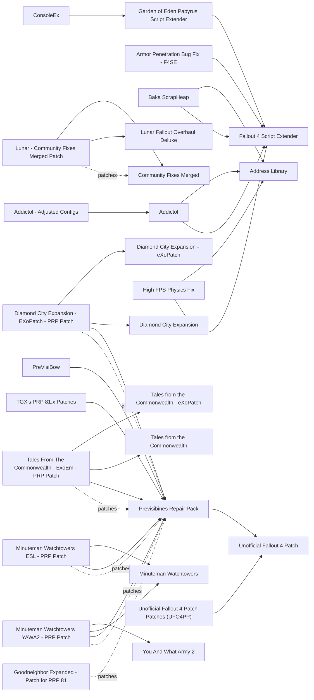

# Stability and performance

Engine fixes, plugin bug fixes, precombines and the tools to check a load order. On 1.11.240 the engine layer has consolidated into Addictol 1.7.1 (2026-10-06), which replaces Buffout 4, X-Cell, Mentats and about 20 single-fix DLLs. The plugin layer is Unofficial Fallout 4 Patch 2.2.2a, Community Fixes Merged 4.7.3 and Previsibines Repair Pack 81.9, the stack The Midnight Ride ships on 1.11.240. The main risks are duplicate fixes (anything Addictol already contains) and stale previs patches: PRP branch 81 is AE-only, and every patch labelled ".74" is for NG/OG and invalid here. On a base M3 under Wine the limit is the main thread (translated x86 code plus Papyrus), so script-heavy mods cost more than any fix DLL can win back.

## Pick one

| Choose between | Difference | Our pick |
| --- | --- | --- |
| Addictol, or Buffout 4, X-Cell, Mentats - F4SE, Fixer, Daytripper 4 and the other single-fix DLLs it absorbs | Addictol contains them; never run both. Buffout 4 has no 1.11.240 build | Addictol |
| Previsibines Repair Pack, Boston FPS Fix or PRP Lite (PRPFX) | Only one previs set can own Boston's cells. PRP Lite has no 1.11.240 build | Previsibines Repair Pack |
| Cell Offset Generator or Faster Cell Lookup | Same job; the two crash together | Neither yet |
| Branch 81 previs patches, or branch 74 collections (CannibalToast's PRP Patch Compendium, Camora's Branch 74 PRP Patch Hub, Emirals Previs Patches for PRP .74) | Branch 74 patches target NG/OG and are not valid on PRP 81. Use one previs patch per cell, matching the exact mods you run | Branch 81 only |
| Flicker Fixer or the version built into PRP | PRP already includes the eXofixed version; the original conflicts with Sim Settlements 2 cells | PRP's built-in version |

## Suggested stacks

| Profile | Take | Skip |
| --- | --- | --- |
| Mac under Wine, base M3 | Addictol, High FPS Physics Fix, Community Fixes Merged + Lunar - Community Fixes Merged Patch, Previsibines Repair Pack, Empty Vendor List Engine Bug Fix, Magic Effect and Spell Engine Fixes, FO4Edit | Weapon Debris Crash Fix (no NVIDIA Flex on a Mac), Baka ScrapHeap (only if infinite loading screens appear), Fallout Silicon, every DLL Addictol already contains |
| Windows with an NVIDIA GPU | The Mac stack plus Weapon Debris Crash Fix | Every DLL Addictol already contains |
| No Lunar, many leveled-list mods | The Mac stack plus Wrye Bash (Bashed Patch) for leveled-list merging | Lunar - Community Fixes Merged Patch |
| Long save that needs watching | Autosave Manager, Canary Save File Monitor, Enhanced Console, FallrimTools (ReSaver) for diagnosis only (not updated since 2023-09, AE saves unverified) | AutoSave F4SE, Better Console, ConsoleEx (no 1.11.240 build) |

## Our choice

The reference playthrough takes Addictol, High FPS Physics Fix, Community Fixes Merged with its Lunar patch, Previsibines Repair Pack 81.9, Empty Vendor List Engine Bug Fix, Magic Effect and Spell Engine Fixes, and FO4Edit to check every patch. High FPS Physics Fix caps the frame rate at 40-45 fps, which on the M3 feels better than a 60 that keeps dropping. We leave out every DLL Addictol already contains, and Weapon Debris Crash Fix, which fixes an NVIDIA Flex crash a Mac cannot have.

<!-- BEGIN GENERATED: do not edit, run scripts/build_catalog.py -->
74 mods: 4 core, 15 recommended, 15 optional, 40 avoid. Plugin slots if you take everything not marked avoid: 2 full.

### Core

| | Mod | What it does | Fit | Cost | Links |
| --- | --- | --- | --- | --- | --- |
|  | **[Addictol](https://www.nexusmods.com/fallout4/mods/84214)** by Dear Modding FO4 and DoubleYouC · v1.7.1 · updated 2026-10-06 · 6,930 endorsements · 24.3 MB | Engine fixes and crash logger; replaces Buffout 4 *Disables its Wine-unsafe options automatically; Crash Logger installer: pick AE (1.11.240.0); 1.7.1 (2026-10-06); Defaults are fine (sAllocator=voltek, nMaxPapyrusOpsPerFrame=500); bLoadScreen needs HFPF; Under Wine bImageSampling is unavailable; NavCut multithreading auto-off on Linux/Proton (CrossOver-mac detection unverified); If audio crackles try bAudioSwitch=false (unverified); Do not use third-party adjusted configs (79804); Keep the workshop fixes on; bInteriorNavCutMultiThreading is auto-disabled only on detected Linux/Proton; CrossOver detection unknown, set it to false if interior workshops misbehave* | `core` 1.11.240: yes F4SE DLL | perf low | needs: Fallout 4 Script Extender, Address Library conflicts: Buffout 4, X-Cell, Mentats - F4SE, Fixer, Unbound Worldspace, Optimized Room Bounds, Escape Freeze F4SE, Baka MaxPapyrusOps, Interior NavCut Fix, Daytripper 4, Long Save Bug Fix, Disk Cache Enabler, Faster Workshop, Companion Shoots At Player Fix - F4SE, Sprint Stuttering Fix, Moon Rotation Fix, Armor Penetration Bug Fix - F4SE, Faster Saves, Faster Decompression, Achievements Mods Enabler, Achievements Enabler AE, Faster Workshop AE, Faster Workshop NG |
|  | **[High FPS Physics Fix](https://www.nexusmods.com/fallout4/mods/44798)** by Antonix35 · v0.8.23 · updated 2026-09-08 · 52,291 endorsements · 0.7 MB | Physics above 60 fps and faster loading screens *0.8.23 supports 1.11.159-1.11.240; On M3: InGameFPS=PipBoyFPS=40-45, DynamicUpdateBudget=false, PostloadingMenuSpeed=2.0, OneThreadWhileLoading=false, no external limiter; Ultrawide: Resolution=2580x1080 + BorderlessUpscale (untested under Wine)* | `core` 1.11.240: yes F4SE DLL | perf low | needs: Fallout 4 Script Extender, Address Library |
|  | **[Community Fixes Merged](https://www.nexusmods.com/fallout4/mods/74945)** by The Community · v4.7.3 · updated 2026-09-16 · 8,394 endorsements · 28.6 MB | Merged community fixes incl. Tesla Cannon, Makeshift Weapons, Heavy Incinerator, Hellfire, X-02 and DLC encounter-rate fixes *4.7.3: update your game, downgraded depots unsupported; Does not cover the Creations Bundle content; Coordinate with the bug-fix report; 4.7.3 (2026-09-16); AE, not the paid Creations bundle; No object placement fixes; Lunar overrides the same records, so add the Lunar-CFM patch; CFMP (89457) patches other mods* | `core` 1.11.240: yes Lunar: patch | perf low | patches: Lunar - Community Fixes Merged Patch |
|  | **[Previsibines Repair Pack](https://www.nexusmods.com/fallout4/mods/46403)** by BenRierimanu · v81.9 · updated 2026-10-06 · 18,511 endorsements · 2258.6 MB | Rebuilt precombines and previs for performance in Boston *ppf.esm loads early; prp.esp near the end; 81.9 (2026-10-06): take Full (1.11.240) plus the plugins update; Branch 81 is AE-only; every '.74' patch is NG/OG and invalid here; Load PRP.esp near the end; Do not clean the 6 DLC masters; One previs patch per cell* | `core` 1.11.240: yes | perf low 2 full / 0 light | needs: Unofficial Fallout 4 Patch patches: Goodneighbor Expanded - Patch for PRP 81, Diamond City Expansion - EXoPatch - PRP Patch, Tales From The Commonwealth - ExoEm - PRP Patch, Minuteman Watchtowers ESL - PRP Patch, Minuteman Watchtowers YAWA2 - PRP Patch conflicts: Boston FPS Fix, PRP Lite (PRPFX) |

### Recommended

| | Mod | What it does | Fit | Cost | Links |
| --- | --- | --- | --- | --- | --- |
|  | **BethINI Pie**  | INI configuration tool *Used by TMR; Mac users use it to fix fullscreen under CrossOver; BethINI Pie has no FO4 Nexus page (FO4 mod 67 is the legacy BethINI); nexus_id left blank* | `recommended` 1.11.240: unknown | perf  |  |
|  | **[Cell Offset Generator](https://www.nexusmods.com/fallout4/mods/104454)** by SoleVaultBoy · v1.1.0 · updated 2026-05-15 · 775 endorsements · 5.3 MB | Generates cell offset data to reduce traversal stutter *1.1.0 (2026-05-15), 1.11.191+; Recommended on the Addictol page; Crashes if combined with Faster Cell Lookup: pick one* | `recommended` 1.11.240: yes F4SE DLL | perf low | conflicts: Faster Cell Lookup |
|  | **[Empty Vendor List Engine Bug Fix](https://www.nexusmods.com/fallout4/mods/83252)** by LarannKiar · v3.1 · updated 2026-08-20 · 2,925 endorsements · 0.2 MB | Engine fix for vendors that show an empty inventory *3.1 (2026-08-20) with an explicit 1.11.240 file; Useful with Lunar vendor changes, Wasteland Economics and Radiant Caravans (unverified)* | `recommended` 1.11.240: yes F4SE DLL | perf low |  |
|  | **[Enhanced Console](https://www.nexusmods.com/fallout4/mods/108365)** by intotherough · v1 · updated 2026-08-24 · 112 endorsements · 4.9 MB | Console autocomplete and command history *AIO for 1.10.163, 1.11.221 or 1.11.240 (2026-08-24); Does not show the mod of origin; Debug tool; new mod (112 end.)* | `recommended` 1.11.240: yes F4SE DLL | perf low |  |
|  | **[FO4Edit](https://www.nexusmods.com/fallout4/mods/2737)** by ElminsterAU and the xEdit Team · v4.1.5f · updated 2024-04-28 · 76,136 endorsements · 23.0 MB | Record editor used to check conflicts and build patches *4.1.5f (2024-04-28) is the latest public build and reads AE BA2 v7/v8; newer builds only on the xEdit Discord; No official AE statement: works for general use per community; Use -PseudoESL + SetESL to flag eligible plugins; Runs under Wine/CrossOver, untested on our setup* | `recommended` 1.11.240: yes | perf  |  |
|  | **[Magic Effect and Spell Engine Fixes](https://www.nexusmods.com/fallout4/mods/83433)** by LarannKiar · v3.2 · updated 2026-08-20 · 3,577 endorsements · 0.2 MB | Fixes engine bugs with spells, enchantments and perks on NPCs *3.2 (2026-08-20); Lunar is perk-heavy, so likely relevant (unverified)* | `recommended` 1.11.240: yes F4SE DLL | perf low |  |
|  | **[Autosave Manager](https://www.nexusmods.com/fallout4/mods/14104)** by Yohane · v1.31 · updated 2024-05-07 · 2,146 endorsements · 13 KB | Timed autosaves that skip combat *1.31 (2024-05), NG-format build; Rotating saves are valuable given Wine crashes* | `recommended` 1.11.240: plugin only | perf low scripts light |  |
|  | **[Canary Save File Monitor](https://www.nexusmods.com/fallout4/mods/44949)** by kinggath · v1.0.0 · updated 2020-05-08 · 10,396 endorsements · 8 KB | Warns on load if a save lost script data *Supported by Sim Settlements* | `recommended` 1.11.240: plugin only | perf low scripts light |  |
|  | **[The Midnight Ride - Glitchfinder All-In-One](https://www.nexusmods.com/fallout4/mods/74949)** by Glitchfinder · v2.02 · updated 2026-02-20 · 4,084 endorsements · 0.8 MB | Bundle of small fixes incl. Nuka-World bottle and radio fixes, Mechanist's Lair pathfinding, bug-swarm crash and falling cars *Don't also install the individual fixes it contains (Clean & Simple NW Bottle Fix, Nuka World Radio Fix, Mechanist's Lair Pathfinding Fix); Likely also covered by the bug-fix report; 2.02 (2026-02-20); Precombine impact not checked in xEdit* | `recommended` 1.11.240: yes | perf low |  |
|  | **[Lunar - Community Fixes Merged Patch](https://www.nexusmods.com/fallout4/mods/89669)** by Farsveinn · v1.3 · updated 2026-06-03 · 33 endorsements · 99 KB | Reconciles Lunar and Community Fixes Merged records *1.0.3 (2026-06-04) predates Lunar 114f and CFM 4.7.3: re-check in xEdit; Only needed if CFM is installed* | `recommended` 1.11.240: plugin only | perf  | needs: Lunar Fallout Overhaul Deluxe, Community Fixes Merged |
|  | **[Unofficial Fallout 4 Patch Patches (UFO4PP)](https://www.nexusmods.com/fallout4/mods/89210)** by KCisSICKnasty · v1.0.0 · updated 2025-10-26 · 304 endorsements · 6 KB | Collection of UFO4P compatibility patches, including one for Improved Railroad *Railroad report uses its Improved Railroad section; other sections not reviewed* | `recommended` 1.11.240: plugin only | perf  | needs: Unofficial Fallout 4 Patch |
|  | **[Diamond City Expansion - EXoPatch - PRP Patch](https://www.nexusmods.com/fallout4/mods/103474)** by AlexintheVerse · v1 · updated 2026-04-19 · 156 endorsements · 10.3 MB | Previs patch for Diamond City Expansion with its eXoPatch on PRP 81 *Built on PRP 81.5x; exactness on 81.9 unverified* | `recommended` 1.11.240: plugin only | perf  | needs: Previsibines Repair Pack, Diamond City Expansion, Diamond City Expansion - eXoPatch |
|  | **[Minuteman Watchtowers ESL - PRP Patch](https://www.nexusmods.com/fallout4/mods/103474)** by AlexintheVerse · v1 · updated 2026-04-19 · 156 endorsements · 10.3 MB | Previs patch for Minuteman Watchtowers (ESL build) on PRP 81 *Built on PRP 81.5x; Use the YAWA2 variant instead when You and What Army 2 is installed* | `recommended` 1.11.240: plugin only | perf  | needs: Previsibines Repair Pack, Minuteman Watchtowers |
|  | **[Minuteman Watchtowers YAWA2 - PRP Patch](https://www.nexusmods.com/fallout4/mods/103474)** by AlexintheVerse · v1 · updated 2026-04-19 · 156 endorsements · 10.3 MB | Previs patch for Minuteman Watchtowers combined with You and What Army 2 on PRP 81 *Built on PRP 81.5x; Replaces the plain ESL patch when YAWA2 is present* | `recommended` 1.11.240: plugin only | perf  | needs: Previsibines Repair Pack, Minuteman Watchtowers, You And What Army 2 |
|  | **[Tales From The Commonwealth - ExoEm - PRP Patch](https://www.nexusmods.com/fallout4/mods/103474)** by AlexintheVerse · v1 · updated 2026-04-19 · 156 endorsements · 10.3 MB | Previs patch for Tales from the Commonwealth with its eXoPatch on PRP 81 *Built on PRP 81.5x; exactness on 81.9 unverified; A TftC + Stumble Upon variant also exists* | `recommended` 1.11.240: plugin only | perf  | needs: Previsibines Repair Pack, Tales from the Commonwealth, Tales from the Commonwealth - eXoPatch |

### Optional

| | Mod | What it does | Fit | Cost | Links |
| --- | --- | --- | --- | --- | --- |
|  | **[Baka ScrapHeap](https://www.nexusmods.com/fallout4/mods/46340)** by shad0wshayd3 · v4.0.0 · updated 2025-11-21 · 17,450 endorsements · 2.8 MB | Bigger scrap-heap allocations for script data *Install only if infinite loading screens appear (SS2 wiki suggestion); 4.0.0 file says 'for 1.11.159'; 1.11.240 and interaction with Addictol's allocators unverified; Report 07 rates it avoid as redundant; Only if infinite loads or ScrapHeap issues appear; File says game version 1.11.159; interaction with Addictol's bMemoryManager unknown; SS2 recommends it for Customizable Faction Identity* | `optional` 1.11.240: unknown F4SE DLL | perf low | needs: Fallout 4 Script Extender, Address Library |
|  | **[FallrimTools (ReSaver)](https://www.nexusmods.com/fallout4/mods/22633)** by MerryMalfunctioning · v6.0.636 · updated 2023-09-07 · 8,769 endorsements · 12.2 MB | Save file inspector *6.0.636, last update 2023-09-07; AE save support unconfirmed; Read-only diagnosis only, never clean a live save; back up first* | `optional` 1.11.240: unknown | perf  |  |
|  | **[Faster Cell Lookup](https://www.nexusmods.com/fallout4/mods/104401)** by Asciim0v · v1.4 · updated 2026-08-21 · 765 endorsements · 0.4 MB | Faster cell lookup (port of the FNV cell offset generator) *1.4.1 (2026-08-21), claims OG/NG/AE without naming 1.11.240; Alternative to Cell Offset Generator; crashes if both are installed* | `optional` 1.11.240: unknown F4SE DLL | perf low | conflicts: Cell Offset Generator |
|  | **[Faster Loadscreens](https://www.nexusmods.com/fallout4/mods/102233)** by Asciim0v · v2.2.1 · updated 2026-10-28 · 228 endorsements · 71.2 MB | DLL that shortens loading screens *Claims AE; Overlaps HFPF loading options; untested with Addictol; Test only* | `optional` 1.11.240: unknown F4SE DLL | perf  |  |
|  | **[Faster Startups](https://www.nexusmods.com/fallout4/mods/109545)** by Asciim0v · v1.1.3 · updated 2026-10-09 · 247 endorsements · 0.3 MB | DLL that shortens game startup *Same author as Faster Loadscreens; claims AE; untested with Addictol; Test only* | `optional` 1.11.240: unknown F4SE DLL | perf  |  |
|  | **[Garden of Eden Papyrus Script Extender](https://www.nexusmods.com/fallout4/mods/74160)** by LarannKiar · v23.8 · updated 2026-10-19 · 8,943 endorsements · 1.1 MB | F4SE plugin that extends Papyrus scripting for other mods *Dependency only: 23.8 lists 1.11.240; Not evaluated on its own; 23.8 (2026-10-19) lists AE 1.11.137-1.11.240; Install when a mod requires it (AFT Plus, Companion Affinity Pip-Boy Tab, Hunger and Hydration)* | `optional` 1.11.240: yes F4SE DLL | perf low | needs: Fallout 4 Script Extender |
|  | **[Hydra](https://www.nexusmods.com/fallout4/mods/104159)** by SoleVaultBoy · v1.0.2 · updated 2026-05-03 · 1,148 endorsements · 22.4 MB | Script utilities and engine patches; replaces PCL *1.0.2, 1.11.191+; Dependency for newer mods; install only if required* | `optional` 1.11.240: yes F4SE DLL | perf low |  |
|  | **LOOT**  | Automatic load-order sorter *0.29.2; masterlist updated for 1.11.240 and F4SE 0.7.9 (2026-08-19); TMR lists it under tools to avoid; Use as a first pass, then fix by hand; Not on Nexus* | `optional` 1.11.240: yes | perf  |  |
|  | **[Weapon Debris Crash Fix](https://www.nexusmods.com/fallout4/mods/48078)** by Antonix35 · v2.0.6 · updated 2026-09-19 · 17,164 endorsements · 2.0 MB | Fixes the NVIDIA Flex weapon debris crash *Irrelevant on Mac: Wine has no NVFlex; Useful on Windows with NVIDIA* | `optional` 1.11.240: yes F4SE DLL | perf low |  |
|  | **Wrye Bash (Bashed Patch)**  | Mod manager tool whose Bashed Patch merges leveled-list edits from several plugins *Tool, not a game mod (no Nexus ID in the report); v313 added FO4 NG support, v315 merges ESM-flagged files; FO4 leveled-list merge quality and running under CrossOver unverified: FO4Edit 'Create Merged Patch' is the safer check; v315 (2026-09-14) supports FO4 NG and can merge ESM-flagged files (#727), which matters for Lunar; FO4 leveled-list patcher maturity unverified; No FO4 Nexus page found* | `optional` 1.11.240: unknown | perf  |  |
|  | **[Baka Framework](https://www.nexusmods.com/fallout4/mods/43627)** by shad0wshayd3 · v5.0.0 · updated 2026-09-22 · 11,051 endorsements · 5.1 MB | Library plus a few engine fixes needed by some mods *5.0.0 (2026-09), '1.11.240.0 and later'; ESL; Install only if a mod requires it* | `optional` 1.11.240: yes F4SE DLL | perf low 0 full / 1 light |  |
|  | **[Extended Fake Interiors](https://www.nexusmods.com/fallout4/mods/82222)** by Xeniu · v1.8.1 · updated 2024-06-30 · 2,725 endorsements · 1.6 MB | Roofs block rain in fake interiors *1.8.1 (2024-06-30); Has an Enclave Remnants CC patch; Precombine impact not checked* | `optional` 1.11.240: plugin only | perf low |  |
|  | **[Flutter Flicker Fixer For Foliage](https://www.nexusmods.com/fallout4/mods/79853)** by DoubleYou · v2.0 · updated 2026-04-13 · 4,656 endorsements · 21.2 MB | Fixes foliage flicker in the wind *2.0 (2026-04-13); Use the PRP file* | `optional` 1.11.240: plugin only | perf low |  |
|  | **[No Organic Dismemberment Only Blood](https://www.nexusmods.com/fallout4/mods/28756)** by LarannKiar · v1.0 · updated 2019-04-29 · 524 endorsements · 9 KB | Disables dismemberment to avoid the gore freeze under CrossOver *Alternative: bDisableAllGore=1 under [General]; Gore freezes (often in VATS) are a known Mac issue* | `optional` 1.11.240: plugin only | perf  |  |
|  | **[TGX's PRP 81.x Patches](https://www.nexusmods.com/fallout4/mods/101975)** by TheGamerX20 · v1.0.0 · updated 2026-03-26 · 68 endorsements · 110.0 MB | PRP 81 patches for Rebuild Collection AIO, Boston Airport, South of the Sea *2026-03, PRP 81.x; None of our mods are covered* | `optional` 1.11.240: plugin only | perf  | needs: Previsibines Repair Pack |

### Avoid

| | Mod | What it does | Fit | Cost | Links |
| --- | --- | --- | --- | --- | --- |
|  | **[Achievements Enabler AE](https://www.nexusmods.com/fallout4/mods/98809)** by TheGamerX20 · v1.0.0 · updated 2025-12-01 · 832 endorsements · 0.2 MB | Re-enables achievements with mods on AE *Page says it is now part of Addictol; 1.11.137+ build from 2025-12* | `avoid` 1.11.240: unknown F4SE DLL | perf  | conflicts: Addictol |
|  | **[Achievements Mods Enabler](https://www.nexusmods.com/fallout4/mods/15639)** by xSHADOWMANx or Sumwunn at github · v1.41 · updated 2024-05-07 · 40,966 endorsements · 0.2 MB | Re-enables achievements with mods *Addictol bAchievements=true already does it; TMR lists it as redundant* | `avoid` 1.11.240: unknown F4SE DLL | perf  | conflicts: Addictol |
|  | **[Addictol - Adjusted Configs](https://www.nexusmods.com/fallout4/mods/79804)** by ArcanicVoid · v1.5.4 · updated 2026-05-17 · 589 endorsements · 9 KB | Third-party preset configs for Addictol, HFPF and MCM Booster *TMR: set Addictol yourself rather than use third-party configs* | `avoid` 1.11.240: unknown | perf  | needs: Addictol |
|  | **[Armor Penetration Bug Fix - F4SE](https://www.nexusmods.com/fallout4/mods/73849)** by Zzyxzz · v1.0.4 · updated 2026-09-10 · 4,506 endorsements · 0.3 MB | Fixes the armor penetration calculation *Built into Addictol; do not install alongside it; In LitR* | `avoid` 1.11.240: unknown F4SE DLL | perf  | needs: Fallout 4 Script Extender conflicts: Addictol |
|  | **[AutoSave F4SE](https://www.nexusmods.com/fallout4/mods/95642)** by AdamSena · v0.5 · updated 2025-10-07 · 239 endorsements · 0.2 MB | DLL autosave with safety checks *0.5 (2025-10), OG and NG builds only* | `avoid` 1.11.240: **no** F4SE DLL | perf  |  |
|  | **[Baka MaxPapyrusOps](https://www.nexusmods.com/fallout4/mods/73774)** by shad0wshayd3 · v4.0.0 · updated 2025-11-21 · 6,403 endorsements · 3.2 MB | Raises Papyrus operations per frame *Built into Addictol; do not install alongside it; (bBakaMaxPapyrusOps); 4.0.0 file says 1.11.159+* | `avoid` 1.11.240: unknown F4SE DLL | perf  | conflicts: Addictol |
|  | **[Better Console](https://www.nexusmods.com/fallout4/mods/26582)** by Kassent · vv1.6.2 · updated 2025-11-14 · 24,220 endorsements · 0.3 MB | Shows form ID and mod of origin in the console *1.6.2 supports 1.10.163 through 1.11.137 only; Use Enhanced Console* | `avoid` 1.11.240: **no** F4SE DLL | perf  |  |
|  | **[Buffout 4](https://www.nexusmods.com/fallout4/mods/47359)** by Ryan · v1.28.6 · updated 2023-07-22 · 40,099 endorsements · 1.2 MB | Older crash logger and engine fixes *Buffout 4 NG (64880) does not support AE; the SS2 wiki now points to Addictol, which replaces it* | `avoid` 1.11.240: **no** F4SE DLL | perf  | conflicts: Addictol |
|  | **[Companion Shoots At Player Fix - F4SE](https://www.nexusmods.com/fallout4/mods/81758)** by LarannKiar · v3.3 · updated 2026-08-20 · 2,569 endorsements · 0.2 MB | Stops companion stray bullets from hitting the player *Built into Addictol; do not install alongside it; Report 07 calls it Companion Stray Bullet Fix* | `avoid` 1.11.240: unknown F4SE DLL | perf  | conflicts: Addictol |
|  | **[Console Util](https://www.nexusmods.com/fallout4/mods/51951)** by Ryan · v1.0.1 · updated 2021-08-08 · 3,892 endorsements · 0.1 MB | Console library for modders *1.0.1 (2021), '>=1.10.162', pre-AE; Install only if a mod requires it* | `avoid` 1.11.240: unknown F4SE DLL | perf  |  |
|  | **[ConsoleEx](https://www.nexusmods.com/fallout4/mods/74981)** by LarannKiar · v1.2 · updated 2025-11-27 · 233 endorsements · 0.1 MB | Extra console commands *AE 1.3 stops at 1.11.169* | `avoid` 1.11.240: **no** F4SE DLL | perf  | needs: Garden of Eden Papyrus Script Extender |
|  | **[Daytripper 4](https://www.nexusmods.com/fallout4/mods/91141)** by mith077 · v1.4.9 · updated 2026-03-06 · 458 endorsements · 5.8 MB | Engine fixes DLL *Built into Addictol; do not install alongside it* | `avoid` 1.11.240: unknown F4SE DLL | perf  | conflicts: Addictol |
|  | **[Disk Cache Enabler](https://www.nexusmods.com/fallout4/mods/74841)** by Archost · v1.0 · updated 2023-09-20 · 3,866 endorsements · 20 KB | Enables the engine disk cache *Built into Addictol; do not install alongside it* | `avoid` 1.11.240: unknown F4SE DLL | perf  | conflicts: Addictol |
|  | **[Escape Freeze F4SE](https://www.nexusmods.com/fallout4/mods/75216)** by Bingle and Buravo · vv1.0 · updated 2023-10-08 · 2,980 endorsements · 3.1 MB | Fixes the freeze when pressing Escape *Built into Addictol; do not install alongside it; An NG build also exists (95712)* | `avoid` 1.11.240: unknown F4SE DLL | perf  | conflicts: Addictol |
|  | **[Fallout Silicon](https://www.nexusmods.com/fallout4/mods/109102)** by LuDavik · v1 · updated 2026-09-30 · 3.1 MB | Unsigned macOS app that writes graphics settings to Fallout4Custom.ini *v1 (2026-09-30), 0 endorsements, author says 'fully vibe coded'; Do the same INI edits by hand via BethINI* | `avoid` 1.11.240: unknown | perf  |  |
|  | **[Faster Decompression](https://www.nexusmods.com/fallout4/mods/102435)** by Asciim0v · v1.4.2 · updated 2026-10-07 · 1,120 endorsements · 0.7 MB | Faster BA2 decompression with zlib-ng or libdeflate *Redundant: Addictol bLibDeflate and sZlibBackend do the same* | `avoid` 1.11.240: yes F4SE DLL | perf  | conflicts: Addictol |
|  | **[Faster Saves](https://www.nexusmods.com/fallout4/mods/106152)** by Asciim0v · v1.0 · updated 2026-08-21 · 249 endorsements · 0.4 MB | Faster save writing *Redundant with Addictol bSaveCompression and bCosaveIO* | `avoid` 1.11.240: yes F4SE DLL | perf  | conflicts: Addictol |
|  | **[Faster Workshop](https://www.nexusmods.com/fallout4/mods/35382)** by reg2k · v1.1 · updated 2018-10-18 · 19,757 endorsements · 0.1 MB | Speeds up the workshop menu *Built into Addictol; do not install alongside it; (bFasterWorkshop)* | `avoid` 1.11.240: unknown F4SE DLL | perf  | conflicts: Addictol |
|  | **[Faster Workshop AE](https://www.nexusmods.com/fallout4/mods/100532)** by TheGamerX20 · v1.0.0 · updated 2026-01-22 · 447 endorsements · 0.2 MB | Standalone fix for workshop menu lag *Author: no longer in development; an improved version is in Addictol* | `avoid` 1.11.240: unknown F4SE DLL | perf  | conflicts: Addictol |
|  | **[Faster Workshop NG](https://www.nexusmods.com/fallout4/mods/91075)** by eventHandler · v2.2.0.4 · updated 2025-02-04 · 469 endorsements · 1.6 MB | Standalone fix for workshop menu lag (NG build) *Duplicate of Addictol's Faster Workshop* | `avoid` 1.11.240: unknown F4SE DLL | perf  | conflicts: Addictol |
|  | **Fixer**  | Engine fixes DLL by Qrsr *Incompatible with Addictol; TMR flags its fixes as invalid; Nexus page not found by API search; nexus_id left blank* | `avoid` 1.11.240: unknown F4SE DLL | perf  | conflicts: Addictol |
|  | **[Interior NavCut Fix](https://www.nexusmods.com/fallout4/mods/72904)** by Snapdragon · v1.0.3 · updated 2023-10-20 · 6,303 endorsements · 3.2 MB | Stops workshop navcut leaking into interiors *Built into Addictol; do not install alongside it; Duplicate of Addictol's Interior NavCut Fix* | `avoid` 1.11.240: unknown F4SE DLL | perf  | conflicts: Addictol |
|  | **[Long Save Bug Fix](https://www.nexusmods.com/fallout4/mods/68681)** by Nukem · v1.1 · updated 2024-07-23 · 4,128 endorsements · 0.4 MB | Fixes ever-growing save times *Built into Addictol; do not install alongside it; (bPapyrusGCBug)* | `avoid` 1.11.240: unknown F4SE DLL | perf  | conflicts: Addictol |
|  | **[Mentats - F4SE](https://www.nexusmods.com/fallout4/mods/91565)** by bp42s · v1.1.1 · updated 2025-03-27 · 2,828 endorsements · 3.9 MB | Engine bug fixes DLL *Built into Addictol; do not install alongside it* | `avoid` 1.11.240: unknown F4SE DLL | perf  | conflicts: Addictol |
|  | **[Moon Rotation Fix](https://www.nexusmods.com/fallout4/mods/80005)** by AntoniX · v1.1.2 · updated 2026-08-23 · 2,227 endorsements · 0.4 MB | Fixes the moon's rotation *Built into Addictol; do not install alongside it* | `avoid` 1.11.240: unknown F4SE DLL | perf  | conflicts: Addictol |
|  | **Optimized Room Bounds**  | Room bound and portal optimisation *Incompatible with Addictol (per Addictol page); Nexus ID not confirmed: 88987 'Optimization - Room Bounds and Portals' may be it; left blank* | `avoid` 1.11.240: unknown | perf  | conflicts: Addictol |
|  | **[Sprint Stuttering Fix](https://www.nexusmods.com/fallout4/mods/47760)** by AntoniX · v1.6 · updated 2026-08-22 · 20,654 endorsements · 0.4 MB | Removes stutter while sprinting *Built into Addictol; do not install alongside it; (bSprintStutter)* | `avoid` 1.11.240: yes F4SE DLL | perf  | conflicts: Addictol |
|  | **Unbound Worldspace**  | Removes worldspace bounds *Incompatible with Addictol (per Addictol page); Nexus page not found by API search; nexus_id left blank* | `avoid` 1.11.240: unknown F4SE DLL | perf  | conflicts: Addictol |
|  | **X-Cell**  | Memory and threading engine fixes *Built into Addictol; do not install alongside it; Nexus page not found by API search; nexus_id left blank* | `avoid` 1.11.240: unknown F4SE DLL | perf  | conflicts: Addictol |
|  | **[Fallout 4 DLC Consistency Patch](https://www.nexusmods.com/fallout4/mods/92476)** by BenRierimanu · v1.11.221 · updated 2026-06-25 · 63 endorsements | Aligns DLC masters and assets across storefronts *Targets 1.11.221 and changes the masters PRP was built on; the PRP author says leave masters as shipped* | `avoid` 1.11.240: **no** | perf  |  |
|  | **[Flicker Fixer](https://www.nexusmods.com/fallout4/mods/35720)** by Glass · v5.8 · updated 2022-12-16 · 8,372 endorsements · 1.8 MB | Original flicker fixes *PRP already includes the eXofixed version; SS2 Known Issues: the original causes sinking through floors in SS2 cells; Precombine value inferred, not stated* | `avoid` 1.11.240: unknown | perf  **breaks precombines** |  |
|  | **[Boston FPS Fix](https://www.nexusmods.com/fallout4/mods/26286)** by BetaVirus · v.32 · updated 2019-05-18 · 25,958 endorsements · 104.0 MB | Old previs rebuild for Boston *Replaces PRP; never install with it* | `avoid` 1.11.240: unknown | perf  **breaks precombines** | conflicts: Previsibines Repair Pack |
|  | **[Camora's Branch 74 PRP Patch Hub](https://www.nexusmods.com/fallout4/mods/79798)** by Camora · v1.1 · updated 2024-05-27 · 261 endorsements · 14.3 MB | PRP patch hub for branch 74 *'.74 only' (NG/OG); invalid on PRP 81* | `avoid` 1.11.240: **no** | perf  |  |
|  | **[CannibalToast's PRP Patch Compendium](https://www.nexusmods.com/fallout4/mods/63516)** by CannibalToast · v4NG · updated 2024-08-25 · 1,232 endorsements · 24.8 MB | Large PRP patch collection for branch 74 *'.74 only' (NG/OG); invalid on PRP 81* | `avoid` 1.11.240: **no** | perf  |  |
|  | **[Emirals Previs Patches for PRP .74](https://www.nexusmods.com/fallout4/mods/79497)** by emiral85 · v1.6a · updated 2025-08-15 · 485 endorsements · 8.4 MB | PRP patches for branch 74 *'.74 only' (NG/OG); invalid on PRP 81* | `avoid` 1.11.240: **no** | perf  |  |
|  | **[Max Drechsler's PRP Patch Pack Compendium b74](https://www.nexusmods.com/fallout4/mods/91395)** by Max Drechsler · vv.0.8.1 · updated 2025-05-22 · 100 endorsements · 154.5 MB | PRP patch pack for branch 74 *'.74 only' (NG/OG); invalid on PRP 81* | `avoid` 1.11.240: **no** | perf  |  |
|  | **[Miscellaneous Performance Optimization - PRP](https://www.nexusmods.com/fallout4/mods/71732)** by wheneverpistachio · v3 · updated 2026-02-22 · 1,107 endorsements · 1.9 MB | Previs patches for branch 74 *'.74 only' (NG/OG); invalid on PRP 81* | `avoid` 1.11.240: **no** | perf  |  |
|  | **[PRP Lite (PRPFX)](https://www.nexusmods.com/fallout4/mods/64405)** by BenRierimanu · v4 · updated 2024-07-03 · 924 endorsements · 89.1 MB | Lite cluster build of PRP *v4 (2024-07), pre-AE; Never with PRP* | `avoid` 1.11.240: **no** | perf  | conflicts: Previsibines Repair Pack |
|  | **[PreVisiBow](https://www.nexusmods.com/fallout4/mods/107640)** by kcissicknasty · v1 · updated 2026-09-21 · 23 endorsements · 111.8 MB | PRP 81 patches for the DLC Consistency Patch *Only relevant with the DLC Consistency Patch, which we avoid* | `avoid` 1.11.240: plugin only | perf  | needs: Previsibines Repair Pack |
|  | **[imStiles PRP Patch Collection](https://www.nexusmods.com/fallout4/mods/92804)** by imStiles · v1.1 · updated 2025-06-26 · 41 endorsements · 10.0 MB | PRP patch collection *Listed by report 08 with the '.74 only / NG' collections; invalid on PRP 81* | `avoid` 1.11.240: **no** | perf  |  |

### Dependencies and patches

<!-- END GENERATED -->
