# Weapons and armor

Weapons, armor, power armor, reload animations, VATS and combat feel. Weapon and armor plugins do not depend on the game version, and by late 2026 Runtime Database lets several DLLs run on 1.11.240, while many standalone DLLs (Bullet Counted Reload System, Remove Ammo from Dropped Guns, Better Fusion Core Management) state 1.11.240 support. The cost here is balance, not runtime: Lunar rebalances every vanilla, DLC and free Creation Club weapon and armor, so any plugin that edits the same records overrides it, and gear injected by script or RobCo Patcher ignores Lunar's damage and crafting rules. Whisky's Lunar Fallout Gun Patch Emporium, Whisky's Lunar Fallout Melee Patch Boutique and Lunar Fallout Arsenal exist to close that gap.

## Pick one

| Choose between | Difference | Our pick |
| --- | --- | --- |
| Weapon approach: Lunar Fallout Arsenal, The Attachment Pack, or vanilla Lunar guns plus a few standalone weapons patched through Whisky's Lunar Fallout Gun Patch Emporium | Arsenal: everything pre-balanced, 11 required mods. The Attachment Pack: 400+ attachments with no Lunar patch. Arsenal's FAQ rules out combining the two | Vanilla Lunar guns |
| Gun inertia: Inertia - Physical Movement Response System or Uneducated Shooter - QE Leaning and Gun Inertia | Both add inertia; Uneducated Shooter does not name 1.11.240 | Neither |
| Damage model: Lunar alone, or DirectHit, Better Locational Damage, Dak's Weapon Rebalance, Fallout 76 VATS - F4SE | Each rewrites damage or perks against Lunar's design | Lunar alone |
| Hellfire and X-02: the free Creation Club versions, or Enclave X-02 Power Armor and Hellfire X-03 Power Armor from Nexus | Lunar 111+ already balances the Creation Club versions. Never add the Nexus versions or the old LFO cc patches | Creation Club versions |
| Tesla Cannon: CC Tesla Cannon Upgrade or Creation Club Tesla Cannon Unofficial Patch | The Unofficial Patch's rebalance fights Lunar | Neither |
| Minutemen look: Lunar - Ragged Thunder (Armband Only), Ragged Thunder - RobCo Patcher, Militarized Minutemen, Tumbajamba's Minutemen Armor Collection | Armband on Lunar's outfits, full outfits by RobCo, or a new item set | Neither |
| VATS freeze: VATS Freeze Fix - F4SE or VATS Freeze Fix (script version) | The DLL replaces the old script fix | Neither |

## Suggested stacks

| Profile | Take | Skip |
| --- | --- | --- |
| Lunar on a light machine | Energy Weapon Calculation Fix, Lunar - Fix for Power Armor Repair Requirements, Lunar - AltT60X01, Tactical Reload, Bullet Counted Reload System, Power Armor Animation Changes, Power Armor HUD - paHUD, Better Fusion Core Management | See Through Scopes (second render pass while scoped), Better Locational Damage, The Attachment Pack |
| Lunar with more guns | Lunar Fallout Arsenal and its requirements | The Attachment Pack, Anti-Materiel Rifle - Rat Runners Arsenal (Arsenal includes it), Munitions - Ammo Expansion Project |
| No Lunar | Dak's Weapon Rebalance, The Attachment Pack, Pig's Wasteland Weaponry - A Best Of Pack, Bastion - A Power Armor Overhaul | Every Lunar patch |
| BoS look over balance | Look At Me - Brotherhood Of Steel Edition, CROSS Brotherhood Recon + Lunar - Cross Brotherhood Recon, BOS Rank Insignia Fix | Sons of Steel - Brotherhood Infantry Armor |

## Our choice

The reference playthrough adds only Energy Weapon Calculation Fix here, a DLL engine fix used alongside Lunar since 2024; Lunar's own rebalance already brings variety. We have not added a big weapon pack, because a large pack means many patches. Lunar Fallout Arsenal is the Lunar-native choice to reconsider after 20-30 stable hours.

<!-- BEGIN GENERATED: do not edit, run scripts/build_catalog.py -->
77 mods: 12 recommended, 45 optional, 20 avoid. Plugin slots if you take everything not marked avoid: 0 full.

### Recommended

| | Mod | What it does | Fit | Cost | Links |
| --- | --- | --- | --- | --- | --- |
|  | **[Better Fusion Core Management](https://www.nexusmods.com/fallout4/mods/91399)** by LarannKiar · v3.1 · updated 2026-08-20 · 799 endorsements · 0.2 MB | Uses partially drained fusion cores first *1.11.240 support added in 3.1; In LitR* | `recommended` 1.11.240: yes F4SE DLL | perf low | needs: Fallout 4 Script Extender |
|  | **[Bullet Counted Reload System](https://www.nexusmods.com/fallout4/mods/41178)** by shavkacagarikia · v2.05 · updated 2026-08-29 · 33,399 endorsements · 0.2 MB | Shell-by-shell reloads for lever actions and similar guns *2.05 states 1.11.240; No record edits; In STEP and TMR* | `recommended` 1.11.240: yes F4SE DLL | perf low | needs: Fallout 4 Script Extender |
|  | **[Energy Weapon Calculation Fix](https://www.nexusmods.com/fallout4/mods/75565)** by Zzyxzz · v1.5.1 · updated 2026-09-26 · 2,855 endorsements · 0.4 MB | Fixes energy and typed damage being calculated on base damage only *Used with Lunar in LitR since 2024* | `recommended` 1.11.240: yes F4SE DLL | perf low | needs: Fallout 4 Script Extender, Runtime Database |
|  | **[Anti-Materiel Rifle - Rat Runners Arsenal](https://www.nexusmods.com/fallout4/mods/92287)** by Spadey - Diakyuto - mmacola1 · v1.3.4 · updated 2026-02-03 · 1,004 endorsements · 10.4 MB | Fallout: New Vegas anti-materiel rifle | `recommended` 1.11.240: plugin only Lunar: patch | perf low 0 full / 1 light | patches: Lunar - Anti Mat Rifle Rat Runners Arsenal |
|  | **[Lunar Fallout Arsenal](https://www.nexusmods.com/fallout4/mods/101287)** by WhiskyTangoFox · v1 · updated 2026-05-16 · 8 endorsements · 1851.8 MB | Lunar-native gun overhaul: weapon classes, rarer and stronger pre-war guns, dozens of lore guns and unique weapons made unique *Report's pick, pick-one vs The Attachment Pack or a la carte guns; Also requires Nina's Pipe Guns (old + Revisited, manual folder moves), Rat Runners Pipe Carbine and a Gauss retexture (no rows); Pipe Carbine lists Munitions: whether Arsenal's replacer removes that need is unverified; Burst-fire Papyrus scripts; F4SE need not stated; Arsenal 1.0 vs Lunar 114f not checked; Swaps the Vault 111 10mm for a .38 (precombines probably unaffected, unverified)* | `recommended` 1.11.240: plugin only | perf med scripts light | needs: Lunar Fallout Overhaul Deluxe, Unofficial Fallout 4 Patch, Pig's Wasteland Weaponry - A Best Of Pack, The Heavy Weapons Pack, Skewer Launcher, Anti-Materiel Rifle - Rat Runners Arsenal, Mind Games - Handmade Laser Rifle, CC Tesla Cannon Upgrade conflicts: The Attachment Pack |
|  | **[Tactical Reload](https://www.nexusmods.com/fallout4/mods/49444)** by Bwones · v1.1 · updated 2024-03-15 · 22,326 endorsements · 58 KB | Second reload animation when the magazine is not empty *Use framework 1.1 (1.4 beta needs F4SE + MCM); Skip the Vanilla Weapons ESP (overrides Lunar weapon records): use the RobCo patch; Overwrites 1st-person behavior files; load See Through Scopes after it if both* | `recommended` 1.11.240: plugin only | perf low | patches: Tactical Reload updated Vanilla and DLC patch |
|  | **[Power Armor Animation Changes](https://www.nexusmods.com/fallout4/mods/4408)** by SomberX · v1.1 · updated 2024-04-25 · 39,550 endorsements · 1 KB | Quicker power armor entry and exit *The Instant option can break PA frames (author): use Quick* | `recommended` 1.11.240: plugin only | perf low 0 full / 1 light |  |
|  | **[Lunar - AltT60X01](https://www.nexusmods.com/fallout4/mods/88349)** by WhiskyTangoFox · v3 · updated 2026-04-11 · 52 endorsements · 46 KB | Makes T-60 a BoS-only armor and X-01 a single unique set *From Lunar Power Armor Patchapalooza; Recommended for a BoS-focused run* | `recommended` 1.11.240: plugin only | perf low | needs: Lunar Fallout Overhaul Deluxe |
|  | **[Lunar - Anti Mat Rifle Rat Runners Arsenal](https://www.nexusmods.com/fallout4/mods/35168)** by WhiskyTangoFawks · v1 · updated 2025-09-12 · 339 endorsements · 3.2 MB | Lunar balance patch for the Rat Runners anti-materiel rifle *Only without Lunar Fallout Arsenal (Arsenal already includes the rifle)* | `recommended` 1.11.240: plugin only | perf  | needs: Lunar Fallout Overhaul Deluxe, Anti-Materiel Rifle - Rat Runners Arsenal |
|  | **[Lunar - Ragged Thunder (Armband Only)](https://www.nexusmods.com/fallout4/mods/68956)** by WhiskyTangoFox · v1 · updated 2026-02-27 · 113 endorsements | Adds the Ragged Thunder Minutemen armband to Lunar's new Minutemen outfits *From Whisky's Armor Patch Bazaar; LitR 8.1 uses exactly this; Lunar's own Minutemen outfits are inferred from this patch's description* | `recommended` 1.11.240: plugin only | perf low | needs: Lunar Fallout Overhaul Deluxe, Ragged Thunder conflicts: Ragged Thunder - RobCo Patcher |
|  | **[Tactical Reload updated Vanilla and DLC patch](https://www.nexusmods.com/fallout4/mods/108398)** by N7kie · v1.6.1 · updated 2026-10-05 · 67 endorsements · 2.4 MB | Better Tactical Reload animations for vanilla and DLC guns *RobCo version leaves weapon records untouched (Lunar-safe); A CFM version also exists; New mod (67 endorsements)* | `recommended` 1.11.240: unknown F4SE DLL | perf low | needs: Tactical Reload, RobCo Patcher |
|  | **[Whisky's Lunar Fallout Gun Patch Emporium](https://www.nexusmods.com/fallout4/mods/35168)** by WhiskyTangoFawks · v1 · updated 2025-09-12 · 339 endorsements · 3.2 MB | About 75 per-weapon Lunar patches (damage, receivers, crafting, leveled lists) *Recommended if you add standalone guns without Lunar Fallout Arsenal; Most patches date from 2024: drift vs Lunar 114 unverified; Targets the older individual Pig mods, not Pig's Best-Of* | `recommended` 1.11.240: plugin only | perf low | needs: Lunar Fallout Overhaul Deluxe |

### Optional

| | Mod | What it does | Fit | Cost | Links |
| --- | --- | --- | --- | --- | --- |
|  | **[Inertia - Physical Movement Response System](https://www.nexusmods.com/fallout4/mods/101561)** by Zzyxzz · v2.3.0 · updated 2026-09-12 · 769 endorsements · 0.4 MB | Weapon and camera inertia when moving *OG, NG and AE; In LitR 8.1.1; Test on CrossOver after the list is stable* | `optional` 1.11.240: yes F4SE DLL | perf low | needs: Fallout 4 Script Extender conflicts: Uneducated Shooter - QE Leaning and Gun Inertia |
|  | **[Remove Ammo from Dropped Guns](https://www.nexusmods.com/fallout4/mods/64426)** by ScottyDoesKnow · v1.2.6 · updated 2026-08-29 · 4,541 endorsements · 0.1 MB | Moves ammo from dropped guns to the corpse inventory *Neutral to Lunar's economy by default; In TMR* | `optional` 1.11.240: yes F4SE DLL | perf low | needs: Fallout 4 Script Extender |
|  | **[Uneducated Shooter - QE Leaning and Gun Inertia](https://www.nexusmods.com/fallout4/mods/56789)** by Bingle · v1.31 · updated 2026-06-26 · 8,699 endorsements | Q/E leaning and gun inertia *Supports OG and AE; 1.11.240 not named; Was in LitR 5.x* | `optional` 1.11.240: unknown F4SE DLL | perf low | needs: Fallout 4 Script Extender conflicts: Inertia - Physical Movement Response System |
|  | **[VATS Freeze Fix - F4SE](https://www.nexusmods.com/fallout4/mods/101719)** by Zzyxzz · v1.1.1 · updated 2026-09-23 · 563 endorsements · 0.3 MB | Defers potions applied by Papyrus during VATS to avoid freezes *Mostly a Survival bug; we play non-Survival; In LitR 8.1* | `optional` 1.11.240: yes F4SE DLL | perf low | needs: Fallout 4 Script Extender, Runtime Database conflicts: VATS Freeze Fix (script version) |
|  | **[10mm Pistol Reanimation Pack](https://www.nexusmods.com/fallout4/mods/31508)** by Wardaddy · vV3 · updated 2019-02-22 · 4,294 endorsements · 0.8 MB | New first- and third-person animations for a vanilla gun *Loose animation files, no record edits* | `optional` 1.11.240: plugin only | perf low |  |
|  | **[10mm Pistol debulked remesh](https://www.nexusmods.com/fallout4/mods/75479)** by micalov · v1.03 · updated 2025-05-17 · 899 endorsements · 55.3 MB | Slimmer 10mm pistol, as a replacer or standalone *Replacer is mesh-only, so Lunar-safe (assumed); The Lunar patch for the standalone (77102) was deleted* | `optional` 1.11.240: plugin only | perf low |  |
|  | **[Bastion - A Power Armor Overhaul](https://www.nexusmods.com/fallout4/mods/75184)** by Zzyxzz · v2.1.0 · updated 2026-09-04 · 3,748 endorsements · 0.4 MB | Per-part power armor damage absorption and penetration classes, with MCM *LitR added it in 6.5.0 and removed it in 6.5.1, no reason given* | `optional` 1.11.240: yes F4SE DLL Lunar: patch | perf low | needs: Fallout 4 Script Extender, Runtime Database patches: Lunar - Bastion A Power Armor Overhaul |
|  | **[CC Tesla Cannon Upgrade](https://www.nexusmods.com/fallout4/mods/92847)** by Shiagur · v1.0.6 · updated 2025-06-21 · 674 endorsements · 61.5 MB | Reload animations, new sights and Beaton material for the free CC Tesla Cannon *Required by Lunar Fallout Arsenal; Bug-fix version merged in; May override Lunar's Tesla Cannon stats: check in FO4Edit* | `optional` 1.11.240: plugin only | perf low | conflicts: Creation Club Tesla Cannon Unofficial Patch |
|  | **[Dak's Assault Rifle Replacer REDUX](https://www.nexusmods.com/fallout4/mods/64725)** by Degenerate Dak · v1.0.0 · updated 2024-01-18 · 3,967 endorsements · 54.5 MB | Remesh of the vanilla assault rifle *Take the Remesh Only file: the main file renames and applies Dak's damage, overriding Lunar* | `optional` 1.11.240: plugin only | perf low |  |
|  | **[Laser Rifle Reanimation](https://www.nexusmods.com/fallout4/mods/62410)** by MrLameGaming · v1.2 · updated 2022-07-29 · 3,147 endorsements · 2.6 MB | New first- and third-person animations for a vanilla gun *Loose animation files, no record edits* | `optional` 1.11.240: plugin only | perf low |  |
|  | **[Look At Me - Brotherhood Of Steel Edition](https://www.nexusmods.com/fallout4/mods/51216)** by S4iS3i · vFinal · updated 2022-09-17 · 933 endorsements · 115.3 MB | BoS clothing overhaul *Explicitly supports Lunar; Also needs Classic Combat Armor and a second CROSS mod (no rows); Author's order: Lunar < Improved BoS < ; < Look At Me* | `optional` 1.11.240: plugin only | perf low | needs: CROSS Brotherhood Recon |
|  | **[Marine Armor Paints Pack](https://www.nexusmods.com/fallout4/mods/66104)** by ShanicTheMeme · v1.0 · updated 2022-11-14 · 606 endorsements · 113.3 MB | Paints and camos for Marine armor | `optional` 1.11.240: plugin only Lunar: patch | perf low | patches: Lunar - Marine Armor Paints Pack |
|  | **[Mind Games - Handmade Laser Rifle](https://www.nexusmods.com/fallout4/mods/92161)** by micalov and jhardin · v1.0 · updated 2025-03-14 · 363 endorsements · 16.4 MB | Handmade-style laser rifle, crafted at the chem bench only *Needs 1.10.163 or later; No leveled lists, so no balance risk; Integrated by Arsenal* | `optional` 1.11.240: plugin only | perf low 0 full / 1 light |  |
|  | **[Pig's Wasteland Weaponry - A Best Of Pack](https://www.nexusmods.com/fallout4/mods/90801)** by Pig · v1.0.2 · updated 2025-01-23 · 770 endorsements · 195.1 MB | 15 scrappy makeshift guns with leveled-list integration *Only Lunar-balanced through Lunar Fallout Arsenal (Emporium patches target the older individual Pig mods)* | `optional` 1.11.240: plugin only | perf low |  |
|  | **[Ragged Thunder - RobCo Patcher](https://www.nexusmods.com/fallout4/mods/95682)** by ArcanicVoid · v2.3.5 · updated 2026-02-27 · 84 endorsements · 8 KB | Distributes the Ragged Thunder outfits to Minutemen by rank via RobCo *Overlaps Lunar's Minutemen outfits; pick one vs the armband-only route; Supports Improved Minutemen (optional)* | `optional` 1.11.240: unknown F4SE DLL | perf low | needs: Ragged Thunder, RobCo Patcher conflicts: Lunar - Ragged Thunder (Armband Only) |
|  | **[Reanimation Pack for Combat Shotgun and Rifle](https://www.nexusmods.com/fallout4/mods/30141)** by Wardaddy · vV4 · updated 2019-02-22 · 5,933 endorsements · 0.4 MB | New first- and third-person animations for a vanilla gun *Loose animation files, no record edits; Tactical Reload recommends this set (WarDaddy)* | `optional` 1.11.240: plugin only | perf low |  |
|  | **[See Through Scopes](https://www.nexusmods.com/fallout4/mods/9476)** by henkspamadres · v2.7.1 · updated 2026-10-10 · 97,192 endorsements · 59.0 MB | 3D scopes with hold-breath and dynamic sway *Skip at first: extra render pass while scoped is costly on M3 + Wine; Edits scope mods, overriding Lunar/Arsenal scope rules; the old Lunar-STS patch is gone; LitR cut it back to resource-only; Load after Tactical Reload (TR ships an STS behavior patch)* | `optional` 1.11.240: yes | perf high |  |
|  | **[Skewer Launcher](https://www.nexusmods.com/fallout4/mods/55447)** by Degenerate Dak · v1.0.0 · updated 2022-03-01 · 1,412 endorsements · 210.0 MB | Heavy rebar launcher with script leveled-list injection | `optional` 1.11.240: plugin only Lunar: patch | perf low | patches: Lunar - Skewer Launcher |
|  | **[Thats Gunner Life](https://www.nexusmods.com/fallout4/mods/68969)** by Armighty · v6 · updated 2026-03-12 · 757 endorsements · 98.3 MB | Distributes the Gunner Outfit Pack by level with a Lunar ballistic-weave patch *Lunar patch is on the same page; In LitR* | `optional` 1.11.240: plugin only Lunar: patch | perf low |  |
|  | **[The Attachment Pack](https://www.nexusmods.com/fallout4/mods/76924)** by DegenerateDak and Pig · v1.0.8 · updated 2025-02-15 · 8,380 endorsements · 240.4 MB | 400+ lore-friendly attachments for vanilla and DLC guns *Only without Arsenal (Arsenal FAQ: pick one); No Lunar patch: new attachments ignore Lunar's receiver rules* | `optional` 1.11.240: plugin only | perf low | conflicts: Lunar Fallout Arsenal |
|  | **[The Heavy Weapons Pack](https://www.nexusmods.com/fallout4/mods/59582)** by Pig · v1.3 · updated 2022-04-13 · 1,140 endorsements · 86.6 MB | Five makeshift heavy weapons injected into leveled lists from level 16 | `optional` 1.11.240: plugin only Lunar: patch | perf low | patches: Lunar - Makeshift Heavy Weapons Pack |
|  | **[Vanillafied - CS5 Sniper Rifle](https://www.nexusmods.com/fallout4/mods/70909)** by WhiskyTangoFox · v1.2 · updated 2024-05-17 · 117 endorsements · 10 KB | Vanilla-style rebalance of a CROSS or community gun *Lunar patch is a file on the same page* | `optional` 1.11.240: plugin only Lunar: patch | perf low |  |
|  | **[Vanillafied - Cross Break Action Laser](https://www.nexusmods.com/fallout4/mods/70966)** by WhiskyTangoFox · v1.4 · updated 2024-05-17 · 246 endorsements · 26 KB | Vanilla-style rebalance of a CROSS or community gun *Lunar patch is a file on the same page; Lore highlight of the series* | `optional` 1.11.240: plugin only Lunar: patch | perf low |  |
|  | **[Vanillafied - Cross Cryolance](https://www.nexusmods.com/fallout4/mods/70981)** by WhiskyTangoFox · v1 · updated 2024-05-17 · 192 endorsements · 7 KB | Vanilla-style rebalance of a CROSS or community gun *Lunar patch is a file on the same page* | `optional` 1.11.240: plugin only Lunar: patch | perf low |  |
|  | **[Vanillafied - Street Sweeper Shotgun](https://www.nexusmods.com/fallout4/mods/71495)** by WhiskyTangoFox · v1.2 · updated 2024-05-17 · 125 endorsements · 23 KB | Vanilla-style rebalance of a CROSS or community gun *Lunar patch is a file on the same page* | `optional` 1.11.240: plugin only Lunar: patch | perf low |  |
|  | **[Vanillafied - Syringer Rifle Overhaul](https://www.nexusmods.com/fallout4/mods/71034)** by WhiskyTangoFox · v1.2 · updated 2024-05-17 · 197 endorsements · 8 KB | Vanilla-style rebalance of a CROSS or community gun *Lunar patch is a file on the same page* | `optional` 1.11.240: plugin only Lunar: patch | perf low |  |
|  | **[Vanillafied - The Zap Gun](https://www.nexusmods.com/fallout4/mods/86820)** by WhiskyTangoFox · v1.2 · updated 2025-06-03 · 125 endorsements · 29 KB | Vanilla-style rebalance of a CROSS or community gun *Lunar patch is a file on the same page* | `optional` 1.11.240: plugin only Lunar: patch | perf low |  |
|  | **[Wasteland Melody's Service Rifle - Unofficial Update and Lunar Patch](https://www.nexusmods.com/fallout4/mods/97176)** by Fyntastic · v1.0 · updated 2025-11-14 · 9 endorsements · 57.9 MB | Vanillafied Fallout: New Vegas service rifle with a Lunar patch | `optional` 1.11.240: plugin only | perf low |  |
|  | **[BOS Rank Insignia Fix](https://www.nexusmods.com/fallout4/mods/59409)** by Bordraw · v2.1 · updated 2024-05-07 · 36 endorsements · 0.2 MB | Correct rank insignia on BoS soldiers *Touches BoS outfit/NPC records Lunar may also edit: check in FO4Edit* | `optional` 1.11.240: plugin only | perf low |  |
|  | **[Chameleon and Power Armor Stealth Field Fixes](https://www.nexusmods.com/fallout4/mods/42880)** by Whisper · v2 · updated 2024-05-21 · 980 endorsements · 1 KB | Exits stealth when aiming so you can see the sights *v2 updated for Next-Gen* | `optional` 1.11.240: plugin only | perf low |  |
|  | **[Faction Paintjob Distributor](https://www.nexusmods.com/fallout4/mods/97638)** by WhiskyTangoFawks · v1.0.5 · updated 2026-04-13 · 50 endorsements · 63 KB | FO4Edit script that puts craftable paints (incl. CC skins) on faction NPCs *By the LitR author; Needs FO4Edit 4.1.5o or later (beta from the xEdit Discord)* | `optional` 1.11.240: plugin only | perf low | needs: FO4Edit |
|  | **[Hit Those Objects](https://www.nexusmods.com/fallout4/mods/85755)** by bp42s · v3.0.0 · updated 2026-08-03 · 1,785 endorsements | Bullets make bottles, cans and other objects react *Needs Hydra (all game versions); In TMR and LitR* | `optional` 1.11.240: yes | perf low | needs: Hydra |
|  | **[No Sneaking in Power Armor](https://www.nexusmods.com/fallout4/mods/75430)** by bp42s · v3.0.2 · updated 2025-10-29 · 1,941 endorsements · 2 KB | Makes sneaking in power armor far harder *In TMR; Lunar overlap unknown* | `optional` 1.11.240: plugin only | perf low 0 full / 1 light |  |
|  | **[Power Armor Ownership Fix](https://www.nexusmods.com/fallout4/mods/52315)** by Valour549 · v1.0 · updated 2021-05-28 · 4,112 endorsements · 3 KB | Power armor no longer counts as stolen after inserting a fusion core *Script-only; overlap with UFO4P unverified* | `optional` 1.11.240: plugin only | perf low |  |
|  | **[SPARS - Simple Power Armor Reduction System](https://www.nexusmods.com/fallout4/mods/65983)** by StamperDoesMods · v1.01 · updated 2024-03-25 · 1,895 endorsements · 15 KB | Fewer power armor pieces on world frames *Edits PA leveled lists that Lunar and AltT60X01 also shape; Fine with non-Lunar lists; Lunar already rebalances power armor; probably redundant* | `optional` 1.11.240: plugin only Lunar: conflict | perf low | conflicts: Lunar Fallout Overhaul Deluxe |
|  | **[Tactical Reload - Ingame Switch](https://www.nexusmods.com/fallout4/mods/64785)** by Dank Rafft · v1.1.3 · updated 2026-10-03 · 643 endorsements · 13 KB | Toggles the Tactical Reload keyword on the equipped gun *Hotkey needs F4SE + MCM; Handy for Arsenal guns without TR animations* | `optional` 1.11.240: plugin only | perf low 0 full / 1 light |  |
|  | **[VATS Activation Cost](https://www.nexusmods.com/fallout4/mods/79608)** by SoleVaultBoy · v2.1.0 · updated 2024-07-14 · 141 endorsements · 4 KB | Fallout 76-style AP cost to open VATS *Needs Garden of Eden PSE (23.8 lists 1.11.240); Was in LitR 7.0* | `optional` 1.11.240: yes | perf low | needs: Garden of Eden Papyrus Script Extender |
|  | **[Lunar - Atom's Glory Threads](https://www.nexusmods.com/fallout4/mods/68956)** by WhiskyTangoFox · v1 · updated 2026-02-27 · 113 endorsements | Lunar balance patch for Atom's Glory Threads *From Whisky's Armor Patch Bazaar (file list); the DLC report did not know it existed* | `optional` 1.11.240: plugin only | perf  | needs: Lunar Fallout Overhaul Deluxe, Atom's Glory Threads |
|  | **[Lunar - Bastion A Power Armor Overhaul](https://www.nexusmods.com/fallout4/mods/88349)** by WhiskyTangoFox · v3 · updated 2026-04-11 · 52 endorsements · 46 KB | Lunar patch for Bastion *From Lunar Power Armor Patchapalooza* | `optional` 1.11.240: plugin only | perf  | needs: Lunar Fallout Overhaul Deluxe, Bastion - A Power Armor Overhaul |
|  | **[Lunar - Cross Brotherhood Recon](https://www.nexusmods.com/fallout4/mods/68956)** by WhiskyTangoFox · v1 · updated 2026-02-27 · 113 endorsements | Lunar balance patch for CROSS Brotherhood Recon *From Whisky's Armor Patch Bazaar* | `optional` 1.11.240: plugin only | perf  | needs: Lunar Fallout Overhaul Deluxe, CROSS Brotherhood Recon |
|  | **[Lunar - Makeshift Heavy Weapons Pack](https://www.nexusmods.com/fallout4/mods/35168)** by WhiskyTangoFawks · v1 · updated 2025-09-12 · 339 endorsements · 3.2 MB | Lunar balance patch for The Heavy Weapons Pack *Only without Lunar Fallout Arsenal* | `optional` 1.11.240: plugin only | perf  | needs: Lunar Fallout Overhaul Deluxe, The Heavy Weapons Pack |
|  | **[Lunar - Marine Armor Paints Pack](https://www.nexusmods.com/fallout4/mods/68956)** by WhiskyTangoFox · v1 · updated 2026-02-27 · 113 endorsements | Lunar balance patch for the Marine Armor Paints Pack *From Whisky's Armor Patch Bazaar* | `optional` 1.11.240: plugin only | perf  | needs: Lunar Fallout Overhaul Deluxe, Marine Armor Paints Pack |
|  | **[Lunar - Skewer Launcher](https://www.nexusmods.com/fallout4/mods/35168)** by WhiskyTangoFawks · v1 · updated 2025-09-12 · 339 endorsements · 3.2 MB | Lunar balance patch for the Skewer Launcher *Only without Lunar Fallout Arsenal* | `optional` 1.11.240: plugin only | perf  | needs: Lunar Fallout Overhaul Deluxe, Skewer Launcher |
|  | **[Tactical Reload Patch Repository - RobCo Edition](https://www.nexusmods.com/fallout4/mods/70974)** by PeytonTheGeek · v1.7 · updated 2026-03-17 · 546 endorsements · 33.3 MB | Plugin-free Tactical Reload support for about 100 gun mods *Mostly real-world guns we won't use* | `optional` 1.11.240: unknown F4SE DLL | perf low | needs: Tactical Reload, RobCo Patcher |
|  | **[Whisky's Lunar Fallout Melee Patch Boutique](https://www.nexusmods.com/fallout4/mods/61721)** by WhiskyTangoFox · v1 · updated 2024-10-31 · 135 endorsements · 17 KB | About 20 Lunar patches for melee weapon mods | `optional` 1.11.240: plugin only | perf low | needs: Lunar Fallout Overhaul Deluxe |

### Avoid

| | Mod | What it does | Fit | Cost | Links |
| --- | --- | --- | --- | --- | --- |
|  | **[Fallout 76 VATS - F4SE](https://www.nexusmods.com/fallout4/mods/102703)** by Flan02 - AAARTEMISSS · v1.6.1 · updated 2026-10-24 · 287 endorsements · 0.6 MB | Real-time VATS with a VATS perk overhaul *Rewrites VATS perks (Better Criticals, Grim Reaper, Four Leaf...), colliding with Lunar's perk tree* | `avoid` 1.11.240: yes F4SE DLL Lunar: conflict | perf low | needs: Fallout 4 Script Extender, Garden of Eden Papyrus Script Extender conflicts: Lunar Fallout Overhaul Deluxe |
|  | **[Armor and Weapon Keywords Community Resource (AWKCR)](https://www.nexusmods.com/fallout4/mods/6091)** by Gambit77 - Thirdstorm - Valdacil · vv9.2.1 · updated 2026-10-17 · 246,067 endorsements · 8 KB | Keyword and crafting framework for armor and weapons *The Lunar ecosystem is AWKCR-free; Nexus ID found by name search (report gives none)* | `avoid` 1.11.240: unknown Lunar: conflict | perf  |  |
|  | **[Armorsmith Extended](https://www.nexusmods.com/fallout4/mods/2228)** by Gambit77 · vv4.7.0 · updated 2026-08-10 · 214,122 endorsements · 529.3 MB | Armor crafting and layering framework *Not part of the Lunar ecosystem; Nexus ID found by name search (report gives none)* | `avoid` 1.11.240: unknown Lunar: conflict | perf  |  |
|  | **[Creation Club Tesla Cannon Unofficial Patch](https://www.nexusmods.com/fallout4/mods/72207)** by Dashboarderian · v1.1 · updated 2023-07-15 · 200 endorsements · 70 KB | Tesla Cannon bug fixes, rebalance and RobCo leveled-list injection to the BoS *Bug fixes are now in Community Fixes Merged; its rebalance overrides Lunar 111+ CC edits* | `avoid` 1.11.240: unknown F4SE DLL Lunar: conflict | perf low | needs: RobCo Patcher conflicts: Lunar Fallout Overhaul Deluxe, CC Tesla Cannon Upgrade |
|  | **[Dak's Weapon Rebalance](https://www.nexusmods.com/fallout4/mods/77613)** by DegenerateDak - DaniDoesMods - bp42s - peg · v1.0.0 · updated 2025-02-16 · 794 endorsements · 2 KB | Ammo-based weapon damage overhaul with leveled-list tweaks via RobCo *Overrides Lunar weapon damage at runtime; Coherent for a no-Lunar reader* | `avoid` 1.11.240: unknown F4SE DLL Lunar: conflict | perf low | needs: RobCo Patcher conflicts: Lunar Fallout Overhaul Deluxe |
|  | **[DirectHit](https://www.nexusmods.com/fallout4/mods/75098)** by Zzyxzz · v1.8.1 · updated 2026-09-26 · 4,713 endorsements · 0.4 MB | Combat mod removed from our list on the Lunar author's advice *Removed from our list: the Lunar author advises against it; Nexus ID found by name search (report gives none)* | `avoid` 1.11.240: unknown Lunar: conflict | perf  | conflicts: Lunar Fallout Overhaul Deluxe |
|  | **[Enclave X-02 Power Armor](https://www.nexusmods.com/fallout4/mods/11017)** by DogtoothCG Unoctium · v0.401 · updated 2018-10-04 · 42,952 endorsements · 465.7 MB | Nexus version of the X-02 power armor *Duplicates the free CC X-02 that Lunar 111+ already balances; LitR removed it* | `avoid` 1.11.240: plugin only | perf low |  |
|  | **[Equipment and Crafting Overhaul (ECO) - Redux](https://www.nexusmods.com/fallout4/mods/67679)** by Dank Rafft · v5.0.8 · updated 2026-10-02 · 9,687 endorsements · 19.6 MB | Equipment and crafting overhaul framework *Not part of the Lunar ecosystem; Nexus ID found by name search (report gives none); the deprecated original is 55503* | `avoid` 1.11.240: unknown Lunar: conflict | perf  |  |
|  | **[Hellfire X-03 Power Armor](https://www.nexusmods.com/fallout4/mods/26251)** by DogtoothCG Unoctium · v0.21 · updated 2021-10-28 · 18,800 endorsements · 423.7 MB | Nexus version of the Hellfire power armor *Duplicates the free CC Hellfire that Lunar 111+ already balances; LitR removed it* | `avoid` 1.11.240: plugin only | perf low |  |
|  | **[Leveled List Injection Toolbox](https://www.nexusmods.com/fallout4/mods/17782)** by a_blind_man · v1.0.0 · updated 2016-09-27 · 782 endorsements · 3 KB | 2016 script-based leveled-list injector *Superseded by RobCo Patcher* | `avoid` 1.11.240: plugin only | perf med |  |
|  | **[Munitions - Ammo Expansion Project](https://www.nexusmods.com/fallout4/mods/66051)** by Crash and many others · v1.3.4 · updated 2026-04-06 · 9,898 endorsements · 92.4 MB | Dozens of new ammo calibers *Contradicts the Lunar/Arsenal ammo design (no ammo swapping)* | `avoid` 1.11.240: plugin only Lunar: conflict | perf low |  |
|  | **[T-49 - Armor of the Storyteller](https://www.nexusmods.com/fallout4/mods/14581)** by DogtoothCG Unoctium · v1.1 · updated 2017-05-25 · 17,409 endorsements · 236.8 MB | Full power armor placed near Vault 111 and Red Rocket *Level-1 power armor breaks Lunar progression; not lore; no Lunar patch; World placements near Sanctuary unverified for precombines* | `avoid` 1.11.240: plugin only | perf low |  |
|  | **[Weapons and Ammo Integration - RobCo Patcher](https://www.nexusmods.com/fallout4/mods/74055)** by RogueUnicorn00 - Neco02 · v1.1.0 · updated 2025-11-21 · 32 endorsements · 12.4 MB | Replaces leveled-list scripts with RobCo for about 19 real-world guns and Munitions *Real-world guns + Munitions ammo: off-lore and off-Lunar* | `avoid` 1.11.240: unknown F4SE DLL | perf low | needs: RobCo Patcher |
|  | **[VATS Freeze Fix (script version)](https://www.nexusmods.com/fallout4/mods/27674)** by JDBruce · v0.1.4 · updated 2024-06-22 · 3,526 endorsements · 65 KB | Old script-replacer fix for the Survival VATS freeze *Superseded by the F4SE version; overwrites HC_ManagerScript* | `avoid` 1.11.240: plugin only | perf low | conflicts: VATS Freeze Fix - F4SE |
|  | **[LFO Hellfire Power Armor CC Patch](https://www.nexusmods.com/fallout4/mods/81796)** by Moonracer · v1 · updated 2024-04-29 · 9 endorsements · 1 KB | Old Lunar patch for free Creation Club content *Obsolete since Lunar 111, which includes the Next-Gen CC changes: do not install* | `avoid` 1.11.240: plugin only Lunar: conflict | perf  |  |
|  | **[LFO Next Gen Content Patch](https://www.nexusmods.com/fallout4/mods/82265)** by Moonracer · v2 · updated 2024-05-12 · 6 endorsements · 44 KB | Old Lunar patch for free Creation Club content *Obsolete since Lunar 111, which includes the Next-Gen CC changes: do not install* | `avoid` 1.11.240: plugin only Lunar: conflict | perf  |  |
|  | **[LFO cc Enclave Remnants Patch](https://www.nexusmods.com/fallout4/mods/82027)** by Moonracer · v2 · updated 2024-05-06 · 6 endorsements · 4 KB | Old Lunar patch for free Creation Club content *Obsolete since Lunar 111, which includes the Next-Gen CC changes: do not install* | `avoid` 1.11.240: plugin only Lunar: conflict | perf  |  |
|  | **[LFO cc Makeshift Weapons Patch](https://www.nexusmods.com/fallout4/mods/81846)** by Moonracer · v3 · updated 2024-05-12 · 7 endorsements · 25 KB | Old Lunar patch for free Creation Club content *Obsolete since Lunar 111, which includes the Next-Gen CC changes: do not install* | `avoid` 1.11.240: plugin only Lunar: conflict | perf  |  |
|  | **[LFO cc Tesla Cannon Patch](https://www.nexusmods.com/fallout4/mods/63104)** by Moonracer · v3 · updated 2024-05-06 · 14 endorsements · 9 KB | Old Lunar patch for free Creation Club content *Obsolete since Lunar 111, which includes the Next-Gen CC changes: do not install* | `avoid` 1.11.240: plugin only Lunar: conflict | perf  |  |
|  | **[LFO cc X-02 Power Armor Patch](https://www.nexusmods.com/fallout4/mods/81802)** by Moonracer · v1 · updated 2024-04-29 · 8 endorsements · 2 KB | Old Lunar patch for free Creation Club content *Obsolete since Lunar 111, which includes the Next-Gen CC changes: do not install* | `avoid` 1.11.240: plugin only Lunar: conflict | perf  |  |

### Dependencies and patches

```mermaid
graph LR
  atoms_glory_threads["Atom's Glory Threads"]
  bastion["Bastion - A Power Armor Overhaul"]
  better_fusion_core_management["Better Fusion Core Management"]
  bullet_counted_reload["Bullet Counted Reload System"]
  cc_tesla_cannon_unofficial_patch["Creation Club Tesla Cannon Unofficial Patch"]
  cc_tesla_cannon_upgrade["CC Tesla Cannon Upgrade"]
  cross_brotherhood_recon["CROSS Brotherhood Recon"]
  daks_weapon_rebalance["Dak's Weapon Rebalance"]
  energy_weapon_calculation_fix["Energy Weapon Calculation Fix"]
  f4se["Fallout 4 Script Extender"]
  faction_paintjob_distributor["Faction Paintjob Distributor"]
  fallout_76_vats["Fallout 76 VATS - F4SE"]
  fo4edit["FO4Edit"]
  garden_of_eden["Garden of Eden Papyrus Script Extender"]
  heavy_weapons_pack["The Heavy Weapons Pack"]
  hit_those_objects["Hit Those Objects"]
  hydra["Hydra"]
  inertia["Inertia - Physical Movement Response System"]
  look_at_me_bos["Look At Me - Brotherhood Of Steel Edition"]
  lunar["Lunar Fallout Overhaul Deluxe"]
  lunar_alt_t60_x01["Lunar - AltT60X01"]
  lunar_amr_rat_runners_patch["Lunar - Anti Mat Rifle Rat Runners Arsenal"]
  lunar_atoms_glory_threads_patch["Lunar - Atom's Glory Threads"]
  lunar_bastion_patch["Lunar - Bastion A Power Armor Overhaul"]
  lunar_cross_brotherhood_recon_patch["Lunar - Cross Brotherhood Recon"]
  lunar_fallout_arsenal["Lunar Fallout Arsenal"]
  lunar_makeshift_heavy_weapons_patch["Lunar - Makeshift Heavy Weapons Pack"]
  lunar_marine_armor_paints_patch["Lunar - Marine Armor Paints Pack"]
  lunar_ragged_thunder_armband_patch["Lunar - Ragged Thunder (Armband Only)"]
  lunar_skewer_launcher_patch["Lunar - Skewer Launcher"]
  marine_armor_paints_pack["Marine Armor Paints Pack"]
  mind_games_laser_rifle["Mind Games - Handmade Laser Rifle"]
  pigs_wasteland_weaponry["Pig's Wasteland Weaponry - A Best Of Pack"]
  ragged_thunder["Ragged Thunder"]
  ragged_thunder_robco["Ragged Thunder - RobCo Patcher"]
  rat_runners_amr["Anti-Materiel Rifle - Rat Runners Arsenal"]
  remove_ammo_dropped_guns["Remove Ammo from Dropped Guns"]
  robco_patcher["RobCo Patcher"]
  runtime_database["Runtime Database"]
  skewer_launcher["Skewer Launcher"]
  tactical_reload["Tactical Reload"]
  tr_patch_repository_robco["Tactical Reload Patch Repository - RobCo Edition"]
  tr_updated_vanilla_dlc_patch["Tactical Reload updated Vanilla and DLC patch"]
  ufo4p["Unofficial Fallout 4 Patch"]
  uneducated_shooter["Uneducated Shooter - QE Leaning and Gun Inertia"]
  vats_activation_cost["VATS Activation Cost"]
  vats_freeze_fix_f4se["VATS Freeze Fix - F4SE"]
  weapons_ammo_integration_robco["Weapons and Ammo Integration - RobCo Patcher"]
  whiskys_gun_patch_emporium["Whisky's Lunar Fallout Gun Patch Emporium"]
  whiskys_melee_patch_boutique["Whisky's Lunar Fallout Melee Patch Boutique"]
  lunar_amr_rat_runners_patch -. patches .-> rat_runners_amr
  better_fusion_core_management --> f4se
  bullet_counted_reload --> f4se
  energy_weapon_calculation_fix --> f4se
  energy_weapon_calculation_fix --> runtime_database
  lunar_alt_t60_x01 --> lunar
  lunar_amr_rat_runners_patch --> lunar
  lunar_amr_rat_runners_patch --> rat_runners_amr
  lunar_ragged_thunder_armband_patch --> lunar
  lunar_ragged_thunder_armband_patch --> ragged_thunder
  lunar_fallout_arsenal --> lunar
  lunar_fallout_arsenal --> ufo4p
  lunar_fallout_arsenal --> pigs_wasteland_weaponry
  lunar_fallout_arsenal --> heavy_weapons_pack
  lunar_fallout_arsenal --> skewer_launcher
  lunar_fallout_arsenal --> rat_runners_amr
  lunar_fallout_arsenal --> mind_games_laser_rifle
  lunar_fallout_arsenal --> cc_tesla_cannon_upgrade
  tr_updated_vanilla_dlc_patch -. patches .-> tactical_reload
  tr_updated_vanilla_dlc_patch --> tactical_reload
  tr_updated_vanilla_dlc_patch --> robco_patcher
  whiskys_gun_patch_emporium --> lunar
  bastion --> f4se
  bastion --> runtime_database
  lunar_bastion_patch -. patches .-> bastion
  faction_paintjob_distributor --> fo4edit
  hit_those_objects --> hydra
  inertia --> f4se
  look_at_me_bos --> cross_brotherhood_recon
  lunar_atoms_glory_threads_patch --> lunar
  lunar_atoms_glory_threads_patch --> atoms_glory_threads
  lunar_bastion_patch --> lunar
  lunar_bastion_patch --> bastion
  lunar_cross_brotherhood_recon_patch --> lunar
  lunar_cross_brotherhood_recon_patch --> cross_brotherhood_recon
  lunar_makeshift_heavy_weapons_patch --> lunar
  lunar_makeshift_heavy_weapons_patch --> heavy_weapons_pack
  lunar_marine_armor_paints_patch --> lunar
  lunar_marine_armor_paints_patch --> marine_armor_paints_pack
  lunar_skewer_launcher_patch --> lunar
  lunar_skewer_launcher_patch --> skewer_launcher
  lunar_marine_armor_paints_patch -. patches .-> marine_armor_paints_pack
  ragged_thunder_robco --> ragged_thunder
  ragged_thunder_robco --> robco_patcher
  remove_ammo_dropped_guns --> f4se
  lunar_skewer_launcher_patch -. patches .-> skewer_launcher
  tr_patch_repository_robco --> tactical_reload
  tr_patch_repository_robco --> robco_patcher
  lunar_makeshift_heavy_weapons_patch -. patches .-> heavy_weapons_pack
  uneducated_shooter --> f4se
  vats_activation_cost --> garden_of_eden
  vats_freeze_fix_f4se --> f4se
  vats_freeze_fix_f4se --> runtime_database
  whiskys_melee_patch_boutique --> lunar
  cc_tesla_cannon_unofficial_patch --> robco_patcher
  daks_weapon_rebalance --> robco_patcher
  fallout_76_vats --> f4se
  fallout_76_vats --> garden_of_eden
  weapons_ammo_integration_robco --> robco_patcher
```

<!-- END GENERATED -->
